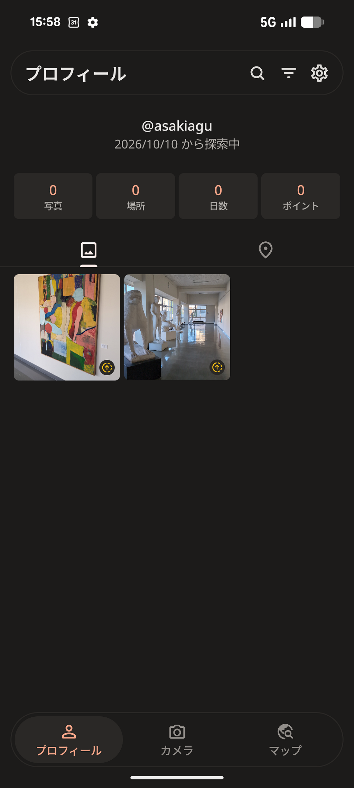
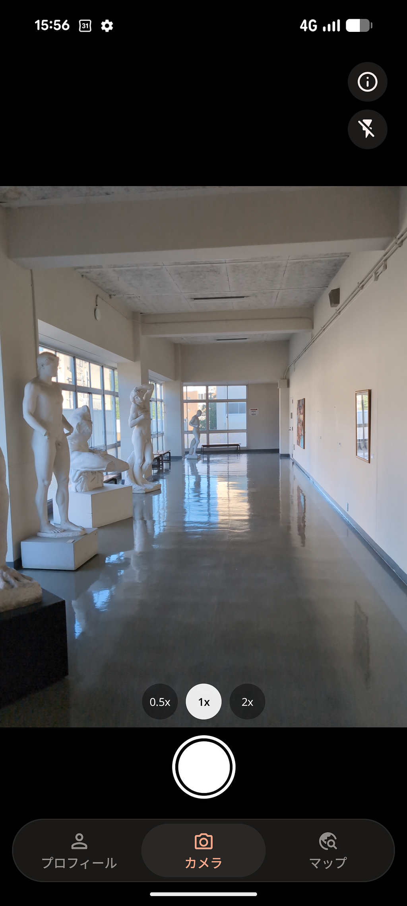
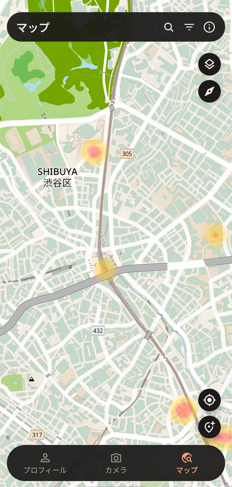
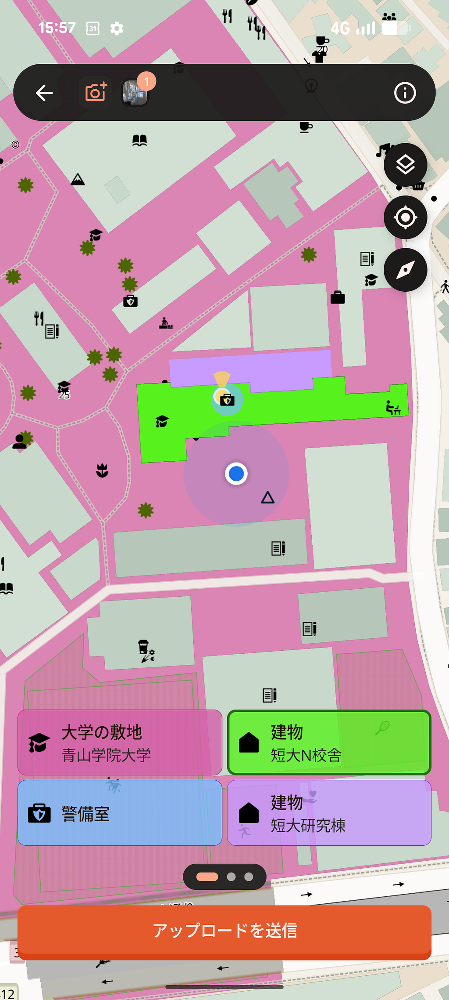
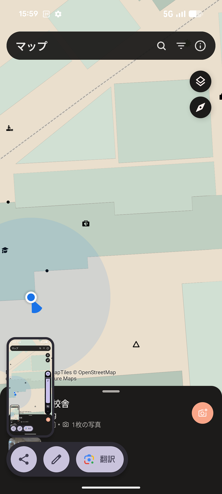
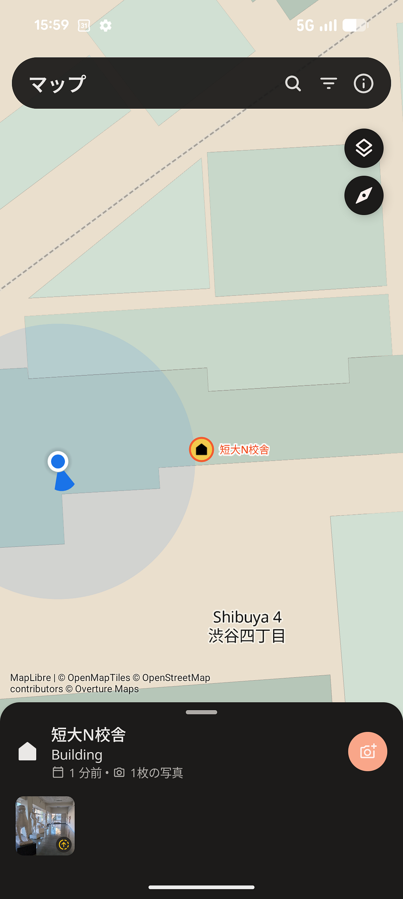
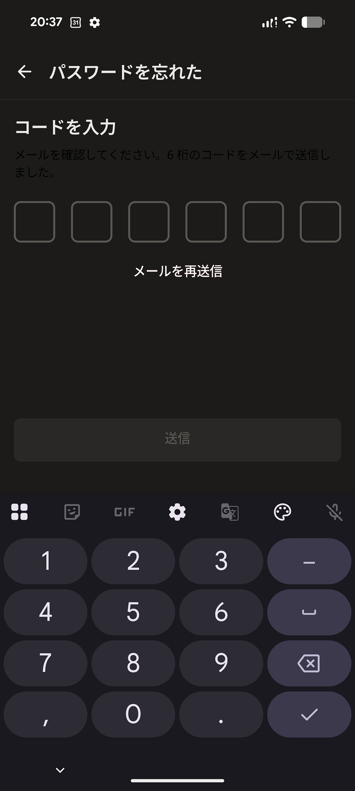
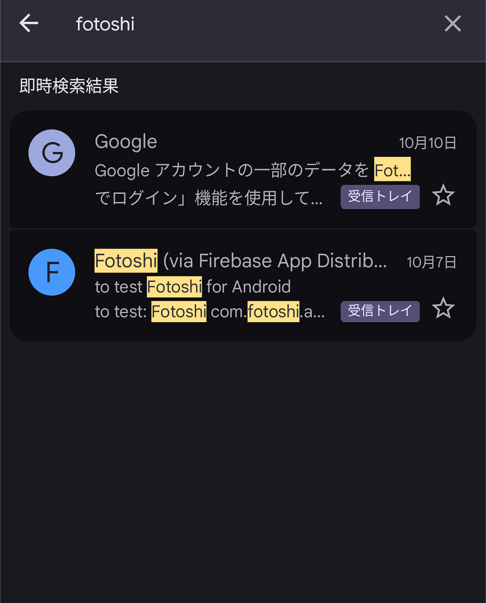

こんにちは！古橋研究室恒例の月１ハッカソン！  
今回の内容はFOSS4G Hiroshimaなどで紹介されたツールor Fotoshiを触ってみよう！という感じです  
自分はアンドロイドの携帯を持っていたので、Fotoshiを試してみようかなと思い、使ってきました！

UIに関しては超簡単に  
プロフィール・カメラ・マップ

プロフィール  
自分があげた写真や日数などを見れます

カメラ  
0.5、1、2倍とフラッシュ機能

マップ  
Fotoshiを使って撮影された場所をヒートマップで見れます

そしてレイヤーも変えられて、URLを入れる場所もあるので入れてみたのですが、変わってない？？

入れたURLが間違ってるのかな  
あと、追加したレイヤーに関してアイコンを触ったらURLを見れるようにしたいですね  
入れたURL  
<https://cyberjapandata.gsi.go.jp/xyz/seamlessphoto/%7Bz%7D/%7Bx%7D/%7By%7D.jpg>

感想  
撮影→地物選択で投稿が完成するためとても簡単でやりやすいと思った  
撮影場所を選ぶ際に、選択した建物の色が変わるため、ユーザーフレンドリー

バグ？  
・撮影した写真の地図表示が不安定（最初は表示されるが、すぐに消える）

・パスワード再設定のコードが送られてこない  
メールからログインではうまくいかなかったが  
下にGoogleアカウントでログインから再び入れてよかった  
（Googleアカウント・メールでログインもどちらも同じメールを入れた）

---

[Fotoshiって何？](https://medium.com/furuhashilab/fotoshi%E3%81%A3%E3%81%A6%E4%BD%95-2a965cd535de) was originally published in [Furuhashi(mapconcierge)Lab.](https://medium.com/furuhashilab) on Medium, where people are continuing the conversation by highlighting and responding to this story.
