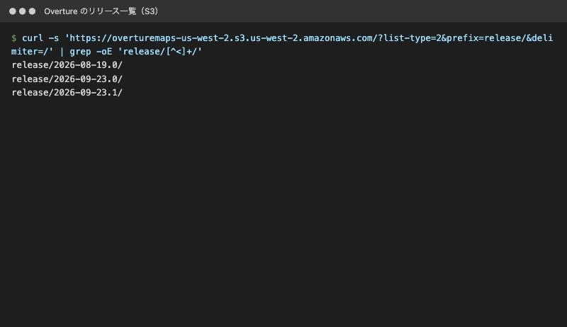
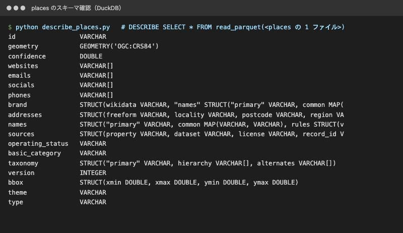
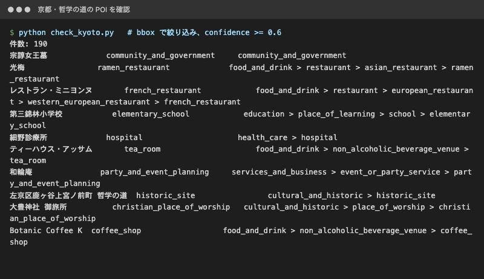
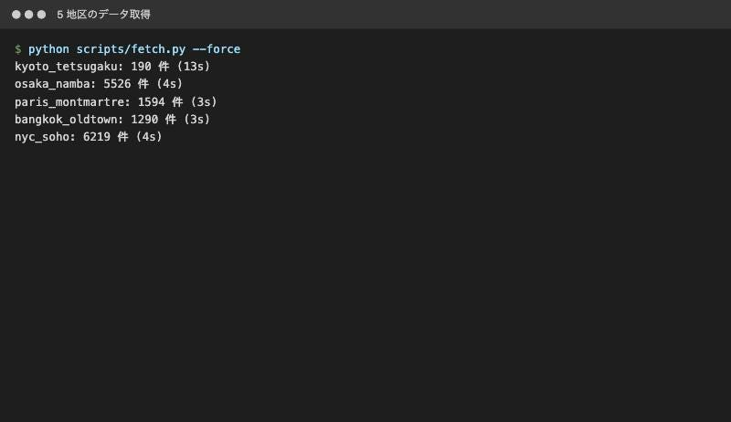
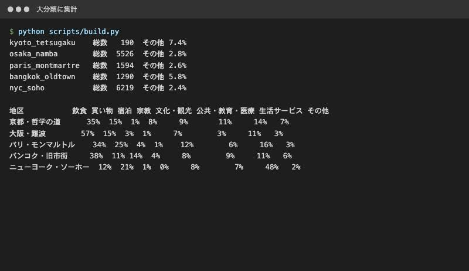
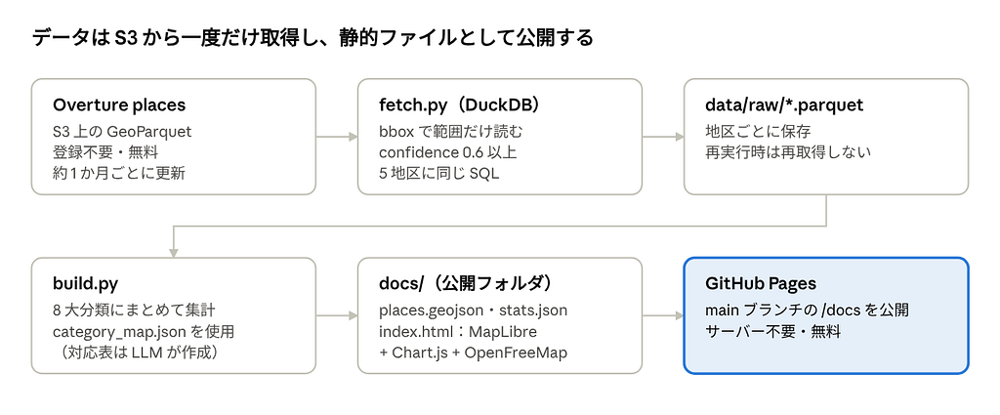
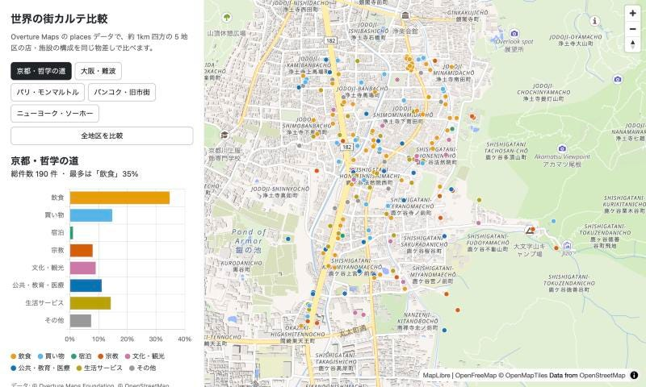
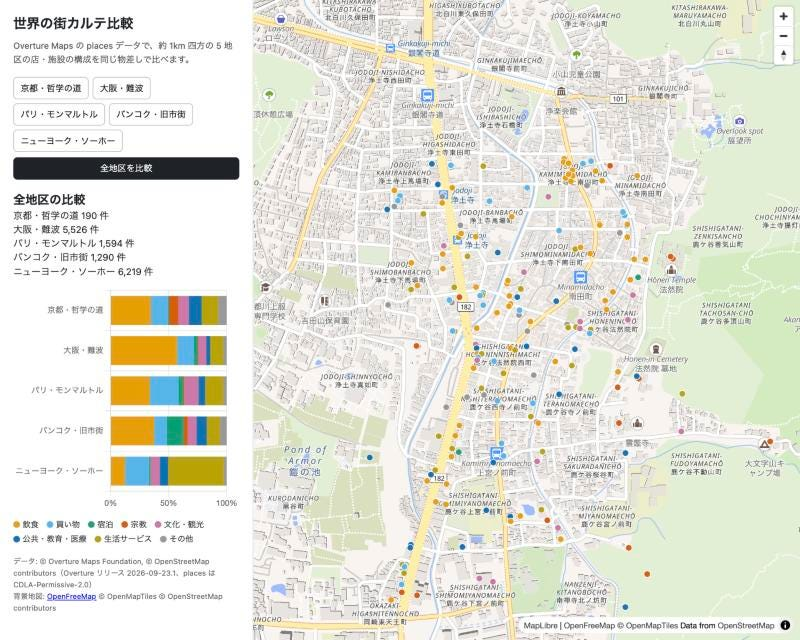
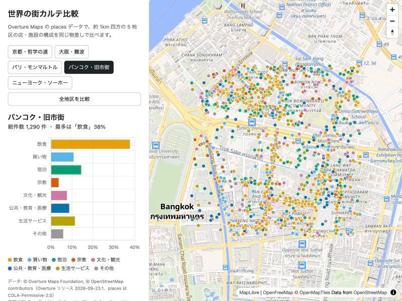

Overture Maps の places データを使って、世界 5 地区の店や施設の構成を同じ物差しで比べる Web 地図を作りました。LLM（Claude Code）と一緒に、データ取得から GitHub Pages での公開まで進めています。

* 公開ページ：<https://akira-motoyoshi.github.io/town-karte/>
* リポジトリ：<https://github.com/Akira-Motoyoshi/town-karte>

### 使った技術：Overture Maps

Overture Maps は、Overture Maps Foundation が公開している世界規模のオープンな地図データです。OpenStreetMap をはじめ、複数の企業のデータを統合し、約 1 か月ごとにリリースされています。

今回注目したのは次の 3 つの特性です。

* **世界共通のスキーマとカテゴリ体系**：国が違っても、同じ列・同じ分類でデータが入っている
* **クラウドに置かれた GeoParquet**：S3 上のファイルを、DuckDB から登録なし・無料で、必要な範囲だけ読める
* **places（店・施設）のカテゴリと信頼度**：各 POI に階層付きのカテゴリと confidence（信頼度）が付いている

補助として、データ処理に DuckDB、地図表示に MapLibre GL JS、背景地図に OpenFreeMap、グラフに Chart.js を使いました。

### やろうとしたこと

「世界中どこでも同じ物差しで測れる」という Overture の特性を、いちばん素直に見せられる題材として「街の比較」を選びました。

約 1km 四方の 5 地区について、店や施設を 8 つの大分類（飲食、買い物、宿泊、宗教、文化・観光、公共・教育・医療、生活サービス、その他）に分け、構成比を並べます。

* **京都・哲学の道**：寺社の多い観光地
* **大阪・難波**：飲食と買い物の繁華街
* **パリ・モンマルトル**：欧州の観光地
* **バンコク・旧市街**：寺院と宿が多いアジアの観光地
* **ニューヨーク・ソーホー**：北米の商業地区

OpenStreetMap だけで同じことをすると、国や地域ごとにタグの付け方が違うため、分類をそろえる作業が必要になります。Overture ならその手間がほぼありません。

### 作成過程

#### 1. 最新リリースとスキーマを確認する

まず S3 のバケットを一覧し、最新リリースが 2026-09-23.1 であることを確認しました。

次に DuckDB で places のスキーマを確認しました。計画段階では categories 列を使う想定でしたが、このリリースでは basic\_category と taxonomy（primary と hierarchy）に変わっていました。最初に実データを確認したことで、手戻りを防げました。

#### 2. 1 地区で試す

京都・哲学の道の範囲で、bbox 列による絞り込みと confidence >= 0.6 を試しました。190 件が返り、taxonomy.hierarchy に「food\_and\_drink > restaurant > asian\_restaurant > ramen\_restaurant」のような階層が入っていることが分かりました。

ここで 1 つつまずきました。DuckDB の初期設定のまま s3:// で読むと、認証情報を探しに行って 5 分以上止まってしまいます。空のキーで匿名アクセスの設定（CREATE SECRET）をすると、約 13 秒で返るようになりました。

#### 3. 5 地区を同じ SQL で取得する

地区の範囲を areas.json にまとめ、同じ SQL を 5 回当てるスクリプト fetch.py を作りました。世界のデータセット全体をダウンロードせず、必要な範囲だけを読むので、5 地区で約 20 秒です。

#### 4. 8 つの大分類にまとめる

当初は、数百ある細かいカテゴリを LLM に 8 分類へ振り分けさせる予定でした。しかし taxonomy.hierarchy の 1 段目がすでに「food\_and\_drink」「shopping」「lodging」のような大分類になっていたため、その 1 段目（宗教だけは 2 段目の place\_of\_worship）を 8 分類に対応させる方式に変えました。対応表は十数行で済みました。

#### 5. 地図ページを作り、公開する

集計結果を GeoJSON と JSON に書き出し、MapLibre GL JS と Chart.js で静的なページを作りました。サーバーは使わず、GitHub Pages で公開しています。

実装は Claude Code に任せ、私は範囲の決定、分類方式の判断、結果の確認を担当しました。リポジトリ作成から Pages の有効化までも GitHub CLI 経由で自動化しています。

### できたもの

地区のボタンを押すと地図がその場所へ移動し、POI が大分類の色で表示されます。左のグラフには、その地区の構成比が出ます。

「全地区を比較」を押すと、5 地区の構成比が積み上げ棒で並びます。

比べてみると、街の性格がはっきり出ました。

* **大阪・難波**：飲食が 57% で最多。そのうち酒類を出す店が 666 件あり、全体の約 12% を占める
* **バンコク・旧市街**：宿泊が 14% で、他の 4 地区（1〜4%）の 3 倍以上
* **ニューヨーク・ソーホー**：生活サービスが 48%。中身は専門サービスやオフィス、不動産が中心で、店の街というより事業所の街だった
* **京都・哲学の道**：宗教が 8% で 5 地区中最多
* **パリ・モンマルトル**：買い物が 25% で最多

### Overture の特性がどう反映されているか

* **世界共通スキーマ**：5 地区すべてに同じ SQL、同じ分類表を当てています。国ごとの調整は一切していません。
* **カテゴリの階層**：taxonomy.hierarchy の上位をそのまま使えたので、分類作業がほぼ不要になりました。
* **クラウドネイティブな配布**：DuckDB で範囲だけ読み、5 地区の取得が約 20 秒。アカウント登録も費用もかかりません。
* **信頼度**：confidence で質の低いデータを落としてから集計しています。

一方で、限界も見えました。

* 地区ごとの件数差が大きく、ソーホー 6,219 件に対して哲学の道は 19 件でした。住宅地や山すそを含むことに加え、網羅率の差もあると考えられます。
* 大豊神社が christian\_place\_of\_worship に分類されていました。神道を表すカテゴリがなく、日本の神社が誤分類される例があります。

「同じ物差し」は強力ですが、物差しそのものの偏りも一緒に見える、というのが今回の発見です。

### 使ったもの

* データ：Overture Maps Foundation places（リリース 2026–09–23.1、CDLA-Permissive-2.0）© Overture Maps Foundation, © OpenStreetMap contributors
* 背景地図：OpenFreeMap © OpenMapTiles © OpenStreetMap contributors
* ツール：DuckDB、MapLibre GL JS、Chart.js、GitHub Pages、Claude Code

---

[Overture Mapを使った世界の街の特性分析](https://medium.com/furuhashilab/overture-maps-%E3%81%A7-%E4%B8%96%E7%95%8C%E3%81%AE%E8%A1%97%E3%82%AB%E3%83%AB%E3%83%86-%E3%82%92%E4%BD%9C%E3%81%A3%E3%81%9F-%E5%90%8C%E3%81%98-sql-%E3%81%A7-5-%E3%81%A4%E3%81%AE%E8%A1%97%E3%82%92%E6%AF%94%E3%81%B9%E3%82%8B-40e7aa84bb3d) was originally published in [Furuhashi(mapconcierge)Lab.](https://medium.com/furuhashilab) on Medium, where people are continuing the conversation by highlighting and responding to this story.
