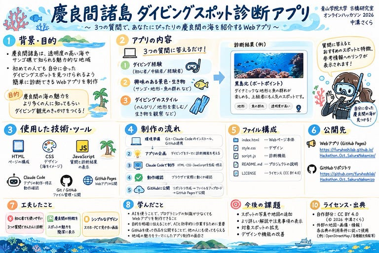

> はじめに

Claude Codeを活用して「慶良間諸島ダイビングスポット診断」というWebアプリを制作しました。

今回のハッカソンでは、FOSS4G Hiroshima 2026で紹介された「Leaflet」という技術を使いました。

私はプログラミングの経験がほとんどありませんでしたが、Claude Codeを活用しながら、ダイビングと地図を組み合わせたアプリの制作に取り組みました。

> FOSS4Gで紹介されたLeafletとは？

Leafletは、Webサイト上に操作できる地図を表示するための技術です。

例えば、地図の拡大・縮小や、特定の場所へのマーカー表示、場所をクリックしたときの情報表示などができます。

今回、この技術を知り、ダイビングスポットの位置を地図で確認できたら便利だと考えました。

そこで、慶良間諸島のダイビングスポット診断アプリにLeafletを取り入れることにしました。

> 制作したアプリについて

アプリ名：慶良間諸島ダイビングスポット診断

Webアプリ：

<https://furuhashilab.github.io/Hackathon_Oct_SakuraNakamizo/>

GitHub：

<https://github.com/furuhashilab/Hackathon_Oct_SakuraNakamizo>

慶良間諸島は、沖縄県に位置し、透明度の高い海や美しいサンゴ礁で知られる地域です。

今回制作したアプリは、3つの質問に答えることで、自分の希望に合ったダイビングスポットの候補を知ることができるものです。

さらに、Leafletを使って地図を表示することで、紹介されたスポットがどのあたりにあるのかを視覚的に確認できるようにしました。

ダイビングに興味がある人が、慶良間諸島の魅力を気軽に知るきっかけになればと考えています。

> アプリの主な機能

アプリでは、ダイビング経験や興味のある海の景色、楽しみたいスタイルについて、3つの質問に答えます。

回答すると、おすすめのダイビングスポットが表示され、地図でも場所を確認できる仕組みです。

> 制作で苦労したこと

最も苦労したのは、Claude Codeの初期設定やGitHubとの連携です。

初めて使うツールが多く、戸惑うこともありましたが、一つずつ確認しながら進めることで、無事にアプリを公開することができました。

> 今回のハッカソンで学んだこと

今回のハッカソンを通じて、AIを活用すれば、プログラミング初心者でも自分のアイデアを形にできることを学びました。

また、Leafletを使うことで、場所の情報を地図上で分かりやすく伝えられることも知りました。

> 今後の改善点

今後は、ダイビングスポットの写真や詳しい説明を追加し、より使いやすいアプリにしていきたいです。

おわりに

今回、Claude Codeを活用して、自分の興味があるダイビングをテーマにWebアプリを制作することができました。

初めての経験で難しい部分もありましたが、新しい技術に触れ、実際に作品を完成させることができてよかったです。

今後も、自分の興味と新しい技術を組み合わせたものづくりに挑戦していきたいです。

⸻

> グラレコ

> 参考資料

* FOSS4G 2026「Leaflet 2.0 is coming – it’s official!」
* . <https://talks.osgeo.org/foss4g-2026/talk/VK8SSV/>
* \* FOSS4G 2026 Workshop「Getting Started with Leaflet 2.0 – Creating Web Maps Made Simple」
* . <https://talks.osgeo.org/foss4g-2026-workshop/talk/S7X8UV/>
* \* Leaflet公式サイト
* . <https://leafletjs.com/>

ライセンス： CC BY 4.0（自作部分）

⸻

---

[Claude Codeで慶良間諸島のダイビングスポット診断アプリを作ってみた！｜古橋ゼミオンラインハッカソン2026](https://medium.com/furuhashilab/claude-code%E3%81%A7%E6%85%B6%E8%89%AF%E9%96%93%E8%AB%B8%E5%B3%B6%E3%81%AE%E3%83%80%E3%82%A4%E3%83%93%E3%83%B3%E3%82%B0%E3%82%B9%E3%83%9D%E3%83%83%E3%83%88%E8%A8%BA%E6%96%AD%E3%82%A2%E3%83%97%E3%83%AA%E3%82%92%E4%BD%9C%E3%81%A3%E3%81%A6%E3%81%BF%E3%81%9F-%E5%8F%A4%E6%A9%8B%E3%82%BC%E3%83%9F%E3%82%AA%E3%83%B3%E3%83%A9%E3%82%A4%E3%83%B3%E3%83%8F%E3%83%83%E3%82%AB%E3%82%BD%E3%83%B32026-489c4e94045b) was originally published in [Furuhashi(mapconcierge)Lab.](https://medium.com/furuhashilab) on Medium, where people are continuing the conversation by highlighting and responding to this story.
