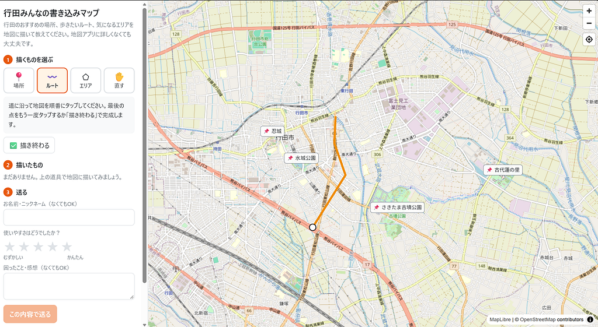
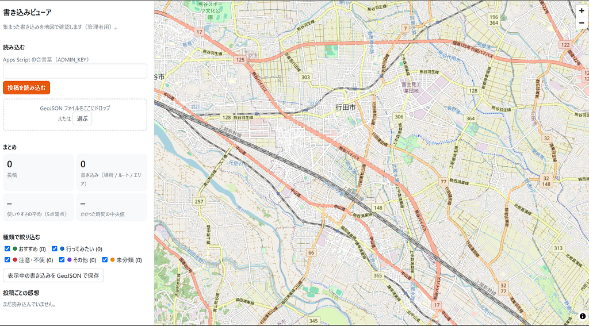

こんにちはあらしょうです！今回は、10月のハッカソン課題として、[FOSS4G Hiroshima](https://2026.foss4g.org/en/)で紹介されていた[Terra Draw](https://workshops.terradraw.water-gis.com/ja/)を使って、卒論に使えたりするかなと考えてみました。

#### Terra Drawとは

Terra Drawは、「地図にお絵かきする機能」を追加できるライブラリです。

ポイントは3つです。

・どの地図にも付けられる  
MapLibre、Leaflet、OpenLayersなど、いろいろな地図ライブラリに後から追加できます。今回はMapLibreの地図に付けました。

・描き方を選べる  
点（場所）、線（ルート）、面（エリア）を描いたり、描いたものを動かして直したりできます。

・描いたものはそのままデータになる  
描いたものはGeoJSON（地図データの標準形式）で保存されるので、そのまま送ったり、別の地図に重ねたりできます。

今回は、送られたデータをGoogleスプレッドシートに集め、私が確認してから観光マップに反映する仕組みを想定して作成しました。

#### 作ったもの

地図に「場所・ルート・エリア」を描いて送れるWebマップを作りました。

[行田みんなの書き込みマップ](https://furuhashilab.github.io/Hackathon_Oct_ShotaArakawa/)

卒業研究で作っている行田市の観光マップは、利用者の声を集めて育てる「育てる観光マップ」を目指しています。文字だけでは伝えにくい、「このエリア！」といった声も集められるのではないかと考えて作成してみました。

利用者が作成したデータは、自動的に送信される仕組みになっていて、そのデータを管理するスプレッドシート・webページがそれぞれ存在します。

#### 感想

今回はClaude Codeを使用して作成しました。

ルートの描き方やエリアの追加方法など、かなり直感的に操作できるものになっているなと思いました。「ここからの景色が良い、名前はわからないけどこの辺りがオススメ」といった声を集めるのには、良いツールだなと感じました。

また、投稿者と管理者の、店舗の位置や名称の認識のズレといった問題も、実際に地図上で位置情報を確認することができるため、軽減できるのではないかという気づきもありました。

#### 今後の活用

卒論に関して、今回のハッカソンでTerra Drawに触るまでは、Googleフォームを使用して利用者の声を集める予定でした。実際にTerra Drawを触ってみると、かなり使いやすかったため、よく検討しながら選択もしくは併用できる形をとろうと思います。

---

[GISに馴染みがない人でも、地図に書き込める？ ── Terra Drawを試してみた](https://medium.com/furuhashilab/gis%E3%81%AB%E9%A6%B4%E6%9F%93%E3%81%BF%E3%81%8C%E3%81%AA%E3%81%84%E4%BA%BA%E3%81%A7%E3%82%82-%E5%9C%B0%E5%9B%B3%E3%81%AB%E6%9B%B8%E3%81%8D%E8%BE%BC%E3%82%81%E3%82%8B-terra-draw%E3%82%92%E8%A9%A6%E3%81%97%E3%81%A6%E3%81%BF%E3%81%9F-fa6c7341278d) was originally published in [Furuhashi(mapconcierge)Lab.](https://medium.com/furuhashilab) on Medium, where people are continuing the conversation by highlighting and responding to this story.
