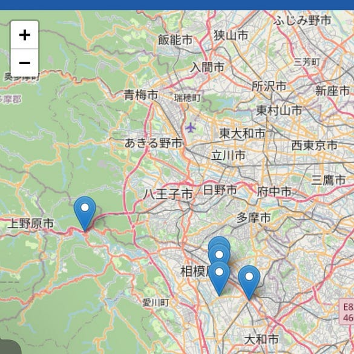
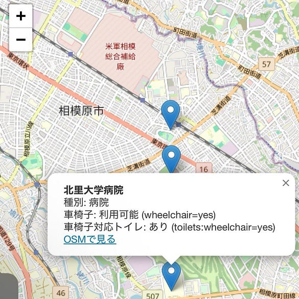
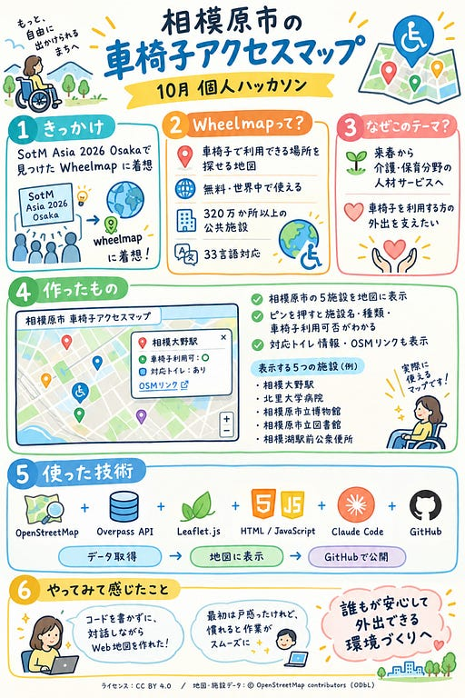

こんにちは！4年の滝沢です！

○ハッカソン発表レポジトリ↓

[GitHub - furuhashilab/Hackathon\_Oct\_MihiroTakizawa: 2026-10　個人ハッカソン成果物](https://github.com/furuhashilab/Hackathon_Oct_MihiroTakizawa)

○ハッカソンの内容

今回のハッカソンでは、SotM Asia 2026 Osakaの公式プログラムで見つけた「[Wheelmap](https://news.wheelmap.org/en/faq/)」に着想を得て、相模原市の車椅子アクセスマップを作成しました！

Wheelmapとは公式サイトによると、

→「**Wheelmapは、車椅子で利用できる場所を探すための地図です。誰でも簡単に場所を検索したり、地図に施設を登録したり、**信号機のような色分けシステムを使って評価したりできます。世界中で**無料**で利用できます。現在、**320万か所以上の公共施設に関する情報が掲載されています。**また、毎日300件以上の新しい情報が追加されています。2010年から、Wheelmapは車椅子利用者や、その他の移動に困難を抱える人々が、より効率的に1日の予定を立てられるよう支援してきました。現在では**33言語に対応しています。**」とのことです。

ポイント

Wheelmapとは？

⭐︎車椅子で利用できる場所を探すための地図

⭐︎誰でも簡単に場所を検索・地図に施設を登録できる

⭐︎無料で利用可能

⭐︎320万箇所以上の公共施設に情報が記載

⭐︎33言語に対応

→世界中の誰もが無料で使える、車椅子で利用できる場所を探す地図！地図に施設を登録もできる！

○なぜこの技術を選んだ？

私自身、来年の春から介護・保育分野の人材サービスに携わる予定です。介護サービスを利用する方の中には車椅子を利用される方もいるのではないかと考え、自分のこれからの仕事ともつながりのあるテーマを選びました。

○アウトプットについて

ClaudeCodeを利用し、相模原市内で車椅子アクセス情報が登録されている場所を5件ピックアップし(100万件以上あり、作成に時間がかかると思ったため)、地図上にピンを立てたシンプルなWebページを作成しました。[成果物](https://furuhashilab.github.io/Hackathon_Oct_MihiroTakizawa/)はこちらです。ピンをクリックすると、施設名、車椅子の利用可否が表示されます。

地図上にピンが表示されます

ピンをクリックすると、車椅子利用可能の施設名、車椅子に対応したトイレがあるかないかが分かります。

ライセンス：CC BY 4.0

○感想

ここまでClaude Codeを使ったのはほぼ初めてて、初めは戸惑うことも多かったのですが、操作に慣れが出てくるとスムーズに作業が進みました。Node.js(Claude Codeを動かすための土台)とGit(GitHub とやりとりするためのツール)をインストールしてからは、コードを1行も書かずに対話形式でWebサイトが完成していく過程はとても新鮮でした。Claude Codeを使うとここまで作業が楽になることを知り、今回をきっかけに今後使っていきたいと思いました！

グラレコ

---

[10月ハッカソン「相模原市の車椅子アクセスマップを作ってみた」](https://medium.com/furuhashilab/10%E6%9C%88%E3%83%8F%E3%83%83%E3%82%AB%E3%82%BD%E3%83%B3-%E7%9B%B8%E6%A8%A1%E5%8E%9F%E5%B8%82%E3%81%AE%E8%BB%8A%E6%A4%85%E5%AD%90%E3%82%A2%E3%82%AF%E3%82%BB%E3%82%B9%E3%83%9E%E3%83%83%E3%83%97%E3%82%92%E4%BD%9C%E3%81%A3%E3%81%A6%E3%81%BF%E3%81%9F-4c7d05ec08a8) was originally published in [Furuhashi(mapconcierge)Lab.](https://medium.com/furuhashilab) on Medium, where people are continuing the conversation by highlighting and responding to this story.
