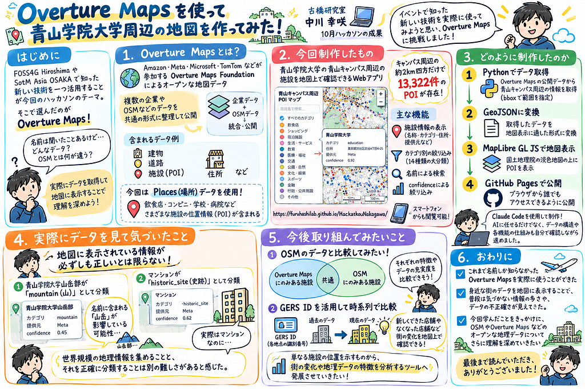

### はじめに

こんにちは！中川です。

今回は、10月のハッカソンで制作した「青山キャンパス周辺 POI マップ」について紹介します。

今回のハッカソンでは、FOSS4G HiroshimaやSotM Asia OSAKAで知った、自分にとって新しい技術を一つ活用することがテーマでした。

そこで私が選んだのが、**Overture Maps**です。

イベントで何度か耳にしていたものの、実際にどのようなデータが公開されているのか、OpenStreetMap（OSM）とは何が違うのか、よく理解できていませんでした。

せっかくの機会なので、自分でデータを取得し、実際に地図に表示することで理解を深めようと考えました。

今回制作したWebマップはこちらです！

[**青山キャンパス周辺 POI マップ**](https://furuhashilab.github.io/Hackathon_Oct_KousakuNakagawa/)

GitHubリポジトリ：  
<https://github.com/furuhashilab/Hackathon_Oct_KousakuNakagawa>

### 1. Overture Mapsとは？

Overture Mapsは、Amazon、Meta、Microsoft、TomTomなどの企業が参加するOverture Maps Foundationによって公開されている、オープンな地図データです。

建物や道路、施設、住所など、世界中のさまざまな地理情報がまとめられています。

特徴的なのは、複数の企業やOSMなどのデータを、共通の形式に整理して公開している点です。

OSMは世界中の人々が協力して地図を編集するプロジェクトですが、Overture Mapsは企業などが保有するデータも活用しながら、さまざまな地理情報を統合しています。

今回はその中でも、\*\*Places（場所）\*\*というデータを使用しました。

Placesには、飲食店やコンビニ、学校、病院などの位置情報が含まれています。このような地図上の施設や地点は、POI（Point of Interest）と呼ばれます。

### 2. 今回制作したもの

今回制作したのは、青山学院大学の青山キャンパス周辺にある施設を地図上で確認できるWebアプリです。

身近な場所を対象にした理由は、自分が知っている場所であれば、地図上のデータが実際の街とどのくらい一致しているのかを確認しやすいと考えたためです。

実際にデータを取得してみると、**キャンパス周辺の約2km四方だけで、13,322件ものPOIが存在**していました。

想像していた以上に多くのデータがあり、普段歩いている街にもこれほど多くの地理情報が紐づいていることに驚きました。

制作した地図には、主に次のような機能を実装しています。

* **施設情報の表示：** 地図上の点をクリックすると、施設名、カテゴリ、住所、データ提供元などを確認できる。
* **カテゴリ別の絞り込み：** 施設を14種類の大分類で絞り込める。
* **名前による検索：** 特定の施設名を入力して探せる。
* **confidenceによる絞り込み：** データ上で、その施設が実在すると考えられる確からしさを指定して表示できる。

また、スマートフォンからも閲覧できるようにしました。

単に地点を表示するだけでなく、データの中身を確認しながら操作できる地図を目指しました。

### 3. どのように制作したのか

今回の制作では、Claude Codeを使用しました。

まず、Pythonを使ってOverture Mapsの公開データから青山キャンパス周辺の情報を取得しました。

Overture Mapsは世界規模のデータを扱っていますが、bbox（Bounding Box）と呼ばれる四角形の範囲を指定することで、必要な地域だけを取り出せます。

取得したデータは、GeoJSONという地図表示に適したファイル形式に変換しました。

その後、MapLibre GL JSというWeb地図を表示するためのツールを使用し、国土地理院の淡色地図の上にPOIを表示しました。

一方で、AIに任せるだけでは理解できない部分も多く、使用するデータの構造や各機能の仕組みについて、自分でも確認しながら進めました。

### 4. 実際にデータを見て気づいたこと

今回、特に面白かったのは、地図に表示されている情報が必ずしも正しいとは限らないことです。

例えば、青山学院大学山岳部が「mountain（山）」として分類されているデータがありました。

実際には大学の部活動ですが、名前に含まれる「山岳」という言葉が分類に影響している可能性があります。

ほかにも、マンションが「historic\_site（史跡）」として分類されている例がありました。

こうしたデータを見て、世界規模の地理情報を集めることと、それを正確に分類することは別の難しさがあるのだと感じました。

### 5. 今後取り組んでみたいこと

今回の制作では、Overture Mapsのデータを取得して地図に表示するところまで実現できました。

今後は、OSMのデータと比較してみたいと考えています。

例えば、同じ地域でOverture Mapsにしか登録されていない施設や、OSMにしか登録されていない施設を可視化できれば、それぞれの特徴やデータの充実度を比較できそうです。

また、Overture Mapsでは各地点にGERS IDという識別番号が付けられています。

このIDを活用して異なる時期のデータを比較すれば、新しくできた店舗や、なくなった店舗など、街の変化を地図上で確認できる可能性があります。

今回制作した地図を、単なる施設の位置を示すものから、街の変化や地理データの特徴を分析するツールへと発展させてみたいです。

### 6. おわりに

今回のハッカソンを通して、これまで名前しか知らなかったOverture Mapsを実際に使うことができました。

特に印象的だったのは、身近な街のデータを地図に表示することで、普段は気づかない情報の多さや、データの不正確さが見えてきたことです。

まだまだ分からないことは多いですが、今回学んだことをきっかけに、OSMやOverture Mapsなどのオープンな地理データについて、さらに理解を深めていきたいと思います。

最後まで読んでいただき、ありがとうございました！

**制作したWebマップ：**  
<https://furuhashilab.github.io/Hackathon_Oct_KousakuNakagawa/>

**GitHub：**  
<https://github.com/furuhashilab/Hackathon_Oct_KousakuNakagawa>

グラレコです！GPT-6

---

[Overture Mapsを使って青山学院大学周辺の地図を作ってみた！](https://medium.com/furuhashilab/overture-maps%E3%82%92%E4%BD%BF%E3%81%A3%E3%81%A6%E9%9D%92%E5%B1%B1%E5%AD%A6%E9%99%A2%E5%A4%A7%E5%AD%A6%E5%91%A8%E8%BE%BA%E3%81%AE%E5%9C%B0%E5%9B%B3%E3%82%92%E4%BD%9C%E3%81%A3%E3%81%A6%E3%81%BF%E3%81%9F-fae22399b940) was originally published in [Furuhashi(mapconcierge)Lab.](https://medium.com/furuhashilab) on Medium, where people are continuing the conversation by highlighting and responding to this story.
