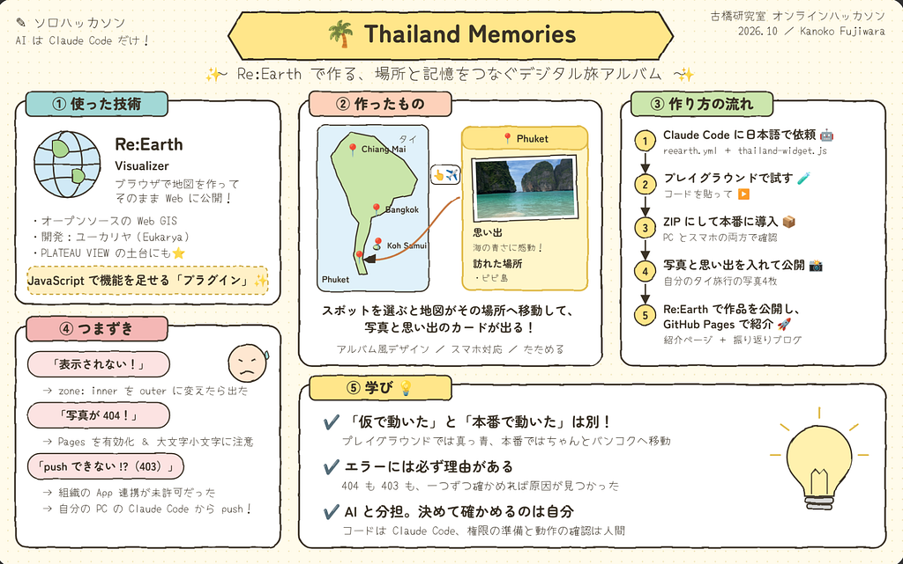

3年の藤原です。

今回は初のソロハッカソンということで最初から最後まで自分一人でClaude Code を使用進めていきました。

いつもはチームでやるハッカソンも一人でやるとなると、なかなかヘビーでした。

#### 🆕技術

今回、私が初めて使うものとして選んだのは、FOSS4G Hiroshima で紹介されてたRe:Earth です。

[Re:Earth（リアース）](https://reearth.io/home) は、株式会社ユーカリヤ（Eukarya）が開発している、オープンソースの WebGISです。

Re:Earth は、ブラウザだけで 3D の地図を作って公開できるオープンソースの地図ツールです。プラグインで自分の機能も足せます。PLATEAU VIEW の土台にも使われています。今回は、その Re:Earth に自分で機能を足せるプラグインを作って、旅の思い出アルバムにしました。

#### PLATEAU（プラトー）

日本の街の建物や道路を 3D データにして、誰でも無料で使えるオープンデータとして公開 している取り組みのことです。

#### 作った流れ

1. Claude Code に、作りたいものを日本語で伝えて、プラグインのファイル（reearth.yml と thailand-widget.js）を作ってもらった。
2. Re:Earth の「プラグインプレイグラウンド」にコードを貼り付けて試した。
3. ZIP にして自分のプロジェクトに入れ、パソコンとスマホの両方の表示で動くか確かめた。
4. 自分で撮った写真と思い出の文章を入れて、地図を公開した。
5. GitHub で管理し、GitHub Pages で紹介ページとブログを公開した。

#### 振り返り

最初は「Re:Earth って何？」という状態だったので、自分の写真や紹介文が地図の上に表示されたときはうれしかったです。

また、push できずに何度もエラーが出たときは焦りましたが、自分のパソコンで Claude Code を動かして解決できたときは達成感がありました。

#### 成果物

<https://c-01m4nrq2eq44ttm7wtwsarb72h.visualizer.reearth.io>

* [Thailand Memories](https://furuhashilab.github.io/Hackathon_Oct_KanokoFujiwara/)
* [GitHub - furuhashilab/Hackathon\_Oct\_KanokoFujiwara](https://github.com/furuhashilab/Hackathon_Oct_KanokoFujiwara)

#### グラレコ

Claude Codeを使用

---

[Re:Earth Visualizer を使った思い出マップづくり](https://medium.com/furuhashilab/re-earth-visualizer-%E3%82%92%E4%BD%BF%E3%81%A3%E3%81%9F%E6%80%9D%E3%81%84%E5%87%BA%E3%83%9E%E3%83%83%E3%83%97%E3%81%A5%E3%81%8F%E3%82%8A-2eb364c09b67) was originally published in [Furuhashi(mapconcierge)Lab.](https://medium.com/furuhashilab) on Medium, where people are continuing the conversation by highlighting and responding to this story.
