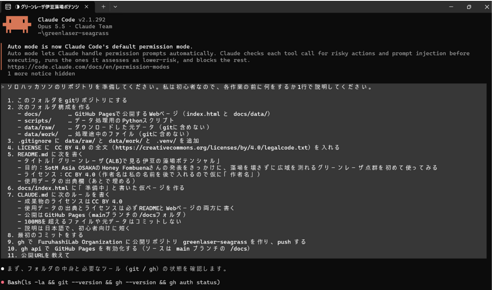
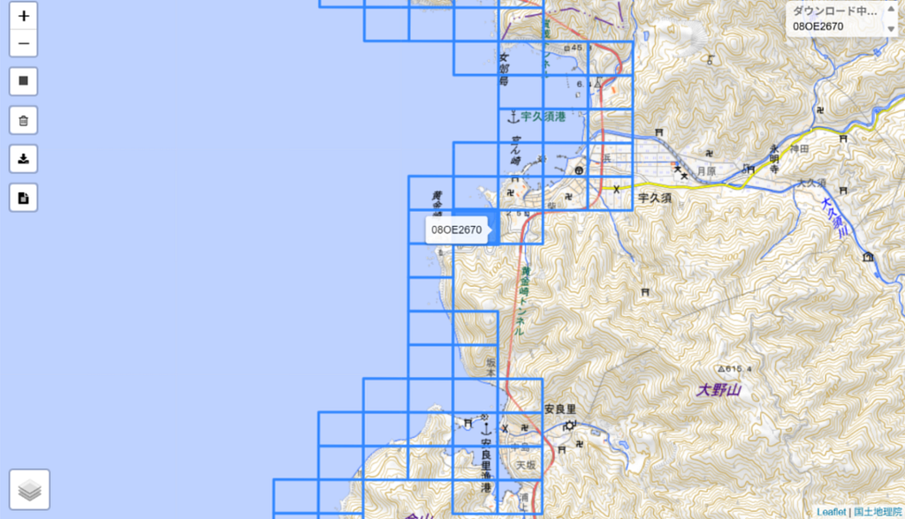
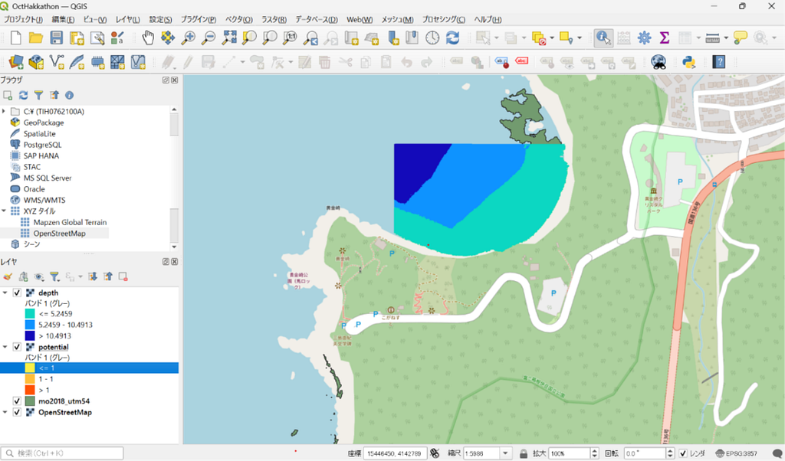
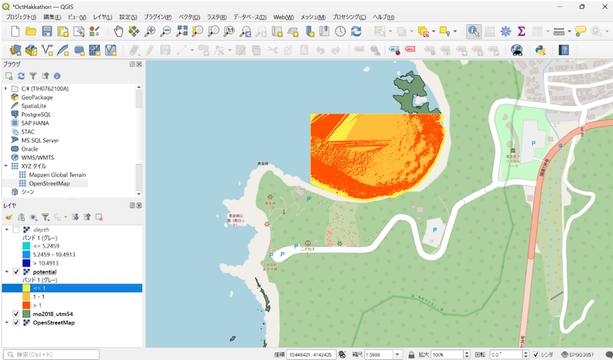
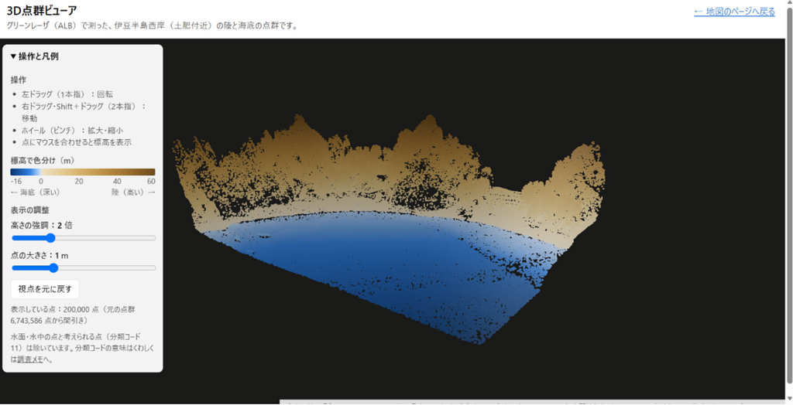
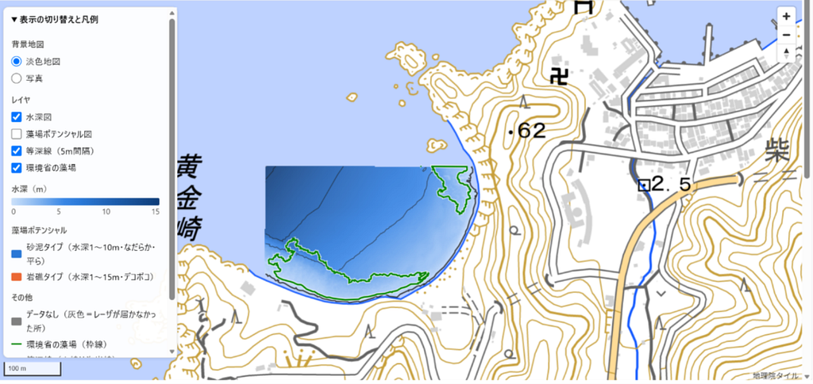
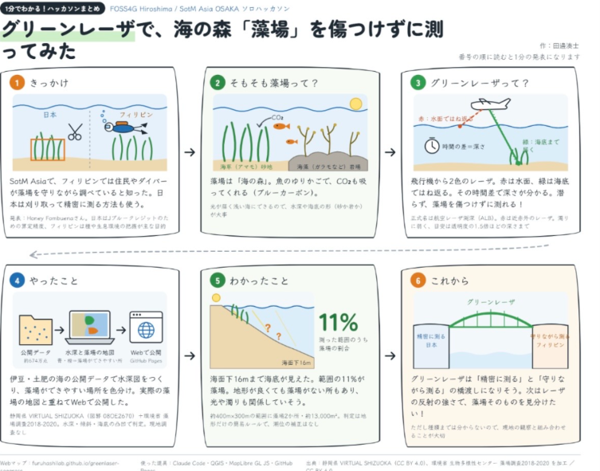

### 海の森「藻場」を傷つけずに測る方法を、ALB・QGIS・Claude Codeで試してみる

3年田邊です。

今回参加したSotM Asia 2026のなかで、自分にとって最も身についたことは、フィリピンの「Honey Fombuena」さんの、「Leveraging the OpenStreetMap Sandbox for Community-Led Seagrass Habitat Mapping」の発表です。

私自身も海草とその算定手法の簡易化などにとても関心があり、この発表を聞くことで、日本とフィリピンの海草測定方法やその規模、目的などに違いがあることに気づきました。

### 日本とフィリピンの藻場調査の違い

フィリピンの団体は、学生やコミュニティ、地域住民による貢献度が高く、日本での調査は、行政や企業、大学などの研究機関による貢献度が高いという点で調査の規模や精度などに差が生じると感じました。

また、調査方法に、フィリピンはダイバーによる目視調査や、ドローンによる調査を多く取っているのに対し、日本では、航空写真、ドローン、目視調査などの他にも、坪刈り、方形枠観察なども行われます。

特に坪刈りや方形枠観察が日本で実施される理由は、JBEによる藻場評価とその認定率確保のために算定精度を高くするという目的があるからだと感じました。

対してフィリピンでは藻場保全だけでなく、種の同定や生息環境・生息状況の分析、海洋生態系への影響評価などが目的として強くあるために坪刈りなどはメジャーな調査方法にならず、藻場を維持しながら調査を可能とする手法がほとんどであるのだと考察できました。

### 公開されているALBデータを可視化してみる

これらを踏まえてClaudeと相談したところ、日本で公開しているALBデータを可視化するのはどうかと回答を得たので、それに完全に乗っかる形で作業を進めました。

作業の概要は、まず伊豆を舞台に決め、その中から1箇所好きなタイルを選び、データを読み込む。次に水深3次元データ、等深線、傾斜を抽出する。最後に水深、藻場造成ポテンシャル、環境省の藻場データを重ね合わせ、まとめる、という流れでした。

ただ、これらの作業を進める前にClaude Codeの設定や必須ソフトのダウンロードなどの工程があり、特にClaude Codeは初めて扱ったので苦戦しました。

### Claude Codeを初めて使ってみた

基本的にはClaudeによる指示をコピペするだけで、これだけで面倒なGitHubリポジトリの作成など全てやってくれることに感動しました。

今回使用したデータは、伊豆西部点群データです。

最初は去年ダイビングをした伊豆半島の大瀬崎周辺のタイルを選択するつもりだったのですが、データがなかったため、伊豆半島西海岸にある黄金崎のうち、海岸と海中両方が含まれているタイルを選びました。

### そもそもALBとは

そもそもALBとは、水中を透過しやすいグリーンレーザと水面で反射する近赤外レーザを同時に照射し、その時間差で水深を算出する仕組みです。

ただし測深性能は透明度や水質によって左右されやすく、ある例では透明度の1.5倍・最大15m程度まで測れるとされています。

船も人も必要なく、藻場を壊さずに浅海を面で測れる技術で、坪刈りや方形枠観察と、ダイバー・ドローンの中間的な測定方法だと感じました。

また、ALBデータがあることで、藻場の分布面積を計算し、ブルーカーボン算定量の計算に使うことができます。

ALBデータを使わなくても計算はできますが、広範囲を海藻、海草を残しながら算定できるという点で優れており、JBEに認定される信頼性のある算定方法のひとつとして使うことができます。

また、3次元データというのが重要で、2次元データの使用と比べると認定率に大きく影響を与えています。

### QGISでデータを重ね合わせてみる

実際にデータを重ね合わせると、こんな風になりました。

作業前はもう少しわかりやすくまとまると思っていたのですが、2次元で可視化してもあんまり良く分からないと気づきました。

なので海底地形を3次元で可視化して、今回扱う新しい技術について理解を深めようとしました。

### 海底地形を3次元で見てみる

奥が陸地で手前が海中を示しています。

こう見ると海底地形も深いところはデータ取得ができていない地点がまばらにあり、水深20mを超えるとその量は一気に増えるのではないかと予想できました。

黄金崎は最大水深が20m未満で、ほとんどが砂地なのでALBデータも精度よく取れていると感じました。

同じことをQGIS上でもやってみました。

### Web上でも見られるようにしてみる

今回作成したデータは、QGISだけではなくWeb上でも確認できるようにしました。

水深、藻場造成ポテンシャル、等深線、環境省の藻場データなどを重ね合わせ、レイヤを切り替えながら確認できるようにしています。

GISソフトを持っていない人でもブラウザから確認できるので、今回のような分析結果を他の人と共有する方法としても便利だと感じました。

### データを比較して分かったこと

これらを見比べると、水深と藻場ポテンシャルの相関は薄いと予想できます。

また、ここには栄養塩や食害、海流などのデータが含まれていないため、実際の藻場は今回取得したデータと異なる特徴を持って造成する可能性もあります。

ただ、岩場、砂場が大体どこにあるのかなど予想しやすくなり、水深の変化を読み取ることも簡単になったので、さらにデータを追加していけば、より精度の高い推定が出来るかもしれないと思いました。

今回の分析だけでは、ALBから「ここに藻場がある」と断定することはできません。

一方で、海底地形や水深、傾斜などを広範囲に把握し、藻場が存在する可能性のある場所を絞り込むためのデータとしては活用できるのではないかと感じました。

### ClaudeとClaude Codeを使ってみて

ClaudeとClaude Codeを初めて使ってみて、Claude Codeでどんな回答が来ていたらこういう状態というのを事前に知らせてくれるのが親切だと感じました。

情報源やライセンスをはっきりとさせ、不明な点はどこで、利用者に何をさせて解決するかをすべて示してくれたので信頼性を感じました。

また、始めに手順書を作成し、その流れに従って作業をしていましたが、改善の指示を出すと即座にそれが手順書にも反映されて、混乱することが少なかったです。

人が手を動かすのは最初の案を考えてClaudeに指示を送ることと、情報元のダブルチェック、動作確認くらいで、他はほとんどClaudeがやってくれました。

恐ろしい。

ただし、Claudeの回答をそのまま信用するのではなく、使用するデータの出典やライセンス、分析方法が正しいのかを自分で確認することは必要だと感じました。

### まとめ

今回参加したSotM Asia 2026で、Honey Fombuenaさんの「Leveraging the OpenStreetMap Sandbox for Community-Led Seagrass Habitat Mapping」という発表を聞いたことをきっかけに、日本とフィリピンにおける藻場調査の方法や目的の違いについて考えました。

そこから、日本で公開されているALBデータを利用して、伊豆半島西海岸の黄金崎周辺を対象に、水深、海底地形、傾斜、藻場造成ポテンシャルなどを可視化しました。

実際に作業してみると、水深や海底地形だけで藻場を推定するのは難しく、栄養塩、食害、海流、水質など、さらに多くのデータが必要であることが分かりました。

一方で、ALBを利用することで、藻場を直接傷つけることなく、広い範囲の海底地形を把握できることには大きな可能性を感じました。

今回のようにALBを使って広域的に調査し、その後にダイバーや水中ドローンなどによって現地確認を行うことで、より効率的な藻場調査につなげられるかもしれません。

また、SotM Asiaの発表を聞いて終わるのではなく、そこから自分で実際にデータを扱い、QGISで分析し、Web上で公開するところまで取り組めたことも大きな成果でした。

今後はさらに他の環境データを追加し、実際の藻場分布との比較や現地調査なども組み合わせながら、藻場調査やブルーカーボン算定にどのように応用できるか考えていきたいです。

### 最後にグラレコです

最後に、今回のソロハッカソンの内容をグラレコとしてまとめました。

### 使用したデータ・ツール

使用データ：静岡県公開のALB関連データ、環境省の藻場関連データ、OpenStreetMap

使用ツール：QGIS、Claude、Claude Code、GitHub、GitHub Pages、MapLibre GL JS

Webマップ：  
[グリーンレーザで見る伊豆の藻場ポテンシャル](https://furuhashilab.github.io/Hackathon_Oct_MinatoTanabe/)

GitHubリポジトリ：  
<https://github.com/furuhashilab/Hackathon_Oct_MinatoTanabe>

SotM Asia 2026：  
[State of the Map Asia 2026 Osaka](https://stateofthemap.asia/)

© 2026 田邊湊士 / Furuhashi Laboratory  
CC BY 4.0

---

[SotM Asia 2026をきっかけに、グリーンレーザで伊豆の藻場ポテンシャルを可視化してみた](https://medium.com/furuhashilab/sotm-asia-2026%E3%82%92%E3%81%8D%E3%81%A3%E3%81%8B%E3%81%91%E3%81%AB-%E3%82%B0%E3%83%AA%E3%83%BC%E3%83%B3%E3%83%AC%E3%83%BC%E3%82%B6%E3%81%A7%E4%BC%8A%E8%B1%86%E3%81%AE%E8%97%BB%E5%A0%B4%E3%83%9D%E3%83%86%E3%83%B3%E3%82%B7%E3%83%A3%E3%83%AB%E3%82%92%E5%8F%AF%E8%A6%96%E5%8C%96%E3%81%97%E3%81%A6%E3%81%BF%E3%81%9F-3c329bcc90fb) was originally published in [Furuhashi(mapconcierge)Lab.](https://medium.com/furuhashilab) on Medium, where people are continuing the conversation by highlighting and responding to this story.
