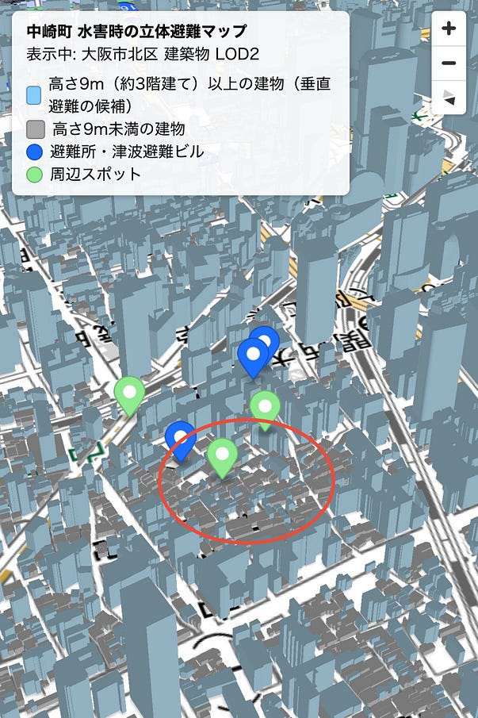
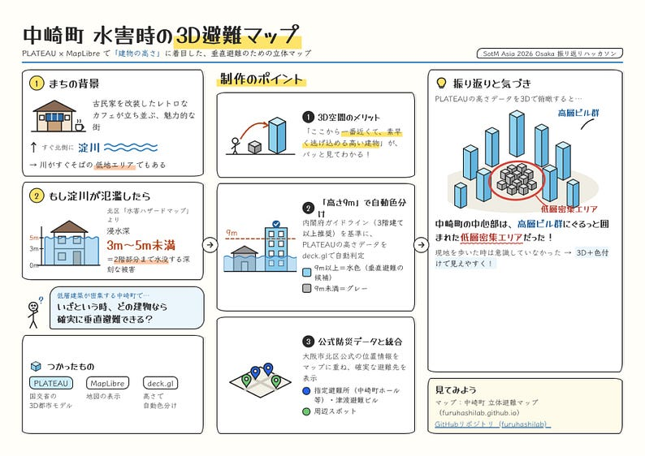
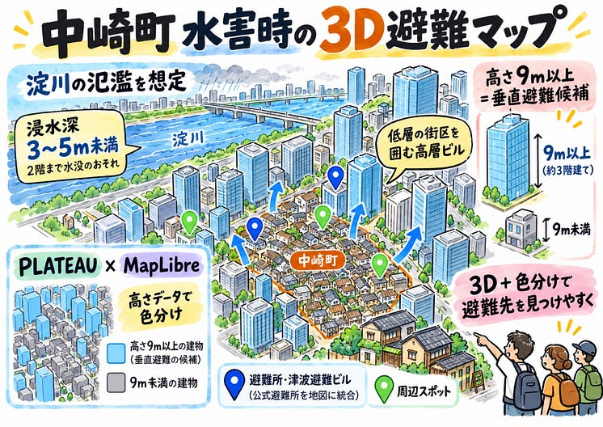

### **中崎町 水害時の3D避難マップ**

こんにちは、4年の安生です。

SotM 2026 Osakaの振り返りハッカソンとして、メイン会場となった「中崎町」エリア周辺の3D マップを作成しました。

中崎町は古民家を改装したレトロなカフェが立ち並ぶ魅力的な街ですが、すぐ北側には淀川が流れる低地エリアでもあります。大阪市北区が公表している「水害ハザードマップ」によると、記録的な大雨等で淀川が氾濫した場合、中崎町周辺は「浸水深3m〜5m未満（2階部分まで完全に水没するレベル）」の深刻な被害が想定されています。

そこで今回は、低層建築が密集する中崎町において「いざという時、どの建物なら確実に垂直避難できるのか」を視覚化するため、国土交通省の3D都市モデル「PLATEAU」とMapLibreを活用し、「建物の高さ」に着目した3D地図を制作しました。

**作成したマップ**

[中崎町 立体避難マップ](https://furuhashilab.github.io/Hackathon_Oct_MoeAnjo/)

**GitHubリポジトリ**

[GitHub - furuhashilab/Hackathon\_Oct\_MoeAnjo](https://github.com/furuhashilab/Hackathon_Oct_MoeAnjo)

**制作のポイント**

1.3D空間のメリット

3Dにすることで、「ここから一番近くて素早く逃げ込める高い建物」が視覚的に分かりやすくなるようにしました。

2.公的基準に基づく「高さ9m」の自動色分け

内閣府のガイドライン（3階建て以上推奨）を基準に「**高さ9m**」を安全圏に設定し、PLATEAUの高さデータ（⁠bldg:measuredHeight⁠）をプログラム（deck.gl）で自動判定し、9m以上の建物を「水色」、それ未満を「グレー」に動的に色分けしました。

3. 公式防災データとの統合データに基づく確実な避難先を示すため、大阪市北区公式の「**指定避難所**（中崎町ホール等）」や「**津波避難ビル**」の位置情報を青いピンでマップ上に統合しました。

**振り返りと考察**

実際にPLATEAUの高さデータを抽出して3D空間で俯瞰してみると、SotMのイベント会場周辺であった中崎町の中心部は、周囲の高層ビル群にぐるっと囲まれた低層密集エリアになっていることが分かりました。現地を歩いた際はあまり意識していませんでしたが、3Dであることに加えて色付けをすると、より視覚的に分かりやすくなりました。

**グラレコ**

Claude Opus 5.5

ChatGPT 5.5

---

[中崎町 水害時の3D避難マップ](https://medium.com/furuhashilab/%E4%B8%AD%E5%B4%8E%E7%94%BA-%E6%B0%B4%E5%AE%B3%E6%99%82%E3%81%AE3d-%E9%81%BF%E9%9B%A3%E3%83%9E%E3%83%83%E3%83%97-6f5727639012) was originally published in [Furuhashi(mapconcierge)Lab.](https://medium.com/furuhashilab) on Medium, where people are continuing the conversation by highlighting and responding to this story.
