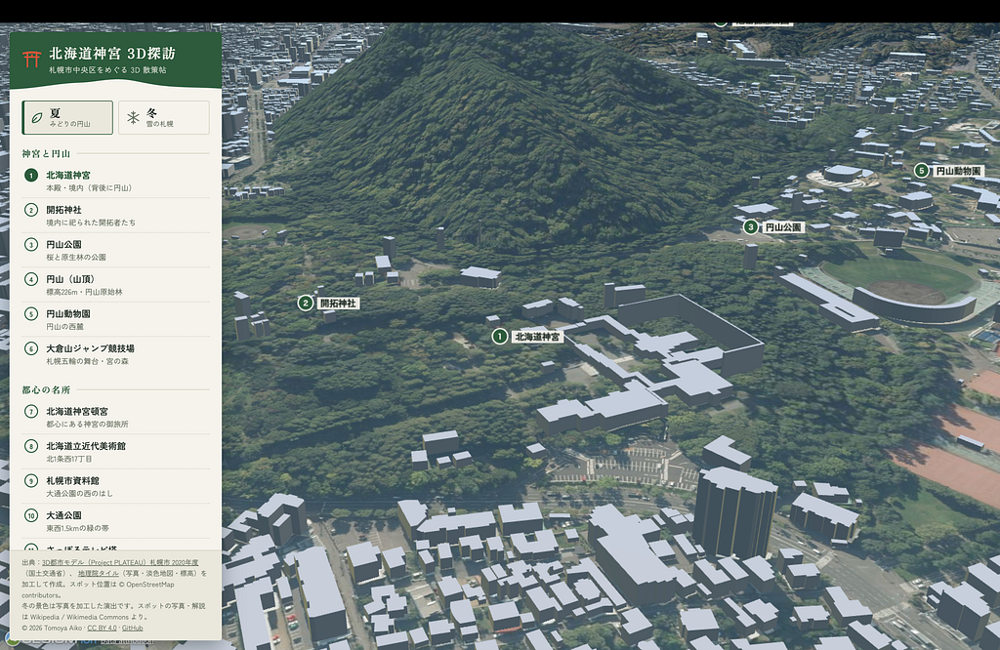
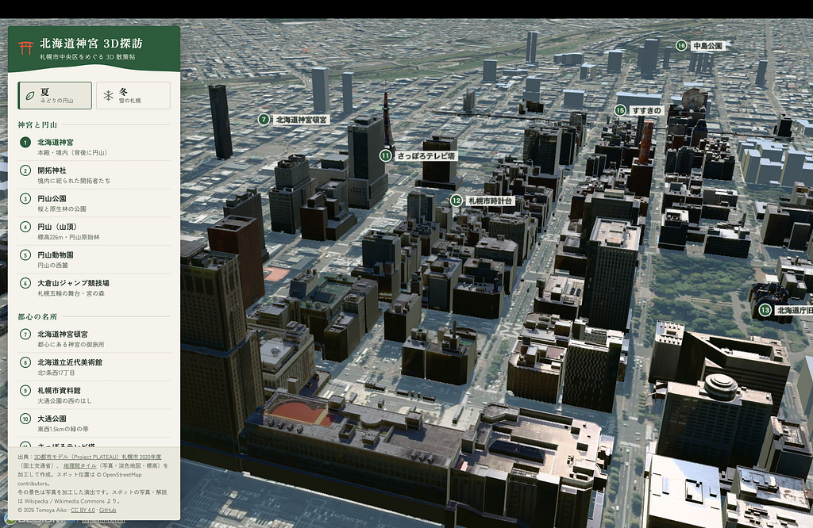
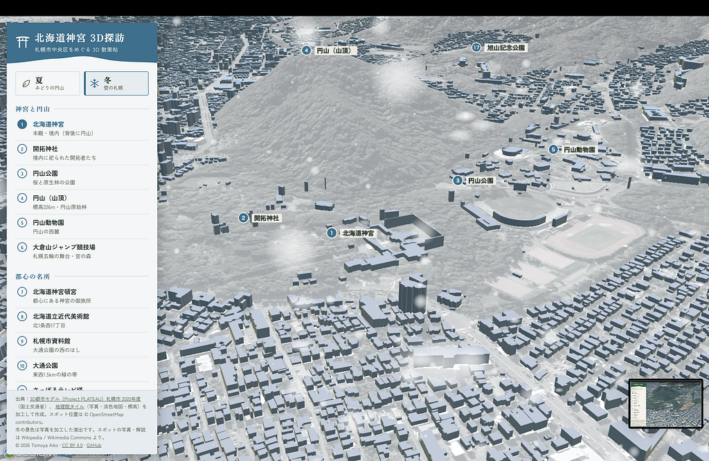
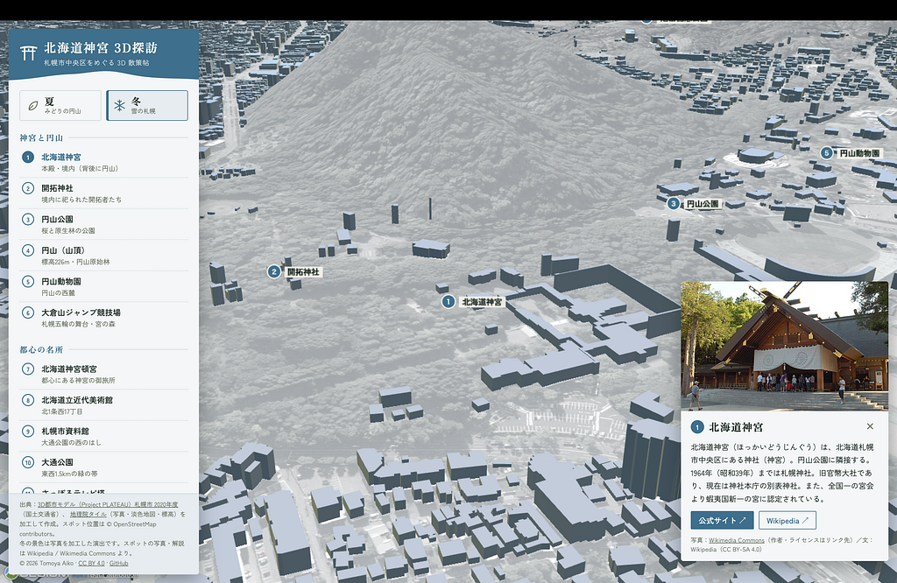
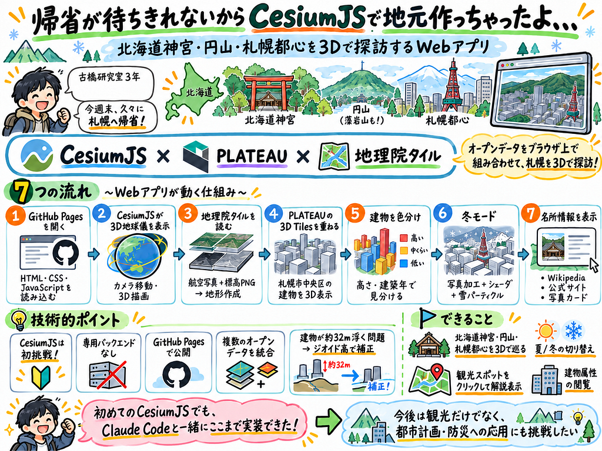
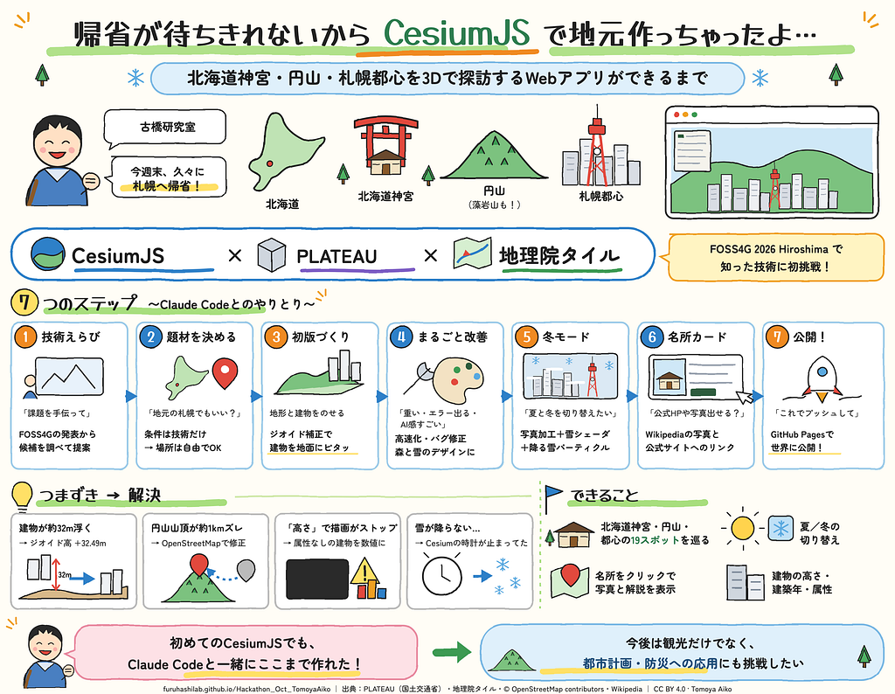

みなさんこんにちは！古橋研究室3年の愛甲です。

突然ですが、今週末久しぶりに地元・札幌に帰ります！！

夏休みは帰省できなかったので久々に実家の猫に会えるとなるとそれはもう最高ですです(アレルギーあるけど

そんな中、今回の古橋研究室のソロハッカソンでは、今年の夏に開催された[FOSS4G Hiroshima](https://2026.foss4g.org/ja/)や[State of the Map Asia 2026 OSAKA](https://stateofthemap.asia/)で紹介された、自分にとって新しい技術を使ってアウトプットを作るというミッションが課されました。

しかも今回、開発に使えるAIはClaude Codeのみ！(無料なの本当に助かります

さて、何を作ろうか。

単純な自分は今週末の札幌のことしか頭にない、札幌、札幌、札幌、、、ということで、**CesiumJSとPLATEAUの3D都市モデルを使って、札幌を3Dで作ってみることにしました。**

### [北海道神宮 3D探訪](https://furuhashilab.github.io/Hackathon_Oct_TomoyaAiko/)

北海道神宮や円山周辺、札幌都心の名所を3Dで巡れるWebアプリです。

なんと夏と冬を切り替えることもできます。札幌らしいですね。

[**GitHubリポジトリはこちら**](https://github.com/furuhashilab/Hackathon_Oct_TomoyaAiko)



### そもそもCesiumJSって何って

今回の主役が、FOSS4G Hiroshimaのプログラムにあった「3D Tiles 2.0 and Cesium」などをきっかけに選んだ**CesiumJS**です。

CesiumJSは、ブラウザ上で3D地球儀や地理空間データを表示できるJavaScriptのライブラリです。

と、言われてもよく分かりませんよね。

簡単に言うと、Google Earthのように地球をぐるぐる回したり、街の建物を立体的に表示したりするWebアプリを自分で作れる技術です。

私は普段、QGISやOpenStreetMapなどを使って地図に触れていますが、CesiumJSを使うのは今回が初めて。

せっかくのハッカソンなので、新しい分野に挑戦してみることにしました。

ちなみにClaude Codeに最初に相談したときは、PMTilesとMapLibreの組み合わせの方が短期間で作るには安全だよ、と勧められました。

でも、今回は3Dをやってみたい！

ということで、Claude Codeの堅実な提案を横目にCesiumJSを選びました。笑

### 3D Tilesってなんや。PLATEAUってなんや。

CesiumJSと一緒に使うのが、**3D Tiles**という技術です。

例えば札幌市内の建物を全部3Dで表示しようとしたら、ものすごい量のデータになります。

全部まとめて読み込もうとしたら、パソコンもびっくりしてしまいます。

そこで3D Tilesの登場です。

3D Tilesは、大規模な3Dデータを効率よく配信・表示するための形式です。

カメラから遠い場所は粗いデータで、近い場所は細かいデータで表示するなど、必要な情報を必要な分だけ読み込めます。

そして今回使用した3Dデータは、国土交通省の**Project PLATEAU**が公開している札幌市の3D都市モデルです。

PLATEAUは、日本の都市を3Dデータとして整備・公開しているプロジェクトです。

今回は札幌市中央区のLOD2建築物モデルを利用しました。

LOD2では、建物の高さだけでなく屋根の形なども表現されているので、街をかなり立体的に眺められます。

つまり今回のアプリは、

**CesiumJSで3D地図を動かして、3D TilesでPLATEAUの建物を効率よく表示する**

という仕組みです。



### ところで、なんで北海道神宮？

家から10分くらいだからです！

……というのは半分冗談ですが、北海道神宮の周辺には円山という自然豊かな場所があり、少し東へ行けば札幌の都心が広がっています。

つまり、地形の起伏と都市の建物を同時に楽しめる場所なんです。

とはいえ、今回のハッカソンは新しい技術を試すのが目的。地元で作ってもいいんだろうか。

そこでClaude Codeに相談しました。

> *せっかくだから地元札幌市中央区の北海道神宮周辺とかでも今回のハッカソンの意図に反しないかな、行けるかな*

すると、今回の条件は新しい技術を使うことであり、場所の制限はないので問題ないとのこと。

さらに札幌市中央区にはPLATEAUのLOD2建物データがあり、外部から読み込めることも確認できました。

ということで、北海道神宮に決定！

### Claude Codeに丸投げしてみた。けど……

最初はClaude CodeにGitHubのハッカソン課題を共有し、技術選定から手伝ってもらいました。

CesiumJSの初期化、PLATEAUの建物表示、地理院の航空写真や標高データの読み込みなど、初版の実装はかなりスムーズに進みました。

すごい。もう札幌ができてる。

しかし、実際に動かしてみると問題がいくつかありました。

まず、スポットの位置がおかしい。

円山山頂の位置が約1kmもずれていました。え？

これはOpenStreetMapのデータを参考に修正。

さらに、建物を高さによって色分けするボタンも、押すとエラーが出てしまいました。

原因は、一部の建物に高さの属性が存在しなかったこと。

その値をそのまま数値比較しようとして、CesiumJSの描画が止まってしまっていたようです。

欠損値がある場合にも処理できるよう修正して解決しました。

AIが一気にコードを書いてくれるとはいえ、完成品を自分で確認することはやっぱり重要ですね。

### 建物が空を飛んでるんですけど。

そして、今回一番興味深かったのが、建物と地形の高さの問題です。

PLATEAUの建物と地理院の標高データを重ねたところ、なんと建物が地面から約32m浮いてしまいました。

札幌、ついに空中都市になった？

もちろんそんなわけはありません。

原因は、地形と建物で使っている**高さの基準が違ったこと**でした。

PLATEAUの3D Tilesでは「楕円体高(だえんたいこう)」という高さが使われている一方、地理院の標高タイルは平均海面を基準とした標高を扱います。

ここで出てくるのが「ジオイド高」という考え方です。

基本的な関係は、

**楕円体高 = 標高 + ジオイド高**

となります。

国土地理院のジオイド計算サービスで北海道神宮付近を調べると、ジオイド高は32.49mでした。

そこで地理院の標高にこの値を足すことで、高さの基準をそろえました。

```
const geoidHeight = 32.49;  
const ellipsoidHeight = elevation + geoidHeight;
```

※考え方を簡略化したコードです。

これでようやく建物が地面に戻ってきました。

普段GISを使っていても、3Dになると高さの基準の違いがこんなに目立つとは思いませんでした。

**緯度・経度だけじゃなく、標高の基準もちゃんと合わせないといけないんですね。**

### なんかボタンがAIっぽいな……

最初の作品を触っていて、もう一つ気になったことがありました。

デザインです。

ボタンがたくさん並んでいて、なんというか、いかにもAIが作りました！というWebアプリになっていました。

そこでClaude Codeに次の指示を出しました。

> *少し動作と読み込みに時間がかかるのと、スポットが少ない、あと高さ表示のボタンはあるのにエラーでて処理されないってのがあるかな。あとボタンがAi感すごいから、もっとデザインを変えて欲しい。色とかも、北海道なら自然豊かだから緑にするとか、雪の要素入れるとか。航空写真も、夏と冬があれば切り替えできるようにしてほしい。*

言いたい放題ですね。笑  
こんだけ曖昧で適当に並べたらどうなるんだろうって思ってあえてこんなプロンプトにしてみました。

すると、北海道の自然をイメージした深緑や苔色、明朝体の見出し、円山の稜線と鳥居のイラストなどを取り入れたデザインに変わりました。

また、スポットも6か所から19か所に増加。

「神宮と円山」「都心の名所」「街をながめる」の3グループに整理されました。

かなり観光案内らしくなってきました！

### 札幌といえば雪！冬も作っちゃおう

ここまできたら、やっぱり冬の札幌も見たい。

そこで夏と冬を切り替えられる機能を追加してもらいました。

しかし、ここで一つ問題が。

今回使用した地理院タイルには、札幌の積雪期の航空写真がありませんでした。

どうするんだこれ。

そこでClaude Codeが実装したのが、**夏の航空写真を加工して雪景色っぽく見せる**という方法です。

先に断っておきますが、今回の冬モードは本物の積雪期の航空写真ではありません。あくまで視覚的な演出です！

写真を白っぽく加工し、さらにCesiumJSのCustomShaderという機能を使って建物の屋根を白くしました。

CustomShaderは、3Dモデルの見た目をプログラムで変更できる仕組みです。

今回は面の向きを示す法線を利用して、上を向いた面を雪に覆われたように描画しています。

さらにParticleSystemを使って降雪も再現しました。

ところが、最初は雪が全然降りません。

原因はCesiumJSの時計が止まっていて、雪のパーティクルが更新されていなかったことでした。

時計を動かすように修正したところ、ようやく雪が降りました。



実際の雪の状態とは異なりますが、札幌の冬らしい雰囲気は表現できたのではないかと思います。

### せっかくだから札幌観光もできるようにしよう

ここまで作ってみると、もっといろいろな機能が欲しくなります。

スポットをクリックしたときに、その場所の写真や解説が表示されたら、もっと面白いのでは？

ということで、

> *この名所のボタン押したらそこの公式のHPに飛ぶとか、写真表示されるとかどう？できる？*

と依頼しました。

Claude CodeはWikipediaから写真と解説を取得し、Wikidataから公式サイトのURLを調べて、スポットカードを表示する機能を追加してくれました。

カードには写真、短い解説、公式サイト、Wikipediaへのリンクが表示されます。

地図上のピンをクリックしても同じカードが開きます。



ただ眺めるだけの3D地図から、札幌の名所を巡れるWebアプリに進化しました！

### ところで、これ重くないの？

実は最初、少し重かったです。

PLATEAUの建物だけでなく、航空写真や標高データも読み込む必要があるため、表示に時間がかかっていました。

そこで、最初に表示する場所の標高タイルを先読みしたり、5mと10mの標高データを並行して取得したり、建物の詳細度を調整したりしました。

また、描画を30fpsに制限することで負荷を抑える工夫もしています。

一度は、画面に変化がないときは描画を止めるrequestRenderModeという設定も試しました。

しかし、地形の非同期読み込みとうまくかみ合わず、逆に地面が表示されなくなってしまいました。

軽くしたいのに地面が消える。困る。

結局、この設定はやめて別の方法で調整しました。

3D地図は見た目が派手な分、快適に動かすための工夫も必要なんですね。

### 要するに、今回何をやったん？

ここまでいろいろ書きましたが、仕組みをまとめるとこんな感じです。

① ユーザーがGitHub Pagesを開く

→ HTML・CSS・JavaScriptを読み込む

② CesiumJSが3D地球儀を表示する

→ カメラの移動や3D描画を担当

③ 地理院タイルから航空写真と標高を読み込む

→ PNGの標高データを変換して地形を作る

④ PLATEAUの3D Tilesを読み込む

→ 札幌市中央区の建物を3Dで表示

⑤ 建物の属性を使って色分けする

→ 高さや建築年によって表示を変更

⑥ 冬モードでは雪景色を演出する

→ 写真の加工、シェーダ、パーティクルを使用

⑦ 名所を選ぶとWikipediaなどから情報を取得する

→ 写真・解説・公式サイトを表示

つまり、**複数のオープンデータをブラウザ上で組み合わせて、札幌を3Dで探訪できるようにした**というわけです。

しかも、専用のバックエンドサーバーを用意せず、GitHub Pagesで公開できました。

### Claude Codeと作ってみて

今回、技術選定から実装、エラー修正、GitHubへのpushまで、Claude Codeにかなり助けてもらいました。

自分でCesiumJSのすべてを理解してから書き始めていたら、ここまで短期間で形にはできなかったと思います。

ただ、Claude Codeが最初に出してきたものが、そのまま完成形だったわけではありません。

座標が間違っていたり、ボタンが動かなかったり、雪が降らなかったり。

実際にアプリを操作して「ここがおかしい」「こうした方が面白そう」と考えることで、どんどん改善できました。

特に印象に残ったのは、今回の作品の特徴である北海道らしいデザインや冬モードが、最初の仕様にはなかったことです。

実際に触ってみたからこそ思いついたアイデアでした。

**AIがコードを書けるようになっても、何を作りたいのかを考えて、完成したものを評価するのは人間の役割なんだなと感じました。**

### 最後に

今回のハッカソンでは、初めてのCesiumJSと3D Tilesを使い、地元札幌を3Dで表現することができました！

PLATEAUの都市モデルや地理院の標高データを組み合わせる中で、高さの基準やデータの欠損など、実際に手を動かして初めて気付く問題もたくさんありました。

また、今回は観光案内のようなアプリになりましたが、3D都市モデルは災害リスクの可視化や都市計画などにも活用できる技術です。

個人的には、札幌の冬季歩行環境にも関心があるので、今回学んだ技術を今後の研究にもつなげていけたらと思います。

そして何より、地元を3Dで眺めていたら、ますます札幌に帰りたくなってしまいました。

結局、帰省欲を高めただけだったかもしれません。笑

今週末はちゃんと本物の札幌に帰ってきます！

最後まで読んでいただきありがとうございました！

[**北海道神宮 3D探訪を触ってみる**](https://furuhashilab.github.io/Hackathon_Oct_TomoyaAiko/)

[**GitHubリポジトリ**](https://github.com/furuhashilab/Hackathon_Oct_TomoyaAiko)

### 使用技術・データ・出典

* [CesiumJS](https://cesium.com/platform/cesiumjs/) 1.146（Apache License 2.0）
* [Project PLATEAU 札幌市3D都市モデル（2020年度）](https://www.geospatial.jp/ckan/dataset/plateau-01100-sapporo-shi-2020)（国土交通省）
* 地理院タイル（国土地理院）
* OpenStreetMap（© OpenStreetMap contributors）
* Wikipedia（CC BY-SA 4.0）・Wikimedia Commons（写真ごとのライセンス）
* Wikidata
* Claude Code

作品の独自コンテンツとコードはCC BY 4.0で公開しています。外部データ・ライブラリには、それぞれの提供元のライセンス・利用条件が適用されます。



GPT-6



Claudecode Opus5.5


---

[帰省が待ちきれないからCesiumJSで地元作っちゃったよ、、、](https://medium.com/furuhashilab/%E5%B8%B0%E7%9C%81%E3%81%8C%E5%BE%85%E3%81%A1%E3%81%8D%E3%82%8C%E3%81%AA%E3%81%84%E3%81%8B%E3%82%89cesiumjs%E3%81%A7%E5%9C%B0%E5%85%83%E4%BD%9C%E3%81%A3%E3%81%A1%E3%82%83%E3%81%A3%E3%81%9F%E3%82%88-c27095fb6476) was originally published in [Furuhashi(mapconcierge)Lab.](https://medium.com/furuhashilab) on Medium, where people are continuing the conversation by highlighting and responding to this story.
