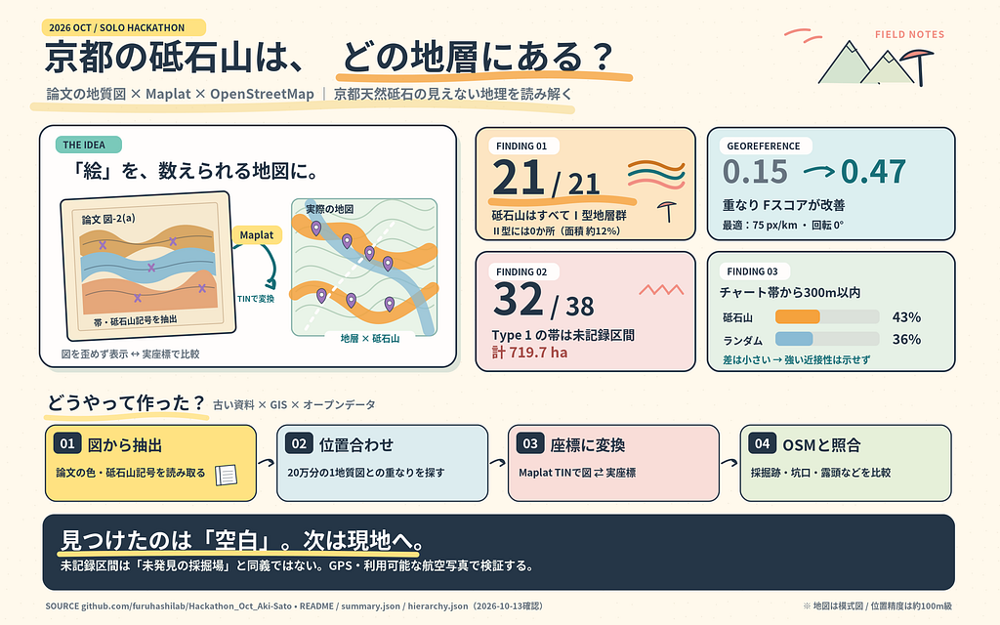

FOSS4G Hiroshima / SotM Asia OSAKA 振り返りハッカソン（FuruhashiLab）

こんにちはー  
佐藤愛妃です。いぇーい

最近、誕生日weekだね

ひなこ、れあら誕生日おめでとう！

ぴーす、ぴーす

### FuruhashiLab「FOSS4G Hiroshima / SotM Asia OSAKA 振り返りハッカソン」成果報告

成果物：<https://furuhashilab.github.io/Hackathon_Oct_Aki-Sato/> リポジトリ：<https://github.com/furuhashilab/Hackathon_Oct_Aki-Sato>

### 1. 作ったもの

\*\*論文の地質図そのものに、スマートフォンの GPS の現在地を表示する Web アプリ「論文図ナビ」\*\*を作りました。

題材は、京都の天然砥石（いわゆる鳴滝砥石）です。研究論文の地質図（図-2(a)）には、地層の塗り分けと砥石山（採掘地）の記号 ⚒ が描かれています。論文図ナビでは、この図を変形せずに画面に表示し、その上に次の情報を出します。

* 自分の現在地（青い丸。歩くと動く）
* その地点が、論文の図でどの区分（Type 1／Type 2／Type II）にあたるか
* 近い砥石山3つまでの方角と距離（両方の図に記載があるかどうかも）

図-2(a)（地質図）と図-1（傾斜量図。白線は凡例で地すべり地）を切り替えて表示できます。

現地にいないときは、図をタップした場所にいるものとして表示する「デモ」も使えます。

### 2. なぜ作ったか

論文の地質図は、紙面に描かれた図版です。経緯度を持たないので、現地で「いま自分は図のどこにいるのか」を知るには、地形や地名を頼りに頭の中で照合するしかありません。

既存の地質アプリ（産総研の地質図Navi、Rockd、StraboSpot など）は、現在地を出してくれますが、表示されるのは現代の地質図です。論文の著者が描いた区分や記号（今回なら ⚒ の位置）とは、そのままでは対応しません。

そこで、論文の図版の上で直接、自分の位置を確かめられるようにすることを目的にしました。

### 3. 参考にした発表と、使った技術

ハッカソンの条件は「FOSS4G Hiroshima / SotM Asia OSAKA で紹介された、自分にとって新しい技術を1つ使う」ことです。私は Maplat を選びました。

* 参考にした発表：大塚恒平「Bringing Old Maps & Illustrated Maps to the Web: 10 Years of Maplat and Turning Misalignment into Innovation」（FOSS4G Hiroshima 2026、General Talk、2026年9月2日）
* スライド：<https://speakerdeck.com/kochizufan/maplat-foss4g-hiroshima-2026-talk>
* Maplat：古地図や絵地図と現代の地図の間を、対応点（GCP）から作る三角網（TIN）で、双方向に座標変換するオープンソースのライブラリ。元の図を変形せずに表示したまま、GPS の現在地を図の上に描ける
* 使ったパッケージ：@maplat/core 1.0.0（図の表示と現在地の描画）、@maplat/tin 1.0.0（座標変換）

Maplat は、古地図や観光用の絵地図の上に現在地を出すために作られてきた技術です。今回はそれを、地質学の論文の図版に使いました。新しいのは技術ではなく、その使い道です。

### 4. 作り方

### 4.1 使った資料

* 論文の図-2(a)（地質図。井本ほか 1989・木村 2000 に加筆）と図-1（傾斜量図。⚒ と地すべり地）。国立国会図書館デジタルコレクションから取得
* 産総研地質調査総合センター 20万分の1地質図幅「京都及大阪」（第2版）。位置合わせの基準
* 京都府レッドデータブック2015、井本ほか（1989）。地質の背景の説明

### 4.2 図から地層と砥石山を取り出す

図-2(a) の画像の色から、Type 1（チャート）、Type 2（砕屑岩）、Type II の範囲をポリゴンにしました（Python、OpenCV）。

砥石山の ⚒ は、最初は図-2(a) から自動で検出していました。しかし、同じ論文の図-1（傾斜量図）の ⚒ と照合すると、合うのは一部だけでした。拡大して確かめると、別の記号を誤って拾い、背景地図の上の ⚒ を取りこぼしていました。そこで、黒くはっきり描かれた図-1 の ⚒ 22か所の位置を目で読み取り、図-2(a) と照合しました。両方の図に記載がある8か所は「両方に記載」、残りは「図-1 のみ」として、確かさを付けています。

### 4.3 図を緯度経度に合わせる

Maplat で現在地を図に出すには、図の上の点と緯度経度の対応点が必要です。

1. 最初は、図中の地名注記（Atago-san など）3点を対応点にしました。しかし、この方法で求めた縮尺は、図の縮尺バーと約1.45倍ずれていました。
2. そこで、20万分の1地質図幅を基準にしました。この図幅は図郭で経緯度が決まっています。20万分の1でチャートとして塗られた範囲と、論文の図の Type 1 の範囲が最も重なる縮尺・回転・位置を、総当たりで探しました。
3. 見つかった縮尺（元の図で 25 px/km）は図の縮尺バー（2 km ≒ 50 px）と、回転（0°）は方位記号（北が上）と一致しました。どちらも探索には使っていない手がかりです。20万分の1との重なり（F 値）は、0.15 から 0.47 に上がりました。
4. この結果から対応点を作り、Maplat（@maplat/tin）で変換用の三角網を作りました。

### 4.4 ナビの画面

GitHub Pages の静的なページです。

* Maplat で論文の図（または20万分の1地質図）を表示する
* ブラウザの位置情報 API で現在地を取り、Maplat が図の上の位置に変換して描く
* 現在地が図のどの区分に入るかと、近い砥石山までの方角と距離を、ブラウザの中で計算する
* 位置情報は端末の外に送らない

位置合わせの方法と集計は、別の「検証ページ」（analysis.html）にまとめてあります。

### 5. 既存アプリとの違い

* 地質図Navi（産総研）・Rockd：現在地を出すのは、現代の地質図の上。全国・全世界を扱え、機能も多い
* StraboSpot：野外記録の機能が非常に多い。自分の地図を使うには、位置合わせ済みの GeoTIFF が必要
* 論文図ナビ：現在地を出すのは、論文の図版そのものの上。図は変形しない。扱えるのは1枚の論文図だけで、機能は表示と方角・距離に限られる

既存アプリが答えるのは「現代の地図の上で、自分はどこにいるか」です。論文図ナビが答えるのは「論文の著者が描いた図の上で、自分はどこにいるか」です。現地で論文の記述（どの地層の、どの ⚒ か）を確かめるための道具です。

なお、「論文の図版に現在地を出すアプリは見当たらない」というのは、私が調べた範囲での話です。網羅的な調査ではありません。

### 6. 分かったこと

* 文献の図版も、公的な地質図との重なりを手がかりにすれば、図自身の縮尺バーや方位と矛盾しない形で緯度経度に合わせられました
* 位置合わせや記号の読み取りが雑だと、見かけの傾向が生まれます。当初は「砥石山はチャートの範囲の縁に集まる」ように見えましたが、位置合わせと砥石山データを正すと、ランダムな点との差は無くなりました（チャートから300 m 以内：砥石山 32%、ランダムな点 36%）
* 図版から記号を自動で拾うと、誤検出と取りこぼしが混ざります。同じ論文の別の図と照合することで気づけました
* 地層の区分を判定できた砥石山17か所は、すべて論文の図の Type 1 または Type 2 の範囲にあり、Type II の範囲には0か所でした（残り5か所は図の色が塗られていない範囲）。ただし、砥石山は群をなしていて独立な点とみなせないため、統計的な有意性は主張できません

### 7. 限界

* 位置の精度は約100 m 単位です。基準にした20万分の1地質図の画像の解像度で決まります。「図のどのあたりにいるか」の目安です
* 論文の図は低解像度の画像を使いました。凡例と ⚒ 記号の読み取りは、原図で確認する必要があります
* 砥石山の位置は、図-1 の ⚒ を目で読み取ったものです。名称・稼働状況・採掘層はまだ付けていません
* 現在地の機能は、HTTPS で配信されるページ（GitHub Pages）でのみ使えます

### 8. 今後

* 5万分の1地質図幅「京都西北部」（井本ほか、1989）を基準に加え、位置の精度を上げる
* 原図で凡例と記号を確認し、砥石山に名称と採掘層を付ける
* ほかの論文の図版でも、同じ手順で使えるようにする

### 参考文献・出典

* 大塚恒平（2026）Bringing Old Maps & Illustrated Maps to the Web: 10 Years of Maplat and Turning Misalignment into Innovation．FOSS4G Hiroshima 2026，General Talk．<https://speakerdeck.com/kochizufan/maplat-foss4g-hiroshima-2026-talk>
* 【著者（年）論文タイトル．掲載誌，巻（号），ページ．】
* 井本信広・清水大吉郎・武蔵野実・石田志朗（1989）京都西北部地域の地質．地域地質研究報告（5万分の1地質図幅），地質調査所．
* 木村克己（2000）ジュラ紀付加コンプレックスのスラスト系．地質学雑誌，55(1)，184–202．
* 産業技術総合研究所地質調査総合センター【発行年】20万分の1地質図幅「京都及大阪」（第2版）．
* 京都府（2015）京都府レッドデータブック2015 地形・地質「鳴滝砥石（砥石型珪質頁岩）とコノドント」「砥石型珪質頁岩および炭素質珪質頁岩」．
* Maplat（Code for History／株式会社那由多）<https://www.maplat.jp/>
* 地質図Navi <https://gbank.gsj.jp/geonavi/> ／ Rockd <https://rockd.org/> ／ StraboSpot <https://strabospot.org/>

作業には AI として Claude Code を使い、リポジトリの作成・更新も Claude Code で行いました。

### ライセンス

コードと抽出データは CC BY 4.0（© 2026 Aki Sato / FuruhashiLab）です。論文の図と産総研の地質図は、それぞれの権利者の条件に従います。

### グラレコ

2026/10/13,GPT-5.5

---

[趣味に全振り：論文＆古文書の地質図を Maplat で地図に乗せて、京都の天然砥石の「採れる場所」を確かめてみた](https://medium.com/furuhashilab/2026-10-13-ba2243a3a27f) was originally published in [Furuhashi(mapconcierge)Lab.](https://medium.com/furuhashilab) on Medium, where people are continuing the conversation by highlighting and responding to this story.
