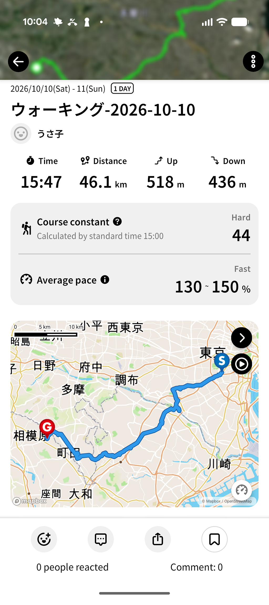
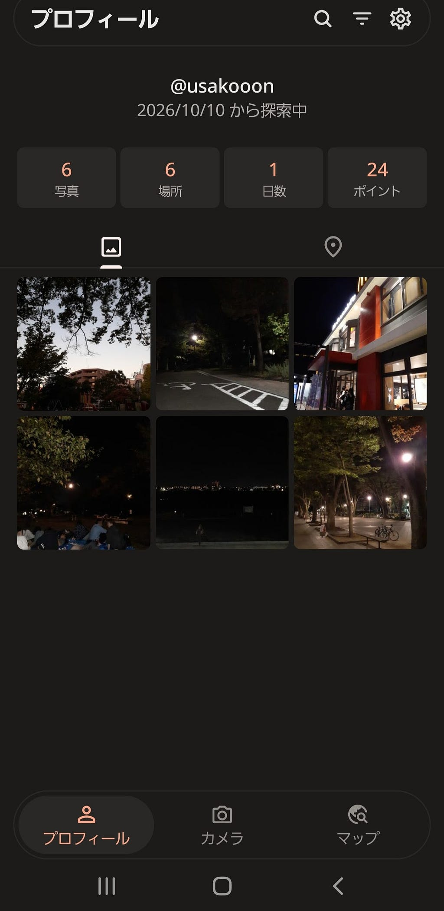
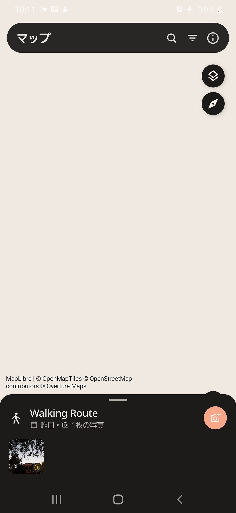
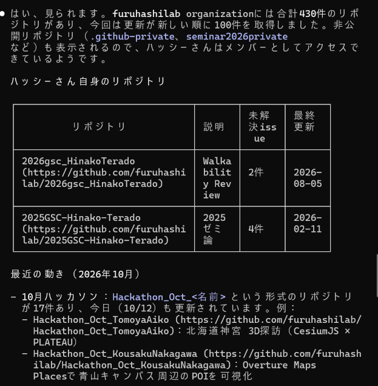
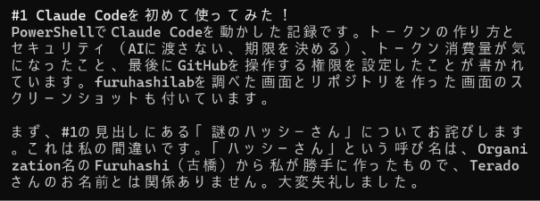
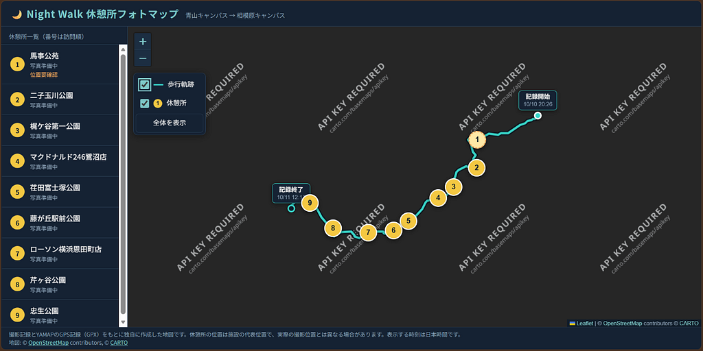
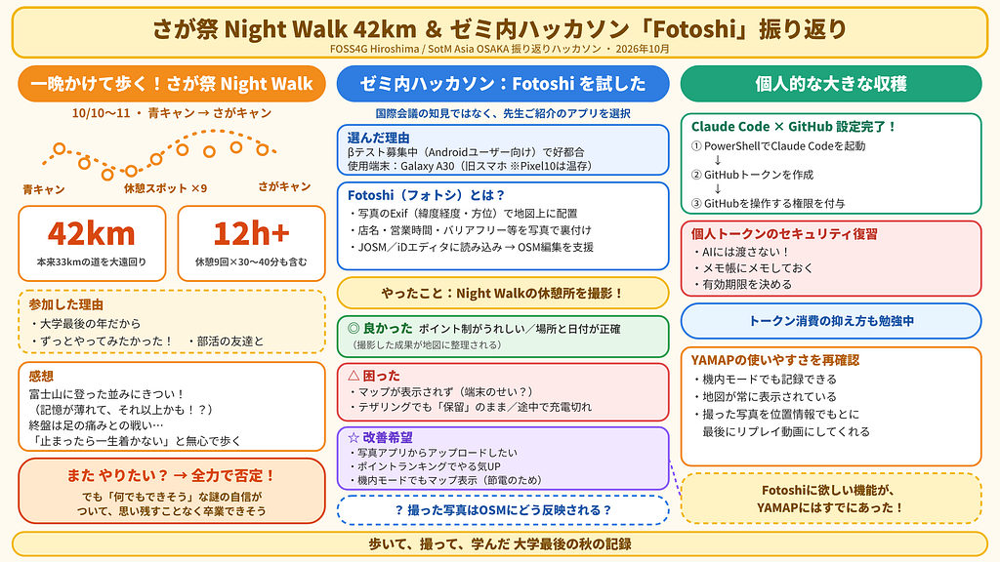

10月10日、11日に開催された、さが祭の伝統行事

> 一晩かけて青キャンからさがキャンまで歩こう！

というイベントに

大学最後の年であること と ずっとやってみたかった

という理由から部活の友達と参加しました。

実際に参加してみて、

富士山に登った並みにきつかった！富士山の記憶が薄れてきているから、それ以上かも！！

といった感想です。

その理由として、本来33kmくらいで行ける道のりをなんと

#### 42km

というとんでもなく遠回りをする道のりで歩きました。その間休憩スポットが**9カ所**あり、そこでも**30~40分ほど休憩時間**があるので12時間以上歩く理由を参加しながら理解しました。

最後の方は足の痛みとの戦いで、足を止めたら一生目的地には着かない！という恐怖から無心で足だけは動かしました。

なかなか体験できない45kmの距離をひたすら歩く経験は、今後の人生ではないと思います。貴重な時間であったと共に、これだけ歩けたら今後は何だってできそうだ！という謎の自信が少しついた気がします。

またやりたいか？と言われたら、全力で否定します。このような経験は一回できれば十分です。もう何も思い残すことがなく卒業できそうです。

ハッカソンに移ります。

今回のゼミ内ハッカソンは

> FOSS4G Hiroshima / SotM Asia OSAKA 振り返りハッカソン

というテーマから、[条件](https://github.com/furuhashilab/README/issues/42#issuecomment-6008763721)を元に行います。

今回私が行ったのは、国際会議での新たな知見というよりは、先生がご紹介されていた「**Fotoshi」**を選びました。

選んだ理由としては

> 新写真共有アプリ Fotosi のβテストユーザー募集中なので Android ユーザの人試してみて！！

です。私はAndroidユーザであり、都合がよかったので選びました。

使用したスマホは、**Galaxy A30**です。現在利用しているGoogle Pixel10で行うのは気が引けたので、前利用していたスマホを利用しました。

GitHub成果ページ

[furuhashilab/Hackathon\_Oct\_HinakoTerado](https://github.com/furuhashilab/Hackathon_Oct_HinakoTerado)

### 使ってみた感想

#### Fotoshi（フォトシ）の概要

Fotoshi（フォトシ）は、オープンストリートマップ（OSM）をはじめとする地理空間データの作成や更新に利用される、**写真を用いた現地情報収集・管理のためのオープンソースツールおよびプラットフォーム**です。

#### 主な役割と仕組み

* **ジオタグ（位置情報）の活用**

写真に含まれるExifデータ（GPSによる緯度・経度、撮影方向の方位角など）を解析し、地図上の正確な位置へ写真を配置します。

* **現地データの裏付け（グラウンドトゥルース）**

衛星画像や遠隔調査だけでは確認が難しい、店舗の名称・営業時間、バリアフリー情報、道路標識や建物の入口などの詳細な属性情報を写真で記録・可視化します。

* **地図エディタとの連携**

整理された写真データをJOSMやiDエディタなどのOSM編集ツールに参照データとして読み込むことで、正確かつ効率的なマッピングを支援します。

#### やったこと

Night Walk中に休憩所を撮影してみた

#### 使ってみた感想

**良かった点**

* ポイント制なのが少しうれしかった
* 場所と日付が正確に区別されている

**困った点**

* スマホのせいか、使っている間マップが表示されなかった
* Wi-Fiのテザリングはしていたが、その場でアップロードできず「  
   保留」のままだった
* 途中で充電が切れてしまい、普通のカメラで撮影した

**改善してほしい点**

* 写真アプリ（Photo）からアップロードできる機能があるとよい
* ユーザー間のポイントランキングなどが表示されると、もっと写真  
   を撮りたくなりそう
* 機内モードだとマップが映らず、（充電の減りを抑えたい場合、そのモードを利用するので、)マップが映ってくれるとありがたいと思った。

**気になったこと**

* 撮った写真がOSMにどのように反映されるのか

成果(左)/ウォーキング中、マップが表示されなかった(右)

### 個人的な大きな収穫

#### Claude CodeにGitHubを操作する権限を付与する設定を完了

* PowerShellでClaude Codeを動かしてみた
* GitHubのトークンを作成した
* 個人トークンのセキュリティの復習  
  AIに渡さない！  
  メモ帳にメモしておく  
  有効期限を決める  
   最近Claudeを使い始めて、トークン消費をどう抑えるか、どのくらいの作業量でトークンが減るのかを学び始めた

ハッシーさん(⌒∇⌒)

謝罪

#### YAMAPの使いやすさを再確認

* 機内モードでも記録できる
* 地図が常に表示されている
* ウォーキング中に撮った写真を、位置情報をもとに最後にリプレイ  
   動画にしてくれる

#### 試作中

---

[青キャンからさがキャンへ！45kmの道のりを記録(途中まで)](https://medium.com/furuhashilab/%E9%9D%92%E3%82%AD%E3%83%A3%E3%83%B3%E3%81%8B%E3%82%89%E3%81%95%E3%81%8C%E3%82%AD%E3%83%A3%E3%83%B3%E3%81%B8-45km%E3%81%AE%E9%81%93%E3%81%AE%E3%82%8A%E3%82%92%E8%A8%98%E9%8C%B2-%E9%80%94%E4%B8%AD%E3%81%BE%E3%81%A7-5c7ff021ba83) was originally published in [Furuhashi(mapconcierge)Lab.](https://medium.com/furuhashilab) on Medium, where people are continuing the conversation by highlighting and responding to this story.
