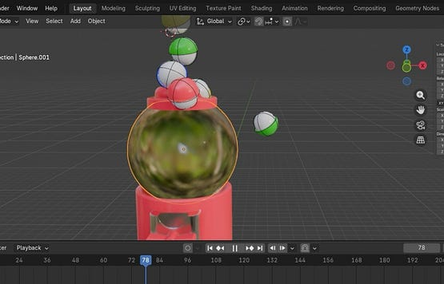
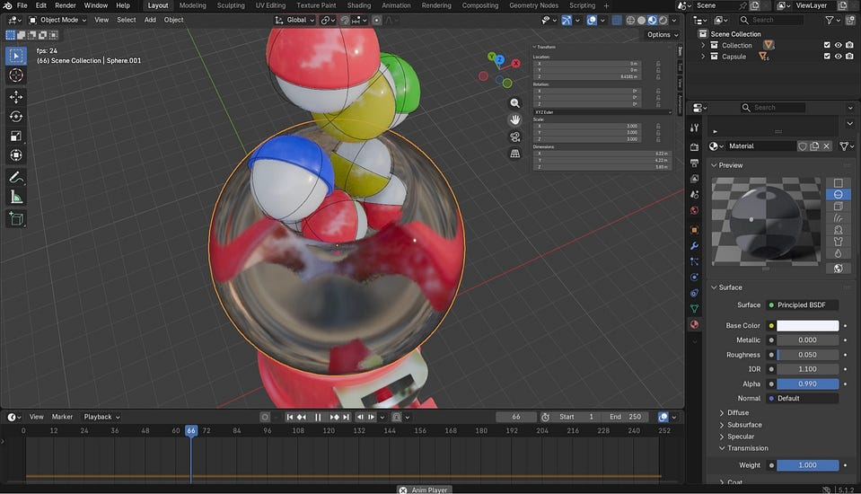
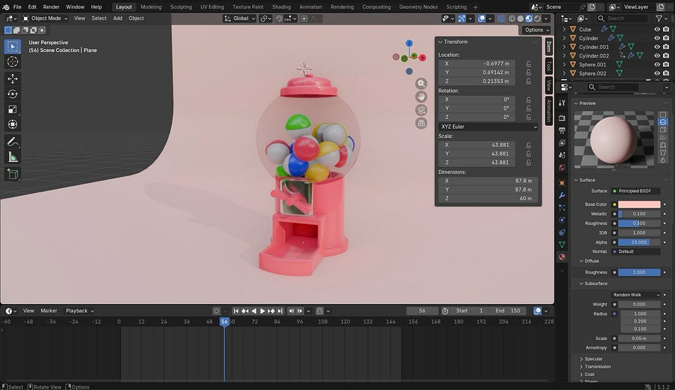
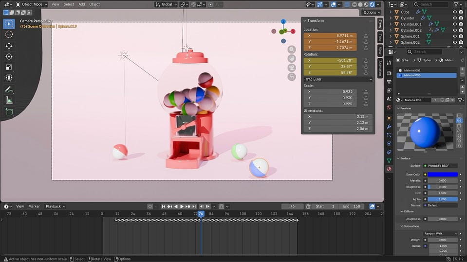

こんにちは、4年の稲田です。

先週は、Claude CodeでFOSS4G・SotM Asia 2026を振り返るハッカソンお疲れ様でした！

今週のデザイン2は、ハッカソンの前週に引き続き、アニメーション制作に取り組みました。

以下が各自の進捗報告になります。

↓↓↓

【もえ】

今回は雲と星のモデリングをしました。

雲のモデリングでは、複製した雲がすべて同じ形だと不自然になるため、それぞれプロポーショナル編集で頂点を動かしました。あえていびつな形に崩したり回転させたりして、それぞれの雲に個性を出して自然に見せたのがポイントです。

星のオブジェクトは、頂点10個の「円」を使い、頂点を1個飛ばしで選択して内側に縮小（Sキー）するだけで作ることができます。複雑な調整の手間がなく、シンプルな円の変形だけで、形の整った綺麗な星が素早く完成させられることに驚きました。

次回はマテリアルの設定から進めていく予定です。

【みわ】

今回私は、雨のアニメーションを完成させることが出来ました！

まずは画面の光や反射を綺麗にする設定を入れました。

ここでまさかの、、ブルームを付け、アンビエントオークルージョンとスクリーンスペース反射を有効にしなければならなかったのですが、動画と同じ場所に表記がありませんでした😭

検索してみたところ⬇️

前回のゆうかさん同様、Blender 4.2以降（5.x系含む）ではEeveeレンダラーの仕様が完全に刷新されたため、動画の画面にあった「アンビエントオクルージョン」や「ブルーム」のチェックボックスはパネルから削除・移動されていました。

最終的には使用できたので良かったです！✨

カメラのピントを合わせて背景をボカす

霧（フォグ）を出して空気感を出す

雨がブレて見える効果（モーションブラー）を入れる

動画データ（MP4）として出力する設定をする

保存先を決めて動画を出力する

【ゆうか】

私は今回、ガチャガチャのアニメーションを再生するパートまで進めました！

しかし、ガチャガチャのガラス部分に落とす操作のところで、問題発生😭

前回一件落着したかと思っていた、透明な質感がうまくアニメーションで見えず、カプセルは入っているのに中身が見えないという状態になってしまいました。RaytracingのメゾットをScreen – Traceに変更したら、一瞬で透明になりました！

入ってはいるけれど見えず😭

色も少し変えて、動画より淡い色合いで仕上げました！アニメーションもいい感じにできました。

動画ではガチャガチャが出てくる動きはなく、ガラスの中でガチャガチャが跳ねるものだったのですが、私は実際に下に落ちてくるところのアニメーションも試行錯誤して作ってみました。

度々画面が白くなり、保存ができなかったため、完成映像はスクリーンショットにします。

<https://medium.com/media/4cf18f34f6e991ac0ad7b0852bfeb63a/href>

まとめ

今回の動画では、それぞれモデリングやモーションブラー、タイムラインなどの工程を進めました。3人とも作っているものが異なるため、他2人の進捗報告を見るのが毎週たのしいです！

来週からも、みんなでアニメーションの制作に取り掛かっていきたいです。

グラレコ(みわ)

---

[【デザイン2】Blenderアニメーション制作の進捗](https://medium.com/furuhashilab/%E3%83%87%E3%82%B6%E3%82%A4%E3%83%B32-blender%E3%82%A2%E3%83%8B%E3%83%A1%E3%83%BC%E3%82%B7%E3%83%A7%E3%83%B3%E5%88%B6%E4%BD%9C%E3%81%AE%E9%80%B2%E6%8D%97-a486fbbf2edb) was originally published in [Furuhashi(mapconcierge)Lab.](https://medium.com/furuhashilab) on Medium, where people are continuing the conversation by highlighting and responding to this story.
