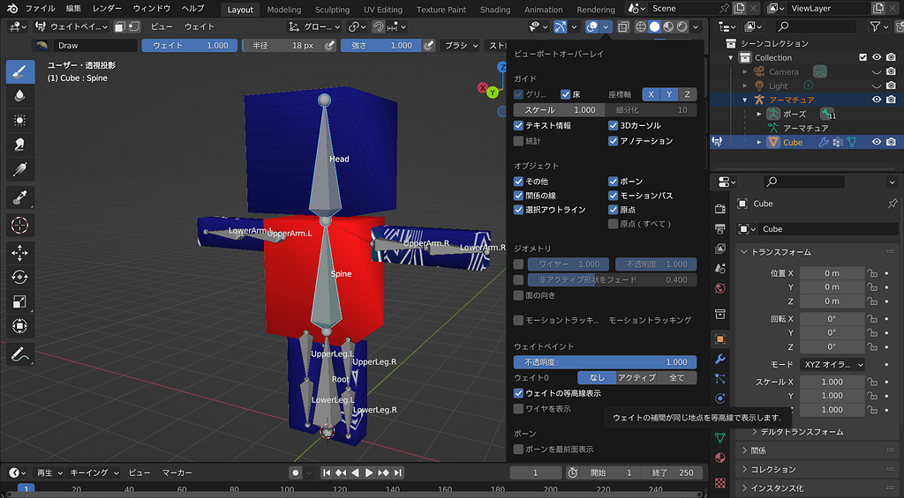
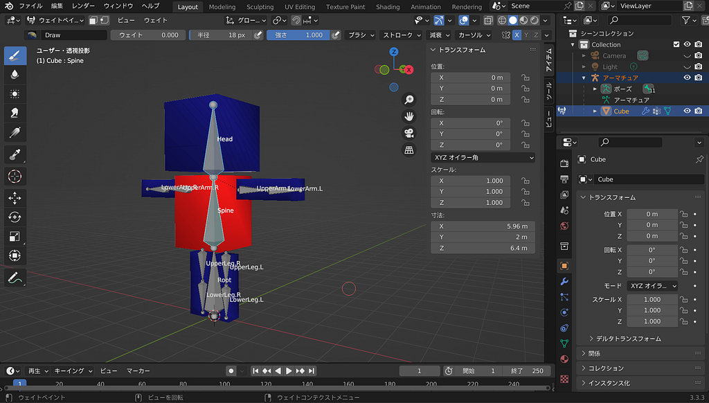
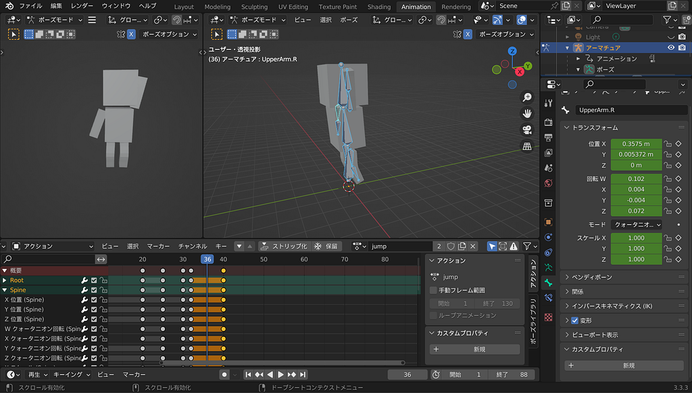
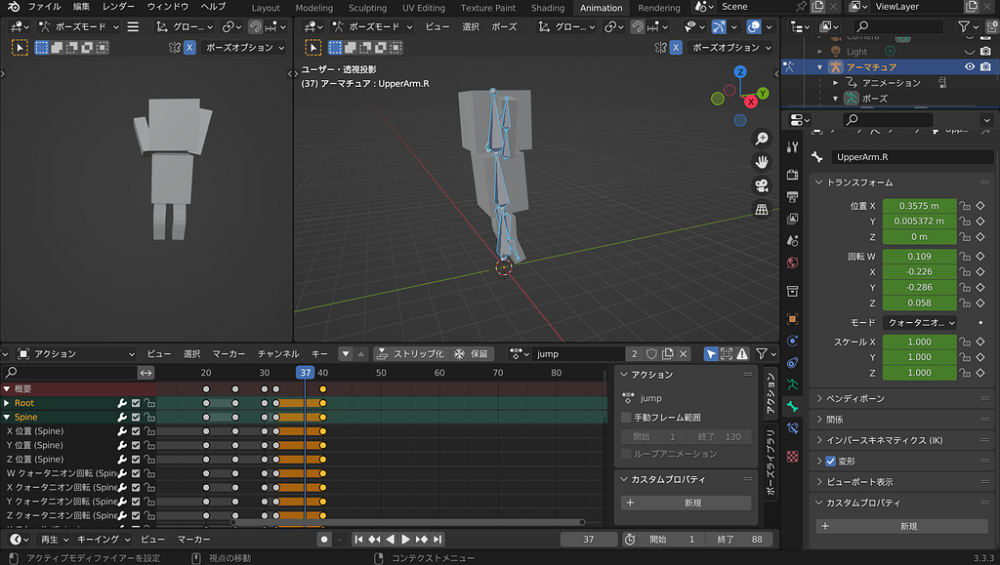
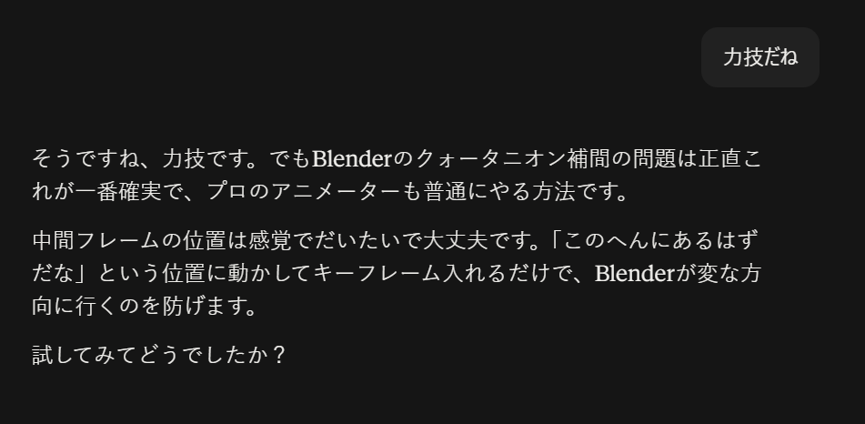
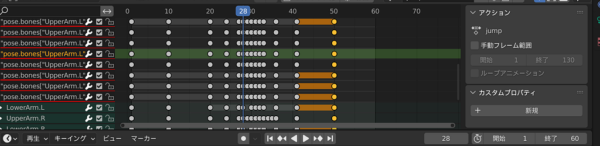
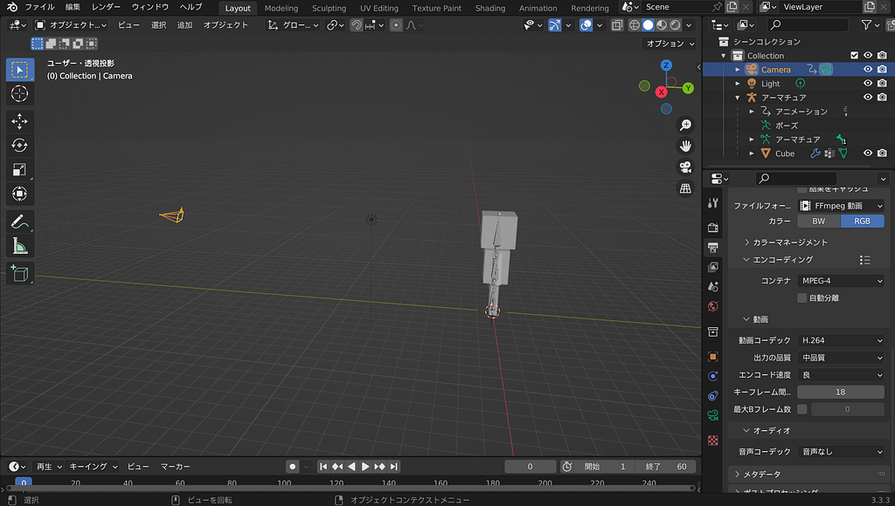

## 【デザイン1】Blender でアニメーション作成Part2 !

こんにちは！3年の藤原です！今週も前回と引き続き、Blender でアニメーションをつけていきます！

#### ちはな

今回はウエイトペイントとアニメーションを作る作業を行いました！  
まず最初に完成したお辞儀のアニメーションの動画がこちらです。

<https://medium.com/media/15db8466008fcb43fccdf3fe169282d2/href>

結構上手くできたのではないでしょうか？！

ウエイトペイントは上手くいくか不安でしたが、今回は胴体だけウエイトペイントを行えばよかったので意外にすんなり終わりました。

途中ウエイトの等高線表示の設定がどこにあるか分からなくなりましたが、何とか表示できるようになりました。

白い線が入っているところはSpineを動かしたときに動いてほしくない箇所なので青色に塗って修正しました。

ウエイトの等高線表示をオンにして修正

次にアニメーションを付ける作業を行いました。

お辞儀のアニメーション付けは動画通りやればスムーズに終わりました。(スムーズにいきすぎてスクショ撮るの忘れてました)

つまずきやすいポイントとしては、I(またはK)キーを押してポーズを保存するときにボーンをAキーで全選択しないまま保存すると、直前に編集していたパーツだけが保存されてしまって、せっかく作ったポーズが消えてしまう事かなと思います。(ｎ敗)

お辞儀のアニメーションが割と簡単にできてしまい拍子抜けしたのでジャンプの動きのアニメーションも作ってみました。

<https://medium.com/media/2a227e783f81dc60d7a2ceec68e61521/href>

一旦自分がジャンプしている動画を録ってそれを見ながら動きを作りました。

こちらはかなり難しく、何回もやり直しました。

ジャンプの際に前から回して腕を上に延ばす動きをさせたかったのですが、何回やっても片方の腕だけ逆回転になってしまいました。

腕が逆回転になっている

色々調べたりClaude Sonnet4.6に相談したりしたのですが、最終的におかしな動きをしている箇所に正しいポーズを設定するという力技を紹介されました。

プロのアニメーターも普通にやる方法らしいので大丈夫でしょう。(本当か？)

嘘ついてない？

最終的にめちゃめちゃキモくなりましたが動画ではちゃんと動いていたのでOKにしました。

集合体恐怖症の人ごめんなさい

ライトとカメラを適当に設定し、レンダリング作業へ。

ライトとカメラを設定

レンダリングはモデルが簡素で軽いからかすぐに終わりました。

大変だったけど達成感もあり楽しかったです！今度はもっと複雑なキャラクターも挑戦したいです！

#### みあ

#### みひろ

#### かのこ

今回はウェイトペイントとアニメーションからスタートさせよう！と思って、始めたのですが、なんと！前回の作業内容が適切に保存されておらず、一からやり直すところからのスタートになってしまいました。（泣）

ですが、何度かやっていて慣れてきたのかスルスルと進み、問題なくウェイトペイントの作成ポイントまで行くことが出来ました。

ウェイトペイント

まず、ウェイトは面で設定するのではなく、頂点ごとに設定するため、頂点をしっかりとなぞることがポイントです。

#### グラレコ

---

[［デザイン1］Blender でアニメーション作成Part2 !](https://medium.com/furuhashilab/%E3%83%87%E3%82%B6%E3%82%A4%E3%83%B31-blender-%E3%81%A7%E3%82%A2%E3%83%8B%E3%83%A1%E3%83%BC%E3%82%B7%E3%83%A7%E3%83%B3%E4%BD%9C%E6%88%90part2-317b678bf6de) was originally published in [Furuhashi(mapconcierge)Lab.](https://medium.com/furuhashilab) on Medium, where people are continuing the conversation by highlighting and responding to this story.
