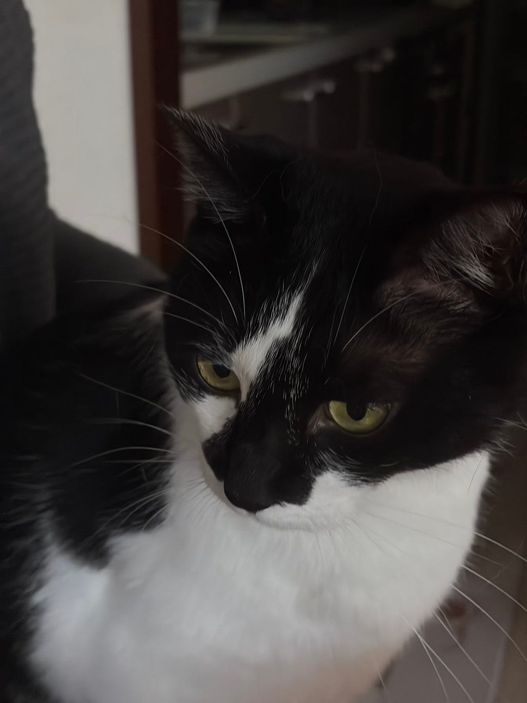
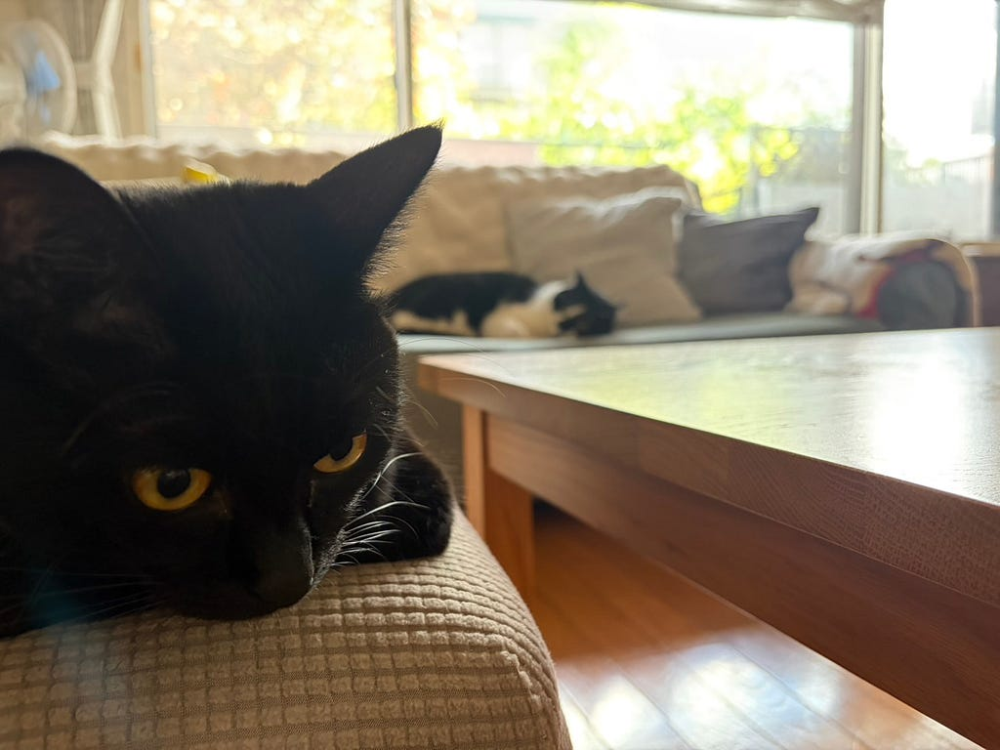
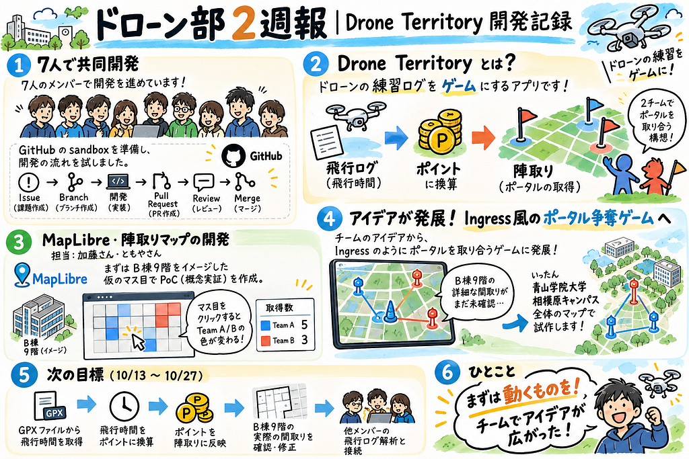

### ドローン部の練習記録を陣取りゲームに！Drone Territoryの開発

こんにちは！愛甲です^ ^  
昨日まで札幌に帰ってました！  
3年ぶりくらいに家族全員が実家に集まり、猫を吸いまくってご飯食べて、Monopolyで熱い戦いを交わしてきました。札幌は本当に涼しくて紅葉が綺麗で癒されましたね本当に。

さて、今週はMapLibre側の作業と並行して、僕はDrone Territoryを7人で共同開発するためのGitHub環境づくりを進めました。  
今回はいきなり本番環境で始めるのではなく、まず練習用のsandboxリポジトリを作成し、READMEやCONTRIBUTING、Issue・Pull Requestのテンプレートなど、共同開発を始めるための最低限の土台を用意しました。

開発の流れは、Issue → Branch → 開発 → Pull Request → Review → Mergeで進める形にしています。mainを直接編集するのではなく、それぞれがBranchを作って作業し、Pull Requestで変更内容を確認してからmainへ統合する形です。  
今回は実際に、初期ファイルを追加するIssueからBranchを作り、Pull Requestを出して、別のメンバーにReview・Approveしてもらい、mainへMergeするところまで一通り試しました。  
Mergeすると関連するIssueも自動でCloseされ、作業用Branchも整理されるところまで確認できました。

もちろん最初から全部うまくいったわけではなく、リポジトリ名を間違えて途中で修正したり、自分で作ったPull Requestは自分ではApproveできないことを忘れてたり。小さいところでコケまくりもう***血だらけ***です。  
ただ、そのおかげでGitHubの用語を覚えるだけではなく、実際の共同開発ではどういう流れで進むのかがかなりイメージしやすくなりました。  
次は各担当にも同じ流れでBranchを作って開発してもらい、少しずつ成果をmainへ統合していく予定です。  
今後は火曜日を、進捗確認やPull Requestの確認、新しい機能案を相談するタイミングとして使いながら進めていきたいと思います。  
<https://github.com/furuhashilab/furuhashilab-drone-territory-sandbox>

３年加藤です。

今回は、ドローン部で開発を進めている「Drone Territory」というアプリの紹介と、私たちが担当している陣取りマップの開発についてお話ししたいと思います！

まだ開発を始めたばかりですが、最初の試作品を作ることができたので、今回の活動を振り返りたいと思います！

### Drone Territoryとは？

Drone Territoryは、ドローンの練習記録を活用した陣取りゲームです。

ドローン部では、それぞれが異なる場所や時間に練習することが多いため、個人の練習成果をチーム全体で共有し、楽しめる仕組みがあったら面白いのではないか、というアイデアから始まりました。

具体的には、ドローンの飛行ログをアップロードすると、飛行時間に応じてポイントが付与され、そのポイントを使って陣地を取り合うというものです。

現在は、位置情報ゲーム「Ingress」のように、マップ上にポータルを設置し、2チームで取り合う仕組みを目指しています。

7人のメンバーで開発を進めており、私はともやと一緒にMapLibre・陣取りマップの部分を担当しています。

### まずは動くものを作ってみる

今回の目標は、10月13日までに「グリッドをクリックするとマスの色が変わる」という基本的な機能を実装することでした。

最初からすべての機能を作るのではなく、まずは陣取りゲームとして動くものを作ることを目指しました。

このように、アイデアが実現できるかを確認するための試作品をPoC（Proof of Concept）と呼びます。

今回はClaudeを活用しながら作業を進めました。

実際に作ってみると、思っていたよりも早く形にすることができました！

**【**[最初のバージョン（ゲーム盤面）](https://claude.ai/artifact/WBBx6J82x7vqnQNhwJ73tU)**】**

今回作成したものは、B棟9階をイメージした仮のレイアウトにマスを配置し、Team AとTeam Bがそれぞれ陣地を取れる仕組みです。

チームを選択してマスをクリックすると色が変わり、取得したマスの数も表示されます。

まだ実際の間取りとは異なりますが、ひとまず陣取りゲームの基本的な部分を動かすことができました。

また、今後の開発で修正しやすいように、部屋の配置をroomsという配列で管理し、マスの状態もcellStateで管理しています。将来的にはSupabaseと連携させ、複数人でリアルタイムに遊べるようにする予定です。

### Ingressのようなゲームに発展！

最初に作成したPoCをチームに共有したところ、Ingressのようにポータルを設置し、それを取り合う仕組みにしたら面白いのではないか、というアイデアが出ました。

ただ、現時点ではB棟9階の詳しい間取りが分からないため、ひとまず青山学院大学相模原キャンパス全体の地図を使って開発を進めることにしました。

そこから、ともやがさらに開発を進めてくれて、実際のキャンパスマップを使ったバージョンができました！

最初はシンプルなマス目のゲームだったものが、実際の地図を使ったゲームへと発展し、少しずつ完成形のイメージが具体的になってきました。

自分が作ったものをもとに新しいアイデアが生まれ、チームで形にしていくのが面白いなと感じました。

実際に作成されたものはこちらです。

* [キャンパスマップ版](https://claude.ai/artifact/BsVLqVdkZKM6ShbzoxKJLH)

### 今後の開発について

今回作成したものは、まだ最初の試作品です。

10月13日から27日までの目標は、GPXファイルをアップロードして飛行時間を取得し、その時間をポイントに変換して陣取りに反映させるところまで実装することです。

私の担当では、まずB棟9階の実際の間取りを確認し、現在の仮マップを修正していきます。

また、他のメンバーが開発している飛行ログの解析機能とつなげていく予定です。

最終的には、日々のドローン練習で獲得したポイントを使って、チーム同士でポータルを取り合えるゲームにしていきたいです。

### おわりに

今回は、Drone Territoryの最初の試作品を作成しました。

まだまだ完成には程遠いですが、実際に動くものができたことで、アプリのイメージが少し具体的になったと思います。

また、最初に考えていたグリッド型の陣取りゲームから、Ingressのようなポータル型のゲームへとアイデアが発展し、チームで開発する面白さも感じました。

技術的に分からないことも多いですが、今回の活動を通してMapLibreやSupabaseについても理解を深めていきたいです。

引き続き頑張ります！

お疲れ様でした！

---

[[ドローン部２週報]](https://medium.com/furuhashilab/%E3%83%89%E3%83%AD%E3%83%BC%E3%83%B3%E9%83%A8%EF%BC%92%E9%80%B1%E5%A0%B1-15ba07b777a1) was originally published in [Furuhashi(mapconcierge)Lab.](https://medium.com/furuhashilab) on Medium, where people are continuing the conversation by highlighting and responding to this story.
