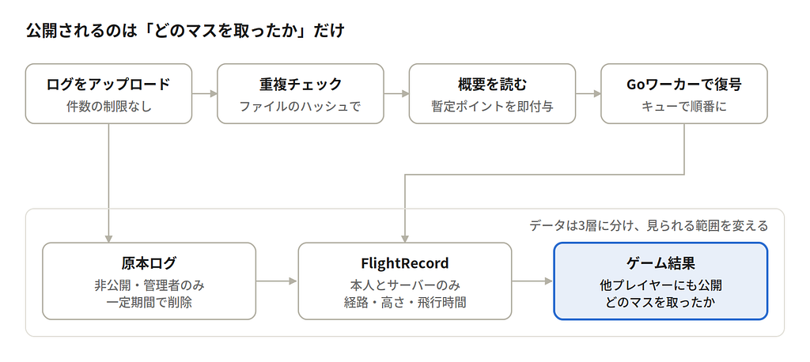
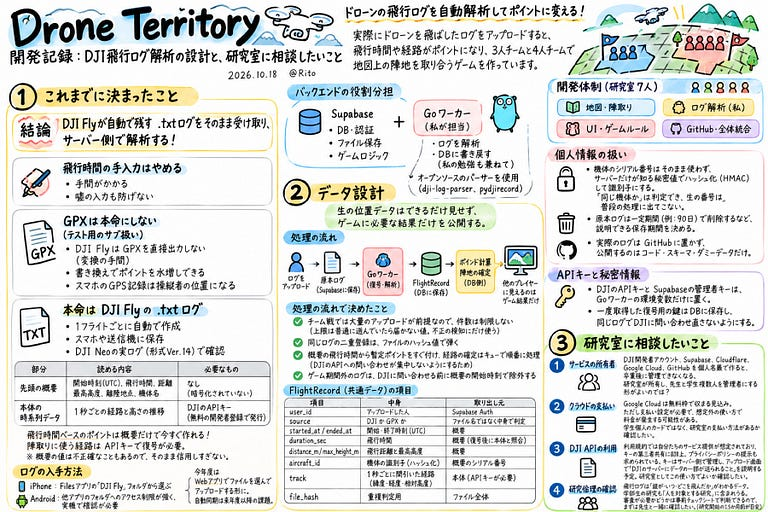

今回もヤマサキが行きます！

前回のドローン部記事の通り「Drone Territory」というゲームを作っています。  
とりあえずは、実際にドローンを飛ばしたログをアップロードすると、飛行時間や経路がポイントになり、3人チームと4人チームで地図上の陣地を取り合う、という仕組み。

開発は地図・陣取り、ログ解析、UI・ゲームルール、GitHub・全体統合の4担当に分かれていて、ヤマサキとカノコはログ解析と飛行データを担当しています。

この記事では、これまでに決まったこと、データ設計、そして研究室に相談したいことの3つを書きます。

### これまでに決まったこと

結論は「DJI Flyが自動で残す .txt ログをそのまま受け取り、サーバー側で解析する」です。そこに至るまでに決めたことを順に書きます。

**飛行時間の手入力はやめる**

最初は飛行時間を手で入力する案でしたが、実際に運用すると手間がかかり、嘘の入力も防げません。ログファイルから自動で取り出す方針にしました。

**GPXは本命にしない**

当初は「扱いやすいGPXから始める」予定でした。調べてみると、ゲームの入力としては問題が3つありました。

* DJI FlyアプリはGPXを直接出力しないので、ユーザーに変換の手間がかかる
* GPXはただのXMLテキストなので、時刻や座標を書き換えればアプリ側では違いが分からず、ポイントを水増しできる  
  それに比べてDJIのログ（.txt）は暗号化されていて、改ざんしにくい
* スマホのGPS記録アプリで作ったGPXは、ドローンではなく操縦者の位置になる

そこでGPXは、DJI以外の機体向けやテスト用のサブ扱いにしました。

### 本命はDJI Flyの .txt ログ

DJI Flyは1フライトごとにログを自動で作り、操縦に使ったスマホや送信機に保存します。メンバーが飛ばしたDJI Neoの実ログで中身を確かめました。

**① 先頭の概要部分（暗号化されていない）**

* 読める内容：開始時刻（UTC）、飛行時間、距離、最高高度、離陸地点、機体名
* 必要なもの：なし

**② 本体の時系列データ（暗号化されている）**

* 読める内容：1秒ごとの経路と高さの推移
* 必要なもの：DJIのAPIキー（無料の開発者登録で発行）

わかったのは、飛行時間ベースのポイントなら概要だけで今すぐ作れること、陣取りに使う経路にはAPIキーで復号する必要があることです。概要の一部の値は不正確なこともあったので、そのまま信用しすぎない設計にします。

### ログの入手方法

iPhoneならFilesアプリの「DJI Fly」フォルダからログを選べます。Androidは他のアプリのフォルダへのアクセス制限が強く、実機での確認が必要です。今年度はWebアプリでファイルを選んでアップロードする形にし、自動同期は来年度以降の課題にしました。

### バックエンドの役割分担

DB・認証・ファイル保存・ゲームロジックはSupabaseに任せます。Go言語のワーカーは、ヤマサキの勉強も兼ねて「ログを解析してDBに書き戻す」部分だけを担当します。ログの解析には、オープンソースのパーサー（[dji-log-parser](https://github.com/lvauvillier/dji-log-parser)、[pydjirecord](https://github.com/rembish/pydjirecord/blob/master/CHANGELOG.md)）を使います。

### 2. データ設計

設計の軸は、生の位置データはできるだけ見せず、ゲームに必要な結果だけを公開することです。

アップロードされたログは原本として保存され、Goワーカーが復号してFlightRecordを作ります。ポイント計算と陣地の確定はDB側で行い、他のプレイヤーに見えるのはゲーム結果だけです。

**処理の流れで決めたこと**

* チーム戦では大量のアップロードが前提なので、件数は制限しない。上限は普通に遊んでいたら届かない値にして、不正の検知にだけ使う
* 同じログの二重登録は、ファイルの[**ハッシュ値**](https://cybersecurity-jp.com/column/99491)で弾く
* 概要の飛行時間から暫定ポイントをすぐ付け、経路を使う陣地の確定だけキューで順番に処理する。DJIのAPIへの問い合わせが集中しないようにするため
* ゲーム期間外のログは、DJIに問い合わせる前に概要の開始時刻で除外する

**FlightRecord（共通データ）の項目**

* **user\_id**：アップロードした人（Supabase Authから取得）
* **source**：DJIかGPXか（ファイル名ではなく中身で判定）
* **started\_at / ended\_at**：開始・終了時刻（UTCで保存、概要から取得）
* **duration\_sec**：飛行時間（概要から取得し、復号後に本体と照合）
* **distance\_m / max\_height\_m**：飛行距離と最高高度（概要から取得）
* **aircraft\_id**：機体の識別子（概要のシリアル番号をハッシュ化）
* **track**：1秒ごとに間引いた経路（緯度・経度・相対高度。本体から取得、APIキーが必要）
* **file\_hash**：重複判定用（ファイル全体から計算）

**個人情報の扱い**

* 機体のシリアル番号はそのまま使わず、サーバーだけが知る秘密値でハッシュ化（HMAC）して識別子にする。「同じ機体か」は判定でき、生の番号は普段の処理に出てこない
* 原本ログは一定期間（たとえば90日）で削除するなど、説明できる保存期間を決める
* 実際のログはGitHubに置かず、公開するのはコード・スキーマ・ダミーデータだけにする

**APIキーと秘密情報**

DJIのAPIキーとSupabaseの管理者キーは、Goワーカーの環境変数だけに置きます。一度取得した復号用の鍵はDBに保存し、同じログでDJIに問い合わせ直さないようにします。

### 3. 相談したいこと

技術的にはこのまま進められそうですが、研究室として判断してほしいことが4つあります。どれも「もしかしたら必要かもしれない」段階で、早めに確認しておきたいものです。

**サービスの所有者**

DJI開発者アカウント、Supabase、Cloudflare、Google Cloud、GitHubを、4年生の私の個人名義で作ると、卒業後に誰も管理できなくなるかもしれません。IDとパスワードを共有するのではなく、研究室が所有して先生と学生複数人を管理者にする形がよいのでは、と考えています。

**クラウドの支払い**

Goワーカーを置く予定のGoogle Cloudは、無料枠で収まる見込みです。ただ、無料枠だけ使う場合でも支払い設定が必要で、想定外の使い方をすれば料金が発生する可能性があります。学生個人のカードではなく、研究室として使える支払い方法があるかを確認したいです。

D**JI APIの利用**

DJIのAPI利用規約では、自分たちのサービスを利用者に提供する目的での利用が想定されています。一方で、キーを第三者と共有することは禁止で、利用者へのプライバシーポリシーの提示も求められています（[DJI API License Agreement](https://developer.dji.com/policies/flight_record)、[DJI Developer Policy](https://developer.dji.com/policies/developer)）。キーはサーバー側だけで管理し、アップロード画面で「DJIのサーバーにデータの一部が送られること」を説明する予定です。研究室としてこの使い方でよいか確認したいです。

### もしかしたら研究倫理の確認が必要かも

飛行ログは「誰が・いつ・どこを飛んだか」がわかるデータです。大学の案内では、個人の行動や環境に関するデータの収集も「人を対象とする研究」に含まれ、学部生の研究も対象になりうるとされています（[2026年度 倫理審査のご案内](http://rs.aoyama.ac.jp/kanri/files/AGU_hitorinri_guide_202604.pdf?2604)）。

7人で遊ぶだけのゲームでも、研究として成果を発表するなら、もしかしたら該当するかもしれません。審査が必要かどうかは公式の[事前チェックシート](http://rs.aoyama.ac.jp/kanri/hitorinri.html)で判断できるので、まずは先生と一緒に確認したいです。

注意したいのはタイミングです。「審査不要」と判断してもらう場合でも、その依頼書は研究開始の1.5か月前を目安に出すよう案内されています。11月前半に7人でのプレイを始めるなら、確認は早いほどよさそう。

### グラレコ

---

[Drone Territory開発記録：ログはどうやって取ろうか](https://medium.com/furuhashilab/drone-territory%E9%96%8B%E7%99%BA%E8%A8%98%E9%8C%B2-%E3%83%AD%E3%82%B0%E3%81%AF%E3%81%A9%E3%81%86%E3%82%84%E3%81%A3%E3%81%A6%E5%8F%96%E3%82%8D%E3%81%86%E3%81%8B-8356bc5b87ce) was originally published in [Furuhashi(mapconcierge)Lab.](https://medium.com/furuhashilab) on Medium, where people are continuing the conversation by highlighting and responding to this story.
