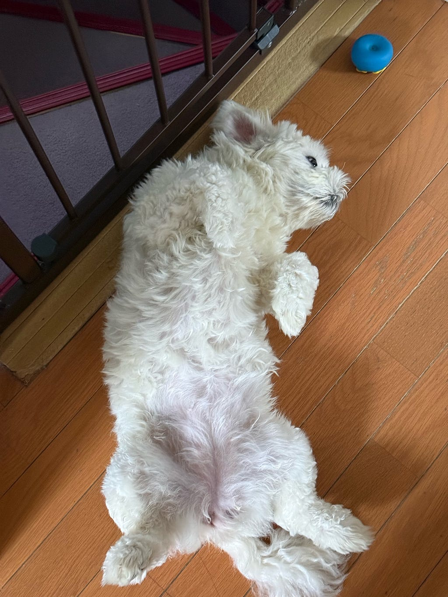
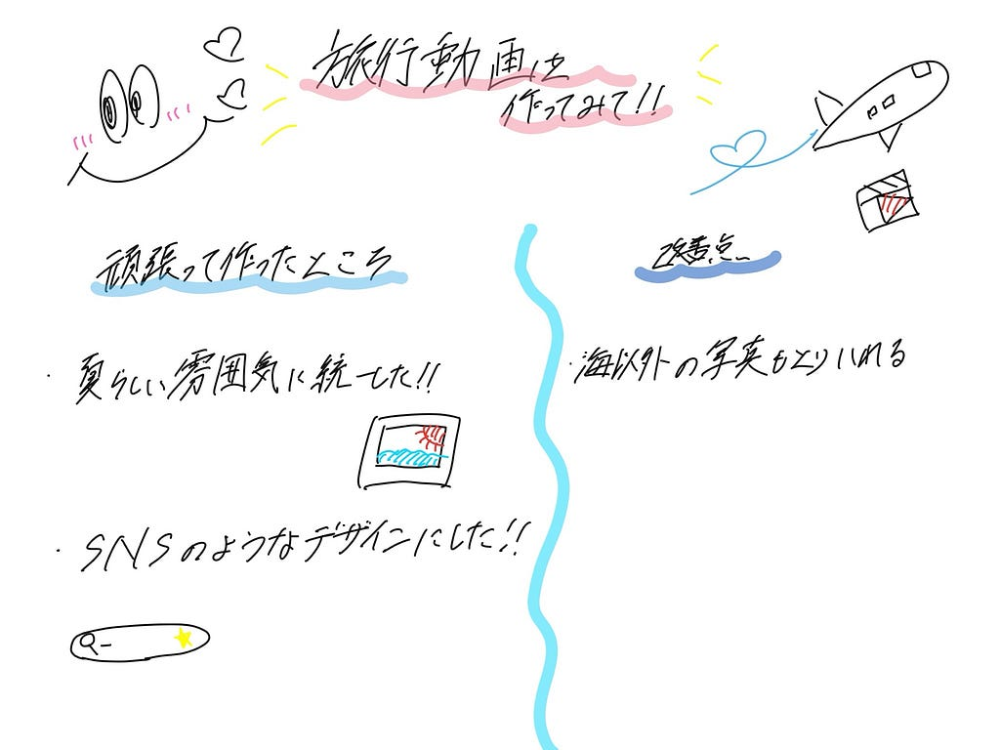

こんにちは。中溝です。朝起きたらワンちゃんがとても可愛い体制で寝てたので見て欲しいです🥹🙌🏻

今回は、夏休みにサークル合宿で行った渡嘉敷島のvlogを作りました！作ってる最中にとてもダイビングやりたくなりました笑笑

> TikTok

<https://www.tiktok.com/@furuhashilab?_r=1&_t=ZS-9AhS6MWgxVs>

> 工夫したところ

動画全体のデザインを統一しながら、写真や映像を組み合わせた点です。海やダイビング、夕日など、異なる場面を取り入れることで、夏の旅行の楽しさが伝わるように工夫しました。また、背景や星、検索バーなどの細かい装飾にもこだわり、旅行雑誌やSNSのような雰囲気に仕上げました。

> 改善点

海の写真だけでなく、現地の食事や街並みなど、さまざまな場面を撮影しておくことで、旅行の魅力をより幅広く伝えられると感じました。また、動画を制作する段階で素材が不足しないよう、旅行中から日常的に動画を撮影する習慣をつけ、後から振り返ったときに思い出や現地の雰囲気が伝わる映像を残していきたいで

> グラレコ

---

[【VF週報】](https://medium.com/furuhashilab/vf%E9%80%B1%E5%A0%B1-e3e6b047cf1d) was originally published in [Furuhashi(mapconcierge)Lab.](https://medium.com/furuhashilab) on Medium, where people are continuing the conversation by highlighting and responding to this story.
