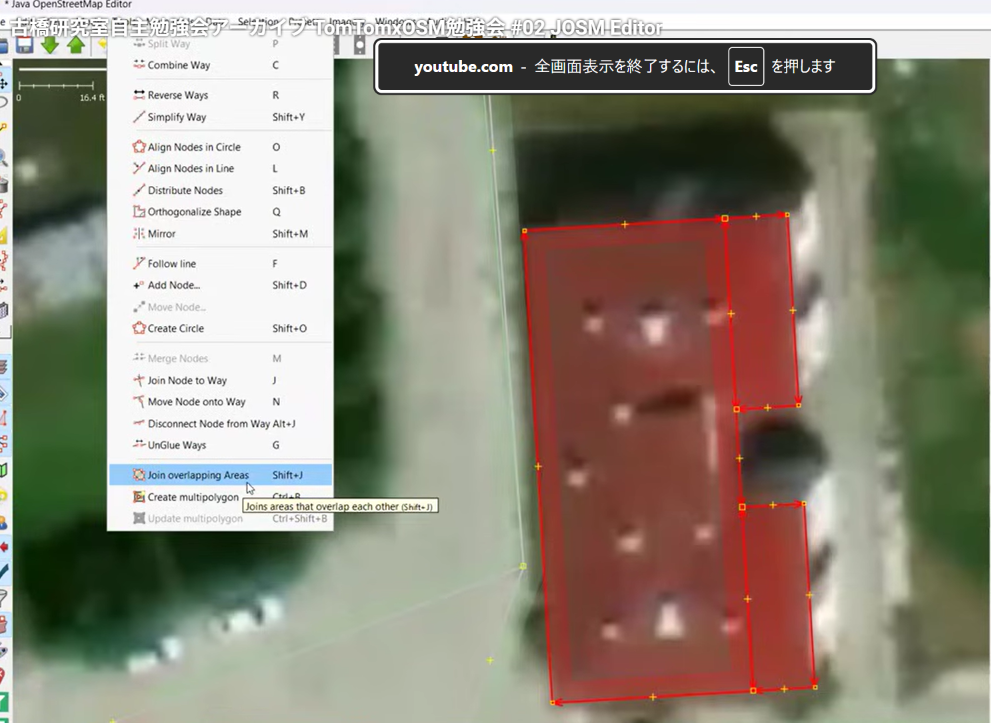
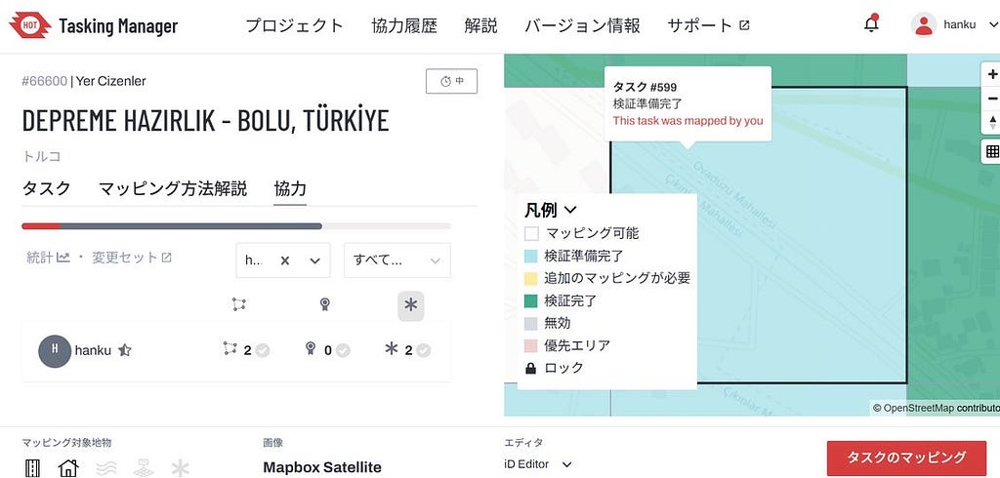
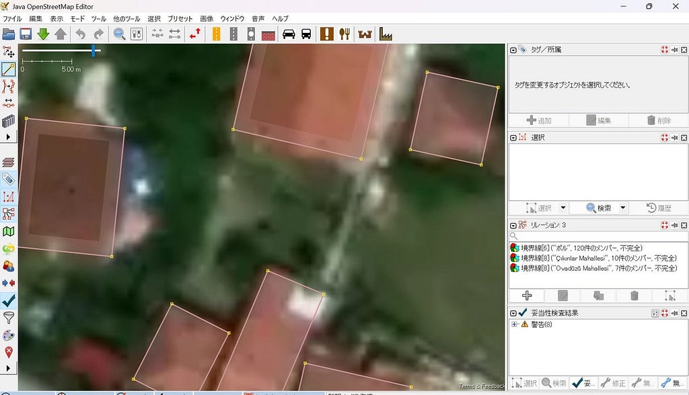
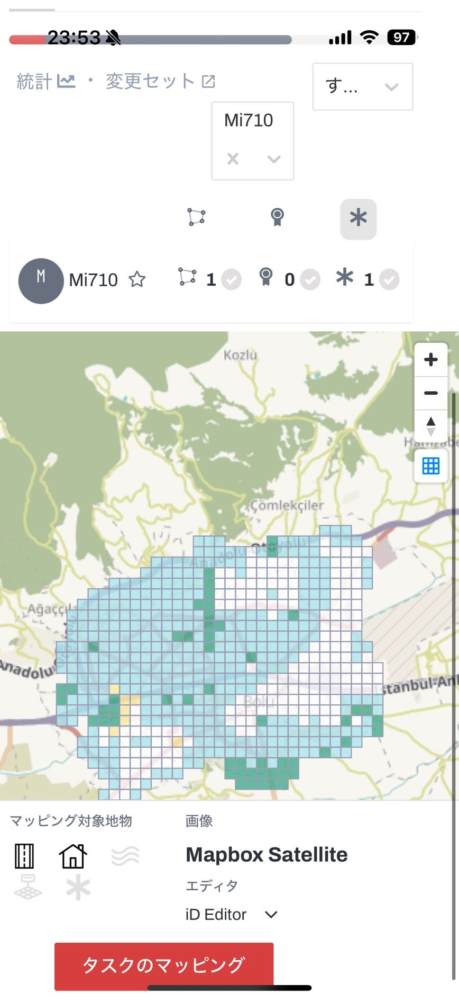
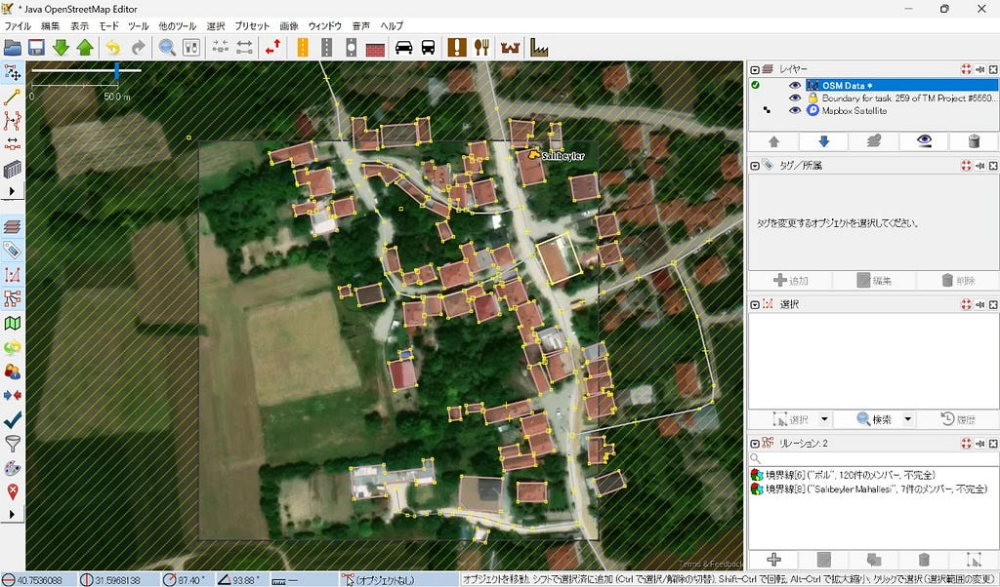
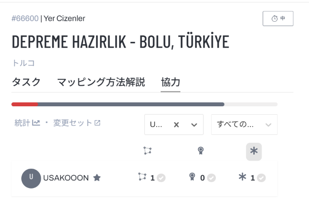
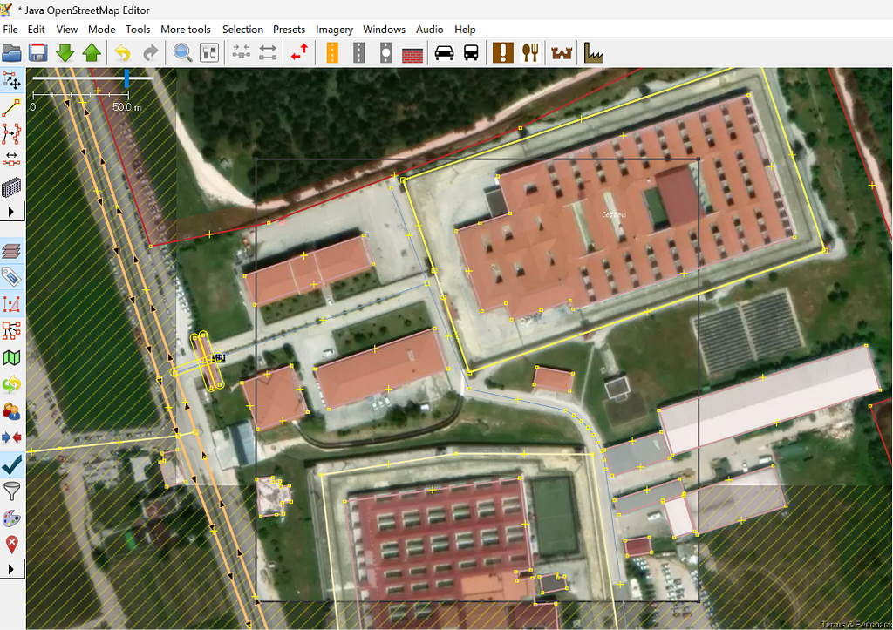
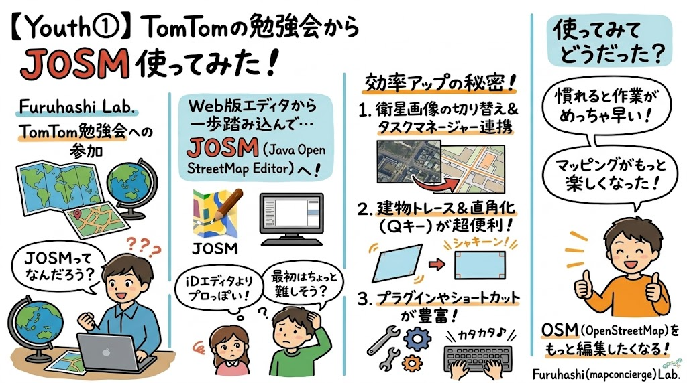

Youth①寺土日南子です。

10月13日に開催された

> 古橋研究室自主勉強会 TomTomxOSM勉強会 #02 JOSM Editor

で得た知識を元に今週はYouth①のメンバーはJOSMでマッピングをしてみました。

詳細は[こちら](https://youtu.be/L53DwLhrwyE?si=vNCRmKvUVyd1SBPp)(限定公開)

### 勉強会の内容

Copilotにまとめてもらいました。

#### 1. JOSMをTasking Managerと連携する方法

講師の John さん（TomTom / OSM Turkey）が、

* OSMアカウント認証
* Remote Control の有効化
* HOT Tasking ManagerからJOSMを起動

という基本設定を実演しています。

特に、

> *「JOSMを開いた状態でRemote Controlを有効にすると、Tasking Managerのタスクを直接JOSMへ送れる」*

という流れが説明されています。

利用しているのは HOT Tasking Manager の

**Project #66600（Bolu Province）**

で、地震リスク地域の建物フットプリント整備が目的です。

内容としては

* 建物の追加
* 道路位置の補正
* landuseと道路の分離
* 品質改善

を行っています。

#### 3. 建物は「屋根」ではなく「フットプリント」

講習の中で特に強調されている内容です。

John さんは

* 衛星画像では建物の側面が見える
* 屋根に沿って描くと位置誤差が発生する
* 高層建物は道路と重なってしまうことがある

と説明し、

> *建物は地面に接しているフットプリントを描くべき*

と解説しています。

#### 4. Building Tools プラグインの実演

JOSMの Building Tools プラグインを用いて、

* Bキーで建物作図
* C字型建物の効率的な作成⇒Shift+Jで結合(複数の建物を結合する)

<https://youtu.be/L53DwLhrwyE?si=vNCRmKvUVyd1SBPp>

* Ctrlキー＋Shiftキーで建物を回転

という実務的な作業方法を紹介しています。

#### 5. バリデータの考え方

アップロード前に

* Error → 基本的に修正
* Warning → 内容を理解して判断

というOSM品質管理の基本も説明しています。

変更セットコメントも

* buildings adjusted
* roads aligned
* landuse separated

など、何を行ったか明記することを推奨しています。

#### 6. 日本の画像利用についての議論

後半では古橋先生と

* GSI
* Bing
* Esri
* Mapbox

の比較が行われています。

特に古橋先生が、

> *日本ではGSIを基準に位置精度を確認し、BingやMapboxにオフセットがある場合は補正するべき*

と説明しています。

上記の内容を各々で確認し、1タスク以上行いました。

ふうか

みなと

ひなこ

最後、Instagramへの投稿も完了！

<https://medium.com/media/f28423cccfb837ca80e812805e9d1ddb/href>

以上です。

グラレコ

---

[【Youth①】TomTomの勉強会からJOSM使ってみた](https://medium.com/furuhashilab/10-20-tomtom%E3%81%AE%E5%8B%89%E5%BC%B7%E4%BC%9A%E3%81%8B%E3%82%89josm%E4%BD%BF%E3%81%A3%E3%81%A6%E3%81%BF%E3%81%9F-5ce67c28e32b) was originally published in [Furuhashi(mapconcierge)Lab.](https://medium.com/furuhashilab) on Medium, where people are continuing the conversation by highlighting and responding to this story.
