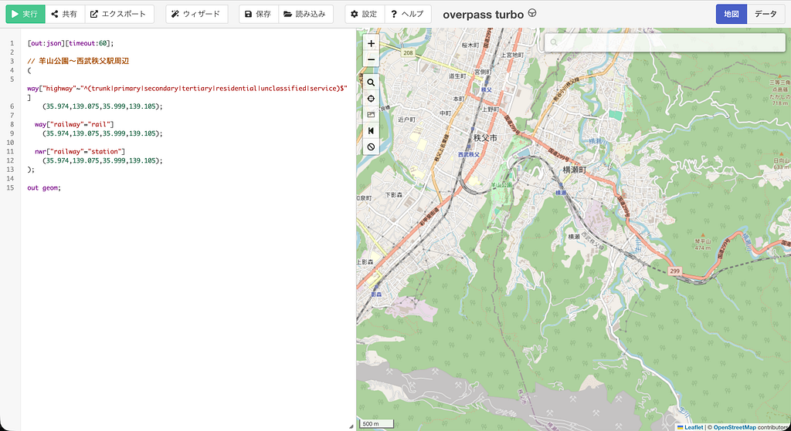
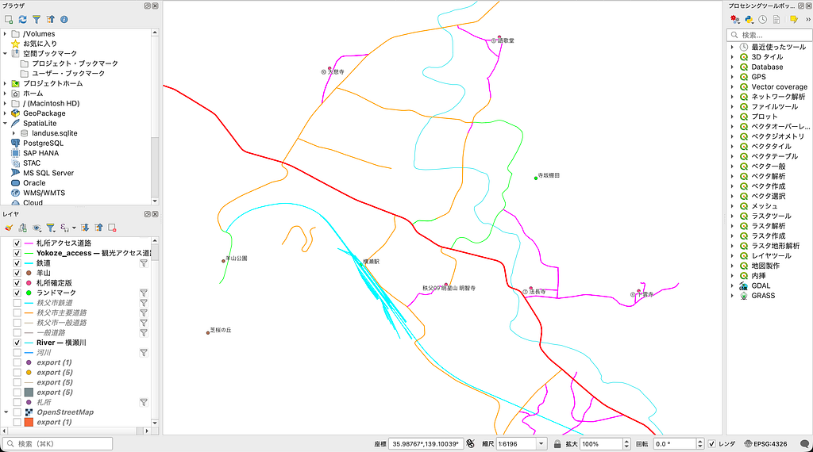
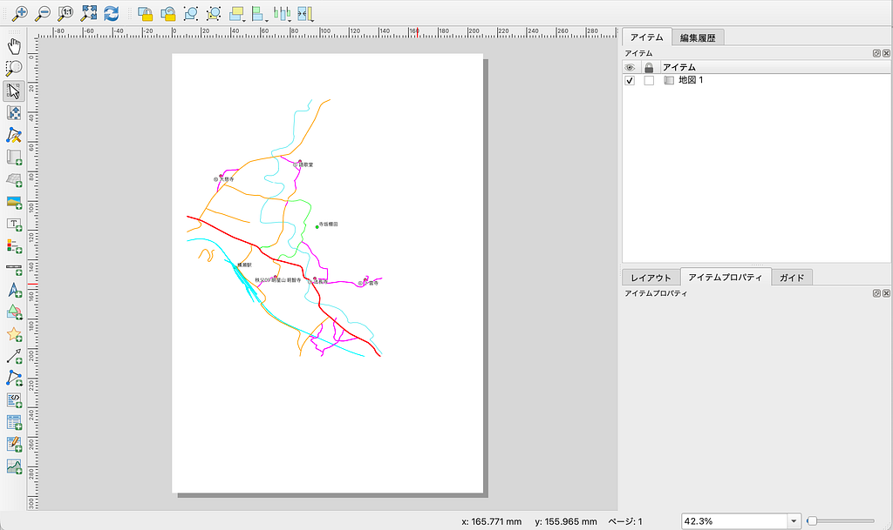
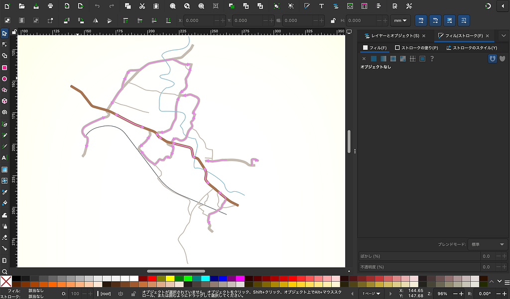
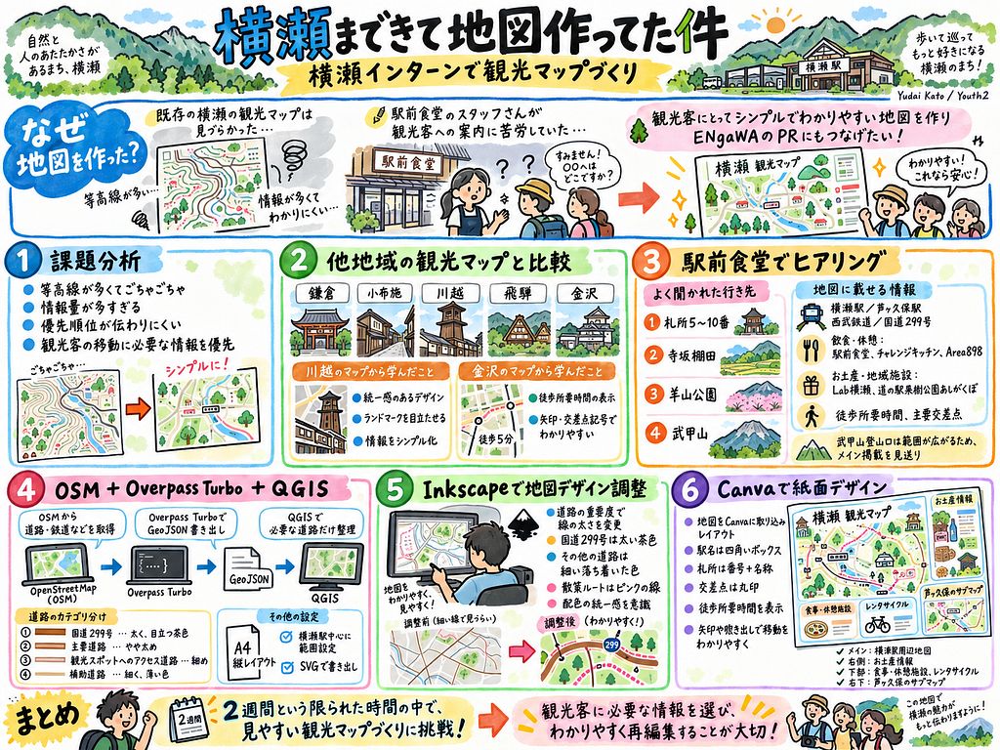

みなさんこんにちは！横瀬から帰還した加藤です。横瀬に半月もいたのになんか後期入って毎週Medium書いてる気がします。もう流石につかみのネタがありません。なんなん。ちなみにウエルシア秩父横瀬店に売ってるセイコーマートのペペロンチーノは美味しいです。安いし。

ということで日曜に帰還して中1日でYouthの週報を考える暇などなかったので横瀬インターンのメインの活動である観光マップづくりについてまとめようと思います。OSM使って作ったのでギリ許されてると思ってます。多分。

> なんで地図作ったの？

インターン期間中お世話になったENgaWAでインターン担当の橋本さんとれんせい君と僕で2週間の間に何ができるかなと考えた時に、二人の共通点の強みである「地図」を使って何かできないかなーなんて話になったところ、橋本さんに今ある横瀬町の観光マップがあまりにも見づらくて駅前食堂のレディが案内に困っているということを伺い、じゃあ見やすい地図作ったらレディも喜ぶしENgaWAのPRにもなるじゃんということで地図作りに取り組むことになりました。

<https://medium.com/media/e0f3d7ea2ca0684bc5f8b30c2dd1276b/href>
> 1.課題分析

まずは現状の観光マップの課題を洗い出すところから始めました。まず画像を見て分かるように等高線がウジャウジャと記載されていることがわかると思います。別に観光客にとって等高線の情報はあまり重要ではないですよね。それに近しいところでは、地図上に非常に多くの情報が記載されていると思います。こんなにごちゃごちゃしてると情報の優先順位が伝わりにくいです。他にも多くの課題点が洗い出され、詳細な地形や道路をすべて掲載するのではなく、観光客の移動に必要な情報を優先した地図を制作する方針としました。

> 2. 他地域の観光マップと比較

次に鎌倉・小布施・川越・飛騨・金沢などの観光マップを参考に、それぞれのデザインや情報の表現方法を比較しました。

特に川越と金沢の観光マップが非常に参考になると感じました。

* 川越

→道路や観光施設のイラスト、文字のデザインに統一感があり、全体としてシンプルに整理されている点を参考にしました。

特に、細かい地理情報を省略し、観光客に必要なランドマークを目立たせる表現を取り入れることにした。

<https://medium.com/media/92a523acd90b52525e16dd4c9b8cf24b/href>

* 金沢

→地点間の徒歩所要時間が「約○分」と表示され、移動にかかる時間を把握しやすい点を参考にしました。

また、矢印や交差点の記号を使用して、観光客が道順を理解しやすくなるような表現も取り入れることにしました。

<https://medium.com/media/37c19166c7f0baac060b048c3c46d595/href>
> 3.駅前食堂でヒアリング

観光客が実際にどのような情報を必要としているのか把握するため、駅前食堂でヒアリングを行いました。その結果、札所5〜10番、寺坂棚田、羊山公園、武甲山などについて道順を尋ねられることが多いとわかりました。特に札所については、単に施設の場所を示すだけでなく、そこまでどの道を歩けばよいのかを伝えることが重要だと考えました。

これを踏まえ、以下の情報を掲載する方針としました。

* **観光施設**：札所5〜10番、寺坂棚田、羊山公園
* **交通情報**：横瀬駅、芦ヶ久保駅、西武鉄道、国道299号
* **飲食・休憩施設**：駅前食堂、チャレンジキッチン、Area898など
* **お土産・地域施設**：Lab横瀬、地域の商品、道の駅果樹公園あしがくぼ
* **移動情報**：徒歩所要時間、主要交差点

なお、武甲山登山口については、掲載すると地図の表示範囲が広がりすぎてしまうことから、メインマップへの掲載をいったん見送りました。

> 4.Overpass Turbo APIを使って地理空間データを取得し、QGISでデータの整理(すごい！Youthにも応用できる！！！！！！！)

ここが一番Youthっぽいですね！！！！！（圧）

地図のベースとなる道路や鉄道などのデータには、OpenStreetMap（OSM）を利用しました。OSMデータの取得にはOverpass Turboを使用し、横瀬町周辺の地理情報をGeoJSON形式で書き出しました。

取得したGeoJSONファイルをQGISに読み込み、地図に使用する道路や観光施設を整理しました。特に時間をかけたのが、**観光案内に必要な道路だけを残す作業**です。最初は多数の道路が表示されていたが、これでは既存の観光マップと同じように情報量が多くなってしまいます。そこで、道路を次のように分類・整理しました。

① 国道299号

横瀬町を東西に通る主要道路として、独立したレイヤーで管理した。

② 主要道路

国道以外の比較的重要な道路を抽出した。

③ 観光スポットへのアクセス道路

札所5〜10番、寺坂棚田、羊山公園などに到達するために必要な道路を選択し、別レイヤーとして保存した。

④ 補助道路

主要道路とアクセス道路だけでは道路網が途切れて見える場所があったため、道順の理解に必要な道路を追加しました。このように、OSMの道路分類だけで機械的に表示するのではなく、観光客が目的地まで歩く際に必要な道路を個別に判断しました。

その後、QGISの印刷レイアウト機能を使用して紙面用の地図を作成しました。A4縦のページを設定し、横瀬駅を中心として札所5〜10番、寺坂棚田、羊山公園が収まる範囲に地図を配置し、その後、地図をSVG形式でエクスポートしました。SVG形式を選択した理由は、道路の線幅や色、図形の配置をInkscapeで編集できるようにするためです。

> 5.Inkscapeで地図デザインの調整

QGISから書き出したSVGをInkscapeに読み込み、観光客にとってわかりやすい地図になるよう編集しました。道路に関しては重要度によって太さを変え、国道299号を太い茶色の線、その他の道路を細い落ち着いた色の線として表現しました。また、一般道路と観光スポットへのアクセス道路を色だけで区別するのではなく、地図全体の配色を統一することを意識しました。また、観光客が道順を把握できるよう、札所や主要観光スポットへ向かう散策ルートをピンク色の線で表示しました。

> 6.Canvaでデザイン

Inkscapeで作成した地図をCanvaに取り込み、紙面全体のレイアウトを制作しました。駅名は四角いボックス、札所は番号と名称、主要な交差点は丸印など、用途によって表現方法を使い分けました。加えて、金沢のまち歩きマップを参考に、散策ルート上に徒歩所要時間を表示しました。矢印や吹き出しを利用し、観光客が移動する際の目安を確認できるよう工夫しました。紙面では、横瀬駅周辺の地図を大きく配置するとともに、右側にお土産情報、下部に食事・休憩施設やレンタサイクルの情報を配置しました。さらに、芦ヶ久保エリアについては右下にサブマップを設け、芦ヶ久保駅、国道299号、西武鉄道、河川、道の駅などの位置関係がわかるようにする構成としました。

<https://medium.com/media/b294865a7b3879872dc2f53b8dea372b/href>

2週間という限られた時間で限界点はあるながらも、ある程度の完成度までは持っていけられたかなと感じています。

ChatGPT6

---

[横瀬まできて地図作ってた件【Youth2】](https://medium.com/furuhashilab/%E6%A8%AA%E7%80%AC%E3%81%BE%E3%81%A7%E3%81%8D%E3%81%A6%E5%9C%B0%E5%9B%B3%E4%BD%9C%E3%81%A3%E3%81%A6%E3%81%9F%E4%BB%B6-youth2-18a4bf8f90ce) was originally published in [Furuhashi(mapconcierge)Lab.](https://medium.com/furuhashilab) on Medium, where people are continuing the conversation by highlighting and responding to this story.
