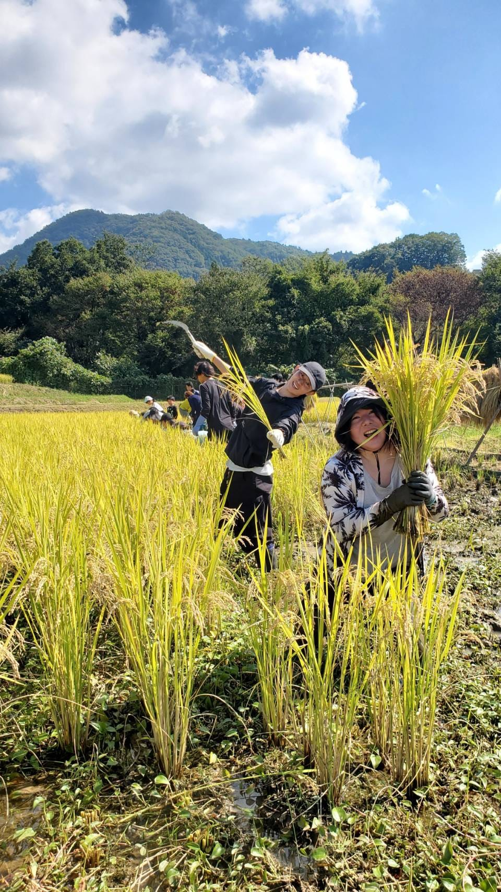
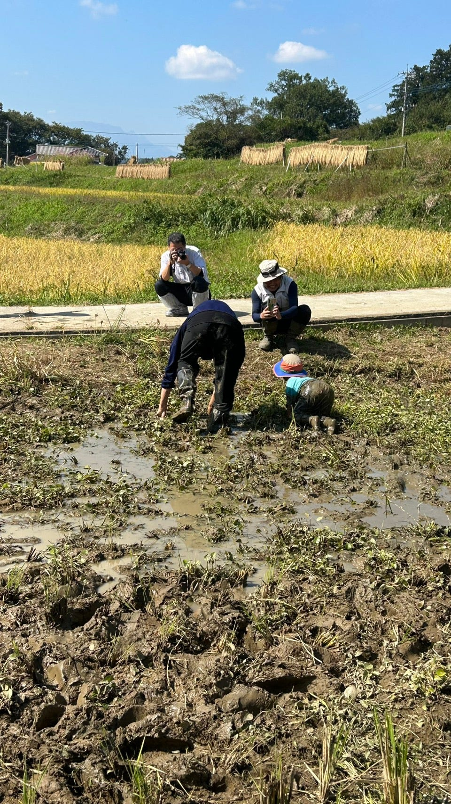
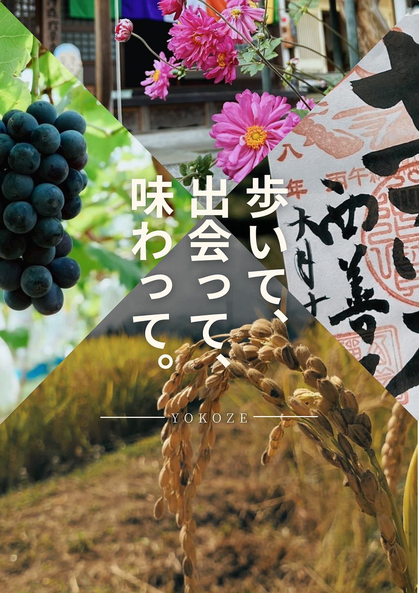
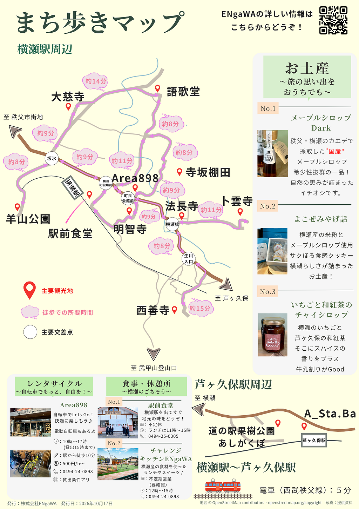
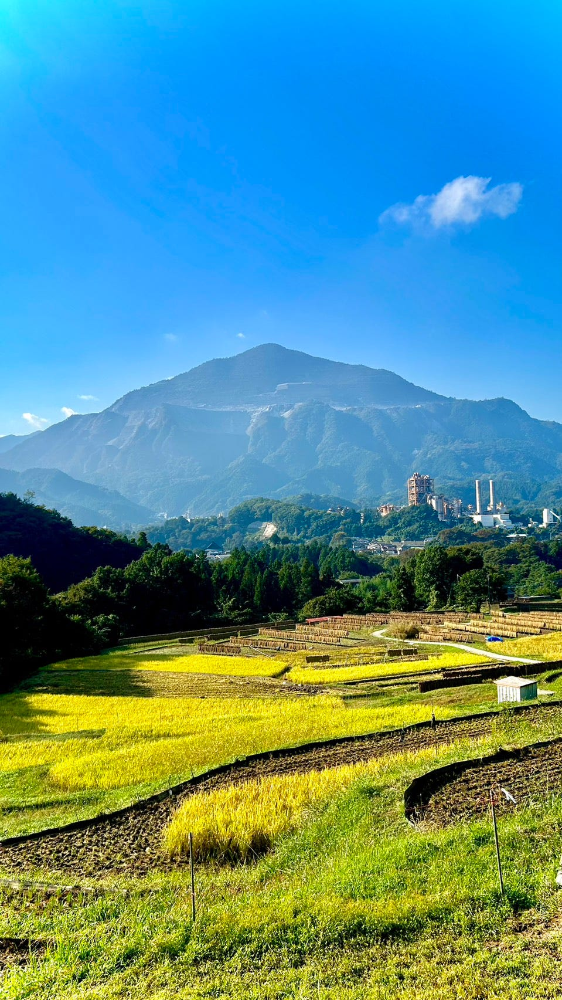
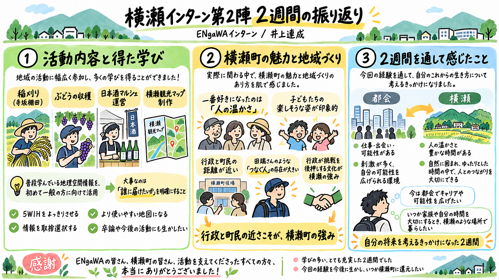

こんにちは、4年の井上です。2週間ぶりに相模原に帰ってきてこっちの夜の暑さにビビってます。横瀬では祐大と二人でぶるぶる震えていたんで季節が変わったような変な気分です。

さて、今回は、私と祐大の二人が参加してきた横瀬インターンを振り返りたいと思います。この2週間で経験したことや学んだことを簡単にまとめてみました。正直、もっと書きたいことしかないけど、頑張って短めにおさめます。

ちなみに、この2週間で新たな特技としてルービックキューブの6面完成を身に付けました。今年中に1分を切れるようになりたいです。

### ① 活動内容と得た学び

まず、活動期間中に特に多くお手伝いしたのが**稲刈り**です。ほかにも、ブドウの収穫や日本酒マルシェの運営など、さまざまな活動に参加させていただきました。

中でも印象深かったのは、寺坂棚田での稲刈りです。大型の機械が入れない棚田で米づくりを続け、あの美しい景色を守っていくことの大変さを身をもって感じました。普段何気なく食べているお米も、多くの方々の努力によって届けられているのだと実感し、農業に携わる皆さんへの感謝の気持ちが一層強くなりました。

真面目に稲刈りをする井上と子供と遊ぶ加藤

また、今回のインターンの成果として「横瀬観光マップ」の制作にも取り組みました！

普段ゼミで学んでいる地理空間情報の知識を、初めて一般の方々に向けて活用する機会となりました。

そこで特に感じたのが、**「誰に情報を届けたいのか」を明確にすることの大切さ**です。5W1Hをはっきりさせ、利用する人の立場で情報を取捨選択することで、より使いやすい地図になると学びました。この経験は今後の卒業論文にも生かしたいですし、同じように地図づくりに取り組むみんなにも共有していきたいと思います！

作成したパンフレットです

### ② 横瀬町の魅力と地域づくり

この2週間で横瀬町の一番好きになったところは、何といっても「人の温かさ」です。

皆さん本当に優しく、何より生き生きとした表情をしているのが印象的でした。特に、稲刈り体験などで出会った子どもたちの楽しそうな姿は忘れられません。自然の中でさまざまな経験をしながら、のびのびと成長できる環境は本当に素敵だなと感じました。自分が将来子育てをするなら、こんな環境で育ってほしいなと思いました（笑）。

また、地域づくりという面でも多くの発見がありました。

特に印象的だったのは、**行政と町民の距離の近さ**です。町長や副町長が地域のイベントに自然と顔を出し、田端さんのように行政と町民をつなぐ方がいる。こうした関係性こそが、横瀬町の大きな強みなのではないかと感じました。

地域を盛り上げようとする町民の思いに、行政が寄り添い、挑戦を後押しする。その仕組みや文化があるからこそ、さまざまな取り組みが生まれているのだと思います。今後、町のリーダーが変わってもこの文化が受け継がれてほしいですし、横瀬町のような関係性をほかの地域でも生み出すにはどうすればよいのか、とても興味が湧きました。

### ③ 2週間を通して感じたこと

一方で、今回の経験を通して、都会の良さも改めて感じました。

休日に池袋を訪れた際、人の多さや騒がしさに少し疲れた反面、仕事や人との出会いなど、さまざまな可能性が広がっていることも実感しました。

今は都会で自分自身のキャリアや可能性を広げることに挑戦したい。でも、いつか家族や自分の時間を大切にするようになったときには、横瀬のような場所で暮らしたい。そんなふうに、自分の将来について考えるきっかけにもなった2週間でした。

最後になりますが、今回のインターンで関わってくださったENgaWAの皆さん、横瀬町の皆さん、そして活動を支えてくださったすべての方々、本当にありがとうございました！

皆さんのおかげで、学びの多い、とても充実した2週間になりました。

今回の経験を今後の人生に生かすとともに、いつか自分も横瀬町に何かを還元できたらと思います。

最後にお気に入りの写真です

グラレコです

---

[【横瀬部週報】横瀬インターン第2陣が終了！今回は何してきたん？](https://medium.com/furuhashilab/%E6%A8%AA%E7%80%AC%E9%83%A8%E9%80%B1%E5%A0%B1-%E6%A8%AA%E7%80%AC%E3%82%A4%E3%83%B3%E3%82%BF%E3%83%BC%E3%83%B3%E7%AC%AC2%E9%99%A3%E3%81%8C%E7%B5%82%E4%BA%86-%E4%BB%8A%E5%9B%9E%E3%81%AF%E4%BD%95%E3%81%97%E3%81%A6%E3%81%8D%E3%81%9F%E3%82%93-2479f79f9a8d) was originally published in [Furuhashi(mapconcierge)Lab.](https://medium.com/furuhashilab) on Medium, where people are continuing the conversation by highlighting and responding to this story.
