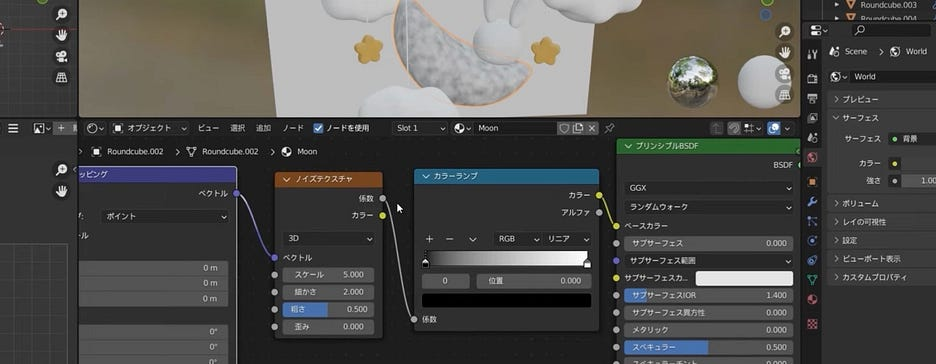
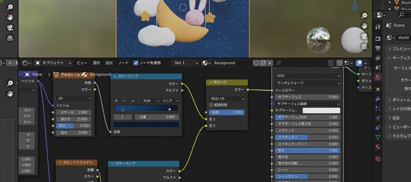
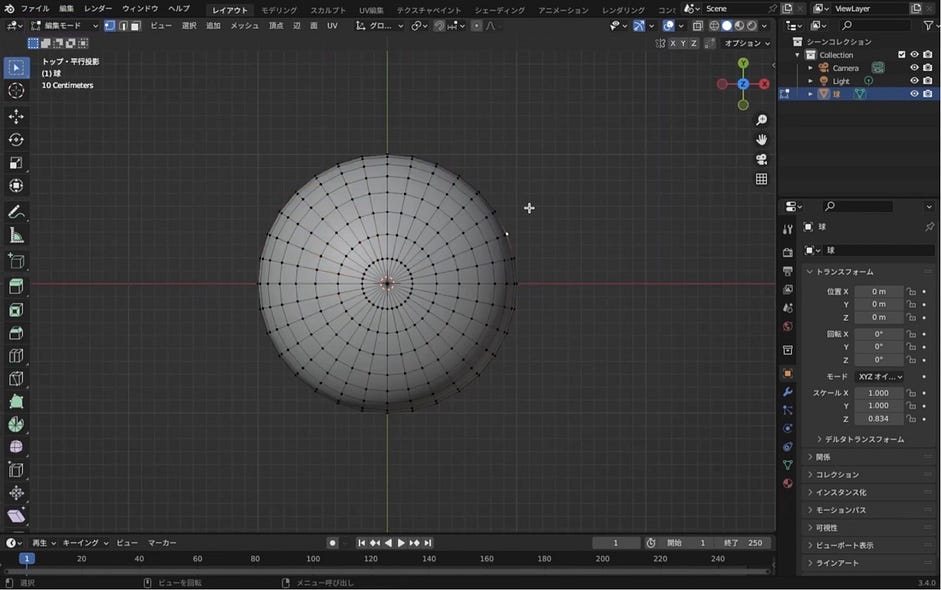
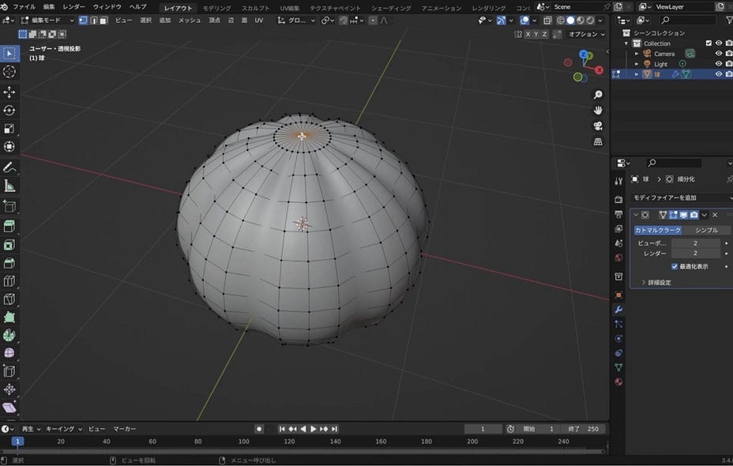
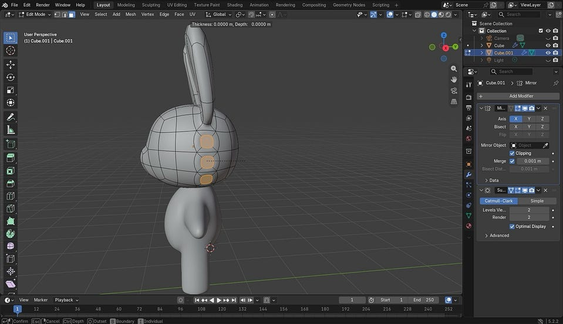
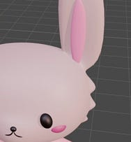
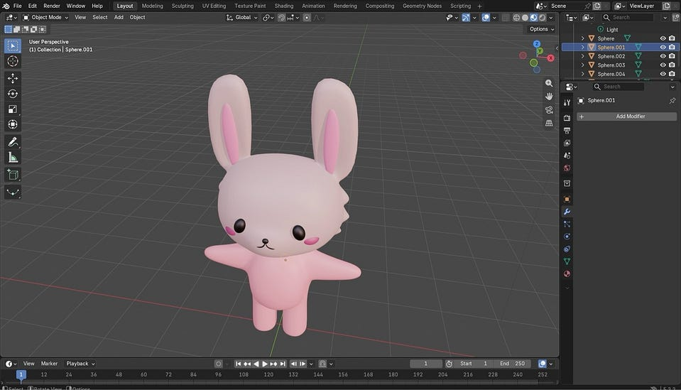
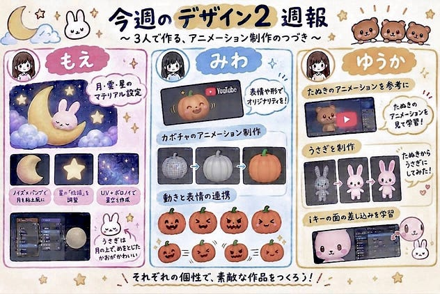

こんにちは、4年の安生です。今週もそれぞれ作品作りを進めました。

【もえ】

今回はマテリアル設定の作業から始めました。

同じマテリアルを使い回す雲や紐などのオブジェクトは、一つ設定を作ったあとに「マテリアルをリンク」という機能を使って一括で適用するようにしました。星のマテリアルは、後から中に配置するライトの光が外へ透けて見えるように、「伝播」のパラメーターを上げる設定にしました。

月は、のっぺりとした見た目を避けるため、ノイズテクスチャとカラーランプを組み合わせて手作りの粘土のような色ムラを作りました。作業前に「Node Wrangler」のアドオンを有効にしておき、ショートカットキーでテクスチャ座標を呼び出し、「オブジェクト」に繋ぎ直すことで模様が均一になるように整えました。さらにバンプノードを繋いで、表面にわずかな凹凸を足してリアルな質感を出しました。

宇宙風の背景も、ノイズテクスチャとカラーランプでベースの模様を作りましたが、こちらはテクスチャ座標を「UV」に繋ぐようにしました。そこに、ボロノイテクスチャで作った無数の小さな星を「RGBミックス」ノードの「明るい方」というブレンドモードを使って合成し、星空を表現しました。背景が光を反射すると不自然になるため、マテリアルの粗さを最大にして、光沢のないフラットな背景にしました。

【みわ】

前回の雨のアニメーションが完成したので、今回はハロウィンが近いためカボチャのモデリングを行います！

今回使用する動画です！⬇️

<https://medium.com/media/ee4abc4a4b734c0a3368d565b9131158/href>

顔の表情だったり、カボチャの形など自分なりに変化させてオリジナルのカボチャを作成しようと思います！

今回はカボチャ本体のモデリングから始めました。形状の調整まで進めたので、次は顔のパーツ作成に入ります。🎃

作業が早く終わりそうな作品なので、次回までに顔とヘタの部分を完成させて色付けまでいきたいです！

【ゆうか】

前回までのガチャガチャアニメーションを終えて、今回は新しい作品を始めました。

去年作っていたクマのキャラクターを思い出し、キャラクターが動いたら楽しいだろうと感じたため、今回は、YouTubeのたぬきアニメーション動画をお手本に、好きな動物を作って動かすところまでやってみようと思います。

<https://medium.com/media/2225ad59754abd1f3fe04389694bfe6f/href><https://medium.com/media/23337082090345f6befca571ed1bf23d/href>

今回の学びとしては、iキーは1回押すだけだと面の差し込みもひとつになりますが、2回押すと、複数面選択したそれぞれに面の押し込みをすることができるというものでした。

うさぎにしましたが、動画のたぬきのように毛を生やしました

来週からはマテリアルのお腹色塗りから頑張ります

毎週進めていく中で、同じ作業が出てくることもあり、だんだんBlenderにも慣れてきたかなと思います。来週からもそれぞれ作品作りを頑張っていきたいです。

グラレコ

ChatGPT 5.6 Luna, 2026–10–26

---

[【デザイン2】Blender進捗報告](https://medium.com/furuhashilab/%E3%83%87%E3%82%B6%E3%82%A4%E3%83%B32-7aa965247336) was originally published in [Furuhashi(mapconcierge)Lab.](https://medium.com/furuhashilab) on Medium, where people are continuing the conversation by highlighting and responding to this story.
