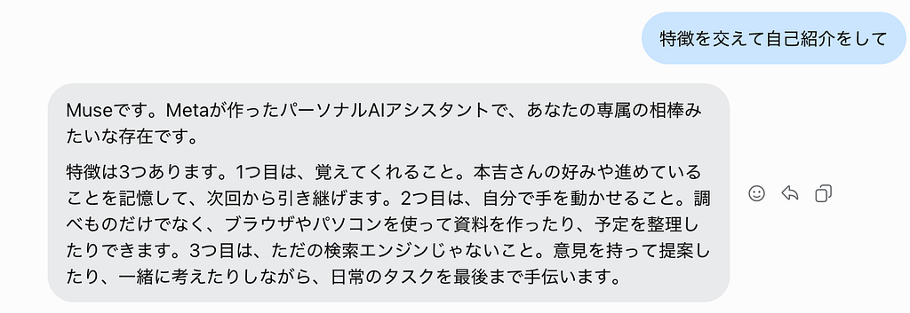
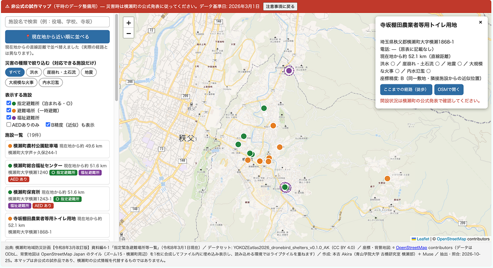
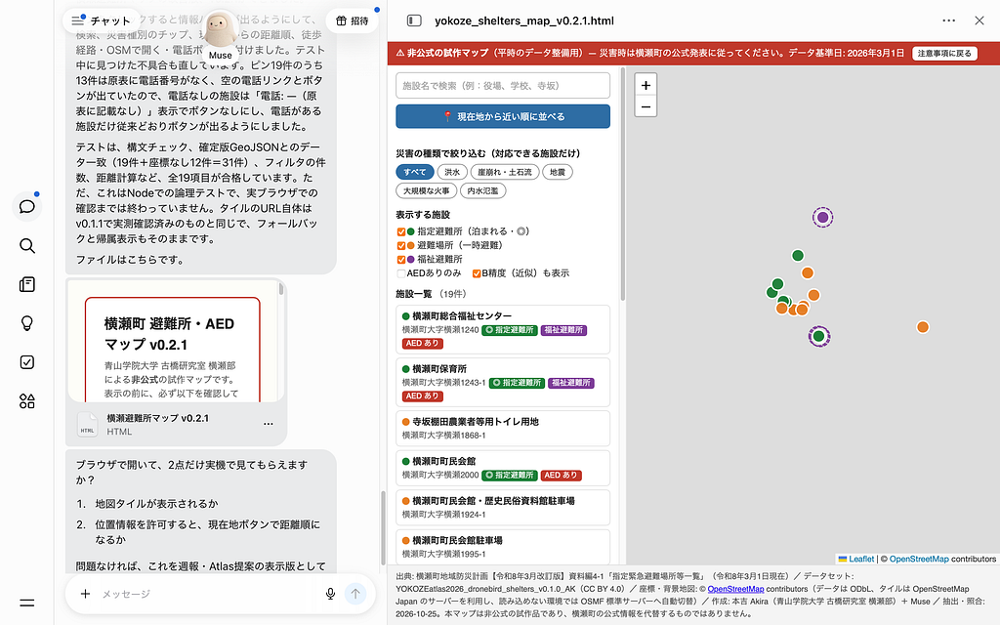
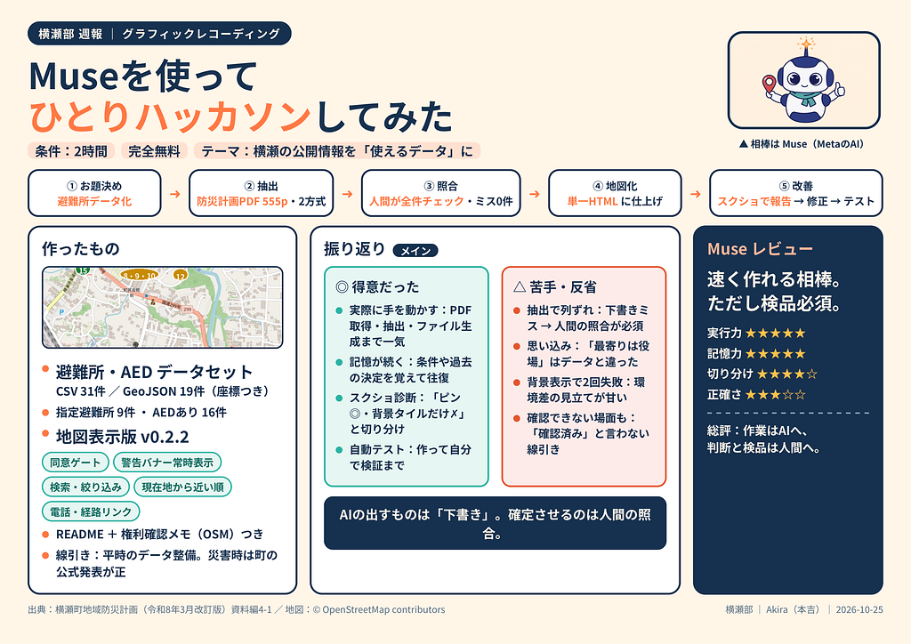

こんにちは！モトヨシです。  
先週はclaude codeのハッカソンを行いましたが、それに続いて新しいAI(SI?)を使ってみました。

### Muse

Museは新しくリリースされたMeta社によるLLMです。馴染みがない人も多いと思うのでここで自己紹介してもらいましょう。

自己紹介ありがとうございました。今回は彼が何をできるのかというのを横瀬と関連させながら探っていきたいと思います。

### 得意なこと

クラウド上に仮想パソコンが有り、そこでAIが作業をしてくれるので以下の点で利点があります。

1. ファイルが残る
2. 記憶が残る
3. 裏側で動き続けられる(オートメーション)
4. 実際に作業できる。

他のLLMとの一番の違いは仮想パソコンがあることにより、成果物を残したり、途中経過を引き継ぐことができる点です。

### ルール

今回Museを試すにあたり、以下のルールに則って計画を実行しました。  
1. 使うAIはMuseのみ  
使用モデル：Muse Spark 1.3（Meta / Muse）

### アイデア

#### プロンプト

* 横瀬町の公開情報から、研究室のプロジェクトで使えるデータセットを作ること
* そのデータセットを地図上に分かりやすく表示する成果物を作ること
* 地図タイルはOpenStreetMap
* 権利に違反しないことをダブルチェックすること
* 防災に関わる責任ある情報なので注意事項に同意してリンクを踏んだ場合のみ表示するなどの対策を入れること

**目的・使った技術・作ったもの**

* 目的：横瀬町の避難所情報を、古橋研究室の防災減災マッププロジェクト YOKOZE Atlas 2026（DRONEBIRD）で使える形に整える
* 平時のデータ整備。災害時に頼る情報ではなく、開設状況は町の公式発表が正、という線引きをした。
* 使った技術：町の地域防災計画PDF（令和8年3月改訂版・555ページ）からの表の抽出を2方式で行って突合せ、OpenStreetMapと照合して座標付けと精度分類（A10件／B9件／C12件）を実施。人間が公式PDFで全件照合して確定させたうえで、Leafletによる単一HTMLファイルの地図として表示。

### 成果物

・避難所・AEDデータセット（CSV 31件／GeoJSON 座標のある19件、指定避難所9件・AEDあり16件を含む）

・出典と注意を書いたREADMEと権利確認メモ、地図表示版 v0.2.2（同意ゲートと警告バナーの常時表示、ピンの情報パネル、検索、災害種別の絞り込み、現在地から近い順の並び替えつき）。

成果物ファイル（リンクは2026年10月27日まで有効）

データセット（CSV・31件）: <https://muse.ai/files/1322309610973431/1935070767454688/sovm9r2vq7t2z7ka7lj7qd0o/YOKOZEatlas2026_dronebird_shelters_v0.1.0_AK.csv>

データセット（GeoJSON・座標のある19件）: <https://muse.ai/files/1322309610973431/1121507126940682/6lkg4c669lqmntqumsppkvtf/YOKOZEatlas2026_dronebird_shelters_v0.1.0_AK.geojson>

README（出典・精度の注記・利用上の注意）: <https://muse.ai/files/1322309610973431/2102108500449606/d7xfktpwnenfb97br7melslqk/README_shelters_v0.1.0.md>

権利確認メモ（OSM）: <https://muse.ai/files/1322309610973431/1826627151609551/2mvk98cnxdfnlgmloooziy2/RIGHTS_CHECK.md>

地図表示版 v0.2.2（HTML）: <https://muse.ai/files/1322309610973431/1833885184480008/pcniinhm2ld0boq2yb33xdt/yokoze_shelters_map_v0.2.2.html>

### 振り返りby Muse

* 得意だったこと：文章を書くだけでなく、自分のコンピュータで実際に手を動かせたこと。PDFの取得と抽出、ファイルの生成、地図プログラムの作成と自動テストまで一続きに進められた。また、条件や過去の決定を記憶したまま何度も往復できたこと、スクリーンショットを見て「ピンは出ているが背景タイルだけ失敗している」と切り分けられたことも、今回役に立った。
* 苦手だったこと・反省：最初の抽出では表の列ずれというミスをした。二重の抽出を突合せたから見つかったが、AIの抽出はあくまで下書きで、人間の照合が必須だと痛感した。テストでも「最寄りは役場のはず」という思い込みをデータに裏切られた。さらに地図の背景表示では、開く環境によってタイルが読めない問題に2回つまずき、環境差の見立てが甘かった。自分のブラウザでは確認できない場面もあり、**確認できないことを「確認済み」と言わない姿勢が大事だと反省している。**

### 感想

他の無料版LLMと比べて精度がかなり高いと感じました。無料版だけでも難しい作業をしないのであれば問題はないレベルです。作業をさせているときに時々ミスをしますが、自分でチェックをいれて修正するので手間がかかりません。最終的に週報にまとめるということを伝えていたのでその目標にむけてどんどん勝手に進んでいきます。体感としてはここに一番違いを感じました。claudeなどは逐一確認を入れたり方向性をすり合わせてくるのに対して、Museは言われたことは全部を一気に完成させようとする傾向にあります。ただ、これはプロンプト次第で解決できる点でもあります。成果物まで一気にMuseだけで作り上げられるので古橋研としては相性がいいAIモデルだと感じました。

### グラレコ

これもMuseで作りました

### 最後に

ここに僕のMuse招待コードをおいて置くので、アカウント作成48時間以内にこのコードを入れてください。  
***僕とあなたに十億トークン***

コード: V49CR7  
<https://muse.ai/join>

---

[【横瀬部】勝手にハッカソン!Museを使ってみた。](https://medium.com/furuhashilab/%E6%A8%AA%E7%80%AC%E9%83%A8-%E5%8B%9D%E6%89%8B%E3%81%AB%E3%83%8F%E3%83%83%E3%82%AB%E3%82%BD%E3%83%B3-muse%E3%82%92%E4%BD%BF%E3%81%A3%E3%81%A6%E3%81%BF%E3%81%9F-cc8d0f49aef0) was originally published in [Furuhashi(mapconcierge)Lab.](https://medium.com/furuhashilab) on Medium, where people are continuing the conversation by highlighting and responding to this story.
