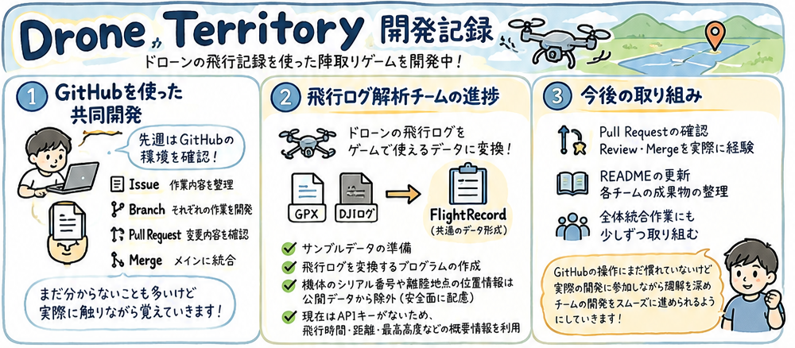

こんにちは！中川です。

今週も「Drone Territory」の開発を進めました！

今回は、GitHubを使った共同開発の取り組みと、飛行ログ解析チームの進捗について紹介します。

### GitHubを使った共同開発

先週は、ともやが整備してくれたGitHubの環境を確認し、共同開発の進め方について理解を深めました。

今回の開発では、Issueで作業内容を整理し、それぞれのBranchで開発を進め、Pull Requestを通して変更内容を確認した後、ReviewやMergeを行うという流れで作業を進めています。

これまではIssueやPull Requestなどの言葉を聞いても、具体的にどのように使うのか、あまり理解できていませんでした。

そこで、まずはリポジトリの構成や各チームの役割、GitHub上での作業の進め方を確認することから始めました。

まだ分からない部分も多いですが、実際にGitHubを触りながら少しずつ覚えていきたいと思っています。

### 飛行ログ解析チームの進捗

今週は、りとさんを中心に飛行ログ解析の開発が進みました。

Drone Territoryでは、ドローンの飛行時間や距離などをもとにポイントを計算し、ゲームに反映させる仕組みを目指しています。

そのため、現在はGPXやDJIの飛行ログから必要な情報を読み取り、「FlightRecord」という共通のデータ形式に変換する仕組みを開発しています。

今週は、動作確認に使用するサンプルデータの準備に加え、飛行ログをFlightRecordに変換するプログラムが作成されました。

また、実際のDJIログには機体のシリアル番号や離陸地点の位置情報などが含まれているため、公開するデータからこれらを除外するなど、プライバシーや安全面にも配慮しています。

現在は、DJIの飛行経路を取得するためのAPIキーがないため、飛行時間や距離、最高高度などの概要情報を利用する方針です。

詳しい開発内容はこちらから確認できます。↓

* [GitHub Issue #16：飛行ログ変換ツール](https://github.com/furuhashilab/furuhashilab-drone-territory-sandbox/issues/16)
* [GitHub PR #17：FlightRecord変換ツールの実装](https://github.com/furuhashilab/furuhashilab-drone-territory-sandbox/pull/17)

### やってること

**GPX → FlightRecord**

①GPXは中身がそのまま読めるので、Goが自分で全部計算します。

②XMLを読む：encoding/xmlで、<trkpt>（記録の点）を1つずつ、緯度・経度・高度・時刻として取り出す。

③時刻を確認する：時刻がない点があれば、飛行時間を計算できないのでここでエラーにする（synthetic\_no\_time.gpxがこれに当たる）。

④時刻から計算する：最初の点の時刻をstarted\_at、最後の点の時刻をended\_at、その差をduration\_secにする。

⑤距離を計算する：隣り合う点どうしの距離をhaversine式（地球の丸みを考えた2点間の距離の式）で求め、全部足してdistance\_mにする。

⑥高さをそろえる：GPXの高度は海抜なので、最初の点の高度を0として引き算し、「離陸地点からの高さ」に直す。その最大値がmax\_height\_m。DJIの高さと意味をそろえるための処理です。

⑦経路を作る：各点を「開始から何秒後・緯度・経度・相対高度」の形にしてtrackに入れる

**DJI → FlightRecord**（今回の動作チェックで使った本当のデータは山﨑のパソコンにあり、レポジトリにあげているJSONはシリアルや座標の値だけダミーに差し替えたもの**）**

①DJIのログはバイナリで、Goだけでは読めないので、読み取りはdjirecordに任せ、Goは結果を整理する係です。

②djirecordを呼び出す：Goがdjirecord – json ファイル名を実行し、出力されたJSONを受け取る。APIキーは渡さないので、djirecordが読めるのは暗号化されていない概要部分だけ。

③必要な値だけ拾う：概要のJSONから、開始時刻・飛行時間・距離・最高高度・機体名を取り出してFlightRecordの項目に入れる。

④機体シリアルをハッシュ化する：シリアル番号は、秘密の鍵（FLIGHT\_ID\_SECRET）を使ってHMAC-SHA256で別の文字列に変換し、aircraft\_idにする。「同じ機体か」は判定できるけれど、元の番号には戻せない。

⑤不要な値は捨てる：離陸地点の座標、カメラやバッテリーのシリアル、地名、動画時間などは、FlightRecordに入れずにここで捨てる。

⑥経路は空にする：本体を復号していないのでtrackは空、parse\_levelはsummaryにする。

#### 結局GPX使うのか

今回の動作チェックでGPX使っているから、どうするんだと疑問に思っていることでしょう。

結論   
補助的に残す  
理由  
DJIだけではなく、他のドローンでも遊べるようにしたいから(\*^◯^\*)  
しかし  
前回の報告でもしたようにGPXはテキストなので容易に改ざんができてしまう→ポイントを少し減らすとかにしようかなぁなんて思ったり

### 今後の取り組み

今後は、各チームが作成したPull Requestの内容を確認し、ReviewやMergeまでの流れを実際に経験してみたいと考えています。

また、READMEの更新や各チームの成果物の整理など、自分が担当する全体統合の作業にも少しずつ取り組んでいきたいです。

まだGitHubの操作には慣れていませんが、実際の開発に参加しながら理解を深め、チームの開発をスムーズに進められるようになりたいと思います。

引き続き、Drone Territoryの開発を進めていきます！

#### グラレコ

GPT-6

---

[Drone Territory開発記録：GitHubでの共同開発と飛行ログ解析の進捗](https://medium.com/furuhashilab/drone-territory%E9%96%8B%E7%99%BA%E8%A8%98%E9%8C%B2-github%E3%81%A7%E3%81%AE%E5%85%B1%E5%90%8C%E9%96%8B%E7%99%BA%E3%81%A8%E9%A3%9B%E8%A1%8C%E3%83%AD%E3%82%B0%E8%A7%A3%E6%9E%90%E3%81%AE%E9%80%B2%E6%8D%97-9c20bd61480f) was originally published in [Furuhashi(mapconcierge)Lab.](https://medium.com/furuhashilab) on Medium, where people are continuing the conversation by highlighting and responding to this story.
