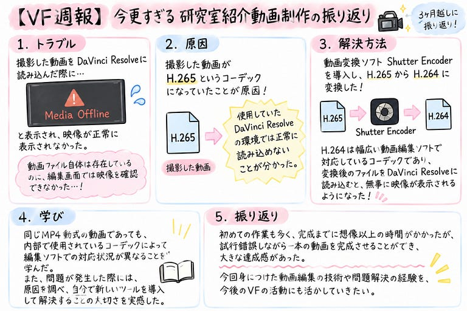

こんにちは！3年の野中です。

7月のハッカソンで行った古橋研究室紹介動画の振り返りをしていないということに今更気付きました💧

そこで今回は、3ヶ月越しに研究室紹介動画制作の振り返りをしていこうと思います！

動画編集には**DaVinci Resolve**を使用しました。今まで動画編集ソフトはCapCutしか使用したことがなかったため、最初は基本的な操作を覚えるところからのスタートでした。

> トラブル

特に苦労したのは、撮影した動画をDaVinci Resolveに読み込んだ際に、「Media Offline」と表示され、映像が正常に表示されなかったことです。動画ファイル自体は存在しているにもかかわらず、編集画面では映像を確認することができず、そもそも編集の段階に辿り着けませんでした。

原因は、撮影した動画がH.265というコーデックになっていたことです。使用していたDaVinci Resolveの環境では正常に読み込むことができないことが分かりました。

そこで、動画変換ソフト **Shutter Encoder** を導入し、元の動画をH.265からH.264に変換しました。H.264は幅広い動画編集ソフトで対応しているコーデックであり、変換後のファイルをDaVinci Resolveに読み込むと、無事に映像が表示されるようになりました。

> 学び

今回のトラブルを通して、同じMP4形式の動画であっても、内部で使用されているコーデックによって編集ソフトでの対応状況が異なることを学びました。また、問題が発生した際には、原因を調べ、自分で新しいツールを導入して解決することの大切さを実感しました。

その後は、映像のカットやテロップの挿入、BGMの調整などを行い、視聴者が最後まで楽しめるよう工夫しました。

工夫した点は以下の通りです。

* テロップにシャドウをつける
* 声とBGMの音量調整

> 振り返り

初めての作業も多く、完成までに想像以上の時間がかかりましたが、試行錯誤を重ねながら一本の動画を完成させることができ、大きな達成感がありました。

今回身につけた動画編集の技術や問題解決の経験を、今後のVFの活動にも活かしていきたいです。

> グラレコ

---

[【VF週報】今更すぎる︎^^;研究室紹介動画制作の振り返り](https://medium.com/furuhashilab/vf%E9%80%B1%E5%A0%B1-%E4%BB%8A%E6%9B%B4%E3%81%99%E3%81%8E%E3%82%8B%EF%B8%8E-%E7%A0%94%E7%A9%B6%E5%AE%A4%E7%B4%B9%E4%BB%8B%E5%8B%95%E7%94%BB%E5%88%B6%E4%BD%9C%E3%81%AE%E6%8C%AF%E3%82%8A%E8%BF%94%E3%82%8A-cc032c7bf684) was originally published in [Furuhashi(mapconcierge)Lab.](https://medium.com/furuhashilab) on Medium, where people are continuing the conversation by highlighting and responding to this story.
