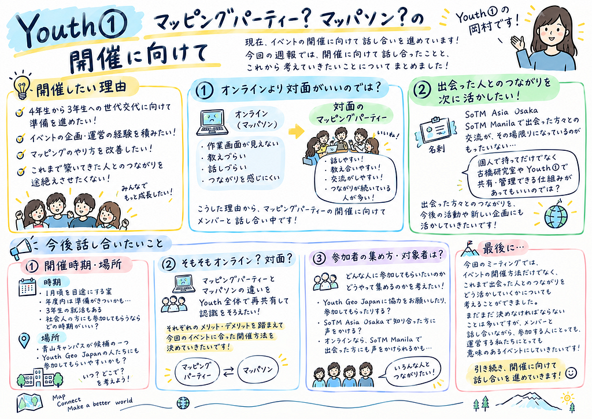

Youth①の岡村です！

現在、Youth①ではイベントの開催に向けて話し合いを進めています。

今回の週報では、開催に向けて話し合ったことと、これから考えていきたいことについてまとめました！

### 開催したい理由

* 4年生から3年生への世代交代に向けて、準備を進めたい！
* イベントの企画・運営の経験を積みたい！
* OSMに貢献したい！
* これまで出会った人とのつながりを途絶えさせたくない！

### 話し合ったこと①（オンラインより対面がいいのでは？）

今回は、オンラインで行うマッパソンではなく、対面でのマッピングパーティーができたらいいのではないか、という話になりました。

理由の一つは、これまで行ってきたオンラインマッパソンでは、お互いの作業画面が見えないため、教えたり、気軽に話しかけたりすることが難しく、つながりを十分に感じにくかったことです。

一方、対面で行うマッピングパーティーでは、直接顔を合わせて話せるため、教え合いや交流がしやすかったと感じているメンバーが多くいました。また、実際に会って知り合った人とは、その後もつながりが続いていることが多い、という意見もありました。

こうした理由から、現在はマッピングパーティーの開催に向けて、メンバーと話し合いを進めています！

### 話し合ったこと②（出会った人とのつながりを次に活かしたい！）

ミーティングの中でもう一つ気づいたのが、これまで出会った人とのつながりを、今後どのように活かしていくかという課題です。

具体的には、SoTM Asia OsakaやSoTM Manilaで出会った方々との交流が、その場限りの一回きりになってしまっていることが、もったいないと感じました。

例えば、イベントでいただいた名刺を、個人で持っているだけでなく、古橋研究室やYouthのメンバー全体で共有・管理できる仕組みがあってもいいのではないか、という話も出ました。（難しい、、、）

せっかく出会えた方々とのつながりを、その後の活動や新しい企画にも活かしていきたいです！

……という感じで、まだまだ話し合うことがたくさんあります。

そこで、今後さらに話し合っていきたいことをまとめました！

### 今後話し合いたいこと①（開催時期・場所）

まずは、いつ、どこで開催するのがよいかを考えたいです。

開催時期については、1月頃を目途にする案が出ています。ただ、年度内の開催となると、準備の時間を十分に確保できるかが気になるところです。

また、3年生の就活もあるため、メンバーが参加しやすい時期を考える必要があります。社会人の方にも参加していただくなら、どの時期がよいのでしょうか？

開催場所については、青山キャンパスが候補の一つです。Youth Geo Japanのメンバーにも参加してもらうことを考えると、どこで開催するのがよいか、引き続き検討していきたいです。

### 今後話し合いたいこと②（そもそもオンライン？対面？）

対面での開催を考えていますが、そもそもマッピングパーティーとマッパソンには、どのような違いがあるのか。

まずはYouth①だけでなく、Youth全体でもそれぞれの違いや特徴を改めて共有し、認識をそろえたいと考えています。

そのうえで、それぞれのメリット・デメリットを踏まえ、今回のイベントに合った開催方法を決めていきたいです！

### 今後話し合いたいこと③（どうやって参加者を集める？対象者は？）

イベントを開催するなら、どのような人に参加してもらいたいのか、また、どうやって参加者を集めるのかも考える必要があります。

例えば、Youth Geo Japanのメンバーに協力をお願いしたり、実際に参加してもらったりする方法が考えられます。また、SoTM Asia Osakaで知り合った方々にも声をかけ、参加を呼びかけることができそうです。

オンライン開催にする場合は、SoTM Manilaで出会った方々にも声をかけられるかもしれません。

誰に参加してもらいたいのかを考えながら、周知方法についても検討していきたいです！

### グラレコ

---

[Youth① マッピングパーティー？マッパソン？の開催に向けて](https://medium.com/furuhashilab/youth%E2%91%A0-%E3%83%9E%E3%83%83%E3%83%94%E3%83%B3%E3%82%B0%E3%83%91%E3%83%BC%E3%83%86%E3%82%A3%E3%83%BC-%E3%83%9E%E3%83%83%E3%83%91%E3%82%BD%E3%83%B3-%E3%81%AE%E9%96%8B%E5%82%AC%E3%81%AB%E5%90%91%E3%81%91%E3%81%A6-d877c22f8619) was originally published in [Furuhashi(mapconcierge)Lab.](https://medium.com/furuhashilab) on Medium, where people are continuing the conversation by highlighting and responding to this story.
