### **カービィをアニメーションさせてみた**1️⃣

こんにちは！デザイン部4年の滝沢です。

今回は、夏休み前に作成したカービィのモデルを使って、実際にアニメーションを付ける作業を行いました。前回は基本的なアニメーションを一通り学んだので、今回はその応用編です。

モデリングは2週に分けて進めており、各自のペースで2週目に完成させる形にしました。

↓

↓

↓

**みひろ**

1週目にやったことは、アーマチュアとスキニングです。

<反省点・失敗したこと>

最初、何も考えずにボディを作成していたのですが、ボーンを関節の位置に配置するということを忘れていました。。。

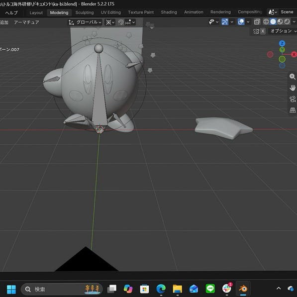

何気なくボーンを作成してしまい親子関係のない形に…

後から修正したところ、親ボーンと子ボーンの間に正しく接続線が生まれ、うまく繋がりました！！

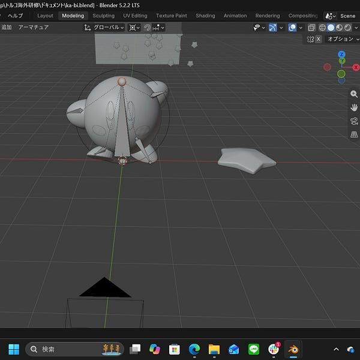

修正後

チョー基本的なことですが、改めて「ボーンは必ず関節の位置に置く」ということを意識するべきだと思いました。

<2週目について>

1週目は自動でモデルとボーンを連携させる設定(スキニング)を試みましたが、思うように動かなかったため、次回はウェイトペイントを使って動きを細かく調整していく予定です。今回は参考動画が全くない状態でゼロから取り組むという、これまでとは異なる作業だったため、非常に緊張しました。。。また、動画を見ながら作業していたときの自分を振り返ると、動画に合わせてなんとなく手を動かしているだけになっていたことに気がつきました。動画を参考にしても、「なぜこの操作をするのか？」と常に考えながら取り組む姿勢が大切だと、今回の経験を通じて実感しました。。。！

**みあ**

私は前期に作成したカービィを動かすことにしました！

モデリングは完成しているので、今週はアーマチュアとスキニングを行いました。

前回アーマチュアを行った時は、人型のモデルを使ったので骨格が分かりやすかったのですが、カービィは骨格が特殊なのでどういう風に作るか少し悩みました！

背骨、頭、腕、足、という構成がデフォルトですが、頭をなくして背骨（本体部分）、腕、足、の3つで構成することにしました！

パーツの結合をし忘れて、動きの確認をした時にカービィの顔がついてきませんでした、、、😭

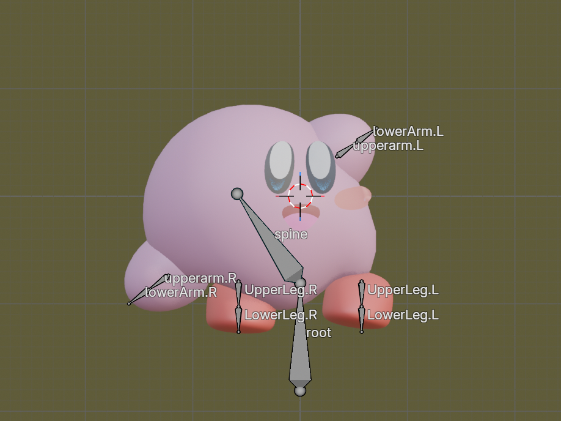

**ちはな**

今回はカービィを動かすというのを目標に活動しました！既にモデリングは終わっているので、アーマチュア、スキニングが実際に行った作業になります。

前回簡単なモデルでモデリングの作業を行ったときに全体を統合する、と言っていたので最初にカービィのモデルを統合して進めたら大変なことになりました。

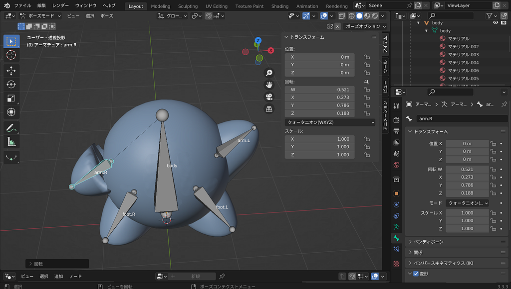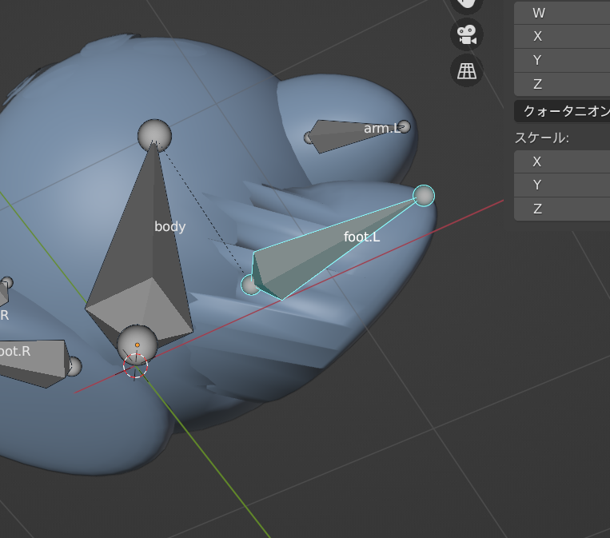

付け根がおかしいカービィ

ウエイトペイントに問題があると思い何度も試行錯誤したのですが上手くいきませんでした。

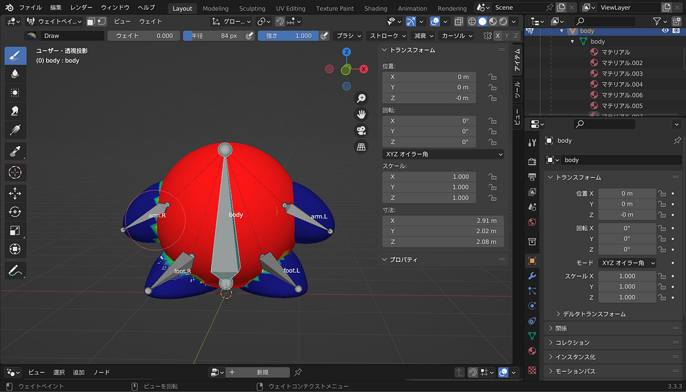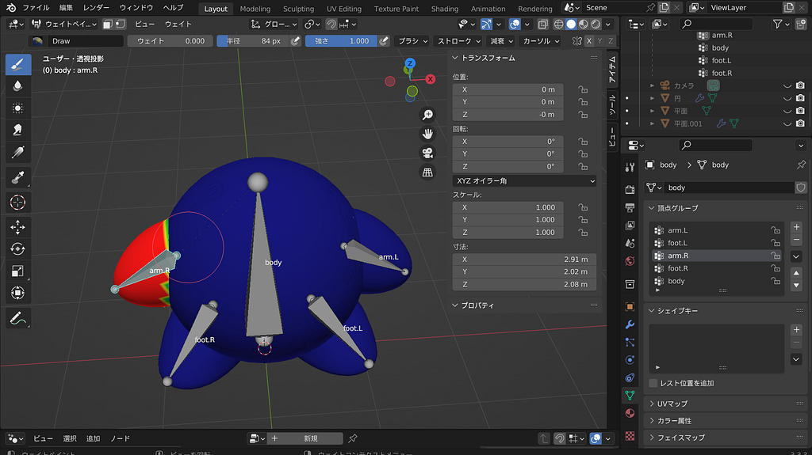

ウエイトペイントの様子

どんなに頑張ってもはっきり色が分けられませんでした。

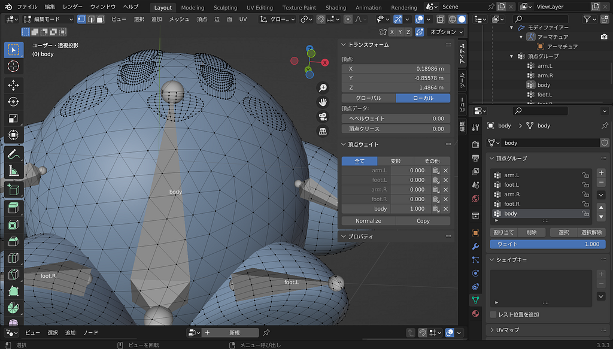

恐らく腕や脚の付け根に頂点があるわけではないので、綺麗に塗り分けることが出来ずこうなってしまったと思われます。

なので腕や脚を統合しない方法で進めることにしました。

ボーンは統合したときと同じ方法で作り、パーツごとにそれぞれアーマチュアを設定します。

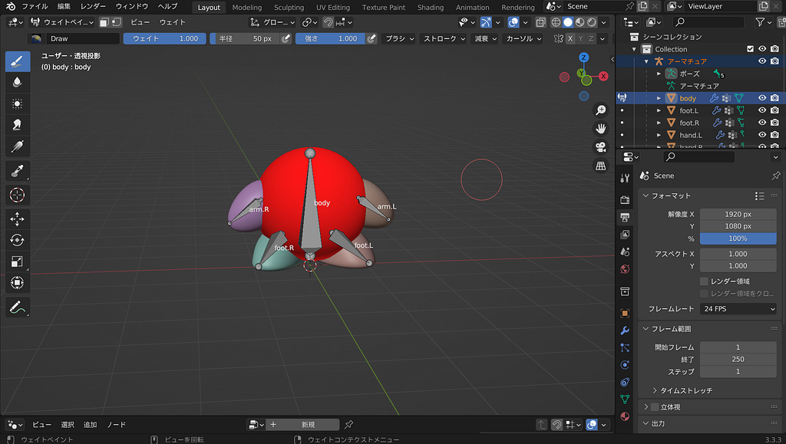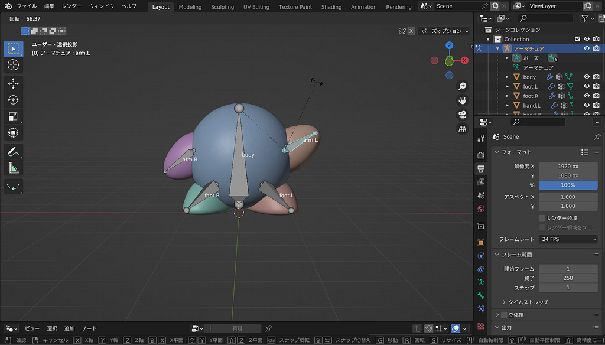

完成した様子

この方法で進めると腕や脚がおかしくなることなく動かすことができました。パーツごとに進めているのでウエイトペイントもばっちり。

顔のパーツだけはボディと統合したので見えませんが、以前色を塗り分けたのでレンダリングすれば見られます！

カービィは腕が直接生えていたり、少し特殊な動きをしたりするので、統合すると上手くいかないと学びました。

人間と遠い形のキャラクターを動かすときは気を付けたいと思いました。

かなり苦労しましたが、次にアニメーションを付ける準備は整ったので、次週、動かせるのを楽しみにしています！

**かのこ**

私は前回作成したカービィがパソコンの不具合により消えてしまったので、取り急ぎ丸っぽいおばけを作成し、それをカービィの代わりとしてこれに動きをつけていくことにしました。

> 1. おばけのモデリング

おばけの3Dモデルを制作しました。

まず、おばけの本体を作り、目やほっぺを追加しました。

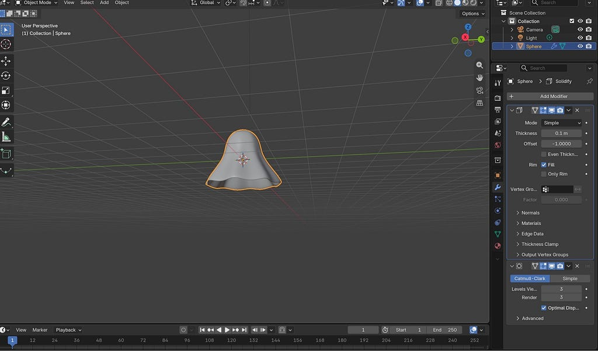

作業中に苦労したのは、おばけ全体のサイズ調整です。最初は本体だけを選択していたため、目やほっぺも含めて縮小できませんでした。そこで、複数のパーツをまとめて選択し、サイズを調整することで解決しました。

その後、背景・カメラ・照明を設定し、光の強さや位置を調整しました。特に、影が大きく伸びてしまう問題があったため、ライトの位置と半径を変更し、影が自然に見えるように工夫しました。

最終的に、おばけが浮いている様子をレンダリングできました。

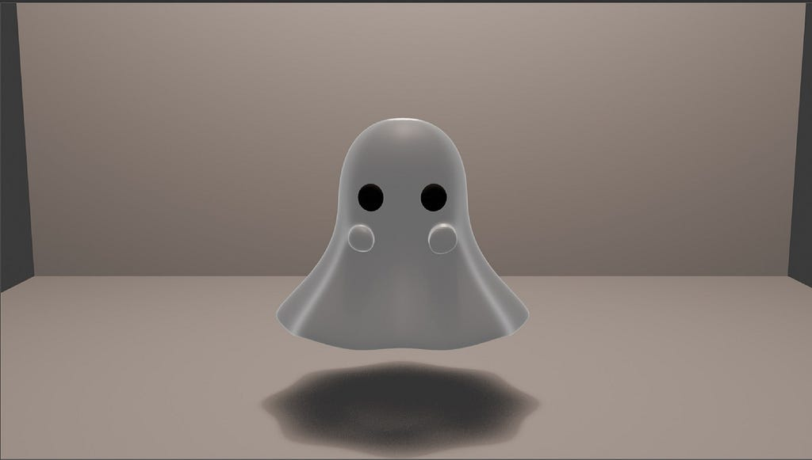
> 2. アーマチュアの作成

次に、おばけを動かすためのアーマチュア（骨組み）を作成しました。

今回は、頭・胴体・裾の左側・中央・右側の合計5本のボーンを配置しました。

最初はボーンの位置や向きが合わず、調整に苦労しました。そこで、正面からモデルを確認しながら、各ボーンの根元と先端を調整しました。

また、胴体のボーンを親として、ほかのボーンとの親子関係を設定しました。

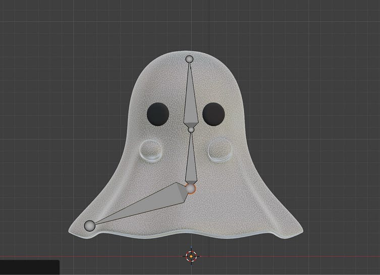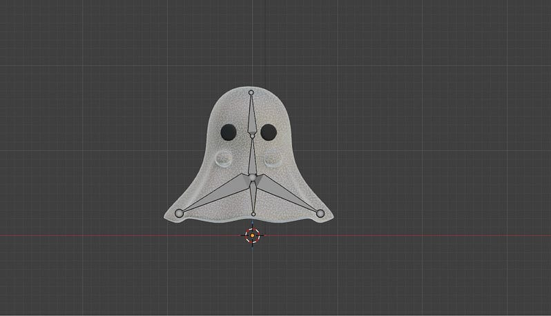
> 3. 今後の作業

今回の作業では、おばけのモデリングとレンダリング、アーマチュアの作成まで進めることができました。

今後はスキニングを行い、ボーンの動きに合わせておばけの体が変形するようにします。その後、ふわふわと浮いたり、裾が揺れたりするアニメーションを制作していきます。

グラレコ

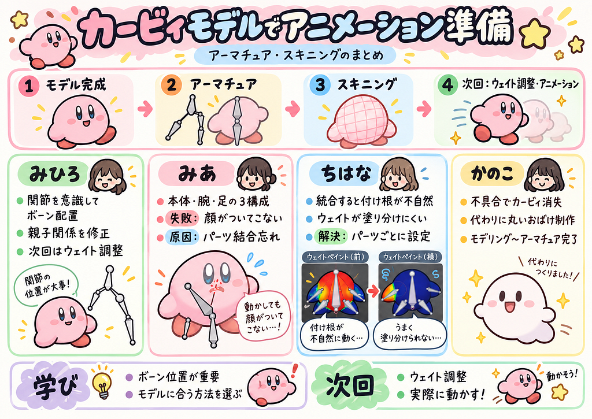

---

[カービィのアニメーションを作ろう1️⃣](https://medium.com/furuhashilab/%E3%81%BF%E3%81%B2%E3%82%8D-7a4c6d7514dd) was originally published in [Furuhashi(mapconcierge)Lab.](https://medium.com/furuhashilab) on Medium, where people are continuing the conversation by highlighting and responding to this story.
