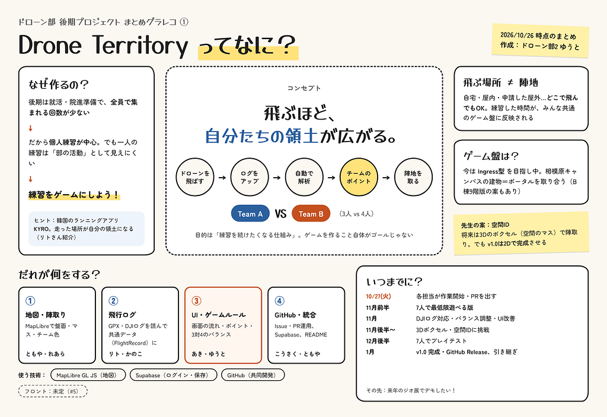
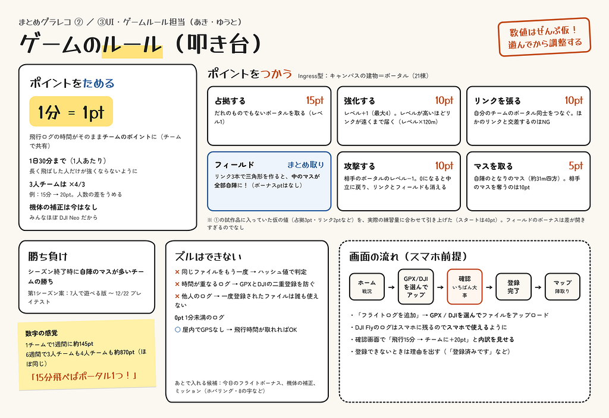
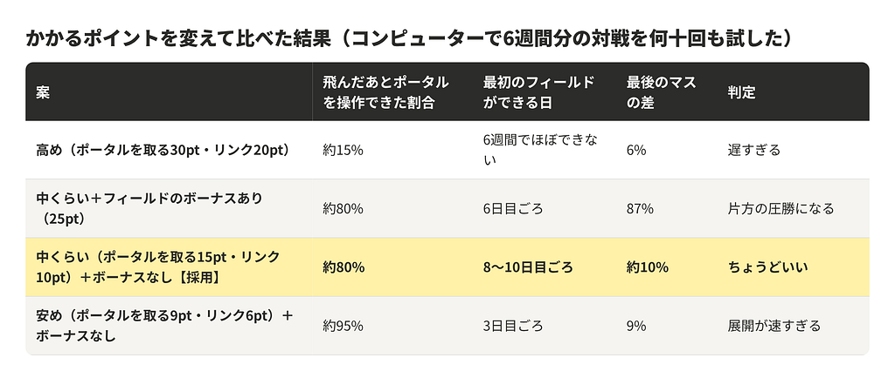
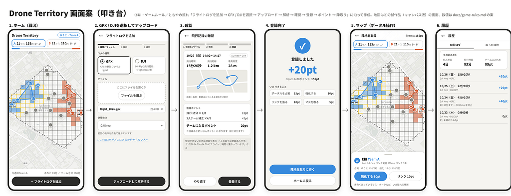
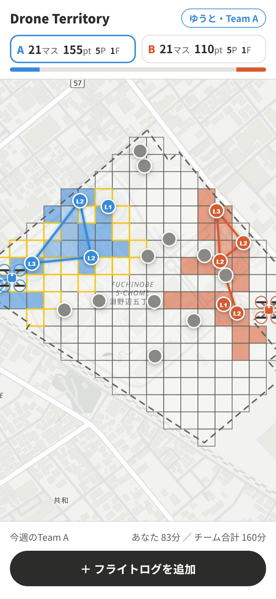
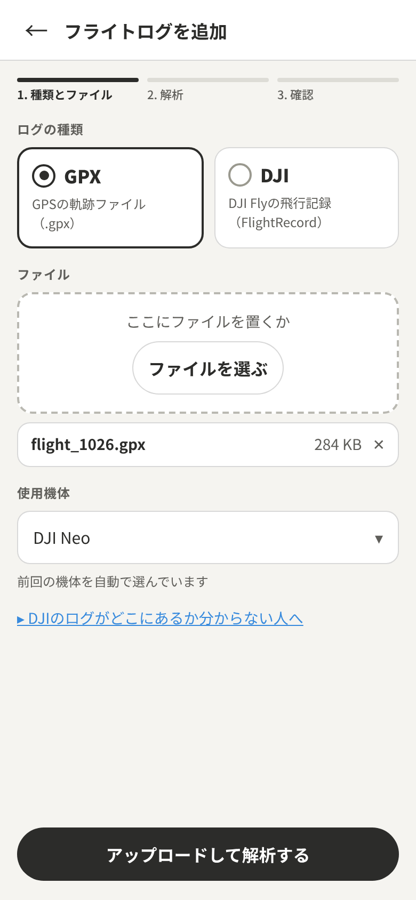
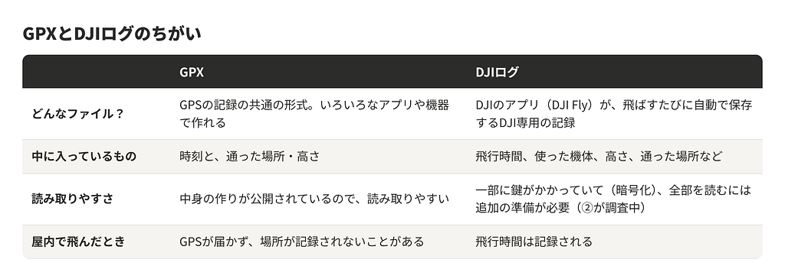
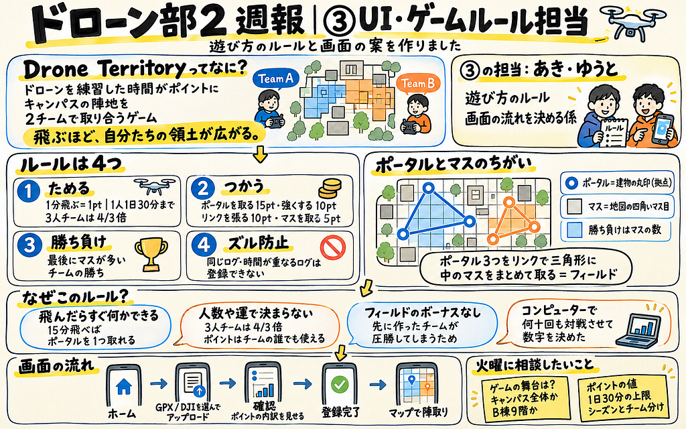

こんにちは！ドローン部2の渡辺です。

今週は、ドローン部で作っているゲーム「Drone Territory」の**遊び方のルール**と**画面の案**を作りました。

### この記事のまとめ

**Drone Territoryってなに？**  
ドローンを練習した時間がポイントになり、そのポイントで大学のキャンパスの陣地を2チームで取り合うゲームです。7人で4つの担当に分かれて作っています。

以下担当分担表

* ① 地図・陣取り：地図の上に陣地を表示する（ともや・れあら）
* ② 飛行ログ：ドローンの飛行記録を読み取る（りとくん・かのこ）
* **③ UI・ゲームルール：遊び方のルールと、画面の流れを決める（あきさん・ゆうと）**
* ④ GitHub・全体統合：みんなの作業を1つにまとめる（こうさく・ともや）

私は**③ UI・ゲームルール担当**です。「UI」は、アプリの画面やボタンなど、使う人が触れる部分のことです。③は「どうやったらポイントがたまって、どうやって陣地を取るのか」というルールと、「アプリをどんな順番で操作するのか」という画面の流れを考える係です。

**今週やったこと**

> ・ゲームのルールの叩き台を作成

> ・ルールの数字が妥当か、クロードでシミュレーションして決定

> ・スマホの画面イメージを作成

この記事では、まずルールの中身を説明し、そのあとで「なぜそのルールにしたのか」を説明します。最後に画面の案を紹介します。

### 用語メモ（先に読むと分かりやすいです）

* **GPX（ジーピーエックス）**：飛行記録のファイルの種類の1つ。GPSで記録した「いつ・どこを通ったか」が入っている。いろいろなアプリや機器で使われている共通の形式
* **DJIログ**：ドローン会社DJIのアプリ（DJI Fly）が、飛ばすたびにスマホへ自動で保存する飛行記録。DJI専用の形式
* **ポータル**：キャンパスの建物21棟に置いた「拠点」。地図上の**丸印**。取る・強くする・リンクでつなぐ、ができる
* **リンク**：自分のチームのポータル同士を結ぶ**線**
* **フィールド**：リンク3本で三角形を作るとできる陣地。三角形の中のマスがまとめて自分たちのものになる
* **マス**：キャンパスを約31m四方に区切ったマス目（全部で182マス）。地図上の**四角**。最後にこの数が多いチームが勝ち

### ルールの概要

ルールは「ポイントをためる」「ポイントをつかう」「勝ち負け」「ズル防止」の4つでできています。数字はすべて仮で、実際に遊んでから調整します。

#### 1. ポイントをためる

* ドローンを**1分飛ばすと1ポイント（pt）**
* ポイントになるのは**1人1日30分まで**
* ポイントは**チームの共有財産**になる（自分が飛んだ分もチームの財布に入る）
* **3人チームは、もらえるポイントが4/3倍**（例：15分飛ぶと、15ptではなく20pt）
* 飛ばす場所は自由（自宅、屋内、許可をとった屋外など）。飛んだ場所とゲームの陣地は関係ない

#### 2. ポイントをつかう

地図の上には、**ポータル（建物の丸印）**と**マス（地図の四角いマス目）**の2種類があります。勝ち負けを決めるのは**マスの数**です。ポータルはそのための拠点で、ポータル3つをリンク（線）で三角形につなぐと、中のマスをまとめて取れます。マスは1つずつ取ることもできます。

* **ポータルを取る：15pt**…誰のものでもない建物が、自分のチームのものになる
* **ポータルを強くする：10pt**…レベルが1上がる（最大レベル4）。レベルが高いほど遠くのポータルと結べる
* **リンクを張る：10pt**…自分のチームのポータル同士を線で結ぶ。線3本で三角形を作ると、中のマスが全部自陣になる（フィールド）
* **相手のポータルを攻撃する：10pt**…相手のポータルのレベルが1下がる。0になると誰のものでもなくなる
* **マスを取る：5pt**（相手のマスは10pt）…自分の陣地のとなりのマスを1つ取れる

スタート時は、各チームに40ptが配られます。

#### 3. 勝ち負け

* シーズンの最後に**自分たちのマスが多いチームの勝ち**
* 最初のシーズンは「7人で遊べる版ができてから、12月22日のプレイテストまでを想定
* 「誰が何分飛んだか」「誰がどこを取ったか」は記録して、一人ひとりの頑張り・練習が見えるようにする

#### 4. ズル防止

* 同じファイルは2回登録できない（他の人が登録したファイルも使えない）
* 飛んだ時間が重なるログも登録できない（同じフライトをGPXとDJIログの両方で登録するのを防ぐ
* 屋内でGPSが使えなくても、飛行時間が分かれば登録できる

### なぜそのルールにしたのか

ルールを決めるときに一番大事にしたのは、「**飛んだらすぐ何かできる**」ことと、「**人数や運で勝ち負けが決まらない**」ことです。このゲームの本当の目的は、勝つことよりも、一人ひとりが練習を続けたくなることだからです。

#### 1分＝1ptにした理由

前回の週報で「最初は1分＝1ptくらいの単純なルールから始めて、遊んでから直す」という方針が出ていたので、それに合わせました。①の担当が作った試作品（お試し版のゲーム）も同じで1分＝1ptです。説明書を読まなくても分かることを優先しました。

#### 1日30分までにした理由

上限がないと、「とにかく長く飛ばした人」だけが強くなってしまうからです。計算してみると、「週6日・毎回60分」飛ぶ人は、「週2〜3日・15分」の人の約10倍のポイントになりました。上限を30分にすると、約5倍におさまります。30分は、みんなが使っているDJI Neoのバッテリー約2本分です。

たくさん練習した人が有利になるのはいいことです。ただし、「1日に長く」より「飛ぶ日を増やす」方が得になるようにしました。

#### 3人チームを4/3倍にした理由

ドローン部は7人なので、3人チームと4人チームになります。そのままだと、人数が多い方がポイントも多くなります。一人あたり同じだけ練習すれば、チームの合計も同じになるように、3人チームのポイントを4/3倍にしました。6週間分を計算すると、どちらのチームも約870ptでほぼ同じになりました。

#### チームのポイントを「誰でもいつでも」使えるようにした理由

「飛んだ人しかポイントを使えない」という作りだと、人数が多いチームほど操作できる回数が多くなり、ポイントが同じでも有利になりました（コンピューターで試すと、4人チームが約75%勝ち）。誰でも使えるようにすると、勝率はほぼ五分五分になりました。

#### かかるポイントを今の値にした理由

①の試作品（お試し版のゲーム）には、「ポータルを取る：3pt」「リンクを張る：2pt」などの仮の数字が入っていました。これは画面の動きを試すための値で、実際の練習量（1人が週2〜3日、1回15分くらい）で遊ぶと、**1週間ほどで全部の建物が取れてしまう**計算でした。

そこで、試作品と同じルールをコンピューターの中に作り、かかるポイントを変えながら、6週間分の対戦を何十回も自動で試しました。結果は次のとおりです。

「ポータルを取る15pt・リンク10pt」にすると、**15分飛べばポータルを1つ取れる**ので「飛んだらすぐ何かできる」が守れます。それでいて、どちらかのチームが全部を取りきってしまうこともありません。

#### フィールドのボーナスをなくした理由

試作品では、フィールド（三角形）を作るとボーナスポイントがもらえました。しかしこれがあると、先にフィールドを作ったチームがボーナスでさらにフィールドを作り、差が雪だるま式に開いてしまいました。フィールドは「中のマスがまとめて取れる」だけで十分有利なので、ボーナスはなくしました。

#### ズル防止を入れた理由

飛行ログはファイルなので、そのままだと同じフライトを何度も登録できてしまいます。また、屋内ではGPSが届かず場所が記録されないことがあるので、「時間さえ分かればOK」にして、屋内練習もポイントになるようにしました。

※コンピューターで試すときは、単純な作戦で自動で遊ばせているので、数字は「おおよその傾向」です。最終的には12月のプレイテストで確かめます。

### 画面の案

スマホで使う前提で、画面イメージを作りました。画面の順番は、ともやが出した「フライトログを追加 → GPX / DJIを選択 → アップロード → 解析 → 確認 → 登録 → ポイント → 陣取り」の流れのとおりです。地図は、①の担当が作った試作品（お試し版のゲーム）の実際の画面を使い、色や表示も試作品に合わせています。

スマホを前提にしたのは、DJIの飛行ログがスマホのアプリに保存されるからです。飛ばしたあと、その場で登録できるようにしたいと考えました。

「マニュアルが必要なゲームにはしない」を目標にしました

#### ① ホーム（戦況）

アプリを開くと最初に出る画面です。上に両チームのマスの数とポイント、真ん中に地図、下に「フライトログを追加」ボタンがあります。「今どっちが勝っているか」と「次に何をすればいいか」が、開いてすぐ分かるようにしました。地図の**丸印がポータル**、**四角がマス**です。（P＝持っているポータルの数、F＝フィールドの数）

#### ② GPX / DJIを選んでアップロード

ログの種類を選んで、ファイルを選ぶ画面です。使ったドローン（機体）は前回と同じものが自動で選ばれるので、毎回選び直す必要はありません。「DJIのログがどこにあるか分からない」人向けの案内も置きました。

**GPXとDJIログの違い**  
どちらも「飛行記録のファイル」ですが、作られ方と中身がちがいます。

どちらで登録しても、ゲームの中では同じ「飛行時間」として扱います。そのために、②の担当が2つのファイルを同じ形にそろえる仕組みを作っています。

### GitHubへの提出

今回は3まで進め、**PR #19「ゲームルール・画面フローの叩き台を追加」**を出しました。火曜日にみんなに確認してもらい、OKが出たら本体に入ります。自分のPRは自分でOKを出せない仕組みなので、必ず誰かに見てもらうことになります。

### 火曜日に相談したいこと

この叩き台は、まだ決定ではありません。火曜日には、次のことをみんなで相談したいです。

1. ゲームの舞台を、キャンパス全体で建物を取り合う形（Ingressというスマホゲームと同じ形）にするか、B棟9階にするか
2. かかるポイント（ポータルを取る15pt・リンク10pt・フィールドのボーナスなし）はこれでいいか
3. 「1日30分まで」を最初から入れるか

### おわりに

今回は、数字を実際に試してはじめて分かることが多くありました。試作品の数字のままだとすぐに全部取れてしまい、高くしすぎると飛んでも何もできず、ボーナスがあると片方の圧勝になります。ゲームのルールは、頭の中だけで決めず、試しながら決めるものだと感じました。

これからは、①の地図、②の飛行ログの読み取りとつながるように、③のルールと画面を少しずつ形にしていきます。最終的には「あと10分飛べば次のマスが取れる！」と思えるゲームにしたいです。

GPT Sol 6.1で生成

### AIの使用について

* 使用したAI：Claude（Anthropic、モデル Claude Opus 5.5）
* 使用日：2026年10月25日〜26日
* 使ったところ：ルールの叩き台の下書き、コンピューターで自動で対戦させて試す仕組みの作成と実行、画面案の画像とグラレコの作成、この記事の下書き
* 画面案の地図は、①の担当が作った試作品（キャンパス版）の画面を使用（地図 © OpenStreetMap contributors、OpenFreeMap）
* 内容は自分で確認・修正しています

---

[ドローン部2 週報｜③UI・ゲームルール担当](https://medium.com/furuhashilab/%E3%83%89%E3%83%AD%E3%83%BC%E3%83%B3%E9%83%A82-%E9%80%B1%E5%A0%B1-%E2%91%A2ui-%E3%82%B2%E3%83%BC%E3%83%A0%E3%83%AB%E3%83%BC%E3%83%AB%E6%8B%85%E5%BD%93-6f2b43bab48d) was originally published in [Furuhashi(mapconcierge)Lab.](https://medium.com/furuhashilab) on Medium, where people are continuing the conversation by highlighting and responding to this story.
