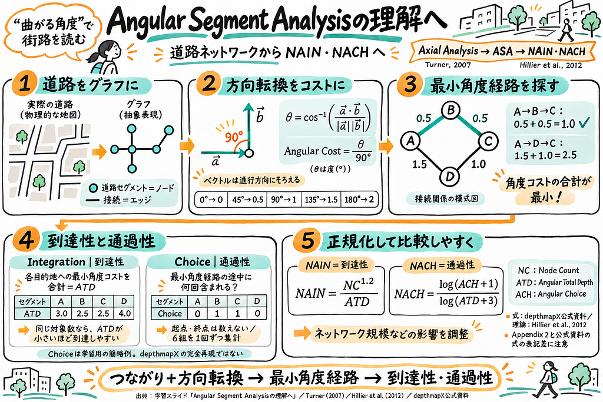

11月10日の中間発表まとめをGitHubとスライドにまとめました。

[GitHub](https://github.com/furuhashilab/2026gsc2_HinakoTerado)

<https://medium.com/media/11bab7b23c26dd4f1c822866c99f307e/href>

グラレコ

---

[【11/10】中間発表のまとめ](https://medium.com/furuhashilab/11-10-%E4%B8%AD%E9%96%93%E7%99%BA%E8%A1%A8%E3%81%AE%E3%81%BE%E3%81%A8%E3%82%81-e28f58fb22d9) was originally published in [Furuhashi(mapconcierge)Lab.](https://medium.com/furuhashilab) on Medium, where people are continuing the conversation by highlighting and responding to this story.
