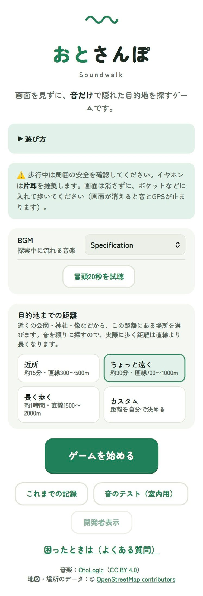
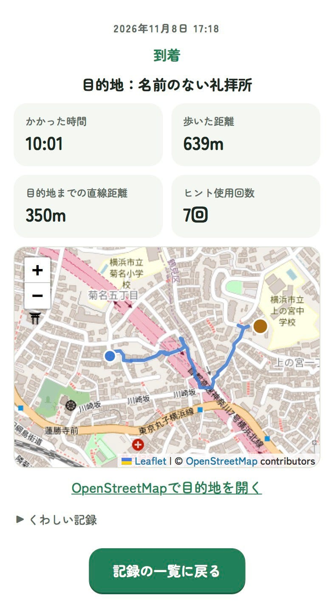
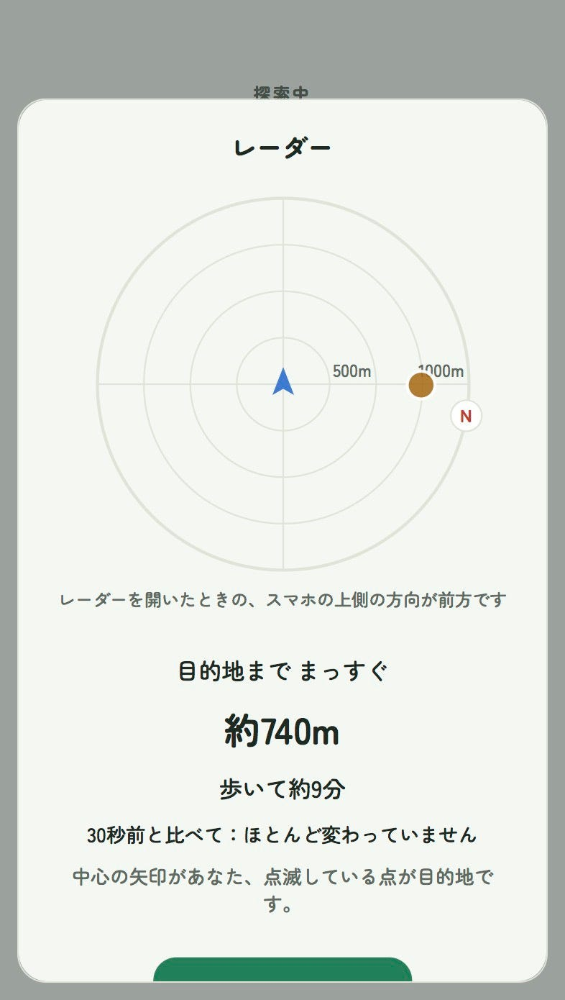
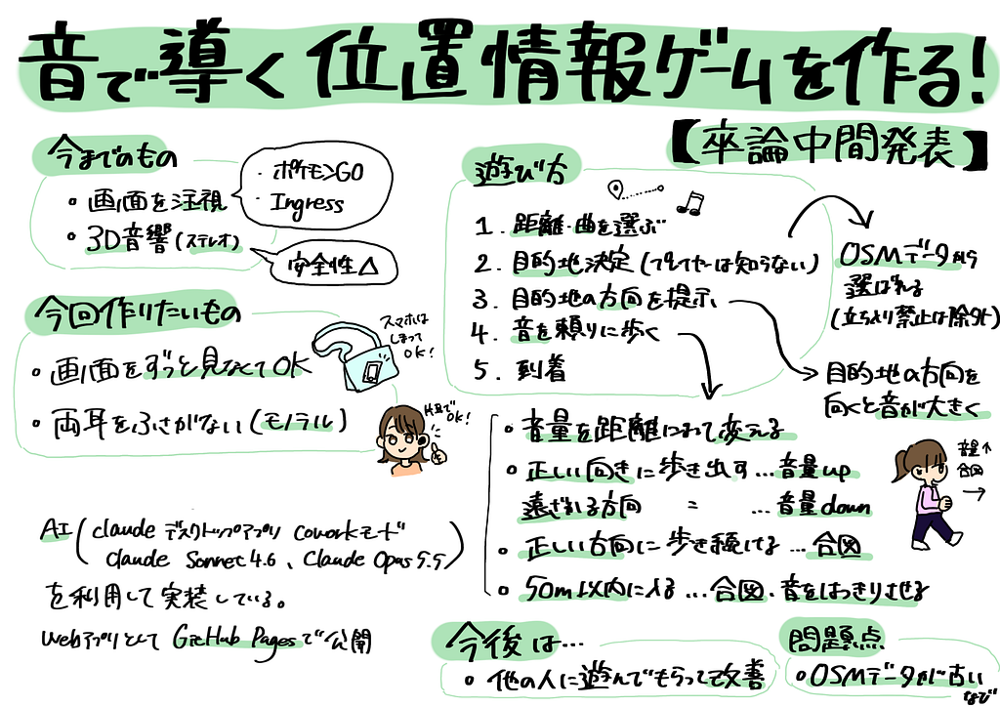

こんにちは、臼井です。

今回は卒論の中間発表として現在の進捗とここに至るまでの経緯、今後の展望について書いていきます！

以下は卒論についてのGitHubのレポジトリのURLと中間発表のプレゼン資料です。

GitHubのURL：

<https://github.com/furuhashilab/2026gsc_ChihanaUsui.git>

中間発表の資料：

<https://medium.com/media/bf6d48619710b5503f501729ea48f76c/href>

まずは私が卒論で扱っているテーマについて書いていきます。

今回私が目指すのは、「音のみで導く位置情報ゲーム」です。

その中でも、画面を見る必要が少なく、両耳をふさがない、安全に配慮した物を目指しています。

既存の位置情報を利用したゲームは、視覚に頼ったものが多いです。

例えば、ポケモンGOやIngressは高いゲーム性を持つ代わりに画面を注視している時間が長いです。散歩を楽しむというよりはゲームを楽しむイメージですね。

音での道案内という観点から見ると、3D音響を使用した物がほとんどです。

Microsoft Soundscapeは現在サービスとしては終了していますが、3D音響前提で設計されていたようです。

言葉を使わず音だけで道案内ができるかを試した研究でも 3D音響を使用していました。

論文URL：

[Hearing the Way Forward: Exploring Ambient Navigational Awareness with Reduced Cognitive Load through Spatial Audio-AR | Extended Abstracts of the 2023 CHI Conference on Human Factors in Computing Systems](https://doi.org/10.1145/3544549.3585800)

という事で、出発時の方向の情報と歩行中の音の変化 （音量・音のこもり具合・短い合図）によって、画面を見ることなく両耳をふさがない設計の位置情報ゲームを作成することが最終目標です。

新規性はモノラルな音を利用する事と画面を注視しない設計になります。

実装はAIによるプログラミング支援を活用して進めていて、Claude デスクトップアプリ（Coworkモード）Claude Sonnet 4.6、Claude Opus 5.5を使用しています。

実装形態はWebアプリで、GitHub Pagesで公開しています。

↓以下のURLから遊ぶことができます！

[おとさんぽ](https://furuhashilab.github.io/2026gsc_ChihanaUsui/)

<https://medium.com/media/a82f9766b46bf62831c70430a25c4d7f/href>

デモ版の紹介動画も作ってみました。動画時間は約3分です。良ければ見てください。

ゲームの遊び方としてはプレイヤーが選択した距離に応じて目的地を決定→どの方向に向かえばいいか示す→目的地に向かって歩く、という流れです。

目的地はOSMに登録されている場所のデータから設定されます。

最初は音量の変化のみで道を案内する予定でしたが、実際に歩いてみると難しかったので正しい方向に向かったときに大げさに音を大きくしたり、正しい方向に歩き続けると合図の音が鳴るようにしました。

逆に目的地から離れる方向に移動している場合、大げさに音を小さくするという仕組みも導入しました。

また、目的地の50ｍ以内に入ったときに近距離モードを設定し、合図の音を鳴らしたり、音をこもらせずはっきり鳴らしたりするように設計しました。

プレイ時の画面

実際に遊んでみたときの結果の画面はこちらです。

距離は近所(約15分・直線距離で300～500ｍ)で設定しました。

軌跡を見ると分かるのですが、分かれ道で違う方に向かった場合、音が小さくなるので逆に向かった方が良いことが分かりやすかったです。

ヒントとして使えるレーダー

ヒントとしてキャリブレータ―を再度使えるようにし、レーダーも使えるようにしました。（レーダーは構想発表の時に先生にアドバイスしてもらったドラゴンレーダーを参考にしました。）

今後の展望としては自分以外のプレーヤーにも遊んでもらい、その評価を基に改善していきたいと考えています。

特にヒントの音が適切で目的地にたどり着けるかという点は要検証です。

また、OSMのデータが古い場合もあるのでそこをどう改善していくかも問題点になります。

まだまだ改善の余地があると思っているので、今後の開発も頑張りたいです！

#### **グラレコ**

---

[音で導く位置情報ゲームを作る！【卒論中間発表】](https://medium.com/furuhashilab/%E9%9F%B3%E3%81%A7%E5%B0%8E%E3%81%8F%E4%BD%8D%E7%BD%AE%E6%83%85%E5%A0%B1%E3%82%B2%E3%83%BC%E3%83%A0%E3%82%92%E4%BD%9C%E3%82%8B-%E5%8D%92%E8%AB%96%E4%B8%AD%E9%96%93%E7%99%BA%E8%A1%A8-32a000dd7912) was originally published in [Furuhashi(mapconcierge)Lab.](https://medium.com/furuhashilab) on Medium, where people are continuing the conversation by highlighting and responding to this story.
