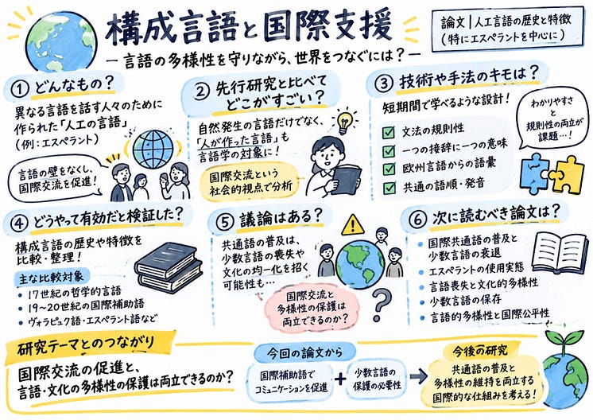

> テーマ

多様性が失われない国際支援の方策

> 落合陽一フォーマットとグラレコ

---

[【ゼミ論中間発表】](https://medium.com/furuhashilab/%E3%82%BC%E3%83%9F%E8%AB%96%E4%B8%AD%E9%96%93%E7%99%BA%E8%A1%A8-0bbf9211ec75) was originally published in [Furuhashi(mapconcierge)Lab.](https://medium.com/furuhashilab) on Medium, where people are continuing the conversation by highlighting and responding to this story.
