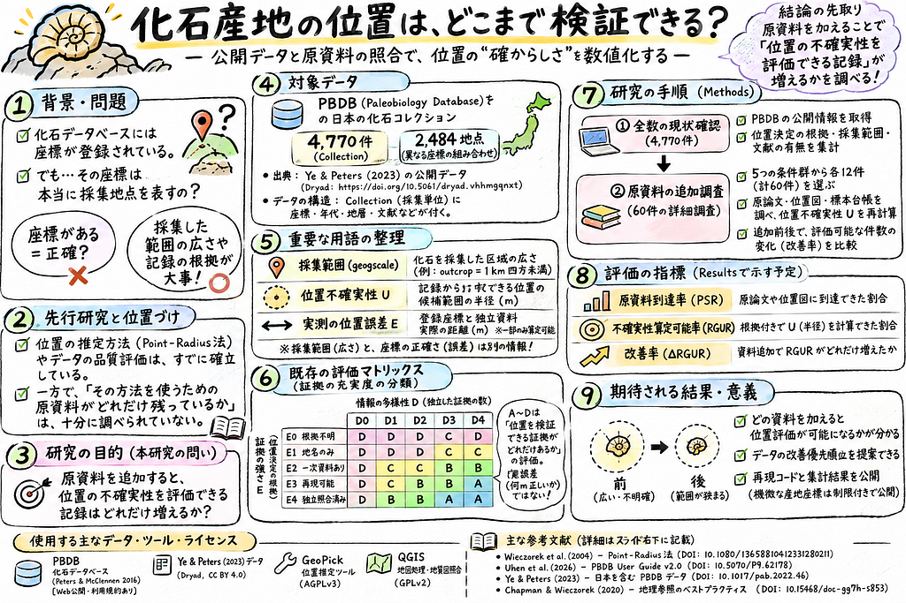

佐藤愛妃

#### まず、研究全体を一つにすると

1. **問題**：化石の点が地図に表示されても、そこが実際の採集地点とは限らない。座標の小数桁、採集範囲、位置不確実性、実測位置誤差は別である。［Peters & McClennen, 2016, <https://doi.org/10.1017/pab.2015.39；Wieczorek> et al., 2004, <https://doi.org/10.1080/13658810412331280211］>
2. **既存技術**：地名・位置図などから場所を絞るPoint-Radius法と、その作業を支援するGeoPickなどのツールが既に存在する。［Wieczorek et al., 2004, 上記；GBIF Georeferencing Best Practices, <https://doi.org/10.15468/doc-gg7h-s853；GeoPick> <https://geopick.gbif.org/about.html］>
3. **未解決の具体的な問い**：既存ツールの計算に必要な「原論文・位置図・標本ラベル・採集ノート」は、実際の日本の化石記録に何件残り、何件使えるのか。これは**本研究でこれから測る問い**で、国内全件の実測結果はまだない。［本研究の研究質問。関連する不足・品質論点：Thomer et al., 2013, <https://doi.org/10.1002/meet.14504901331；Jones> et al., 2025, <https://doi.org/10.1111/pala.70028］>
4. **手順**：既存4,770件のIDを出発点にPBDB本体の追加項目を確認し、選定済み60件について「公開情報だけ」と「原資料を追加した後」を、**同じ記録**で比較する。［対象件数と抽出法：既存Dryad由来CSV／60件選定表。元資料 <https://doi.org/10.5061/dryad.vhhmgqnxt］>
5. **判定**：原資料への到達率、根拠付きの位置不確実性を算定可能な割合、算定不能の理由を報告する。独立した正しい採集位置がある場合だけ、実際の座標誤差（m）を別に測る。［GBIF Georeferencing Best Practices, 上記。指標の組合せは本研究案］
6. **到達点**：資料を追加して「何がどれだけ分かるようになったか」を再現可能に公開する。ただし、非公開の野帳や盗掘につながる詳細座標は公開しない。［Jones et al., 2025, 上記；公開条件は原データ提供者・所蔵館の規約を個別確認］

### A. そのまま読む5分原稿（太字と注釈は読まない）

### スライド1｜なぜ化石の座標を疑うのか（約35秒）

「化石の地図を開くと、一つひとつの化石が点で表示されます。でも、その点が**実際に掘った場所**とは限りません。原論文に詳しい位置図がある記録もあれば、地名だけをもとに座標が付けられた記録もあるからです。そこで私は、いきなり座標が正しいかを決めるのではなく、**どんな資料が残っていて、どこまで位置を確かめられるか**を調べます。」

**話の役割**：『座標がある』と『場所を確かめられる』が別だと、誰でも分かる例を示す。［地理参照の基礎：Wieczorek et al., 2004, DOI上記］

### スライド2｜まず「精度」の意味を分ける（約45秒）

「ここでは、似ている三つの言葉を分けます。一つ目は、**化石を採集した区域の広さ**。二つ目は、**座標を決めた根拠**で、現地測量なのか、論文の地図なのか、地名からの推定なのかという違いです。三つ目は、資料から**本当の場所をどれくらいの範囲に絞れるか**です。PBDBの『露頭』という分類は、採集区域が1キロ四方未満という意味で、座標誤差が1キロ以内という意味ではありません。」

**話の役割**：誤解の多い outcrop を例に、採集区域と座標誤差の混同を防ぐ。［PBDB User Guide v2, §3.6, <https://doi.org/10.5070/P9.62178］>

### スライド3｜現在のデータだけでは何が分からない？（約50秒）

「使用するのは、PBDB由来の化石記録をYeとPetersが加工し、Dryadで公開したデータです。日本に該当するものは**4,770件**で、登録された異なる座標は**2,484組**ありました。ただ、今回の加工データは13項目しかなく、座標をどう決めたか、原資料にどうたどり着くかの情報は十分ではありません。だから次に、**元のPBDB本体の記録と原論文を調べる**必要があります。」

**話の役割**：既存の実測数値と「今のCSVでは答えが出ない理由」を直接つなぐ。［Ye & Peters, 2023, <https://doi.org/10.1017/pab.2022.46；Dryad>, <https://doi.org/10.5061/dryad.vhhmgqnxt］>

### スライド4｜何を『資料が残っている』と判断する？（約50秒）

「例えば、ある記録に『〇〇谷』という地名と座標だけがあったとします。この段階では、座標を再計算する根拠が足りないかもしれません。でも、原論文に位置図や縮尺が残っていれば、候補範囲を絞れる可能性があります。逆に、原論文が見つかっても地名だけなら、数値化できないこともあります。そこで、**原資料に到達できたか、位置を計算できるだけの情報があったか**を別々に記録します。」

**話の役割**：「出典が見つかった＝位置の精度が上がった」という誤解を断つ。例は架空。［Point-Radius法：Wieczorek et al., 2004；記録間の情報欠落：Thomer et al., 2013, DOI上記］

### スライド5｜新しく始める実験：60件を前後比較（約75秒）

「追加の原資料調査は、まず**60件**に絞ります。座標が丸められていそうな記録、同じ座標を共有する記録、地質図に割り当てられていない記録などを、**5群から12件ずつ**選びました。最初に、PBDBで公開されている情報だけで、採集位置の候補範囲を計算できるか確認します。次に、原論文や位置図、博物館資料を探し、同じ60件で判定をやり直します。比較するのは、**資料に到達できた割合と、位置の不確実性を根拠付きで計算できた割合が何ポイント変わるか**です。計算には、GeoPickなどの既存ツールを利用します。」

**話の役割**：対象・入力・操作・結果指標を一息で示す。60件は抽出済みだが照合は未実施。［GeoPick <https://geopick.gbif.org/about.html；GBIFガイド> <https://doi.org/10.15468/doc-gg7h-s853］>

### スライド6｜何が分かれば成功か（約45秒）

「この研究で出したいのは、『日本の化石は平均何メートル正確だ』という根拠のない数字ではありません。**今の情報だけでは何件が評価できず、何の原資料を足すと、何件が評価可能になるのか**です。もし改善しなければ、原資料が見つからないのか、見つかっても位置の記述が足りないのかを区別します。最後に、監査方法と計算コード、公開できる集計結果を残し、次に調べる価値の高い資料を示したいと考えています。」

**話の役割**：未検証であることを隠さず、結果がどちらに転んでも卒業研究として価値があることを示す。［研究計画。原データ保存・再現可能性：Jones et al., 2025, DOI上記］

### B. 発表者が理解しておく詳しい解説（質問されたときに使う）

### B1. 実際、今何が分かっている？

項目数値・状況何を意味するかやってはいけない言い換え根拠全世界の加工済みCollection**224,107件**今回使用したDryadの研究用ファイルの行数世界の化石標本総数元データ <https://doi.org/10.5061/dryad.vhhmgqnxt>日本のCollection**4,770件**当該ファイルで日本と分類された行数日本の全化石標本数同上・既存集計異なる緯度経度の組**2,484組**数値上別の座標実際に2,484露頭がある同上・既存集計地質図の割当IDあり**4,584／4,770件**原研究のマッチングによる割当IDがある4,584件の位置が確認されたYe & Peters, 2023, <https://doi.org/10.1017/pab.2022.46>手元の加工CSV**13列**以前の地理参照根拠・採集範囲を網羅していないPBDB本体も13項目しかない同上のデータ形式原資料調査候補**60件（5群×12件）**調査するレコードを選んだ60件の位置を確認済み既存の60件選定CSV・再現コードPBDB本体の`latlng\_basis`等の日本全件充足率**未測定**本体の拡張項目を今回まだ全数取得していない本体の項目はほぼ欠損現在の監査状態位置不確実性の算定可能率**未測定**60件の前後比較は未実施記録の精度が改善した現在の実験状態独立参照に対する位置誤差中央値**未測定**独立に確認された採集地点が必要「平均1km程度」のような推測GBIFガイド <https://doi.org/10.15468/doc-gg7h-s853>

**どうして地質図の割当IDがあっても正確性の根拠にはならない？** Ye & Petersの地質図対応付けは、年代等の条件を利用して化石記録に適合する地質ポリゴンを探す処理も含む。地質ポリゴンが割り当てられたことと、独立資料で実際の採集位置が検証されたことは違う。［Ye & Peters, 2023, Methods, DOI上記］

**4,584と4,583の数字が以前の資料で違う理由は？** 全4,770件の集計と、欠損・範囲外等を除いた4,766件の解析サブセットで分母が異なるため。発表では**全4,770件**を分母に揃え、4,584件とする。［従来の監査結果と今回の発表用データの範囲の違い］

### B2. 採集範囲、位置不確実性、位置誤差が違うのはなぜ？

**採集範囲**＝採集活動が行われた領域の広さ。PBDBでは`small collection`（10m×10m未満）、`outcrop`（1km×1km未満）、`local area`（100km×100km未満）、`basin`（それ以上）等の尺度があるが、**座標をどの方法で決めたか**の値ではない。［Uhen et al., PBDB User Guide v2 (2026), §3.6, <https://doi.org/10.5070/P9.62178］>

**位置不確実性 U**＝記述や位置図などを根拠に、「本当の産地が含まれると考えられる領域」をどう表現するか。Point-Radius法は円の中心と包含半径を使う。なお、原資料が矛盾している場合や範囲が定まらない場合は、数値化できないと記録する。［Wieczorek et al., 2004, <https://doi.org/10.1080/13658810412331280211；GBIF>, 2020, <https://doi.org/10.15468/doc-gg7h-s853］>

**実測位置誤差 E**＝PBDB登録座標と、独立した参照位置との距離。**UはEそのものではない**。参照位置にも誤差がある場合は、その不確実性を付して報告する。［GBIFガイド；本研究の測定定義］

**説明用の架空例**：「山の東側にある採石場」で採集されたと原論文にある場合、採石場全域の地図があれば候補区域を示せる。採石場中心を示す点を描けたとしても、その点が掘削した場所と一致するとは限らない。これは説明用の例であり、実測結果ではない。［Point-Radius法の考え方に基づく例］

### B3. 新規研究の実験を、実務作業まで分解

作業段階具体的な入力何をする？完了したら何が出る？未解決・注意0. 対象固定Ye & Petersの日本Collection ID・13列CSV元の版と日付、行数、IDを固定4,770件の基準母集団研究用データと最新PBDBは同じ版ではない1. 本体取得PBDB Collections API（Collection IDベース）位置決定根拠、採集範囲、産地名、地層、文献・コメントなど**公開される項目**を取得項目別充足率、未取得・非公開・欠損の区分API応答は本体入力画面の全項目と同一とは限らない2. 60件選定5条件×12件の既存選定表格子・重複・地質図未割当の対照条件を保持する60件の調査台帳探索的抽出。全国平均の推定には使わない3. 追加前評価PBDB本体から取得できた資料のみ出典リンクに到達可能か、候補領域／Uを根拠付きで算定可能か判定前の到達率・算定可能率URLがあるだけと原文が読めたことは別4. 元資料追跡原論文PDF、位置図、博物館標本ページ、採集記録など文献ID・産地名・標本番号から追跡。実際に確認した根拠とページを記録到達／到達不可／記載不足／照合不能の理由別件数多くの資料は非公開または未デジタル化の可能性5. 追加後評価新たに読んだ位置・範囲の根拠既存GeoPick・Point-Radiusなどを同条件で使い再判定後の到達率・算定可能率、算定できたUの値**Uの縮小＝実際の正確さ向上**とは限らない6. 独立照合（任意）測量済み元地点などの別証拠登録点と参照位置の地表距離、領域包含の妥当性を測る位置誤差E(m)、包含率（検証できたレコードだけ）真値を確かめられない記録にはEを付けない7. 公開証拠台帳・計算条件・スクリプト・集計著者・出典・ライセンス・再現手順を明記再現可能な監査セット保護対象産地の位置、未許諾標本データは公開しない

**具体的に監査台帳に必要な列**：`collection\_no`、PBDB原URL／取得日、元の座標、`geogscale`、`latlng\_basis`、原出典IDとURL、位置説明、地層名、文献PDFの到達状況、位置図の有無、観測方法・CRS・地図縮尺・地名範囲・参照地図、U算定可否（前／後）、Uの値・根拠と計算条件、独立照合可否、公開制限、判断理由、確認者。すべてがPBDB APIで同じフィールド名で取れるわけではないため、API仕様と返却値で確認する。［PBDBの構造：Peters & McClennen, 2016, DOI上記；Darwin Core <https://dwc.tdwg.org/terms/］>

### 研究指標（発表で略号を読まなくてよい）

* **原資料到達率（%）**＝原文の位置情報まで実際に確認できたレコード数 ÷ 対象レコード数。**文献IDがあるだけでは『到達』としない。**［本研究の操作的定義］
* **不確実性算定可能率（%）**＝必要な位置・範囲・手法等の根拠が揃い、Uを算定できたレコード数 ÷ 対象レコード数。**値が計算不能なら空欄／判定不能で保持。**［本研究の操作的定義；Point-Radius法の要件に準拠］
* **改善（ポイント）**＝追加後の算定可能率（%） − 追加前の算定可能率（%）。同じ60レコードの対応した比較。**%の倍率と「パーセントポイント」は区別。**［本研究の計画］
* **算定したUの分布**：算定できた記録についてのみ半径（m）と算定条件を記載。**不確実性半径が小さいほど必ず正確、と決めない。**［GBIF Georeferencing Best Practices］
* **資料ごとの寄与**：原論文、位置図、標本ラベル等を追加すると、新たに算定可能となった件数。どの資料を先に調べるべきかの実用的な根拠になる。［本研究の計画］

**なぜ『前後』の比較にする？** 最初から原資料を全部読んで1回だけ精度を計算すると、何を追加した効果なのか分からない。同じ60件について公開情報の状態を固定しておき、その後に原資料を追加すると「新たに算定可能になった件数」を判別できる。ただし資料に到達しやすい60件を選ぶと改善率が高く見える可能性があり、全国値ではない。［本研究の比較設計・選択バイアスへの注意］

**既存マトリックスはどう使う？** 添付Excelの縦軸E0〜E4（位置決定の根拠の強さ）と横軸D0〜D4（証拠群の多様性）は、各レコードの**監査可能性**を分類する補助表として保持する。ただしA〜Dは標準化済みの精度等級ではなく、U（m）や独立参照誤差E（m）へ換算できない。新しい研究では「原資料到達」「U算定可能」を主結果として報告する。［既存マトリックスの設計定義；Thomer et al., 2013, DOI上記］

### B4. 先行研究はどこまで進み、何が足りない？

論文すでに実現したこと今回の研究では繰り返さないこと卒論で新たに測ること原典Wieczorek et al., 2004地名の位置を中心点＋不確実性半径で記述既知のPoint-Radius法を新発明としない原資料があるため実際に計算可能な化石記録の率<https://doi.org/10.1080/13658810412331280211>Peters & McClennen, 2016PBDBのCollection・Occurrence・地質情報とAPIDBを点の羅列だと扱わない公開されている本体の追加項目の取得率<https://doi.org/10.1017/pab.2015.39>Zizka et al., 2019CoordinateCleanerによる異常な座標・丸めの検出丸め検出を新規手法だと主張しないフラグの記録に、原資料を足すと位置を検証できるか<https://doi.org/10.1111/2041-210X.13152>Thomer et al., 2013同一標本の複数データ記録の情報充足度等を比較情報項目数だけを独創性としない資料追加による**地理参照の評価可能性**の変化<https://doi.org/10.1002/meet.14504901331>Ye & Peters, 2023PBDB由来化石と地質ポリゴンを対応付け地質図マッチを実測位置精度と呼ばない原資料の残存・位置根拠の質を監査<https://doi.org/10.1017/pab.2022.46>Jones et al., 2025化石記録の品質管理と再現性の10規則を提示検出された記録を無条件に誤りと判定しない「到達不能」「記載不足」「資料矛盾」を区別<https://doi.org/10.1111/pala.70028>

**新規性を言い切れる？** 上記の方法論は既存。国内4,770件の現在の資料条件と、60件の追加前後の評価可能性を追跡する組合せがどこまで未研究かは、同一の国内サンプル・データ加工条件を扱う先行研究の網羅確認が必要。**『世界初』とは言わない。**［本研究の限界］

### B5. データ・研究機関・ライセンスを聞かれたら

対象出典／所属・主体データ構造・使用方法ライセンスの現時点の説明PBDBPaleobiology Database；Peters & McClennen (2016) はUniversity of Wisconsin–MadisonCollection、Occurrence、文献、層序等の関係。Collection IDで追跡PBDB公開利用条件・引用規則を再配布前に原文確認。投稿論文のCC条件と個々のデータは別。<https://paleobiodb.org/> ／ <https://doi.org/10.1017/pab.2015.39>Ye & Petersデータ研究者はUniversity of Wisconsin–Madison所属（論文掲載時）。Dryad収蔵加工済み世界224,107行、日本4,770行、13列論文はCC BY 4.0。**配布ファイル自体の権利・帰属はDryadのその版に明記された条項を再確認**。<https://doi.org/10.1017/pab.2022.46> ／ <https://doi.org/10.5061/dryad.vhhmgqnxt>PBDB User Guide v2Uhen et al. (2026)、PBDB関連研究者。全著者の所属と権利条件は個別確認が必要geogscaleのカテゴリーなどを定義本文転載条件は版の表示を確認。<https://doi.org/10.5070/P9.62178>GeoPick研究開発はCREAF等；GBIFで提供原資料の地理参照・不確実性を人が確認し計算ソフトウェアAGPLv3。利用形態に応じてコード配布条件を確認。<https://geopick.gbif.org/about.html>GBIFガイドGBIF Secretariat発行（Chapman & Wieczorek, 2020）Point-Radius等の手順と品質評価の基礎ガイドCC BY-SA 4.0（使用版の原ページを確認）。<https://doi.org/10.15468/doc-gg7h-s853>jPaleoDB／収蔵館Ito et al. (2024)、日本の複数機関（九州大学、東京大学、国立科学博物館ほか）標本単位。PBDB Collectionと必ず1対1ではない論文CC BY 4.0と所蔵館DBの再利用条件は別。<https://doi.org/10.3897/biss.8.137726> ／ <https://www.jpaleodb.org/>Thomer et al.University of Illinois at Urbana–Champaign（当時の報告）。他共著者は原文で確認データ充足度・情報変換での損失論文CC条件は未確認。<https://doi.org/10.1002/meet.14504901331>

**ライセンス上の原則**：「解析するために読む権利」と「標本データ・地図・資料画像をGitHubへ再配布する権利」は別。コード・データ・論文の許諾を混同しない。機微な産地詳細は、権利があっても保全上の判断を必要とする。［提供元の利用規約の個別確認が必要／研究上の公開方針］

### B6. 想定質疑：短く答える版

**Q. つまり、位置精度を上げる研究？** 直接の目標は「何m正しいかを保証すること」ではなく、資料を追加して**位置の不確実性を計算できる記録を増やせるか**の検証。独立した採集位置がある場合だけ実測位置誤差も測る。［GBIF Best Practices］

**Q. 原資料が見つかったら必ず不確実性が小さくなる？** ならない。原資料を読むことで、従来の座標が誤った代表点だと分かり、不確実性がむしろ大きくなる可能性もある。最初の評価では「計算可能になったか」を主指標にする。［Point-Radius法／研究設計］

**Q. 60件で全国の平均や誤り率を言える？** 言えない。5群×12件は、調査方法が実際に使えるかを確かめるパイロット。全国値には全数の公表フィールド監査と、代表性を考えた別の抽出設計が必要。［選定条件］

**Q. スライドの例は実際の化石の記録？** いいえ。地名だけの例は分かりやすくするための**架空例**。実測結果は4,770件、2,484座標、60件選定などに限る。［発表上の区別］

**Q. 前の『122地点／3,848ペア』との関係は？** 以前は座標の丸めによる地図表示上の混同を計算した。今回は、その座標を作った根拠の残存と再検証可能性へ進む。前の数値は位置誤差の実測ではない。［同じDryadデータを用いた以前の研究内実験］

**Q. 位置の根拠が十分ならAランクで何m？** A〜Dは証拠の充足・監査可能性の**暫定分類**。mへの換算表はない。mは原資料に基づくU算定と独立資料によるE測定で別に示す。［本研究マトリックスの定義］

**Q. 調査しても改善しなかったら失敗？** いいえ。「文献にたどり着けない」「図はあるが場所を絞れない」「資料同士が矛盾する」などの阻害要因を、件数と理由別に測れば、次の資料整備に必要な優先順位が出る。［本研究の反証可能な結果］

### B7. まとめをIMRaDに対応させると

* **I（背景と目的）**：公開化石座標の根拠と実測精度の間にギャップがある。既存法でUは計算できるが、その原資料が何件利用できるかは手元データでは不明。［Wieczorek 2004、Ye & Peters 2023］
* **M（方法）**：日本4,770件を基準にPBDB本体の項目を監査。60件について「公開情報のみ」→「原資料追加後」を同じルールで比較する。［本研究の計画］
* **R（現在の結果）**：世界224,107件、日本4,770件、2,484座標、60件の調査候補を選定。原資料到達率・U算定可能率・独立参照位置誤差は未測定。［既存CSVと選定表］
* **D（考察と次段階）**：どの資料が実際に役立ち、どこで判断不能になるかを数値で示す。コードと安全な集計のみ公開。［Jones 2025／研究計画］

### 参照URL（スライドでは著者・年だけ記し、詳細はこの原稿で確認）

1. Wieczorek, J. et al. (2004), Point-Radius Method. <https://doi.org/10.1080/13658810412331280211>
2. Chapman, A. D. & Wieczorek, J. R. (2020), Georeferencing Best Practices. <https://doi.org/10.15468/doc-gg7h-s853>
3. Peters, S. E. & McClennen, M. (2016), PBDB API. <https://doi.org/10.1017/pab.2015.39>
4. Ye & Peters (2023), fossil/geologic map matching. <https://doi.org/10.1017/pab.2022.46>
5. Dryad, release dataset. <https://doi.org/10.5061/dryad.vhhmgqnxt>
6. Uhen et al. (2026), PBDB User Guide Version 2.0. <https://doi.org/10.5070/P9.62178>
7. Thomer et al. (2013), Metadata Completeness. <https://doi.org/10.1002/meet.14504901331>
8. Zizka et al. (2019), CoordinateCleaner. <https://doi.org/10.1111/2041-210X.13152>
9. Jones et al. (2025), Cleaning palaeobiology occurrence data. <https://doi.org/10.1111/pala.70028>
10. GeoPick official project page. <https://geopick.gbif.org/about.html>
11. jPaleoDB, Ito et al. (2024). <https://doi.org/10.3897/biss.8.137726>
12. Darwin Core terms (TDWG). <https://dwc.tdwg.org/terms/>

### C. 研究を実際に動かすためのツール選定と判定表

### C1. 最低限必要なツール（最初から全部を使わない）

ツール何のために使う？採用理由／代替何はできない？出典・ライセンス上の注意**PBDB Collections API**Collection IDから公開属性・原文献・採集範囲・位置記述の取得元CSVにない列を確認するために必須APIが返さない項目＝本家DBに存在しない、とは限らないPBDB <https://paleobiodb.org/> ／構造の根拠 <https://doi.org/10.1017/pab.2015.39。サービス条件要確認>**Python（pandas等）**4,770件をID照合し、項目充足率・60件の比較・判定ログを集計同じコードで再現できる元文献が正しいかは自動判定できない利用ライブラリごとのOSSライセンスを記録。pandas <https://pandas.pydata.org/>**GeoPick**地名・区域・位置図等からPoint-RadiusまたはShapeによる地理参照を支援既存の不確実性計算を再発明せずに済む元資料が不足すると妥当なUは決められない<https://geopick.gbif.org/about.html。ソフトAGPLv3（版と再利用方法を確認）>**QGIS**図の読み取り、候補地の確認、ポリゴン・円の可視化複雑な地理関係を目視検査できるデータベースの座標を独立に保証しない<https://qgis.org/> 。GPL系ライセンス**Zotero／文献DOI・出版社ページ**原論文の到達、書誌・版・リンク・図のページ記録原資料到達率の監査記録を作る書誌情報があっても全文に到達したとは限らない原論文・出版社のライセンスは資料ごとに別途確認**GitHub**スクリプト、入力のバージョン、判定基準、公開可能な集計を管理再現可能な研究として公開する公開許諾のない台帳・機微座標の自動公開は不可<https://github.com/> 。自作コードと参照資料のライセンスを区別

**優先順位**：PBDB API／Python／原論文閲覧／GeoPick の4つだけで主実験は進められる。QGISは候補区域の確認と図化に使用し、地質図への照合は今回の主結果とは切り分ける。［本研究の実装判断。主要手法：PBDB API 2016、GBIF 2020、GeoPick公式］

### C2. 1件を監査するときの判定フロー

1. **IDが正しいか**：Collection IDがPBDBとDryadの双方で追えるか。不一致なら「取得不可・更新・ID変更」などに分ける。
2. **公開情報だけで根拠があるか**：位置を決めた方法が書いてあるか、元文献の書誌と位置記述に到達できるかを別々に記録する。
3. **位置の候補範囲を計算する根拠は十分か**：原地名・位置図・地図の基準・示された範囲などの必要条件を、手法の手順に照らし判定する。無理なら\*\*『算定不可』\*\*と記録する。
4. **追加資料を探す**：引用論文、図版、収蔵館、旧地名資料等を順に照合。参照したURL・ページ・取得日を残す。
5. **同じ基準で再判定する**：追加前と追加後を対応づけ、判断が変わった理由も残す。
6. **独立照合は別扱い**：同じ原論文をコピーしたDBを複数見つけても、独立した位置の正しさの裏付けにはならない。

［上記は本研究の運用基準。根拠：Wieczorek et al., 2004；Jones et al., 2025；Thomer et al., 2013］

### C3. 『計算できない』を1つにまとめない

判定具体的に何が足りない？次に試すこと『誤座標』と言える？原文献に到達できないDOI・文献の存在は分かるが本文や図が入手できない図書館・機関リポジトリ等の検索、閲覧許諾**言えない**原文献に位置の記述がない文献を読んでも「広域地名」だけ標本ラベル・調査報告書を探索**言えない**記述が曖昧／古い地名の範囲・道路名称が変わった歴史地名・旧地図との比較**言えない**複数資料が矛盾するA論文とB台帳で別の地点を示す原資料の独立性・転記経路を調べる**まだ確定できない**機微情報として非公開詳細位置は存在するが公開されない公開不能を記録し、提供元の規約を尊重**言えない**十分な根拠が揃った手順に従い候補区域・Uを算定できるUの算定根拠を保存**実測位置誤差はまだ別問題**

［判定カテゴリーは本研究の提案。機微情報の公開は提供元・収蔵館の判断に従う。位置誤差の意味はGBIF Georeferencing Best Practices参照］

### C4. この実験の結果が『面白い』のはどんな場合か？

* **パターンA**：「文献は大量にあるのに、位置図にたどり着けない」→ 公開アクセスの問題を数量化できる。ただしアクセス制限と原資料の消失は区別する。［本研究の予測される解釈例］
* **パターンB**：「文献は読めるが地名が曖昧でU算定不能」→ デジタル化だけでは解決しない記述上の限界を測れる。［本研究の予測される解釈例］
* **パターンC**：「元資料追加で算定可能な記録が増えた」→ 今後どの資料を重点的に整備すればよいか、実際の追加効果から優先順位を付けられる。［本研究の検証仮説］
* **パターンD**：「原資料を読むと、当初の座標が不自然だったと分かる」→ 再地理参照の候補を抽出できる。ただし独立した参照位置なしに『修正後が真値』とは断定しない。［本研究の検証仮説］

### 研究の強みを一文で

**『化石データの座標がどれだけ正しいか』を根拠なく採点するのではなく、『どの資料があれば、正しさを評価するための計算を開始できるか』を、公開情報と原資料追加の前後で数値化する研究である。**［本研究の測定対象と手順の要約］

---

[化石の座標は、どこまで確かめられるか？](https://medium.com/furuhashilab/%E5%8C%96%E7%9F%B3%E3%81%AE%E5%BA%A7%E6%A8%99%E3%81%AF-%E3%81%A9%E3%81%93%E3%81%BE%E3%81%A7%E7%A2%BA%E3%81%8B%E3%82%81%E3%82%89%E3%82%8C%E3%82%8B%E3%81%8B-0f1849e2fe60) was originally published in [Furuhashi(mapconcierge)Lab.](https://medium.com/furuhashilab) on Medium, where people are continuing the conversation by highlighting and responding to this story.
