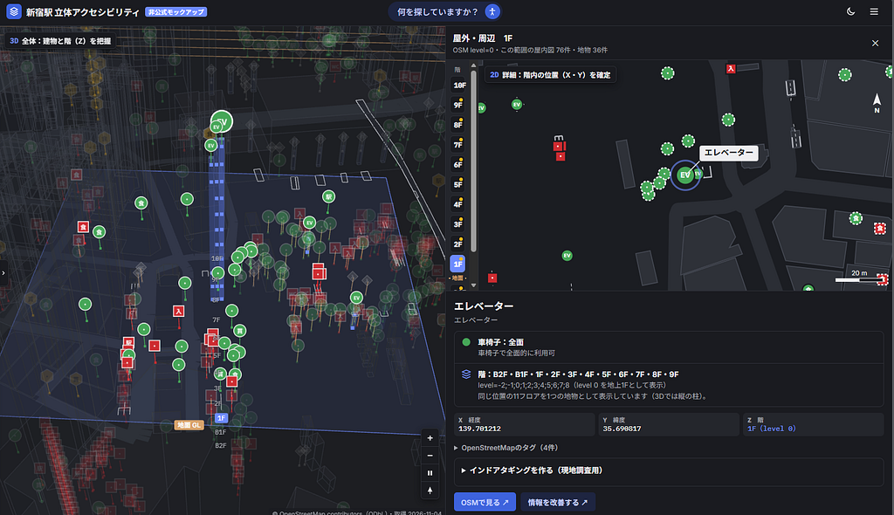

こんにちは、4年の井上です。最近より一層寒くなってきて、また布団から出られない日々が続きそうで心配です。先日はバイト前に昼寝をしていたところちゃんと寝坊しました。気を付けます。

さて、今回は卒論の中間発表ということでこの秋学期中に取り組んだことをまとめていきたいと思います。

> *発表スライド*

<https://docs.google.com/presentation/d/1Jr162UzTxx9SAu1KG4gP2yVKWIv3wzb7tUM2BiSjpfw/edit?usp=sharing>

> *GitHub*

[GitHub - furuhashilab/2026gsc\_RenseiInoue: 2026年度卒論](https://github.com/furuhashilab/2026gsc_RenseiInoue)

今回は新宿駅周辺のOpenStreetMapの実データを用いた**3Dマップのモックアップ作成**と、**先行事例の調査**を行いました。

モックアップでは、3Dで地物の階層を把握し、2Dの階平面図で詳細な位置を確認できる仕組みを試作しました。しかし、1,109件の地物のうち、階情報が登録されているのは637件（約57％）にとどまり、3D表示に向けたデータ整備の必要性が明らかになりました。

モックアップ

古橋先生との面談では、階情報を簡単に入力できるツールの開発について助言をいただき、研究対象をWheelmapに限定せず、3Dマップ全体へ広げる方針となりました。

また、ミニ東京3Dやスプラトゥーンの事例から、**特定の階層を強調し、それ以外を半透明にする表現**が、立体的な位置関係の理解に有効だと考えました。

> *まとめ*

面談を経て元々の方針と少し変わっては来ましたが、自分のやりたいことが明確になってきました。残り少ない期間ですが、できることはやり切って終わりたいと思います。

---

[【卒論】11月中間発表](https://medium.com/furuhashilab/%E5%8D%92%E8%AB%96-11%E6%9C%88%E4%B8%AD%E9%96%93%E7%99%BA%E8%A1%A8-9f60ff43bcf0) was originally published in [Furuhashi(mapconcierge)Lab.](https://medium.com/furuhashilab) on Medium, where people are continuing the conversation by highlighting and responding to this story.
