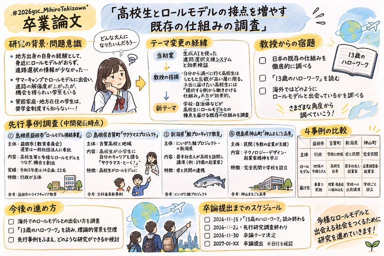

こんにちは！４年の滝沢です！！

今回は中間報告ということで、[スライド](https://aoyamajp-my.sharepoint.com/:p:/g/personal/aa122112_aoyama_jp/IQDrWJT6CzG7SbObkQOvFnZnAckjge7h0Mgh6cxk6cN2L34?e=Fgu7va)と[GitHub](https://github.com/furuhashilab/2026gsc_MihiroTakizawa/blob/main/README.md)のリンクを共有しておきます。

**卒論研究テーマ：「高校生とロールモデルの接点を増やす既存の仕組みの調査」**

#### はじめに

「将来、何になりたいのか」

高校生の頃、私はこの質問にすぐ答えることができなかった。

地方出身の私は、身近に多様な職業や生き方を知る機会が少なく、進路について考えるための情報も十分ではなかった。

そんな私の視野を広げてくれたのが、高校時代に参加したサマーキャンプでのロールモデルとの出会いだった。

自分とは異なる経験や生き方に触れることで、それまで知らなかった進学の道や将来の可能性(奨学金の存在、大学進学の意味)を知ることができた。この経験をきっかけに、私は「ロールモデルとの出会いが、人の未来の選択肢を広げるのではないか」と考えるようになった。

そして現在、卒業研究として取り組んでいるのが、**高校生とロールモデルの接点を増やす既存の仕組みの調査**である。

#### なぜ、この研究に取り組むのか？

ロールモデルとの出会いは、家庭環境や居住地域によって、得られる情報や出会いの機会には差がある。

例えば、身近に大学進学を経験した人がいなければ、進学に関する情報を得る機会そのものが少ないかもしれない。こうした状況を考えたとき、本人が自ら情報を探しに行くことだけに頼るのではなく、学校や自治体、地域などが高校生に機会を届ける仕組みが重要なのではないかと考えた。

#### 研究テーマを変更した理由

当初は、生成AIを活用した進路選択支援システムの開発と効果検証を考えていた。

生成AIとの対話を通じて、自分の価値観や強み、興味を整理し、ロールモデルとの出会いを通して将来の選択肢を広げる仕組みを構想していた。

しかし、教授との相談を通じて、自分から情報を探しに行く高校生だけを対象にしてしまう可能性があることに気が付くことができた。

積極的に進路について調べたり、AIサービスを利用したりする高校生は、もともと将来への関心や行動意欲が高い層かもしれない。

特に貧困家庭や地方住みの学生、本当に機会を必要としている高校生にも届けるためには、本人の主体的な行動だけに依存しない仕組みが必要なのではないか。

そこで、研究の方向性を見直し、現在のテーマに変更した。

#### 国内の先行事例4選

現在、日本国内で高校生とロールモデルをつなぐ取り組みを調査している。

今回は、主体や届け方が異なる4つの事例を紹介したい。

#### ① 島根県益田市「ロールモデル接続事業」

行政が主体となり、高校生等と多様なロールモデルをつなぐ取り組み。

一般社団法人豊かな暮らしラボラトリーと連携し、多様なライフキャリアに触れる機会を企画・コーディネートしている。

令和5年度には14企画、22名のロールモデルとの接点を創出した。

学校外の活動や居場所づくりにもつなげている点が特徴だ。

#### ② 島根県吉賀町「サクラマスプロジェクト」

吉賀高校を中心に、学校と地域が連携してキャリア教育に取り組んでいる。

特に注目したのは、高校生が町内の小学生に向けて、自分自身のキャリアを語る「サクラマス・とーく！」という活動だ。

高校生自身が小学生のロールモデルとなり、経験や学びを次の世代へつないでいる。

ロールモデルとの出会いが一方向ではなく、地域の中で循環している点が興味深い。

#### ③ 新潟県「にいがた鮭プロジェクト」

県と民間が連携し、若手社会人や起業家などが高校を訪問して、自身の仕事やキャリアについて語る取り組み。

地域で働くことや、新潟でキャリアを築くことの魅力を高校生に伝えている。

私自身の出身地でもある新潟県の事例として、関心を持っている。

地域で活躍する人との出会いが、地元で働くことや暮らすことを考えるきっかけになるのではないかと感じた。

#### ④ 徳島県「神山まるごと高専」

企業や起業家など、多様な人材と学生が関われる教育環境をつくっている学校。

テクノロジー、デザイン、起業家精神を軸に、新しい価値を生み出す人材の育成を目指している。

これまでの事例とは異なり、外部の人との出会いを単発のイベントにするのではなく、学校の教育環境そのものに組み込んでいる点が特徴だ。

#### 今後について

今後は、国内の先行事例をさらに調査するとともに、海外では高校生がどのようにロールモデルと出会っているのかについても調べていく。

また、村上龍氏の『13歳のハローワーク』を読み、職業選択やキャリア教育についての理解を深めたい。

最終的には、既存の仕組みの特徴や課題を整理し、高校生に多様なロールモデルとの出会いを届けるためには何が必要なのかを考察していく予定だ。

GPT-6

---

[卒論中間発表](https://medium.com/furuhashilab/%E5%8D%92%E8%AB%96%E4%B8%AD%E9%96%93%E7%99%BA%E8%A1%A8-399b6a5fe5be) was originally published in [Furuhashi(mapconcierge)Lab.](https://medium.com/furuhashilab) on Medium, where people are continuing the conversation by highlighting and responding to this story.
