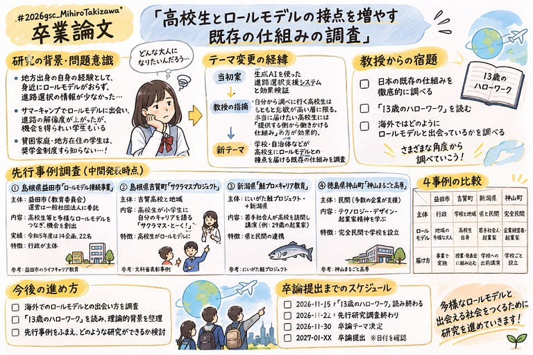
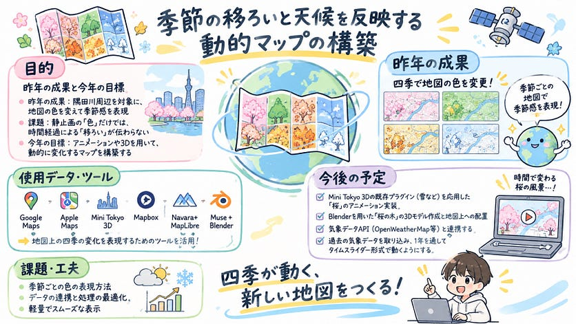

こんにちは、4年の安生です。

中間発表のスライドはこちらです。

<https://medium.com/media/50a019129f2498e1e6798b485a869e6e/href>

1. 昨年の成果と今年の課題

昨年のゼミ論では、隅田川周辺を対象に地図の色彩を変化させることで「四季」を表現する試みを行いました。一定の成果は得られたものの、静止画による色の変化だけでは、時間経過に伴う季節の「移ろい」を直感的に伝えるのが難しいという課題が残りました。

そこで今年度は、アニメーションや3D表現を取り入れ、より動的に変化するマップ体験の構築を目指しています。

2. 既存マップ・ツールの比較分析

どのような技術アプローチが最適かを探るため、現在利用可能な地図サービス（Google Maps, Apple Maps等）と、開発ツール・技術（Mini Tokyo 3D, Mapbox, MapLibre, Navara, Blender等）の現状を調査し、比較表を作成しました。

分析の結果、以下のことが見えてきました。

* データ連動による「雨や雪」の表現は、Mini Tokyo 3DやMapbox等で実現されている。
* - しかし、リアルタイムの気象データと連動して「桜などの植物の季節変化」を3Dで動的に表現しているWebマップは現状存在しない。

ここに本研究の新規性があると考えました。

3. 今後の制作方針と実装内容

既存の優れた技術を組み合わせ、以下のアプローチで「リアルタイムのデータを連動させた季節の移ろいを体験できる地図」を制作します。

【実装する機能】

* 現実の天候や季節データ（時間経過）の自動取得
* \* 取得したデータと連動して変化する「桜」の3Dアニメーション

【使用するツール・技術】

* Mini Tokyo 3D (ソースコード):システム全体とアニメーションの基盤
* MapLibre:ベースとなる地図の土台
* OpenWeatherMap API等:気象データの取得元
* \*Blender:桜などの空間3Dモデルの作成

4. 現在の進捗と今後の予定

現在は比較分析を通じた方針決定と、ベースとなる「Mini Tokyo 3D」を自身のGitHubへフォークし、開発環境を構築するところまで完了しています。

今後は以下の手順で実装を進めていきます。

1. Mini Tokyo 3Dの既存プラグイン（降水等）を応用した「桜」のアニメーション実装
2. 2. Blenderを用いた「桜の木」の3Dモデル作成と地図上への配置
3. 3. 気象データAPI（OpenWeatherMap等）との連携テスト
4. 4. 過去の気象データを取り込み、1年を通してタイムスライダー形式で動くUIの実装

進捗については、引き続きGitHubに更新していきます。

---

[卒論中間発表](https://medium.com/furuhashilab/%E5%8D%92%E8%AB%96%E4%B8%AD%E9%96%93%E7%99%BA%E8%A1%A8-5da5b01ccd2e) was originally published in [Furuhashi(mapconcierge)Lab.](https://medium.com/furuhashilab) on Medium, where people are continuing the conversation by highlighting and responding to this story.
