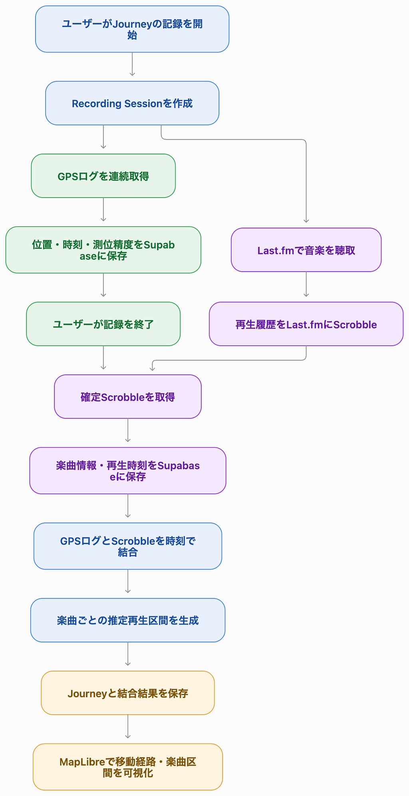
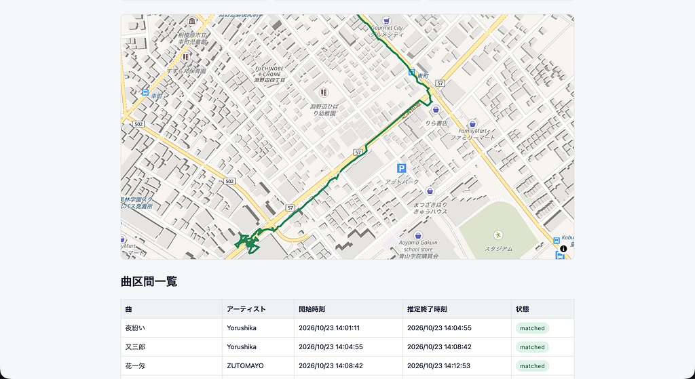
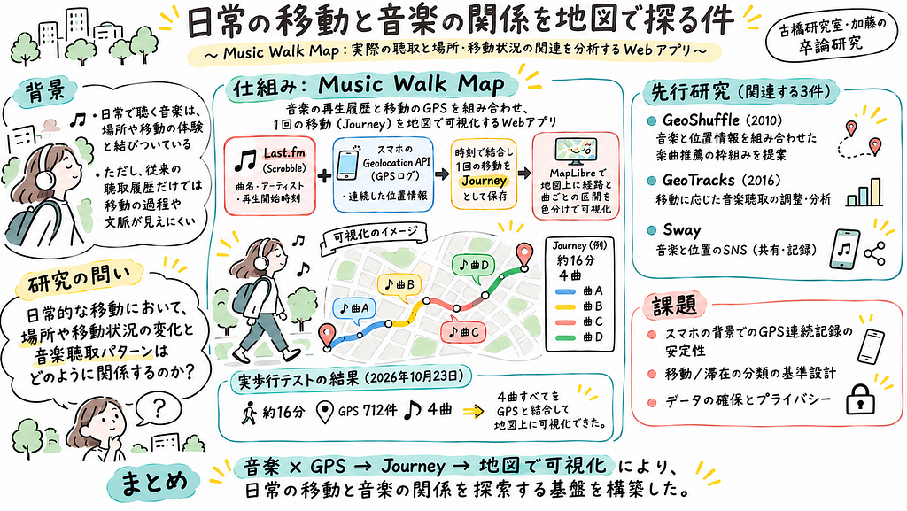

みなさんこんにちは！古橋研究室4年の加藤です。

今回は、卒業論文の研究として開発しているWebアプリケーション「Music Walk Map」について紹介します。

2025年度のゼミ論では、音楽の再生履歴と位置情報を組み合わせ、聴いていた音楽を地図上に記録するプロトタイプを開発しました。卒論ではこの取り組みを発展させ、**日常的な移動と音楽聴取の関係を明らかにすること**を目指しています。

この記事では、研究の背景や目的、先行研究との違い、現在までの開発成果、今後の計画についてまとめます。

<https://medium.com/media/855f4c5c6a2ac6b009e8355a536898d0/href>

### 1. 研究背景

普段、通学や散歩などの移動中に音楽を聴く人は多いと思います。

私自身も日常的に音楽を聴いており、以前訪れた場所を通ったときに、そのとき聴いていた曲を思い出すことがあります。音楽は楽曲そのものだけでなく、聴いていた場所や移動中の体験とも結びついているのではないかと感じています。

現在、SpotifyやApple Music、Last.fmなどのサービスでは、音楽の再生履歴を確認できます。しかし、一般的な再生履歴からは、その曲をどこで、どのように移動しながら聴いていたのかを把握することは難しいです。

例えば、ある曲を聴いている間に住宅地から公園へ移動していたとしても、通常の再生履歴にはその移動過程は記録されません。

そこで、音楽の再生履歴と連続的な位置情報を組み合わせれば、移動中の音楽聴取を、時間だけでなく場所の変化も含めて捉えられるのではないかと考えました。

### 2. 研究目的

本研究の中心となるリサーチクエスチョン（RQ）は、次のとおりです。

**「日常的な移動において、場所や移動状況の変化と音楽聴取パターンはどのように関係するのか？」**

この問いに対し、音楽再生履歴とGPSによる連続的な位置情報を組み合わせ、日常的な移動中の音楽聴取パターンを探索的に分析することを目指しています。

また、本研究では、音楽聴取パターンとして、楽曲やアーティスト、再生順序、曲の切り替わりなどに注目し、取得可能な場合にはジャンルや音楽タグも分析対象とします。

具体的には、以下の3つの観点に注目します。

* **場所との関係：** 公園や住宅地、駅周辺など、場所によって聴かれる音楽にどのような特徴が見られるのか。
* **移動状況との関係：** 移動中と滞在中で、音楽聴取パターンに違いが見られるのか。
* **移動過程での変化：** 場所や移動状況が変わる中で、聴かれる楽曲やアーティスト、曲の切り替わりなどにどのような変化が見られるのか。

なお、本研究では場所が音楽の選択に直接影響を与えるという因果関係の証明ではなく、実際に記録されたデータから両者の関連性を探索することを目的としています。

### 3. 先行研究と本研究の特徴

音楽と位置情報を組み合わせる研究は、これまでにも行われてきました。ここでは、本研究と関連する4つの研究を紹介します。

### GeoShuffle（Miller et al., 2010）

GeoShuffleは、位置情報や移動経路、過去の音楽再生履歴を利用し、利用者の状況に応じた音楽推薦を行うシステムです。

GPSによる移動経路の記録や、経路上で聴かれた楽曲・ジャンルの集計も実現しており、本研究と共通する部分が多い先行研究です。

一方、GeoShuffleが音楽推薦や探索の改善に重点を置いているのに対し、本研究では、**場所や移動状況と実際の音楽聴取パターンの関係を分析すること**に重点を置いています。

### GeoTracks（Greenhalgh et al., 2016）

GeoTracksは、GPSで取得した移動経路に合わせて、既存の音楽の構成や長さを調整するシステムです。

移動に合わせて音楽を変化させることを目的としているのに対し、本研究では、利用者が普段どおりに聴いている音楽を記録し、移動との関係を後から分析します。

### Sway（関連アプリ）

Swayは、音楽と位置情報を組み合わせたSNSアプリです。ユーザーの周辺で聴かれている楽曲を地図上で確認したり、すれ違った人が聴いていた音楽を知ったりすることができます。

Music Walk Mapと同様に、音楽と場所を結びつけている点が特徴です。一方、Swayは音楽を通じた交流や新しい楽曲との出会いを主な目的としており、公開されている機能では、移動経路全体とその途中の音楽聴取を連続的に可視化する仕組みは確認できませんでした。

本研究では、音楽と場所のつながりに加え、1回の移動をJourneyとして記録し、場所や移動状況の変化と音楽聴取パターンの関係を分析することを目指しています。

### 本研究の特徴・新規性

これらの先行研究では、都市環境を利用した音楽生成、位置情報に基づく音楽推薦、移動中の音楽体験の調査など、音楽と場所に関するさまざまな取り組みが行われています。

本研究では、これらの研究を踏まえながら、**日常的な移動における場所や移動状況の変化と、実際の音楽聴取パターンの関係を分析すること**に重点を置いています。

具体的には、Last.fmの音楽再生履歴と連続的なGPSログを時刻によって結合し、1回の移動をJourneyとして記録します。これにより、楽曲ごとの移動経路や再生順序を保持し、場所カテゴリや移動・滞在などの状況と音楽聴取パターンの関連を探索的に分析します。

GeoShuffleなどの先行研究でも移動経路と音楽履歴の組み合わせは実現されていますが、本研究では、音楽推薦ではなく、移動中の環境や行動の変化と音楽聴取の関係そのものを分析対象とする点に特徴があります。

こうした分析の有用性と研究上の貢献については、今後収集する実データを用いて検証していきます。

### 4. Music Walk Mapの仕組み

本研究のために開発しているのが、Webアプリケーション「Music Walk Map」です。

2025年度のゼミ論では、Spotify APIを利用して再生履歴を取得し、その時点の位置情報や天気、気分などと組み合わせ、地図上に記録するプロトタイプを開発しました。

しかし、この方式では楽曲を検出した時点の位置しか取得できず、1曲を聴いている間にどのように移動したかを把握できませんでした。

そこで卒論では、音楽再生履歴とGPSログを別々に取得し、時刻によって結合する方式へ変更しました。

### 音楽再生履歴と位置情報の取得

音楽データには、Last.fmのScrobble機能を利用しています。

Scrobbleとは、対応する音楽プレイヤーで再生した楽曲をLast.fmに記録する仕組みです。Music Walk Mapでは、Last.fm APIから楽曲名、アーティスト名、再生開始時刻などを取得します。

位置情報については、WebブラウザのGeolocation APIを利用し、記録開始から終了までの間、緯度・経度、取得時刻、測位精度などを継続的に保存します。

### Journeyという記録単位

本研究では、1回の移動と、その間に聴いた複数の楽曲をまとめたデータを「Journey」と呼んでいます。

例えば、大学から駅まで移動している間に4曲聴いた場合、その移動経路と4曲の再生履歴を1つのJourneyとして記録します。

Journeyでは、移動経路だけでなく、楽曲の再生順序や、各曲を聴いていたと推定される区間も保持します。

これにより、「この場所でこの曲を聴いた」という地点単位の記録だけでなく、「この曲を聴きながら、どこからどこへ移動していたか」という移動の過程を把握できるようになります。

### 時刻によるデータの結合

Music Walk Mapでは、Last.fmから取得した楽曲の再生開始時刻とGPSログの取得時刻を照合します。

楽曲の終了時刻は、次の曲の開始時刻や楽曲の長さなどを参考に推定し、その再生区間に含まれるGPS地点を楽曲へ対応付けます。

生成した移動経路と楽曲区間は、MapLibre GL JSを利用して地図上に可視化します。

この仕組みにより、音楽再生履歴を単なる時系列の一覧ではなく、移動中の空間的な文脈を持つデータとして扱えるようにしています。

### 5. 現在までの開発成果

2026年8月の構想発表以降、Music Walk Mapの基盤となる機能の開発を進めてきました。

現在までに、主に以下の機能を実装しています。

* Last.fm APIによる音楽再生履歴の取得
* Geolocation APIによる連続GPSログの取得
* Supabaseへの音楽履歴・位置情報の保存
* 音楽再生履歴とGPSログの時系列結合
* Journeyの生成・保存
* MapLibreによる移動経路と楽曲区間の地図表示
* ユーザー認証、研究参加同意、記録開始・終了画面の実装

### 実際の歩行データによる検証

2026年10月23日には、スマートフォンを用いた実歩行テストを実施しました。

約16分間の移動で712件のGPSログと4曲の音楽再生履歴を取得し、4曲すべてについて、推定再生区間内のGPSログとの結合に成功しました。

さらに、MapLibreを利用して、移動経路と楽曲ごとの推定再生区間を地図上に表示できました。

この結果から、実際の歩行データを用いて、音楽再生履歴と連続GPSログを結合し、Journeyとして可視化する一連の処理が動作することを確認できました。

一方、楽曲の終了時刻は推定値であり、今回の結果だけで結合精度や継続的な記録の安定性が十分に検証されたわけではありません。今後は異なる移動環境や複数の参加者による検証を進めていきます。

### 6. 今後の研究計画

今後は、開発したMusic Walk Mapを利用して実際の移動データを収集し、研究の中心である「場所や移動状況と音楽聴取パターンの関係」を分析していきます。

### 気分・天気データの活用

さらに、2025年度のゼミ論で扱っていた気分や天気のデータについても、今後の研究で活用したいと考えています。

天気については、GPSの位置情報と記録時刻をもとに気象データを取得し、晴れや雨、気温などの違いと音楽聴取パターンの関係を調べることを検討しています。

また、気分についても、利用者が記録した主観的な状態と音楽聴取との関係を分析できる可能性があります。

まずは場所や移動状況と音楽聴取パターンの関係を中心に分析し、データ収集や実装の状況に応じて、気分・天気などの要素も取り入れていく予定です。

### パイロット調査の実施

まずは少人数の参加者にMusic Walk Mapを利用してもらい、日常的な移動中のGPSログと音楽再生履歴を取得します。

アプリの操作性や記録の安定性、音楽再生履歴と位置情報の結合状況を確認し、本格的なデータ収集に向けた課題を整理します。

### 場所・移動状況の分類

収集したGPSログに対して、OpenStreetMap（OSM）の地理データを利用し、公園、住宅地、駅周辺、商業地などの場所カテゴリを付与することを検討しています。

また、GPSログから推定される移動速度や位置の変化を利用して、移動中と滞在中などの状態を分類する予定です。

これらの分類によって、場所や移動状況ごとに音楽聴取パターンを比較できるようにします。

### 音楽聴取パターンの分析

収集したJourneyデータを用いて、場所や移動状況と音楽聴取パターンの関係を分析します。

まず、OpenStreetMapの地理データを利用してGPSログに場所カテゴリを付与し、位置の変化や移動速度などから移動中・滞在中といった状態を分類する予定です。

そのうえで、公園や住宅地、駅周辺などの場所カテゴリごとに、聴かれた楽曲やアーティストなどの特徴を比較します。また、移動中と滞在中の違いや、1回のJourneyの中で場所・移動状況が変わる前後の楽曲の切り替わりにも注目します。

さらに、楽曲のジャンルや音楽タグを安定して取得できた場合には、音楽的な特徴についても比較を行いたいと考えています。

ただし、音楽の好みや再生方法、移動目的なども結果に関係する可能性があるため、まずは少人数のデータを用いた探索的・記述的な分析を進める予定です。

### 7. 現時点での課題

研究を進めるうえで、現時点では主に3つの課題があります。

**1つ目は、データ収集の安定性です。**

スマートフォンのブラウザで位置情報を継続取得する場合、画面ロックやバックグラウンド動作などによって記録が中断される可能性があります。

**2つ目は、場所や移動状況の分類方法です。**

GPSログから得られる位置や時刻の情報をもとに、場所カテゴリや移動状態をどのような基準で判定するか、今後検証する必要があります。

**3つ目は、分析に必要なデータの確保です。**

日常的な移動と音楽聴取の関係を調べるためには、異なる場所や移動状況を比較できるだけのJourneyを収集する必要があります。

また、位置情報は個人の生活圏や移動経路を推測できる情報でもあるため、研究参加者の同意やデータの管理にも十分に配慮しながら進めていきます。

### 8. おわりに

2025年度のゼミ論では、音楽再生履歴を地図上に記録するプロトタイプの開発からスタートしました。

卒論ではそこから発展し、音楽再生履歴と連続的な位置情報を組み合わせることで、1回の移動をJourneyとして記録・可視化する仕組みを実装しました。

2026年10月には、実際の歩行データを用いてJourneyを記録・可視化できるところまで進みました。

今後は、開発したシステムを研究のためのデータ収集基盤として活用し、日常的な移動における場所や移動状況と音楽聴取パターンの関係を分析していきます。

音楽を「いつ聴いたか」だけでなく、「どこで、どのように移動しながら聴いていたか」という視点から捉えることで、新しい発見につなげていきたいと考えています。

卒論完成に向けて、引き続き取り組んでいきます！

---

[日常の移動と音楽の関係を地図で探る件](https://medium.com/furuhashilab/%E6%97%A5%E5%B8%B8%E3%81%AE%E7%A7%BB%E5%8B%95%E3%81%A8%E9%9F%B3%E6%A5%BD%E3%81%AE%E9%96%A2%E4%BF%82%E3%82%92%E5%9C%B0%E5%9B%B3%E3%81%A7%E6%8E%A2%E3%82%8B%E4%BB%B6-ebf04367c53e) was originally published in [Furuhashi(mapconcierge)Lab.](https://medium.com/furuhashilab) on Medium, where people are continuing the conversation by highlighting and responding to this story.
