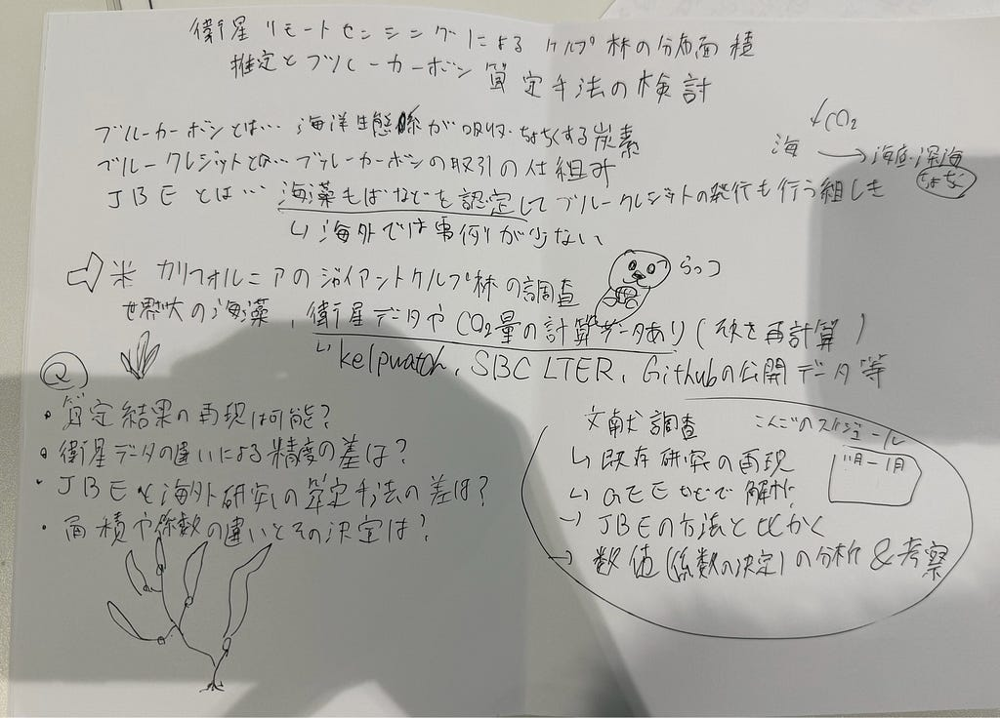

2026年度 ゼミ論構想・秋季中間報告

3年 田邊 湊士

GitHubリンク: <https://github.com/MinatoTanabe/Zemiron_2026gsc_MinatoTanabe/blob/main/zemiron.md>

スライドリンク: <https://speakerdeck.com/minatotanabe/zemiron-chuukan-houkoku-1>

⸻

Introduction｜研究背景・目的・研究の問い

1. 研究の背景

ブルーカーボンとは、一般に海草藻場、海藻藻場などの沿岸・海洋生態系に関連して吸収・貯留される炭素のこと

日本では、ジャパンブルーエコノミー技術研究組合が、CO₂吸収・貯留効果を評価し、Jブルークレジットを認証・発行している。

JBEは、海草藻場だけでなく、大型海藻が形成する藻場も評価対象としている。海外ではマングローブ林や塩性湿地などのブルーカーボン評価が先行しており、長期炭素貯留量の算定方法などが課題である。

2. ジャイアントケルプ林への着目

世界最大級の大型褐藻であるジャイアントケルプについて調査をする。ジャイアントケルプは成長速度が速く、海洋生態系の中でも生産性が高いことが知られている。

ケルプが海面でキャノピー面を作り、それを利用した複数の衛星画像からケルプ林の分布や変化を観測する研究ができる。しかし、衛星画像からは海中に存在する藻体全体の現存量を測定できない。

3. 研究目的

研究の目的は、カリフォルニア沿岸のジャイアントケルプ林を対象として、既存研究の炭素算定結果を再計算し、衛星リモートセンシングによる面積推定とJBEの算定手法を比較することで、海外のケルプ林に対する算定方法の適用可能性と課題を検証すること。

さらに、Google Earth Engineを使用してジャイアントケルプの分布面積を推定し、既存の衛星分布データとの違いを明らかにする。またJBEの算定式で必要となる変数と海外研究で用いられる変数を比較し、データや係数の違いが推定結果に与える影響を調べる

4. 研究の問い

カリフォルニアのジャイアントケルプ林について、既存研究で公表された炭素算定結果を再現できるか。

\*\*衛星データや解析方法の違いによって、ジャイアントケルプの面積推定値はどの程度変化するか。

日本のJBEと海外の既存研究では、炭素算定方法や必要な変数にどのような違いがあるか。

藻場面積や変換係数の違いは、炭素量の推定結果にどの程度影響するか。

⸻

Method｜調査対象区域・使用データ・調査方法

1. 調査対象区域

カリフォルニア州のサンタバーバラ海峡を衛星解析の対象海域とした。理由は、ジャイアントケルプ林が形成されていることに加え、長期間の生態学的観測データと衛星データが蓄積されているため。SBC LTERでは、2000年からケルプ林の生態系構造などの継続観測が行われている。ジャイアントケルプの現存量、純一次生産量、炭素・窒素含有率、水温、波浪、海底環境などに関するデータが公開されている。

2. 使用するデータ

Kelpwatch: 1984年以降の長期的なケルプキャノピーの分布変化を確認できる。また、Planet由来の高解像度ケルプ分布地図については、Cavanaugh et al.（2026）が公開した分類済みデータを利用する。

独自の解析では、GEEを用いてSentinel-2画像を取得し、可視光・近赤外バンドなどの情報をもとにケルプを分類する。さらに、AlphaEarth Foundationsの64次元の年次特徴量を用いた分類も使う。

3. 調査方法

JBEの公式認証申請手引きから、算定方法の入力変数と条件を確認する。

English et al.（2025）の公開GitHubから解析用データとRコードを取得し、DOC生産量の再計算を試してみる。

GEEでSentinel-2画像を取得し、雲・雲影・陸域などを除外した後に分類を行う。

KelpwatchのLandsat由来データと、Planet由来の約3m解像度の分類地図を取得する。

⸻

Results

1. 先行研究Bell et al.（2023）：Kelpwatchによるケルプ林の長期変化

論文（PLOS ONE）

Kelpwatch

1–1. 研究目的

衛星画像から推定されたケルプキャノピーの長期分布データから、Kelpwatchを開発した。

1–2. 使用したデータと調査方法

衛星: Landsat 4、5、7、8

1984～2021年の間に取得された、空間解像度30mのデータを利用。

### 解析では、6つの波長帯を利用し、雲や陸域を除外したうえでケルプを分類している。

1–3. 得られた主な数値

調査項目・結果

衛星観測期間 1984～2021年

空間解像度 30m

主な集計区画 10km×10km

解析した区画数 172区画

有意な長期変化があった区画 32区画（18.6%）

有意な減少傾向を示した区画 25区画（14.5%）

有意な増加傾向を示した区画 7区画（4.0%）

172区画のうち約8割では、38年間を通して増加、減少傾向がなかったことが分かり、同じ地域でも年によって面積が大きく変化することが明らかになった。

1–4. 本研究での活用

Kelpwatchからサンタバーバラ海峡周辺の面積データを取得し、GEEで分類したSentinel-2の面積推定値と比較する。

2. 先行研究English et al.（2025）：ジャイアントケルプのDOC生産量

論文（Communications Biology）

公開データ・解析コード（GitHub）

2–1. 研究目的

English et al.（2025）は、ジャイアントケルプが周囲の海水中に放出する溶存有機炭素について、放出量がどのように変化するのかについての調査。

2–2. 調査地点と実験条件

試料採集は、サンタバーバラ沖で行われ、採集期間は2023年8月から2024年6月で、計9回の採集した。

2–3. 成熟・老化によるDOC放出速度の違い

実験で得られたDOC放出速度は、葉状部の乾燥重量1g当たり、1時間当たりに放出された炭素の物質量を表している。

成熟段階のケルプでは、光合成によって生産した炭素の比較的小さな割合がDOCとして放出されていることが分かった。老化段階では、純一時生産量を上回る速度でDOCが放出された。

2–4. 衛星データを利用した広域DOC生産量の推定

広域解析では、Landsat 7・8・9のデータを用いて、2001～2023年におけるカリフォルニア中部・南部のジャイアントケルプの現存量と生理状態を推定している。DOC放出量を推定する際に、ケルプの現存量や光合成量だけでなく、藻体の生理状態を考慮する必要があることを示している。

2–5. 本研究でどのように活用するか

この論文の年間DOC生産量などの再計算を試みる。

3. 先行研究Cavanaugh et al.（2026）：Planet Doveによる高解像度ケルプ地図

論文（Communications Earth & Environment）

公開データ・Shapefile版（Zenodo）

公開データ・Raster版（Zenodo）

3–1. 研究目的

Cavanaugh et al.（2026）は、従来のLandsatなどの中解像度衛星では十分に検出できなかった小規模・低密度のケルプキャノピーを高解像度で把握することを目的とした。

PlanetのDove衛星画像を使用し、深層学習モデルによってカリフォルニア沿岸のケルプ分布を地図化し、その地図を使ってケルプが同じ場所に何年間存在していたかを調べ、分布の持続性と海洋環境の関係を分析した。

3–2. 使用した衛星データと解析方法

空間解像度は約3mであり、30m解像度のLandsatよりも細かなケルプ分布を観測できる。2017～2024年のカリフォルニア沿岸のケルプ地図を作成した。画像の分類には、深層学習モデル「VGG16-U-Net」を使用した。

3–3. ケルプ分類モデルの精度

モデル全体の平均分類精度は89.59%。

分類対象 分類精度

ケルプ 86.4%

海水 94.7%

陸域 98.1%

波 79.2%

全体の平均精度 89.59%

深層学習によってケルプを比較的高い精度で分類できるが、波や海面反射などとの識別には課題がある。

3–4. ドローン・航空機による観測との比較

Planet Doveの分類地図は、UAVや航空調査に比べてケルプキャノピー面積を約2倍大きく推定する傾向がある。

3–5. ケルプ分布の持続性と環境条件の関係

2017～2024年の地図から、ケルプが同じ場所に何年間存在していたかを計算している。8年間のうちケルプが検出された年数を数えたところ、平均2.94年、標準偏差2.09年。

地域別では、カリフォルニア北部で持続性が低く、中部では比較的高い持続性が確認された。また、過去の持続性が高い場所、比較的水温が低い場所、浅い場所、分断の少ない場所で、ケルプが持続しやすい傾向が確認された。

3–6. 本研究でどのように活用するか

Cavanaugh et al.（2026）が公開した約3m解像度のケルプ分布地図を、衛星解析による面積推定の比較対象として活用する。

GEEでSentinel-2から作成した10m解像度のケルプ分類地図と、同じ地域・時期のPlanet由来地図を比較し、面積差を確認する。

Bellらは、ケルプの分布面積が時間的・空間的に大きく変化することを示した。

Englishらは、DOCの生産量を推定する際には現存量だけでなく、生理状態を考慮する必要があることを示した。

Cavanaughらは、衛星の解像度と分類精度がケルプの面積推定に影響し、高解像度の分類地図でも面積が過大評価される場合があることを示した。

これらを組み合わせることで、面積推定の違い、生態学的係数の違い、炭素量の定義の違いを整理し、JBEの算定方法との比較へつなげることができる。

Discussion

1. 衛星による面積推定の課題

衛星画像によって得られるケルプキャノピーの面積が、実際の藻場面積や現存量をどの程度表しているかという問題がある。特に、ジャイアントケルプは海面だけでなく海中にも大量の藻体が存在するため、海面のキャノピー面積だけでは海中のケルプ林全体を直接把握できない。

Cavanaugh et al.（2026）では、Planetによる面積推定がUAVや航空調査に比べて約2倍大きくなる傾向が示されている。衛星ごとの解像度だけでなく、分類方法、観測時期、ピクセル内の被覆率などを考慮して面積推定を比較する必要がある。

2. 炭素生産量と長期貯留量の違い

海藻が生産した炭素と、長期間貯留される炭素を区別することも課題である。

English et al.（2025）が推定したのは、ジャイアントケルプから海水中へ放出されるDOCの生産量である。しかし、DOCのすべてが長期間海洋中に残存するとは限らない。

3. 日本とカリフォルニアの環境条件の違い

日本の海藻藻場とカリフォルニアのジャイアントケルプ林では、生育する海藻の種類だけでなく、周辺の自然環境の条件も異なる。

これらの環境条件は、ケルプの成長速度や現存量、炭素生産量に影響すると考えられる。

そのため、日本のJBEで使用される算定係数を海外のケルプ林に適用する場合、係数の対象生態系や測定条件が一致しているかを確認する必要がある。

4. 本研究の独自性と意義

これまでの研究では、衛星を利用したケルプ林の面積推定や、DOC生産量の推定がそれぞれ行われてきた。

しかし、それらの推定結果を海外のブルーカーボン算定方法や、日本のJBEの算定体系と比較する際には、データの定義や係数の違いを整理する必要がある。

⸻

Conclusion

初めに、English et al.（2025）の既存算定結果を再現する。また、GEEによるケルプ面積の推定結果をKelpwatchやPlanet由来の分類地図と比較し、衛星観測の違いが計算結果に与える影響を検証する。その後、算定式の確立と検証を行い、成果を考察する。

今後は、先行研究の再現と独自の衛星解析を通じて、JBEの算定方法を海外のジャイアントケルプ林に応用する場合の可能性と課題を明らかにしていきたい。また、藻場やブルーカーボンについての総合的な知識を身につけ、専門的な知識を持つ人々との交流も深めたい。

⸻

References｜参考文献

査読論文・先行研究

Bell, T.W., et al. (2023) ‘Kelpwatch: A new visualization and analysis tool to explore kelp canopy dynamics reveals variable response to and recovery from marine heatwaves’, PLOS ONE, 18(3), e0271477. Available at: https://doi.org/10.1371/journal.pone.0271477

Cavanaugh, K.C., et al. (2026) ‘High-resolution Planet Dove data identify local drivers of kelp canopy persistence’, Communications Earth & Environment, 7, Article 137. Available at: https://doi.org/10.1038/s43247-025-03134-y

English, C.J., et al.(2025) ‘Senescence-driven solubilization of biomass is the main source of kelp-derived dissolved organic carbon to the coastal ocean’, Communications Biology, 8, Article 1172. Available at: https://doi.org/10.1038/s42003-025-08477-y

制度・データ・解析ツールの参照資料

Japan Blue Economy Association (JBE) (2026) Jブルークレジット認証申請の手引き Ver.2.6. 横須賀：ジャパンブルーエコノミー技術研究組合. Available at: https://www.blueeconomy.jp/credit/ (Accessed: 10 November 2026).

Santa Barbara Coastal Long Term Ecological Research (SBC LTER) (n.d.) Data Catalog. University of California, Santa Barbara. Available at: https://sbclter.msi.ucsb.edu/data/catalog/ (Accessed: 10 November 2026).

Kelpwatch (n.d.) Kelpwatch: Kelp Canopy Monitoring and Visualization. Available at: https://kelpwatch.org/map (Accessed: 10 November 2026).

English, C.J. et al. (2025) Giant\_Kelp\_DOC: Research Data and Analysis Code. GitHub repository. Available at: https://github.com/chance-english/Giant\_Kelp\_DOC (Accessed: 10 November 2026).

Cavanaugh, K.C. et al. (2026) High-resolution kelp canopy mapping datasets. Zenodo. Available at: https://zenodo.org/records/17644635 and https://zenodo.org/records/17717965 (Accessed: 10 November 2026).

Google (n.d.) Google Earth Engine Data Catalog: Sentinel-2 Harmonized Surface Reflectance. Available at: https://developers.google.com/earth-engine/datasets/catalog/COPERNICUS\_S2\_SR\_HARMONIZED (Accessed: 10 November 2026).

Google (n.d.) Google Earth Engine Data Catalog: AlphaEarth Foundations Satellite Embeddings. Available at: https://developers.google.com/earth-engine/datasets/catalog/GOOGLE\_SATELLITE\_EMBEDDING\_V1\_ANNUAL (Accessed: 10 November 2026).

グラれこ

---

[衛星リモートセンシングによるジャイアントケルプ林の面積推定とブルーカーボン算定手法の検討](https://medium.com/furuhashilab/%E8%A1%9B%E6%98%9F%E3%83%AA%E3%83%A2%E3%83%BC%E3%83%88%E3%82%BB%E3%83%B3%E3%82%B7%E3%83%B3%E3%82%B0%E3%81%AB%E3%82%88%E3%82%8B%E3%82%B8%E3%83%A3%E3%82%A4%E3%82%A2%E3%83%B3%E3%83%88%E3%82%B1%E3%83%AB%E3%83%97%E6%9E%97%E3%81%AE%E9%9D%A2%E7%A9%8D%E6%8E%A8%E5%AE%9A%E3%81%A8%E3%83%96%E3%83%AB%E3%83%BC%E3%82%AB%E3%83%BC%E3%83%9C%E3%83%B3%E7%AE%97%E5%AE%9A%E6%89%8B%E6%B3%95%E3%81%AE%E6%A4%9C%E8%A8%8E-51a7c3c69c48) was originally published in [Furuhashi(mapconcierge)Lab.](https://medium.com/furuhashilab) on Medium, where people are continuing the conversation by highlighting and responding to this story.
