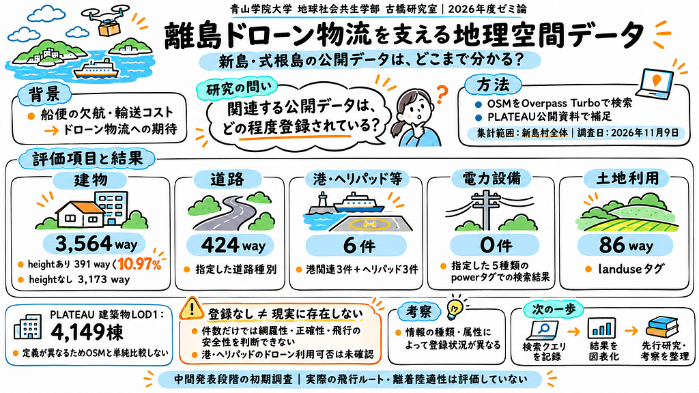

### ゼミ中間発表

スライド資料

<https://medium.com/media/28dae38cc5af4d1675473d17705abeb6/href>

リポジトリ

<https://github.com/furuhashilab/2026gsc_RearaKato/blob/main/README.md>

---

[離島のドローン物流に必要な地図情報は、どこまで公開されている？](https://medium.com/furuhashilab/%E9%9B%A2%E5%B3%B6%E3%81%AE%E3%83%89%E3%83%AD%E3%83%BC%E3%83%B3%E7%89%A9%E6%B5%81%E3%81%AB%E5%BF%85%E8%A6%81%E3%81%AA%E5%9C%B0%E5%9B%B3%E6%83%85%E5%A0%B1%E3%81%AF-%E3%81%A9%E3%81%93%E3%81%BE%E3%81%A7%E5%85%AC%E9%96%8B%E3%81%95%E3%82%8C%E3%81%A6%E3%81%84%E3%82%8B-67a60c1cd4bd) was originally published in [Furuhashi(mapconcierge)Lab.](https://medium.com/furuhashilab) on Medium, where people are continuing the conversation by highlighting and responding to this story.
