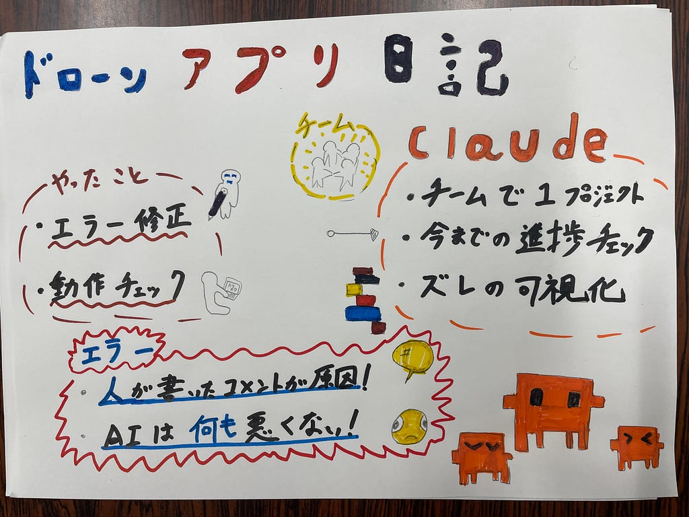

### **ドローンアプリ開発、少しずつ前進中！🚁**

こんにちは！ドローン部１の3年藤原です。今回の週報では、ドローン部の進捗を書いていきます！

### 1. 今回取り組んだこと

ドローン部で担当している飛行ログ解析について、今回はGPX変換ツールのエラー修正と動作確認を行いました。

飛行ログ解析グループでは、ドローンの飛行記録から飛行時間や移動距離、高度などの情報を取得し、共通のデータ形式「FlightRecord」に変換する機能を開発しています。

私は既存のプログラムに発生していた構文エラーの修正と、修正後の動作確認を担当しました。

### 2. GPX変換ツールのエラー修正

今回修正したのは、Go言語で作成された [worker/cmd/flightparse/main.go](https://github.com/furuhashilab/furuhashilab-drone-territory-sandbox/blob/feat/flight-parser/worker/cmd/flightparse/main.go) というファイルです。

コードの中に不要な関数宣言が入り込んでいたことで構文エラーが発生していたため、該当部分を削除しました。

今回の修正では、既存のデータ変換処理には変更を加えず、エラーの原因となっていた部分のみを修正しています。

修正内容はGitHubのPull Request #18として提出しました。

[**Pull Request #18：Fix flight parser syntax error**](https://github.com/furuhashilab/furuhashilab-drone-territory-sandbox/pull/18)

### 3. サンプルデータを使った動作確認

修正後は、テスト用のGPXファイルを使ってプログラムが正しく動作するかを確認しました。

まず、正常な飛行記録が含まれている synthetic\_normal.gpx を使用したところ、以下の結果が得られました。

項目実行結果飛行時間120秒飛行距離約121.37m最高高度30m出力形式FlightRecord（JSON）

飛行時間や距離などの情報を取得し、JSON形式のデータとして出力できることを確認しました。

また、時刻情報が含まれていない synthetic\_no\_time.gpx でもテストを実施しました。

こちらは飛行時間の計算に必要な情報が不足しているデータですが、時刻情報に関するエラーメッセージが表示されることを確認できました。

今回の作業では、正常なデータだけでなく、情報が不足しているデータに対する処理も確認することができました。

### 4. チーム開発に向けた引き継ぎ資料の作成

これまでの開発状況を整理するため、Markdown形式の引き継ぎ資料を作成しました。

現在、ドローン部では7人のメンバーがそれぞれAIを活用しながら開発を進めています。そのため、メンバー間で開発状況や仕様を共有し、認識のずれを防ぐことが重要になります。

今回の資料には、主に以下の内容をまとめました。

* これまでに担当した作業と実装状況
* GitHubのIssueやPull Requestの情報
* 使用している技術やプログラムの構成
* 現在の課題と未完成の機能
* 他のグループと確認する必要がある仕様
* 今後取り組む作業

特に意識したのは、**実際に実装・動作確認ができたものと、まだ検討段階のものを区別すること**です。

今後は各メンバーの資料を1つのClaude Projectに集約し、チーム全体の開発状況や仕様の食い違いを整理する予定です。

### 5. 今後の予定

今後は、提出したコードのレビューを進めるとともに、飛行ログから取得したデータをゲーム内のポイント計算にどのようにつなげるかについて、他のグループと相談していきたいです。

今回の作業を通して、コードの修正や動作確認だけでなく、複数人で開発を進めるうえで情報を整理・共有することの重要性も感じました。

今後も、他のグループとの連携を意識しながら開発に取り組んでいきたいと思います。

### 関連リンク

* [Drone Territory GitHubリポジトリ](https://github.com/furuhashilab/furuhashilab-drone-territory-sandbox)
* [Pull Request #18：GPX変換ツールの構文エラー修正](https://github.com/furuhashilab/furuhashilab-drone-territory-sandbox/pull/18)
* [Issue #6：FlightRecordの仕様検討](https://github.com/furuhashilab/furuhashilab-drone-territory-sandbox/issues/6)

#### グラレコ

---

[Drone Territory開発記録｜飛行ログ解析ツールの修正と開発状況の整理](https://medium.com/furuhashilab/drone-territory%E9%96%8B%E7%99%BA%E8%A8%98%E9%8C%B2-%E9%A3%9B%E8%A1%8C%E3%83%AD%E3%82%B0%E8%A7%A3%E6%9E%90%E3%83%84%E3%83%BC%E3%83%AB%E3%81%AE%E4%BF%AE%E6%AD%A3%E3%81%A8%E9%96%8B%E7%99%BA%E7%8A%B6%E6%B3%81%E3%81%AE%E6%95%B4%E7%90%86-21ef998c0f28) was originally published in [Furuhashi(mapconcierge)Lab.](https://medium.com/furuhashilab) on Medium, where people are continuing the conversation by highlighting and responding to this story.
