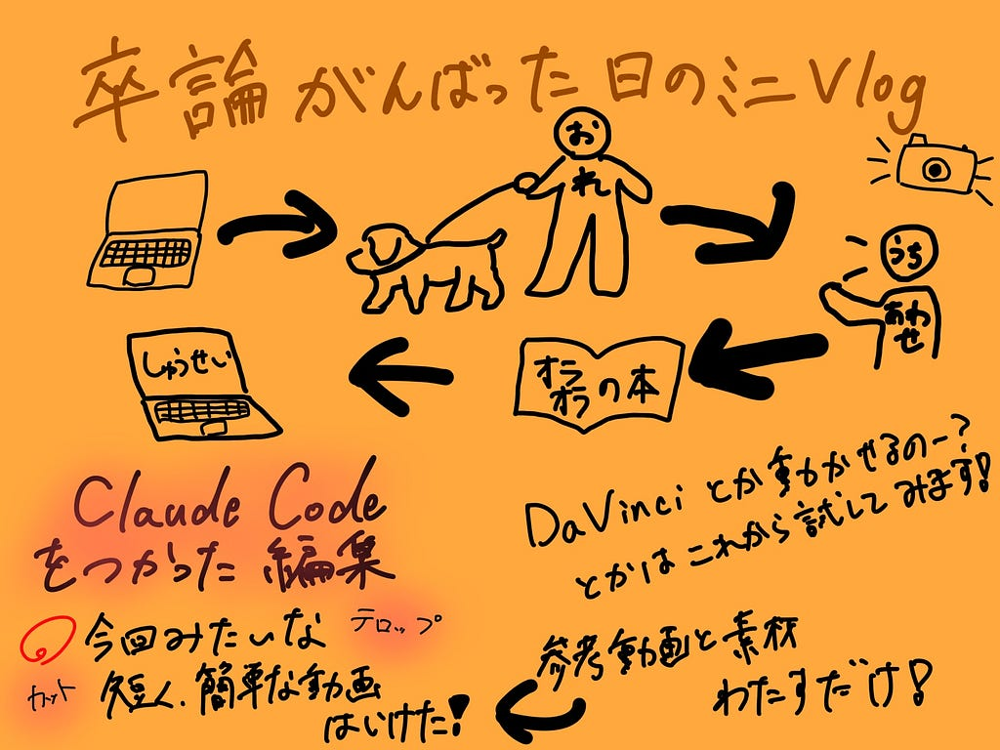

こんにちはあらしょうです！ほんとに最近寒くて嫌だけど、服選ぶのが楽しくて幸です。

今週のV&Fの週報では、TikTokに動画投稿したよーの報告をします。

[動画リンク](https://www.tiktok.com/@furuhashilab/video/7708633207758916882?is_from_webapp=1&sender_device=pc&web_id=7708298869937866261)

今期のテーマとして、「卒論・ゼミ論を発信しよう」を掲げているので、今回一本目として作成しました。卒論ってパソコンをいじる時間が長いので、なかなか動画にするのは難しいかなと思いますが、できるだけ記録に残して発信していきたいと思います！

今回の編集でも少し試してみたのですが、Claude Codeに動画編集を任せてみたいなと最近あらしょうの中で話題になっています。（今回は結局自分の手で完成させました）

今回は短い素材をつないでテロップ・SEを入れただけの簡単な編集でしたが、参考動画・動画素材を渡すだけで一応形にはなったので使い方次第で色んな可能性があるなと感じました。使用モデルはOpus 5.5で、クレジット消費もかなり少なく短時間で出力されたため、使い勝手もよくテンションが上がっています。

今回は[FFmpeg](https://ja.wikipedia.org/wiki/FFmpeg)というツールを動かして編集したみたいです。詳しいところまでリサーチは出来ていないので、編集ソフトで直接編集することはできるのかーなど、よく調べてみようと思います。

---

[【V&F週報】卒論頑張っちゃうぞ♪って1日を簡単な動画にしてみました](https://medium.com/furuhashilab/v-f%E9%80%B1%E5%A0%B1-%E5%8D%92%E8%AB%96%E9%A0%91%E5%BC%B5%E3%81%A3%E3%81%A1%E3%82%83%E3%81%86%E3%81%9E-%E3%81%A3%E3%81%A61%E6%97%A5%E3%82%92%E7%B0%A1%E5%8D%98%E3%81%AA%E5%8B%95%E7%94%BB%E3%81%AB%E3%81%97%E3%81%A6%E3%81%BF%E3%81%BE%E3%81%97%E3%81%9F-761b8f5f834d) was originally published in [Furuhashi(mapconcierge)Lab.](https://medium.com/furuhashilab) on Medium, where people are continuing the conversation by highlighting and responding to this story.
