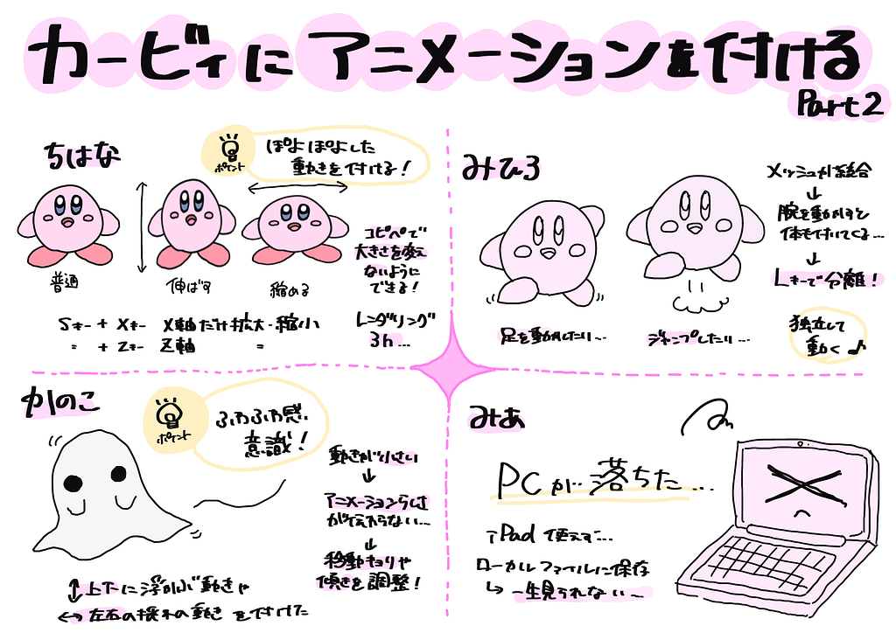

こんにちは！4年の小崎です。前期から始めたBlenderの作業ですが、ついにアニメーションを各自で作成する段階まで来ました！すごい！

#### ちはな

今回はカービィにアニメーションを付けました。

何の動きを作るか迷ったのですが、ゲーム上でしていたモーションを作りたいと考え、[カービィダンス](https://dic.pixiv.net/a/%E3%82%AB%E3%83%BC%E3%83%93%E3%82%A3%E3%83%80%E3%83%B3%E3%82%B9)の最後のキメの部分だけ作る事にしました。

完成した動画がこちらです。

<https://medium.com/media/85c3d0759733192187deda9a5900f55b/href>

カービィはぽよぽよとした可愛い動きが特徴だと思ったので、Sキー+ZキーやSキー+Xキーを使ってカービィの体を押しつぶしたような形にしたり、逆に伸ばしてみたり、弾力が感じられるアニメーションを付けてみました。

全体的にそこまで苦労はしなかったのですが、拡大縮小を使う関係上、最初と最後でカービィの大きさが微妙に変わっていても気づけないなとアニメーションを付け終わって気づきました。

モデルを拡大縮小した時は最初のポーズをコピペするなどの対策を取れば大きさを変えずにアニメーションを付けることができると思いました。

また、今回はマテリアルペイントを行っていたこともあり、レンダリングにかなり時間がかかりました。

短い動画でこの長さなので、もっと長いアニメーションを作るときは恐ろしい長さになるな……と思いました。

カービィは腕や足の可動域が広く、腕や足を大きく動かしても破綻がなく、アニメーションを付けるのがとても楽しかったです。

機会があれば、形の変わらないキャラクターのアニメーションにも挑戦してみたいです！

#### かのこ

前回制作したお化けの3Dモデルに、Blenderでアニメーションをつけました！

まず、ボーンとモデルを関連付け、ボーンの動きに合わせてお化けが変形するように設定しました。

その後、キーフレームを使って上下に浮かぶ動きや左右に揺れる動きを追加しました。最初は動きが小さく、アニメーションらしさが伝わりにくかったため、移動距離や傾きを調整し、お化けらしいふわふわした浮遊感を意識しました。

完成したアニメーションはこちらです！

<https://medium.com/media/fce8d57c90303cb0d78caf152213ff40/href>

#### みひろ

今回は、最後の工程、アニメーションを行いました。最初はメッシュが統合されていたため、腕を動かすと体全体がついてきてしまう問題が発生しました。

そこで解決策として編集モードでLキーを使って腕と足のパーツを分離しすることにしました。

その結果、腕と足がそれぞれ独立して動くようになり、ジャンプのアニメーションを作ることができました。

アニメーションはこちらです。↓

[fa020c69ad9dc9bb5733853ebfaded0a.MP4](https://drive.google.com/file/d/19x6x83U3dfqVbdWHsBAdLg5qLRMc8roh/view?usp=drivesdk)

#### みあ

作業するぞー！と思ってパソコンを触ったら、電源がつかなくなってしまいました。。。充電してみても全く動かないので、今週修理に出そうと思います。

iPadとかで代用できるかな？と思って調べましたがどうやらできなさそうで、、😥😥

元々作成していたファイルもPCのローカルにしか保存していなかったので直らなかったら一生見られないものになりそうです。

#### グラレコ

ちはな作

---

[デザイン1週報](https://medium.com/furuhashilab/%E3%83%87%E3%82%B6%E3%82%A4%E3%83%B31%E9%80%B1%E5%A0%B1-11f22c448973) was originally published in [Furuhashi(mapconcierge)Lab.](https://medium.com/furuhashilab) on Medium, where people are continuing the conversation by highlighting and responding to this story.
