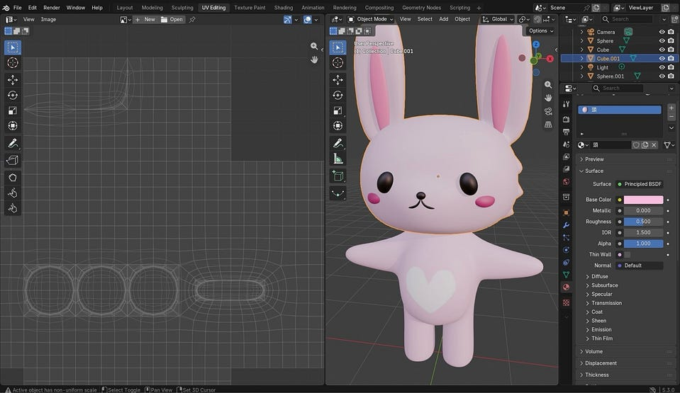
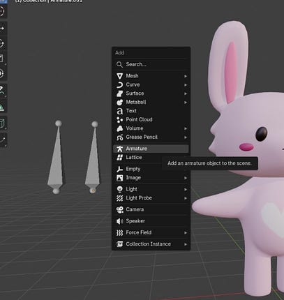

こんにちは、3年の米久保です！

ゼミ論・卒論の中間発表など、数週間他の作業を行っていましたが、今回はまたアニメーション制作の続きを行いました！

【ゆうかさん】

今週はうさぎのテクスチャペイントと骨作り、名前付けの作業を行いました。お腹に色をつけるのは3年生の時にクマを作成した時にも行ったため、今回はハート模様にして工夫しました。

何回かエラーが出てしまいましたが、原因は、左と右の画面で異なる箇所を選択をしていたためで、ちゃんと塗ることができました。

しかし、骨を入れていく作業は初めて行ったため、shift＋Aから、Armatureというオブジェクトを出して、Eで引き伸ばすことで、アニメーションとして動かす際の骨組みを作ることができると分かったのがとても良かったです。

来週からは、[2つ目の動画](https://youtu.be/blrl76DraEc?si=I6AzInE1Gk74Estn)を進めていき、3つ目のアニメーション偏の動画までいけるように引き続き頑張っていきたいと思います。

【もえさん】

【みわ】

> まとめ

> グラレコ

---

[デザイン2 アニメーション制作を再開！](https://medium.com/furuhashilab/%E3%83%87%E3%82%B6%E3%82%A4%E3%83%B32-%E3%82%A2%E3%83%8B%E3%83%A1%E3%83%BC%E3%82%B7%E3%83%A7%E3%83%B3%E5%88%B6%E4%BD%9C%E3%82%92%E5%86%8D%E9%96%8B-ff6f4b239a88) was originally published in [Furuhashi(mapconcierge)Lab.](https://medium.com/furuhashilab) on Medium, where people are continuing the conversation by highlighting and responding to this story.
