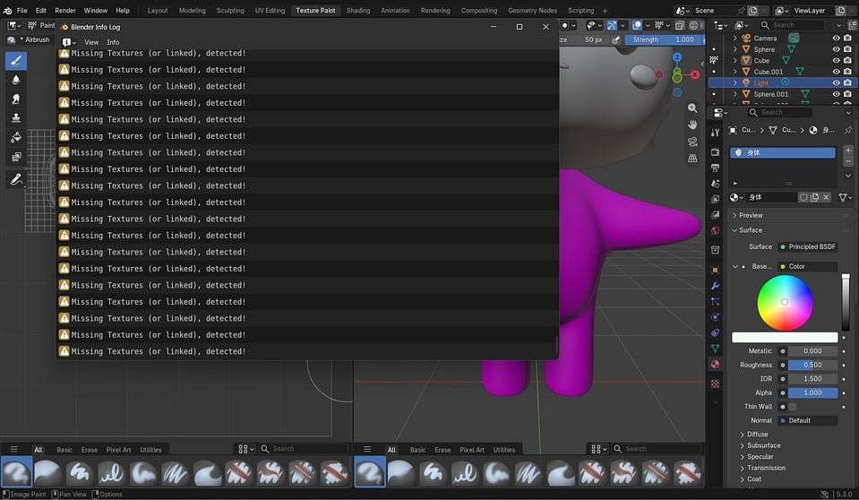
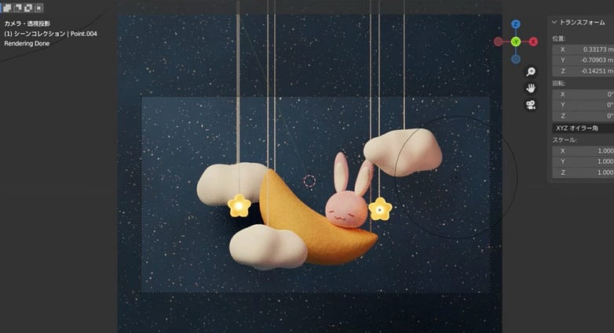
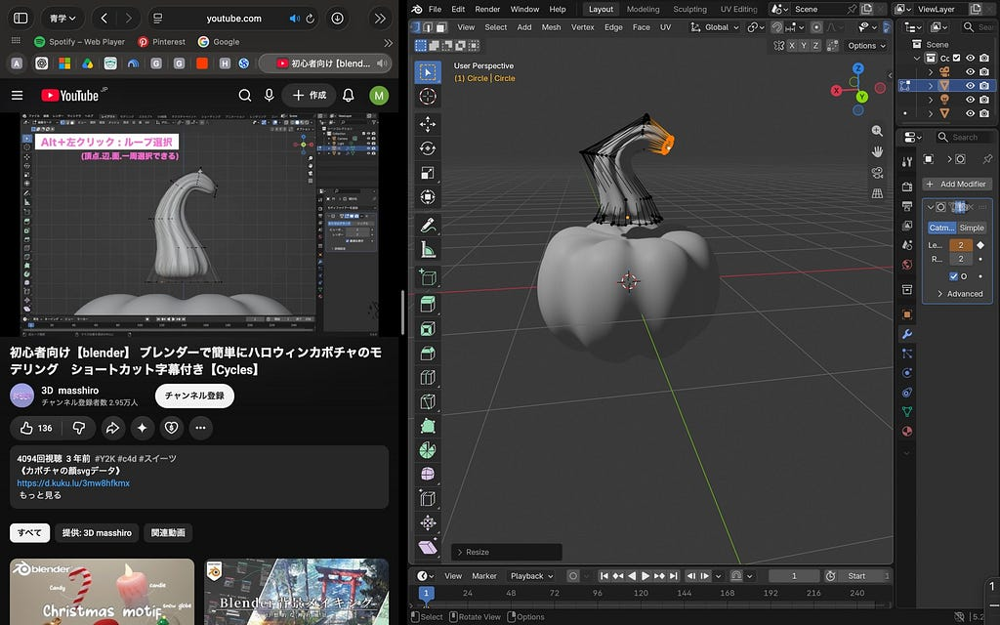
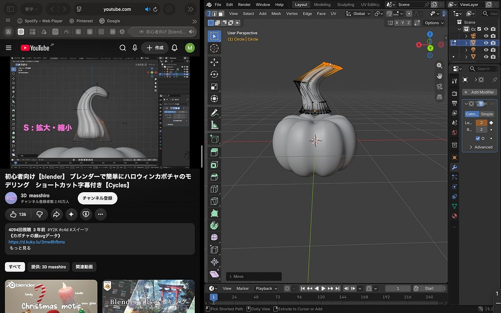
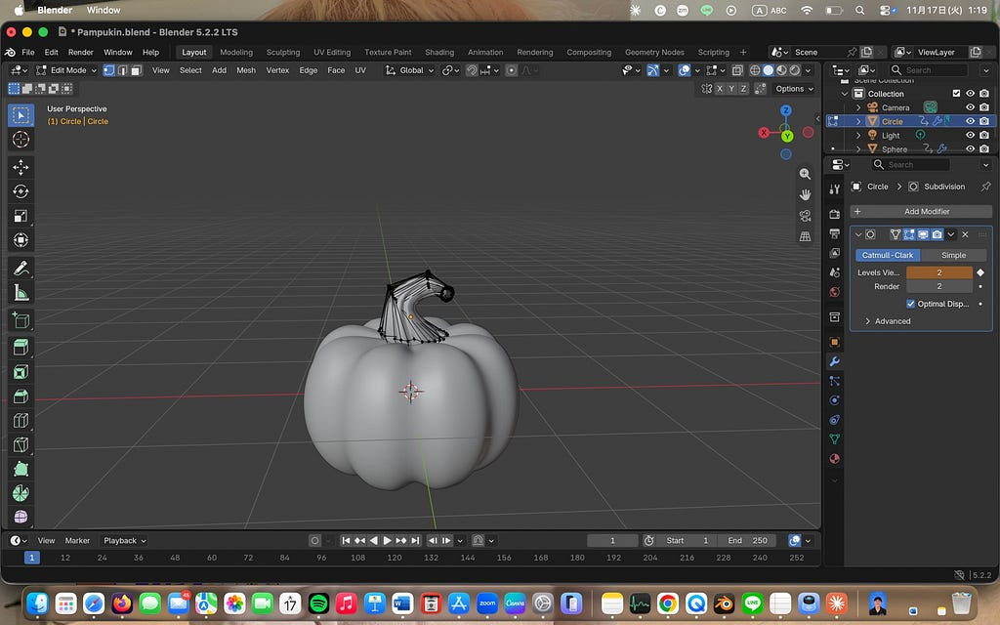
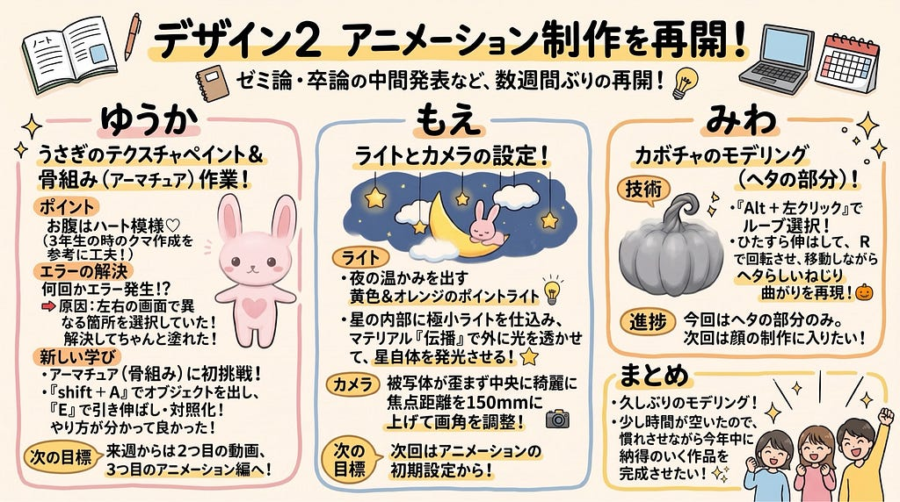

こんにちは、3年の米久保です！

ゼミ論・卒論の中間発表など、数週間他の作業を行っていましたが、今回はまたアニメーション制作の続きを行いました！

【ゆうかさん】

今週はうさぎのテクスチャペイントと骨作り、名前付けの作業を行いました。お腹に色をつけるのは3年生の時にクマを作成した時にも行ったため、今回はハート模様にして工夫しました。

何回かエラーが出てしまいましたが、原因は、左と右の画面で異なる箇所を選択をしていたためで、ちゃんと塗ることができました。

デザイン1のみんながやっていた、アーマーチュアの骨組み作業も初めて行い、shift＋Aからオブジェクトを出して、Eで引き伸ばしたり対照化するやり方が分かってとても良かったです。

来週からは、[2つ目の動画](https://youtu.be/blrl76DraEc?si=I6AzInE1Gk74Estn)を進めていき、3つ目のアニメーション偏の動画までいけるように引き続き頑張っていきたいと思います。

【もえさん】

今回はライトとカメラの設定を行いました。

全体に夜らしい温かみを出すため、黄色やオレンジ系のポイントライトを複数配置しました。また、星の内部には極小のポイントライトを仕込み、マテリアルの「伝播」を利用して光を外に透かせることで、星そのものが発光しているような質感を表現しています。カメラは、被写体が歪まず画面中央に綺麗に収まるよう、焦点距離を150mmに上げて画角を調整しました。

次回はアニメーションの初期設定から進めたいと思います。

【みわ】

今回は前回の続きからカボチャのモデリングを始めました。

今回はヘタの部分を作成しました！

Alt+左クリックでループ選択を行いながら、ひたすら伸ばして、Rで回転させ、移動させながらカボチャのヘタらしいねじり曲がった部分を再現できました🎃

今回はヘタの部分のみを作成したので、次回は顔の制作に入ってみたいです！

> まとめ

今回は久しぶりのモデリングを行いました！

少し時間が空いたので、慣れさせながら今年中に自分たちが納得のいく作品を完成させたいです！✨

> グラレコ

Gemini 3.1 Pro

---

[デザイン2 アニメーション制作を再開！](https://medium.com/furuhashilab/%E3%83%87%E3%82%B6%E3%82%A4%E3%83%B32-%E3%82%A2%E3%83%8B%E3%83%A1%E3%83%BC%E3%82%B7%E3%83%A7%E3%83%B3%E5%88%B6%E4%BD%9C%E3%82%92%E5%86%8D%E9%96%8B-ff6f4b239a88) was originally published in [Furuhashi(mapconcierge)Lab.](https://medium.com/furuhashilab) on Medium, where people are continuing the conversation by highlighting and responding to this story.
