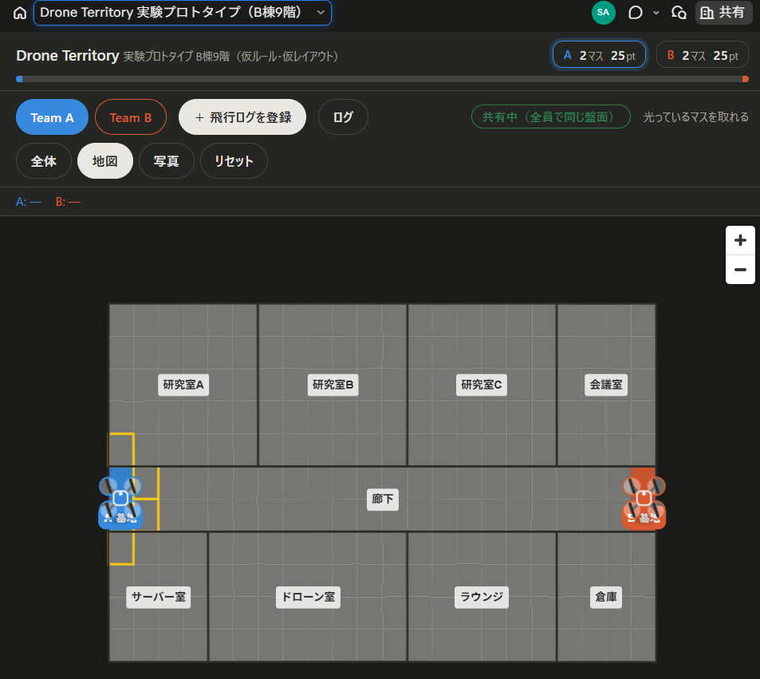
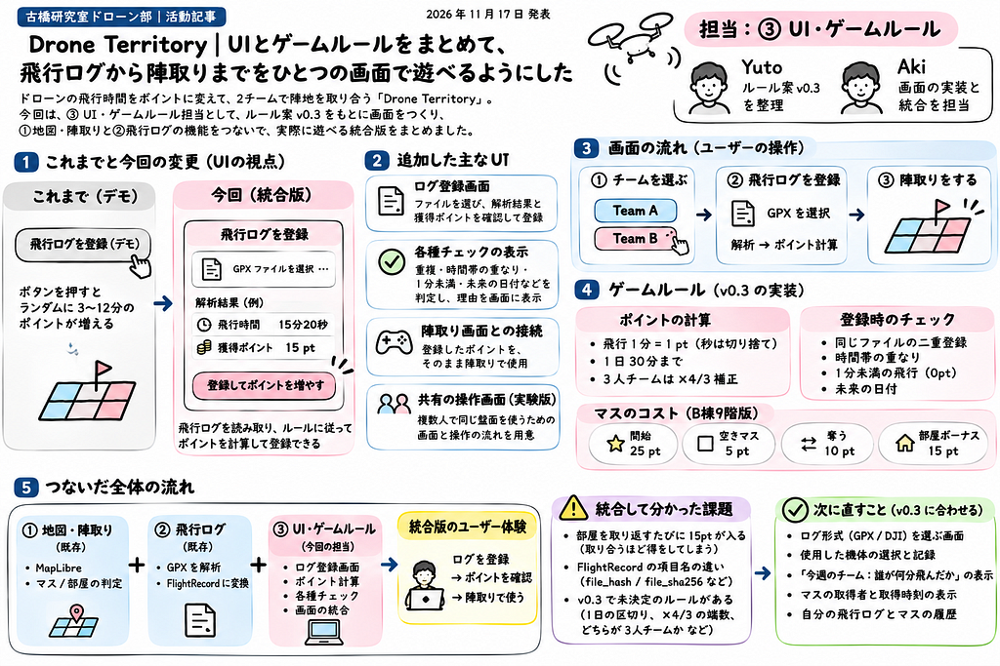

**2026年11月17日｜古橋研究室 ドローン部 佐藤愛妃**

こんにちは！UI担当です。

追加で、ともやがGitHubに各自が使用してるAIのデータまとめてくれました。ちょい説明頼んだ。

[[ui-game] 飛行ログ登録と陣取りの統合プロトタイプ by akidinosaurs · Pull Request #21 · furuhashilab/furuhashilab-drone-territory-sandbox](https://github.com/furuhashilab/furuhashilab-drone-territory-sandbox/pull/21)

### 今回は何をしたの？

古橋研究室ドローン部では、ドローンの飛行時間をポイントに変え、そのポイントで陣地を取り合う「Drone Territory」を開発しています。

ゲームは2チーム対戦で、地図上のマスを取って陣地を広げていきます。

開発は3つの担当に分かれています。

* ① 地図・陣取り：地図の表示、マスや部屋の判定
* ② 飛行ログ：GPXやDJIの飛行記録を共通形式「FlightRecord」に変換
* ③ UI・ゲームルール：ログ登録画面、ポイント計算、ゲームルール

今回、③の担当では、Yuto がゲームルール案 v0.3 を整理し、Aki が①②③をつないだ統合版をまとめました。

これまで、それぞれの機能は別々に開発されていました。

今回は、**飛行ログを登録する → 飛行時間からポイントを計算する → ポイントを使ってマスを取る**という流れを、一つの画面で動かせるようにしました。

具体的に何を変えたのか、順番に紹介します。

### ① ランダムなポイントから、飛行ログを使ったポイント計算へ

### 変更前：飛行ログがなくてもポイントが増える

**デモ用ボタン**

↓

ランダムに3〜12分の飛行時間を生成

↓

ポイントを加算

↓

ポイントを使って陣取り

これまでの①の陣取り PoC は、地図上でマスを取れるか確認するための試作品でした。

そのため、実際の飛行ログを登録する機能はなく、ボタンを押すだけでポイントが増える仕組みでした。

### 変更後：飛行ログに基づいてポイントが増える

claude.ai

**GPXファイルを登録**

↓

FlightRecord に変換して飛行時間を取得

↓

③のルールに従ってポイントを計算

↓

ポイントを加算

↓

ポイントを使って陣取り

### なぜ変更した？

Drone Territory では、ドローンを飛ばした時間をポイントにすることが前提です。

ランダムな値のままでは、飛行ログをゲームに使えているか確認できません。

そこで、②の飛行ログ変換処理と③のポイント計算を①の陣取り画面につなぎました。

①のマスを取る処理や部屋の判定は、そのまま利用しています。

**今回変更したのは、ポイントを取得するまでの処理です。**

### ② PCで動かしていた飛行ログ変換を、ブラウザの中へ

### 変更前：Go のツールを PC で実行する

**GPXファイル**

↓

Go の変換ツール flightparse を実行

↓

FlightRecord を出力

↓

変換結果を別途利用

②の飛行ログ担当は、異なる形式の飛行ログを共通形式の FlightRecord に変換するツールを作っていました。

ただし、これまでのツールは PC 上で実行する必要があり、陣取り画面から直接使う仕組みにはなっていませんでした。

### 変更後：ブラウザの中で GPX を変換する

**GPXファイルを選択**

↓

JavaScript の parseGPX() で解析

↓

飛行開始時刻・終了時刻・飛行時間・距離・高度などを取得

↓

FlightRecord を作成

↓

③のポイント計算へ渡す

### なぜ変更した？

今回の統合版は、ブラウザ上で一連の操作を試せることが目標です。

そのため、GPX の変換処理を Go から JavaScript に移植しました。

これにより、GPXファイルを選ぶと、その場で飛行時間を取得し、ポイント計算に進めるようになりました。

なお、DJI の生ログはブラウザでは直接変換できません。

DJI の場合は、②の flightparse で FlightRecord JSON に変換してから読み込みます。

### 元のツールと同じ結果になる？

合成 GPX を使い、Go 版と JavaScript 版の変換結果を比較しました。

samples/gpx/synthetic\_normal.gpx では、次の結果が一致しています。

項目比較結果飛行時間120秒飛行距離約121.37m最大高度30m開始・終了時刻一致SHA-256 ハッシュ一致飛行軌跡・警告一致

また、時刻が欠けた合成 GPX では、両方のツールが同じエラーを返しました。

ただし、実機で取得した GPX や DJI のログは、まだ確認できていません。

### ③ 文書に書かれたゲームルールを、プログラムに反映

### 変更前：ルールは文書の中にある

**Yuto のルール案 v0.3**

↓

飛行時間・人数補正・登録チェックなどを文章で整理

↓

①の陣取り PoC は以前のデモ用ルールで動作

これまでは、Yuto が整理したルール案と、実際に動いているプログラムが分かれていました。

### 変更後：ルールに従ってポイントを計算する

**FlightRecord を受け取る**

↓

飛行時間を整数の分に切り捨てる

↓

1分 = 1ポイントで計算

↓

1日30分の上限を適用

↓

3人チームの場合は4/3倍に補正

↓

チームのポイントに加算

例えば、15分20秒の飛行なら、まず15分として計算します。

人数補正がないチームなら15ポイント、3人チームなら20ポイントになります。

### 登録時のチェックも追加

ポイントを計算する前に、次の内容を確認します。

* 同じファイルがすでに登録されていないか
* 同じ人の飛行時間帯が重なっていないか
* 飛行時間が1分未満ではないか
* 未来の日付ではないか
* 1日の上限を超えていないか

同じファイルの判定には、file\_sha256 というハッシュ値を使います。

これはファイルの内容から計算する識別用の値です。同じファイルをもう一度登録しようとした場合、すでに登録されていることを検出できます。

### マスを取るためのコストも変更

B棟9階版では、①の PoC で使われていた仮のコストを、v0.3 の提案値に変更しました。

操作変更前変更後開始ポイント5pt25pt空きマスを取る1pt5pt相手のマスを奪う2pt10pt部屋を取ったボーナス3pt15pt

これにより、飛行時間から得られるポイントと、マスを取るために必要なポイントを、v0.3 の提案値で試せるようになりました。

ただし、v0.3 は決定版ではなく、今後のプレイテストで調整するためのルール案です。

### ④ 端末ごとのゲームから、みんなで使う共有盤面へ

### 変更前：端末ごとに別々の盤面

**Aさんがゲームを開く**

↓

Aさんの端末だけでポイントと盤面を管理

**Bさんがゲームを開く**

↓

Bさんの端末では別の盤面になる

これまでは、各端末のページ内でゲームの状態を管理していました。

そのため、複数人が同じ盤面を使うことはできず、ページを閉じると記録も消えていました。

### 変更後：操作の記録を共有して、盤面を再計算

**Aさんが飛行ログを登録**

↓

共有データの logs に記録

↓

**Bさんがマスを取る**

↓

共有データの moves に記録

↓

全員が同じ記録を受け取る

↓

各端末でポイントと盤面を再計算

↓

同じ盤面を表示する仕組み

### なぜ盤面そのものを保存しない？

今回の共有実験版では、完成した盤面やポイント残高を直接保存するのではなく、操作の記録を保存する方法にしました。

保存するのは主に次の3種類です。

記録内容players誰がどのチームに所属しているかlogs誰がどの飛行ログを登録したかmoves誰がどのマスを取ったか

これらの記録を時刻順に並べ、replayShared() という処理でポイントと盤面を再計算します。

各端末が同じ記録を使うことで、盤面を共有する仕組みです。

ただし、同時操作での競合が完全に解決できているかは、別アカウントでの検証が必要です。

### ⑤ Claude の画面でも地図を表示できるように修正

### 変更前：MapLibre が読み込めない

**Claude の実験ページを開く**

↓

MapLibre の読み込みに失敗

↓

地図や盤面が表示されない

### 変更後：読み込み方法を切り替える

**Claude の実験ページを開く**

↓

MapLibre の読み込み先を順番に試す

cdnjs → jsDelivr → unpkg

↓

Web Worker が使えない場合は代替処理に切り替える

↓

地図と盤面を表示する

通常のブラウザでは MapLibre の標準的な処理を使い、Claude のプレビュー環境では必要に応じて代替処理に切り替えます。

また、背景地図が読み込めない場合も、無地の背景で陣取りを続けられるようにしました。

Aki の画面では、盤面が表示されることを確認しています。

### 発表用に用意した B棟9階のデモ

今回の統合版では、次の操作を一つの画面で試せます。

**チームを選ぶ**

↓

**合成サンプルの飛行ログを登録**

↓

**飛行時間からポイントを計算**

↓

**自分の陣地の隣のマスを取る**

例えば15分20秒のサンプルなら15ポイントになります。空きマスは1つ5ポイントなので、3マス取れる計算です。

発表用には、B棟9階の共有実験版を用意しました。

**実際に発表で実演した操作：発表メモを追記**

### 統合して分かった問題

今回、別々の機能をつないだことで、ルールやデータ形式の違いも見つかりました。

### ① 部屋のボーナスを繰り返し獲得できる

相手に取られた部屋を取り返すと、再び15ポイントのボーナスが入ります。

そのため、同じ部屋を繰り返し取り合うことで、ポイントを増やせる問題があります。

ボーナスを最初の1回だけにするのか、取り返したときも付けるのか、今後の検討が必要です。

### ② FlightRecord の項目名が一致していない

Yuto の v0.3 と②の実装では、一部の項目名が異なっています。

v0.3 の記載②の実装file\_hashfile\_sha256max\_altitude\_mmax\_height\_muser\_idFlightRecord 内にはない

今回の統合版は、②の実装に合わせています。

ただし、今後それぞれの担当が別々に修正すると、再びデータの受け渡しができなくなる可能性があります。

共通形式の項目名と、ユーザー情報をどこで管理するかを整理する必要があります。

### ③ ルールに書かれていない処理がある

例えば、1日30分の上限まで残り5分の人が、10分のログを登録した場合です。

今回は残り5分だけをポイントとして数えるようにしていますが、v0.3 ではこの扱いが明確に決まっていません。

ほかにも、4/3倍の端数処理、「1日」の区切り、3人チームの指定方法などを、統合版では仮に決めています。

これらは、チームで確認してから正式なルールにする必要があります。

### 今後の修正

次は、Yuto の v0.3 に書かれている画面構成に合わせて、次の機能を追加・修正します。

* GPX・DJI のログ形式を選択する画面
* 使用したドローンの選択と記録
* 「今週のチーム」と各メンバーの飛行時間
* マスを取った人と取得時刻の表示
* 個人の飛行ログとマス取得履歴

また、実機の飛行ログ、別アカウントでの共同操作、iPhone・Safari での表示も確認する必要があります。

**もらったフィードバック：発表メモを追記**

**その場で決まったこと：発表メモを追記**

**発表後に優先して直すこと：発表メモを追記**

### まとめ

今回の統合版では、①の陣取り、②の飛行ログ変換、③のゲームルールを一つにつなぎました。

これまでランダムなポイントで動いていたゲームを、飛行ログから計算したポイントで遊べる形に変更しています。

また、共有盤面を用意したことで、複数人が同じ記録を使ってゲームを進めるための仕組みもできました。

一方で、実際につないでみたからこそ、データ形式の違いや、まだ決まっていないルールも見えてきました。

今後は、実機ログと複数人での動作を確認しながら、ゲームとして使える状態に近づけていきます。

### 関連リンク

* [GitHub Draft PR #21｜統合版と発表デモ](https://github.com/furuhashilab/furuhashilab-drone-territory-sandbox/pull/21)
* [Claude 実験ページ｜B棟9階の共有盤面](https://claude.ai/artifact/NMNFDkt5B615YZDjnTBc5t)
* [GitHub｜統合版のソース4ファイル](https://github.com/furuhashilab/furuhashilab-drone-territory-sandbox/tree/feature/integrated-prototype/poc/integrated)
* [Yuto のルール案 v0.3｜PR #19](https://github.com/furuhashilab/furuhashilab-drone-territory-sandbox/pull/19)

※ Claude の共有実験ページには、FuruhashiLab の組織アカウントでのログインが必要です。GitHub や GitHub Pages で HTML を開く場合は、端末ごとのプレイになります。

※ 記事中の実演結果・フィードバック・決定事項は、発表メモの追記後に確定します。

---

[Drone Territory｜飛行ログから陣取りまで、3つの機能をつないでみた](https://medium.com/furuhashilab/drone-territory-%E9%A3%9B%E8%A1%8C%E3%83%AD%E3%82%B0%E3%81%8B%E3%82%89%E9%99%A3%E5%8F%96%E3%82%8A%E3%81%BE%E3%81%A7-3%E3%81%A4%E3%81%AE%E6%A9%9F%E8%83%BD%E3%82%92%E3%81%A4%E3%81%AA%E3%81%84%E3%81%A7%E3%81%BF%E3%81%9F-d644c350c463) was originally published in [Furuhashi(mapconcierge)Lab.](https://medium.com/furuhashilab) on Medium, where people are continuing the conversation by highlighting and responding to this story.
