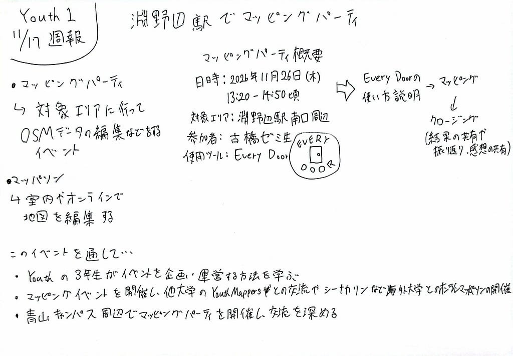

古橋ゼミのYouthMappers AGUに所属する3年生が主体となり、マッピングパーティを開催することになりました！

今回は、青山学院大学相模原キャンパスの最寄り駅である淵野辺駅の南口周辺を対象に、Every Doorを使ったマッピングを行います。

今回のイベントは、地図づくりを体験するだけでなく、Youthに所属する3年生がイベントの企画・運営方法を知り、来年度以降の自主的な活動につなげることも目的としてます。

マッピングパーティとは？

マッピングパーティとは、現地へ行き、フィールドワークを通してOpenStreetMapのデータを編集する参加型のコミュニティイベントです。

室内やオンラインでの共同地図編集を中心とすることが多いマッパソンと比べて、現地で直接確認し、最新の情報を収集できることが特徴です。特別な専門知識を必要とせず、OSMを初めて使う人や、これまで地図編集をしたことがない人でも、楽しみながら参加できるイベントです。そのため、このイベントの大きな魅力は、初心者や新しく参加する人を歓迎している点です。ツールの使い方やデータの集め方を一から学ぶことができるため、OSMを知るためのトレーニングイベントとしても位置づけられます。

また、マッピングパーティでは、参加者同士でチームを組み、実際に街を歩きながら情報を集めるスタイルが一般的です。

机の上だけで作業するのではなく、街を歩きながら地域の特徴を観察するため、散歩や宝探しのような感覚で地域の魅力を再発見できます。

参考：[マッピングパーティについての資料](https://docs.google.com/document/d/1FmOX1qpnkKd21OJcd2z9qEbvS798W6kMzUSR6Mth6aA/edit?usp=drivesdk)

今回の大きな目標は、来年度、現在の3年生が自分たちでマッピングイベントを企画・開催できるようになることです。そのため、開催日時についても、YouthMappers AGUに所属する3年生の予定を優先的に調整し、今回の時間に決定しました。

開催概要

● 開催日： 2026年11月26日（木）

● 開催時間： 13:20〜14:50（青山学院大学の3限）

● 対象エリア： 淵野辺駅南口周辺

● 集合・解散場所： 淵野辺駅

● 参加対象： 古橋ゼミ生

● 使用ツール： Every Door

● 主な活動： アプリの使い方説明、現地マッピング（車椅子のアクセシビリティと古い情報の更新）、クロージング

[Every Door公式サイト](https://every-door.app/)

当日の活動予定

淵野辺駅南口周辺を実際に歩きながら、店舗や施設、街中の設備などを確認し、OSMに不足している情報や更新が必要な情報を探します。

最後に、参加者同士で編集した内容や気づいたことなどを共有し、今回の活動を振り返ります。

現在は開催に向けて、Every Doorの使い方を説明するための原稿や資料の作成、当日のマッピング目標の具体化を進めています。また、参加人数や運営体制を考慮し、必要に応じて2年生への参加募集も検討しています

今後の展望

今後の目標としては、今学期中に、青山キャンパス周辺などを対象としたマッピングパーティの開催も検討しています。

青山キャンパス周辺は、多くの学生にとって集まりやすく、店舗や施設などマッピングの題材も豊富なため、多くの参加者が楽しめる場所だと考えています。

また、日本国内でYouthMappersとして活動している他大学の学生との交流や、過去に交流のあったシーナカリン大学の学生とオンラインでマッパソンを開催することなども、今後の目標の一つです。

過去の活動に関する参考動画

[参考動画①](https://youtu.be/hrp2PDo1Ngk?si=5Aqi_2UButq5FXrY)

[参考動画②](https://youtu.be/6taiWYx0B54?si=tqctuGhLZEdJTivf)

[参考動画③](https://youtu.be/8_dAquI18xY?si=GEMRlLWMPMbDnTZR)

グラレコ

---

[YouthMappers AGUによるマッピングパーティ](https://medium.com/furuhashilab/youthmappers-agu%E3%81%AB%E3%82%88%E3%82%8B%E3%83%9E%E3%83%83%E3%83%94%E3%83%B3%E3%82%B0%E3%83%91%E3%83%BC%E3%83%86%E3%82%A3-0ada7a37732c) was originally published in [Furuhashi(mapconcierge)Lab.](https://medium.com/furuhashilab) on Medium, where people are continuing the conversation by highlighting and responding to this story.
