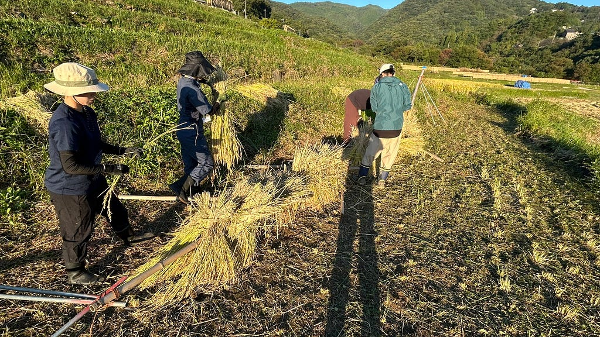
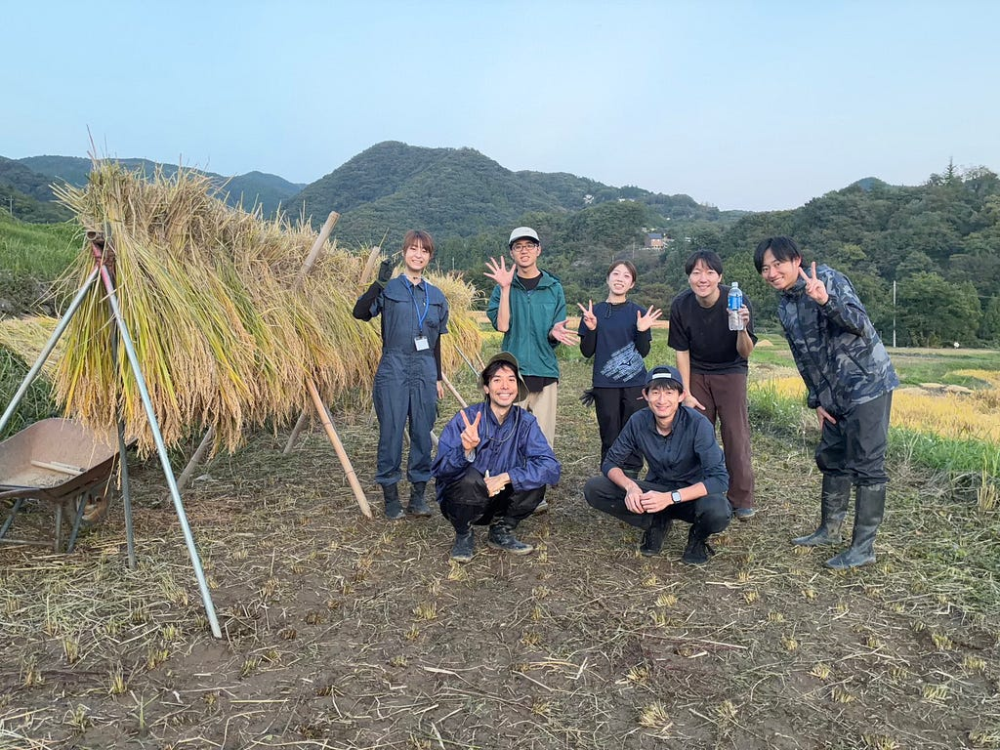
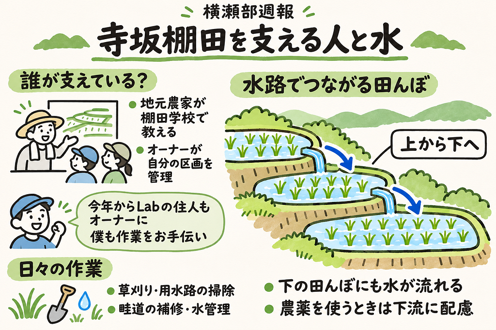

こんにちは、4年の井上です。

最近、占いに行ってみたら、骨折していたことを当てられて震えました。いや、そこまで分かるんは怖すぎるよ。占い舐めててすいませんでした。もし気になる方は雨照（アメテラス）渋谷店にぜひ行ってみてください。

ということで、今週は横瀬の寺坂棚田についてです。10月のインターン初日に見学した場所の一つで、お世話になったENgaWAも一部の田んぼを管理しています。あの段々に並んだ田んぼって、普段は誰がどうやって維持してるんだろう？と思ったので、調べてみました。

### 地元の農家さんが先生になる「棚田学校」

寺坂棚田では、地元の農家さんが中心になって保全活動を続けています。その取り組みの一つが**「寺坂棚田学校」**。地元の農家さんが先生になり、町の外から来る人も生徒として、田起こしから収穫まで一緒に作業するそうです。

学校の卒業生を中心に、自分の区画で米づくりをする**オーナー制度**も始まりました。 実は、Labに住んでいる方が今年から棚田オーナーを始めていて、僕も作業を手伝いました。制度の話を調べていたら、自分が手伝った田んぼも、こうやって棚田を維持している区画の一つだったんだなと、今さらながら実感しました。

下の写真は当時その田んぼをお手伝いした時の写真です。初めての稲刈りだったのもあって刈った稲を掛ける稲架が崩壊しました。この時も経験豊富な地元の農家さんに助けていただいて地域の温かみを感じました。

崩壊した稲架（左）と集合写真（右）

### 棚田では何をしてる？

棚田の作業と聞いて僕が最初に思い浮かべたのは、田植えと稲刈りでした。[埼玉県の資料](https://www.pref.saitama.lg.jp/documents/12829/515005.pdf)を見ると、草刈りや用水路の掃除、畦道の補修も行われています。オーナーは普段の水管理も担当するそうで、農水省の資料には年間30日以上棚田に通うとありました。そんなに通うのか！

水路について聞いた話で面白かったのが、棚田は上から下に水が流れて、田んぼ同士のつながりが近いということ。上の田んぼで使った農薬などが、水と一緒に下の田んぼにも流れることがあるので、使うにも気を遣うそうです。自分の区画で何をするか考えるときに、その下の田んぼのことまで考える必要があるんですね。

次に手伝いに行ったときは、自分たちが作業している田んぼの水がどこから来て、その先のどの田んぼに流れていくのか、見てみたいです。

最後にグラレコです

---

[【横瀬部週報】寺坂棚田って、誰がどうやって維持してるの？](https://medium.com/furuhashilab/%E6%A8%AA%E7%80%AC%E9%83%A8%E9%80%B1%E5%A0%B1-%E5%AF%BA%E5%9D%82%E6%A3%9A%E7%94%B0%E3%81%A3%E3%81%A6-%E8%AA%B0%E3%81%8C%E3%81%A9%E3%81%86%E3%82%84%E3%81%A3%E3%81%A6%E7%B6%AD%E6%8C%81%E3%81%97%E3%81%A6%E3%82%8B%E3%81%AE-49039fedde59) was originally published in [Furuhashi(mapconcierge)Lab.](https://medium.com/furuhashilab) on Medium, where people are continuing the conversation by highlighting and responding to this story.
