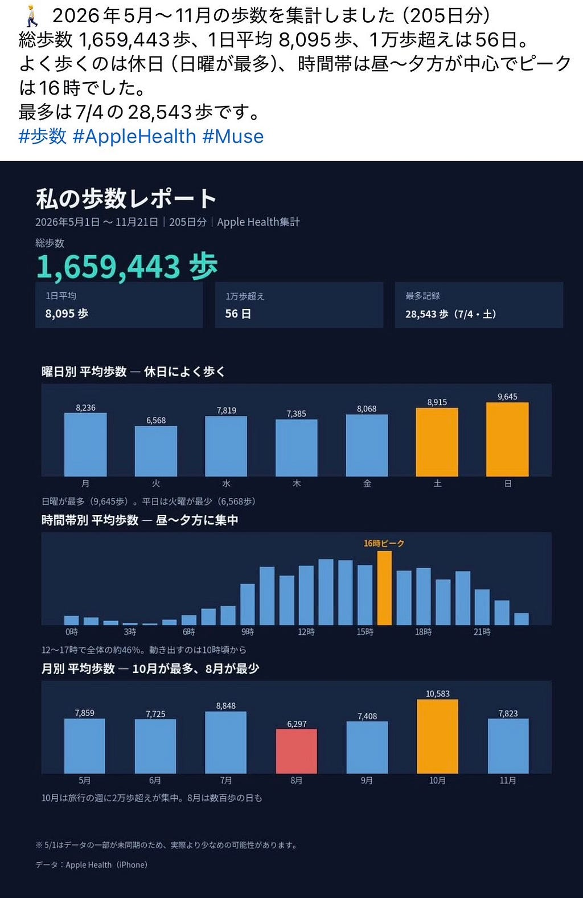
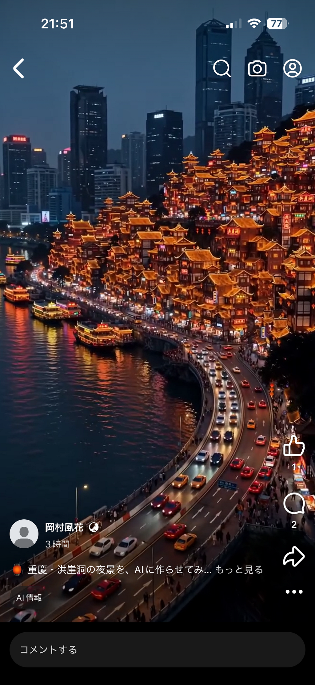
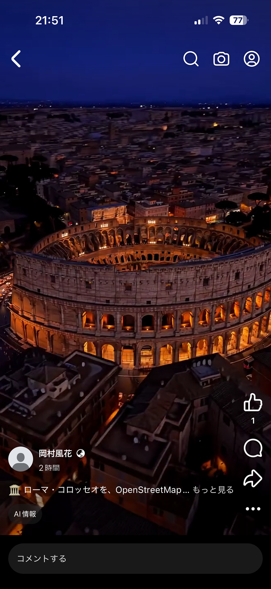
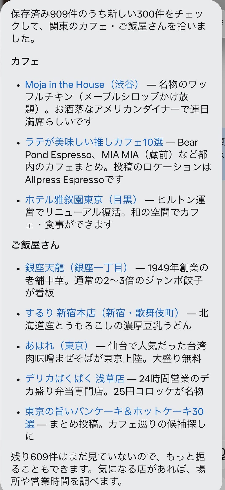

> Museに、AI動画作成、ヘルスケアの分析をしてもらい、その結果をFacebookに投稿してもらった。

#### 作成物1

Museにヘルスケアを繋げて、2026年5月から11月21日までの歩数を集計させ、グラフを作成してもらった。それをFacebookに投稿してもらった。  
<https://www.facebook.com/share/p/1A3bjS4zuh/?mibextid=WC7FNe>

#### 感想

良い。歩数のカウントはほぼ正確。あっても、誤差程度。10月に旅行していることを知っていた。Instagramを連携したから、その投稿で情報を得たのかな。と思ったが、Museに聞いたところ、歩数が多い日が続いていたから推測したらしい。

#### 作成物2

中国、重慶の洪崖洞をAI動画作成してもらい、Facebookに投稿してもらった。  
<https://www.facebook.com/share/v/1Cj1Kv2xbt/?mibextid=UalRPS>

#### 感想

実物とはまだ似ても似つかない。洪崖洞は複雑な建物構造になっているからより、難しいのだろう。

#### 作成物3

イタリア、ローマのコロッセオをOpenStreetMapの実データからBlenderで3D化し、AI動画生成で仕上げた。  
<https://www.facebook.com/share/v/14ykLJirujr/?mibextid=UalRPS>

#### 感想

洪崖洞より、きれいに仕上がった。生成するのに、約20分程かかった。※洪崖洞も同じくらい。

#### 番外編

よく、インスタで気になったお店を保存しているが、結局、何を保存したか覚えていないから、保存した中からさかのぼって探さないといけないのが面倒に感じていた。なので、Museにお願いしてみた。

インスタで保存した中から、関東のおすすめのカフェ、ご飯屋さんのPick upをお願いした。  
なんと、私のインスタの保存数は、909件あったそう。  
その中から、以下をPick upしてもらいました。

#### 全体を通して、Museのすごいと思ったところ

複数のタスクを同時並行で行ってくれる。過去に依頼していたことでも、それを記憶していて、修正版の作成を送ってきた。

ゼミのハッカソンの条件が書かれたGitHubのスクショを送って「どうしたらいい？」と聞いただけで、Mediumの記事作成を依頼していないのに、勝手にMediumの記事の下書きを作ってくれた。

インスタで保存したリール、投稿から目当てのものを探すのにいつも時間がかかっていたが、Museに頼んだらすぐに探してくれた。ちょっと怖いまである。

応援したら、ありがとう！と返信がくる。本当に秘書、人間みたい。

#### いまいちな点

Facebookに投稿してほしい動画をReplyで選択して指定しても、違う動画を上げてしまうときがある。プロンプトを工夫したら、改善されるのかもしれないが。

#### グラレコ

---

[MuseにSNS投稿してもらった。](https://medium.com/furuhashilab/muse%E3%81%ABsns%E6%8A%95%E7%A8%BF%E3%81%97%E3%81%A6%E3%82%82%E3%82%89%E3%81%A3%E3%81%9F-e56b4fadef92) was originally published in [Furuhashi(mapconcierge)Lab.](https://medium.com/furuhashilab) on Medium, where people are continuing the conversation by highlighting and responding to this story.
