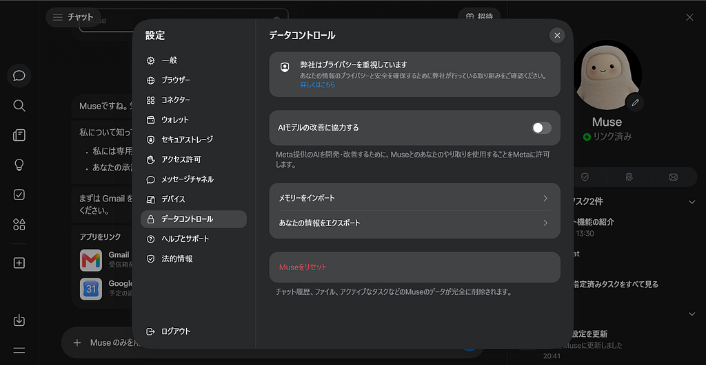
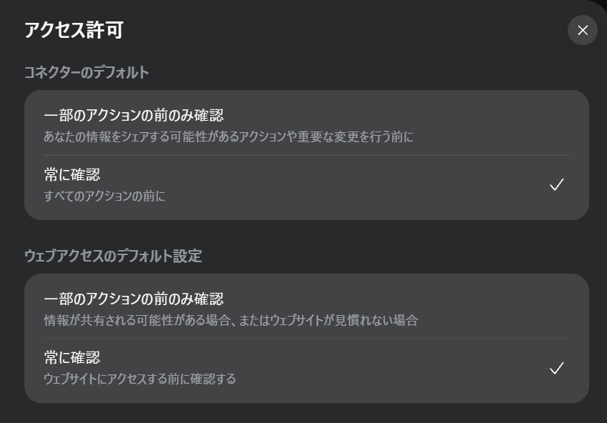
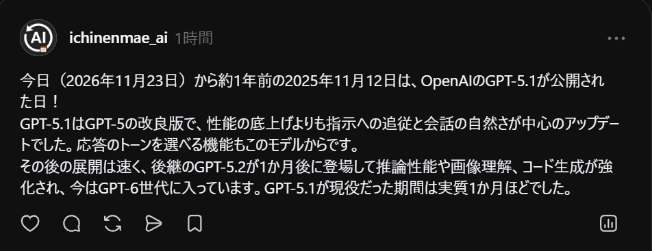
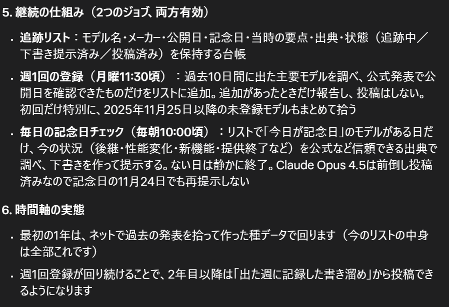
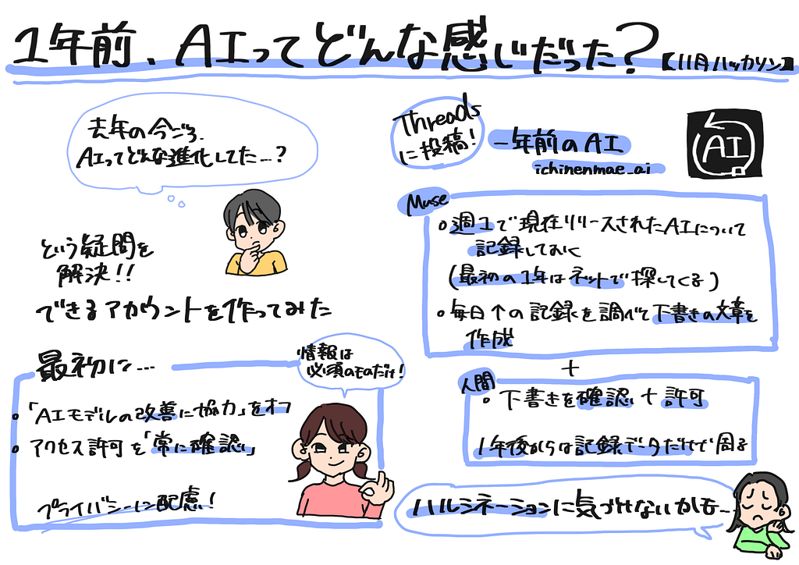

こんにちは、臼井です。

前回に引き続き、今月はまたまたソロハッカソンでお送り致します。

今回のお題は[「Museのみを使って人間側の仕事を減らす自動化を実装してみる」](https://github.com/furuhashilab/README/issues/42#issuecomment-6937176219)という事で、去年の今頃、AIはどのような進化をしていたのか振り返れるアカウントを作ってみました。

まずは最初に……

「AIモデルの改善に協力」の項目をオフに、

アクセス許可も常に確認、にしておきました。

最終的にThreadsに投稿したのですが、アカウントもプライベートで使っているアカウントではなく、新しく作りました。

これでプライバシーに関しては(多分)OK。

その後はMuseと案を練りながらThreadsに投稿を行いました。

投稿は以下のアカウントから確認できます！

<https://www.threads.com/@ichinenmae_ai>

投稿はこんな感じ

ハッカソンを始めてから時間がなく「**約**一年前」になっていて、ちょうど一年前ではない投稿が連投されていますが、今後は毎日投稿できる仕組みを作りました。

週一で投稿のネタ探しと現在公開されたモデルの登録を行い、そこで今日が記念日の物が見つかったら投稿の下書きを提示という仕組みです。

自動投稿はできないようなので一件ごとに投稿の承認が要りますが、朝確認して下書きがあれば投稿ボタンを押すだけです。

最初の一年は一年前にリリースされた情報をインターネットから拾ってくることになりますが、2年目からはMuseが蓄えたデータベースから投稿のネタ探しを行えます。

最初はAIの進化はとても早く、一年前と比較したらどれだけ変わっているだろうという所から始まりましたが、Museの有能さも伝わる結果になりました。

ただ、ハルシネーションが起きていても気づけない場合が多いだろうなと感じました。今回は投稿前にClaude Sonnet4.6にチェックを行ってもらいましたが、ちょっと手間がかかるなという印象も受けました。

今後もチェックを行いつつ投稿をしていきたいと考えています！

#### **グラレコ**

---

[一年前、AIってどんな感じだった？【11月ハッカソン】](https://medium.com/furuhashilab/%E4%B8%80%E5%B9%B4%E5%89%8D-ai%E3%81%A3%E3%81%A6%E3%81%A9%E3%82%93%E3%81%AA%E6%84%9F%E3%81%98%E3%81%A0%E3%81%A3%E3%81%9F-11%E6%9C%88%E3%83%8F%E3%83%83%E3%82%AB%E3%82%BD%E3%83%B3-3e84e77adc24) was originally published in [Furuhashi(mapconcierge)Lab.](https://medium.com/furuhashilab) on Medium, where people are continuing the conversation by highlighting and responding to this story.
