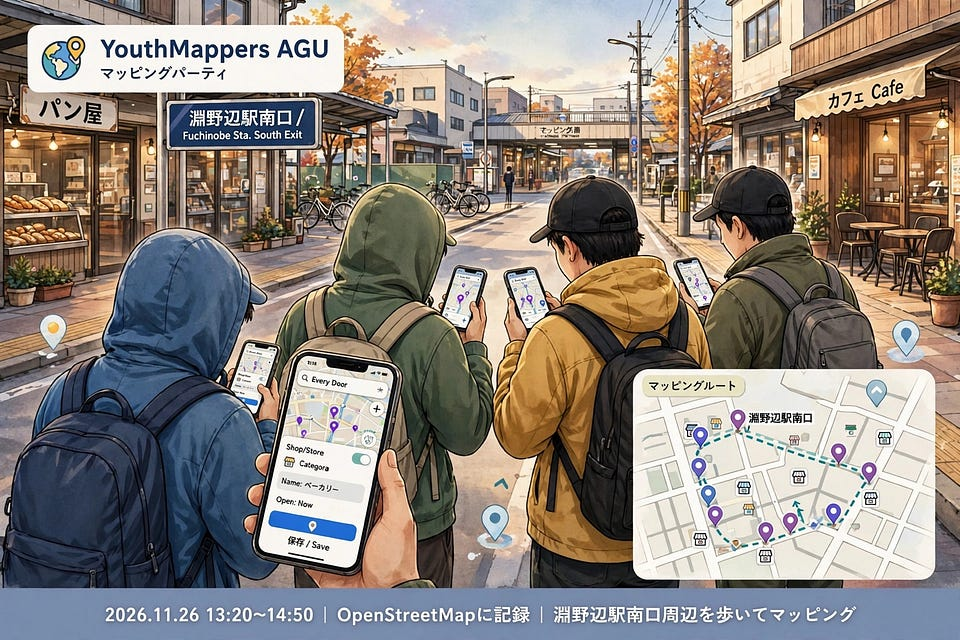
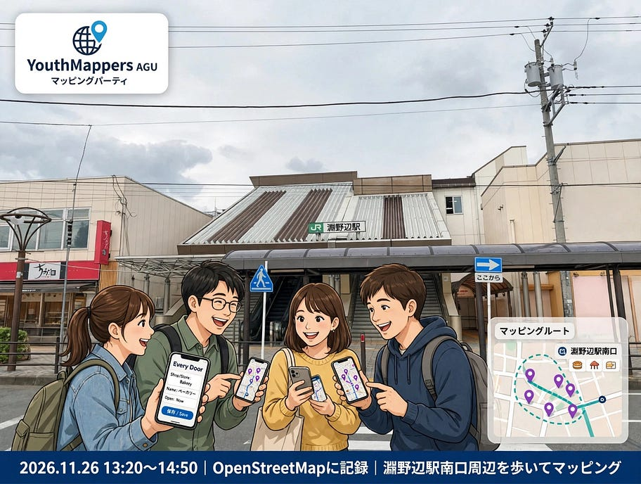
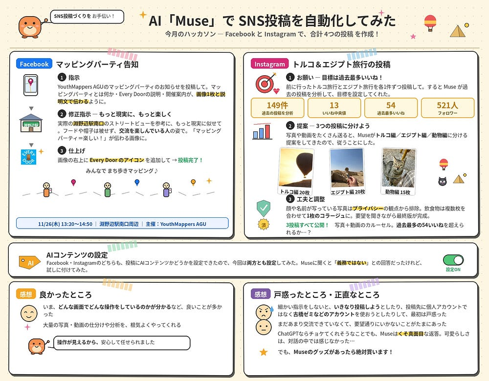

3年の田邊です

今月のハッカソンは、最近登場したAIである、Museを用いた自動化ハッカソンで、SNS投稿物を作りました

僕は2種類のSNSで合計4つの投稿をしました。

初めに、今週予定している、YouthMappers AGUによるマッピングパーティのお知らせをFacebookにて投稿しました

<https://medium.com/media/fab01a89d719f9cc6a7223af9b2e62b9/href>

マッピングパーティとはなにか、Every Doorについての説明、開催内容や日時の案内について画像1枚で伝わるようにして、細くする説明文も考えて投稿して。といったニュアンスの指示を出しました。

すると、最初にこのような画像を生成したため、実際の淵野辺駅南口のストリートビューなどを参考に、より現実と似た画像にして。また、フードや帽子を被せずに、交流を楽しんでいるような人の画像にして、もう少しマッピングパーティ=楽しいものというイメージを画像に出して。と送信しました。

すると、このような画像ができたので、最後に、画像右上にEvery Doorのアイコンを追加するように指示を出してFacebookの投稿は完了しました。

次に、前に行ったトルコ旅行&エジプト旅行について、それぞれ1件ずつInstagram上に投稿をし、いいね数が過去の投稿の中で最多になることを目標に、魅力的な投稿を作成して。とお願いしました。すると、Museが僕の過去の投稿のいいね数から、その中央値やフォロワー数を計算して、目標設定しました。↓↓

\*\*調査で分かった勝ちパターン\*\*

* いいね上位は「象徴的な風景＋人物入り」が圧勝で、風景のみはほぼ上位にいません。あなたの過去投稿でも同じ傾向でした（最多54は仲間との節目の投稿）
* - カルーセルの鉄板構成：1枚目＝最も象徴的な場所での人物写真 → 食や市場 → 地図やTipsなどの実用スライド → 夕景や象徴スポットで締め。カッパドキアの気球を最初と最後に置く「ブックエンド」型も伸びていました
* - キャプションは2型のハイブリッドが最適です。あなたの定番の短い日記風の良さを残しつつ、冒頭にフックの1行、短い日程リスト、最後に質問で締めるとコメントが伸びます。ハッシュタグは英語の地名タグ中心に5個前後＋位置情報タグ
* - 動画がある場合、リールが最もいいねを稼ぐ形式でした。各国カルーセル1件＋動画があればリール1件まで、が現実的な上限です

\*\*この方針での下書き設計（素材が届いたら当てはめます）\*\*

* トルコ編：表紙は気球かモスクでの人物入り写真を最優先。イスタンブールの街並み、バザールや食、最後にもう一度象徴的な1枚で締めます
* - エジプト編：表紙はピラミッドでの人物入り写真。神殿やナイル川、市場の様子を挟み、夕景で締めます

これらの分析後に動画や写真をいくつか選んで送信しました。すると、トルコ、エジプト、動物の3つに分けて投稿することを提案してきたので、それに従うことにしました。顔や名前の写っている写真などをプライバシーの観点から排除したり、飲食物を複数枚合わせてひとつの画像にしてもらったりして、僕の要望を頻繁に聞きながら最終的な投稿が完成しました。

トルコ編

<https://medium.com/media/7c366e44bb76cde4584efb28d119b1b0/href>

エジプト編

<https://medium.com/media/ce2e11ecab01fa42d54a48f28a94d857/href>

動物編

<https://medium.com/media/0f238b495f97349cf668e3c62207f332/href>

今回使用したSNSはFacebookとInstagramです。それぞれ、投稿したものに対してAIコンテンツであるかどうか設定することができたので、今回それぞれ設定してみました。Museにこれについて質問したら、今回Museはそのラベルをつけるべき対象の編集をしていないため、義務ではないと言っていましたが、ラベルをつけてみることにしました。

Museは、今どんな画面でどんな操作をしているのかがわかるなど、良いことが多かったのですが、細かい指示をしないと、いきなり投稿しようとしたり、その投稿先が個人アカウントではなく、他人のアカウント（古橋ゼミのアカウントなど）を使おうとしようとしたりして、最初は戸惑いました。また、まだあまり交流できてなくて、要望通り行かないことがたまにありました。ChatGPTに同じ指示をしたらチョケてくれそうなことでもMuseはくそ真面目な返答をしてきたので、あのマスコットのような可愛らしさを対話の中で感じることはありませんでした。でもMuseのグッズとかあったら絶対買います。

グラレコもMuseに作らせてみました。

---

[11月ハッカソンMuseに旅行記録作ってもらった！](https://medium.com/furuhashilab/11%E6%9C%88%E3%83%8F%E3%83%83%E3%82%AB%E3%82%BD%E3%83%B3muse%E3%81%AB%E6%97%85%E8%A1%8C%E8%A8%98%E9%8C%B2%E4%BD%9C%E3%81%A3%E3%81%A6%E3%82%82%E3%82%89%E3%81%A3%E3%81%9F-1f056555c215) was originally published in [Furuhashi(mapconcierge)Lab.](https://medium.com/furuhashilab) on Medium, where people are continuing the conversation by highlighting and responding to this story.
