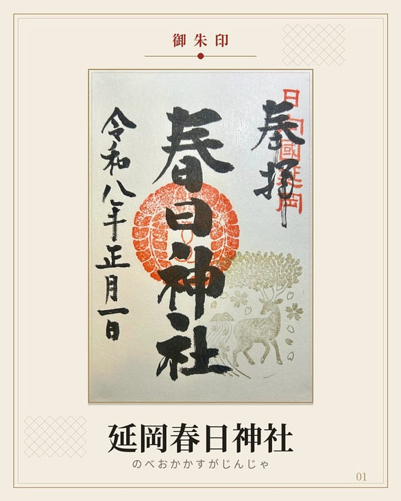
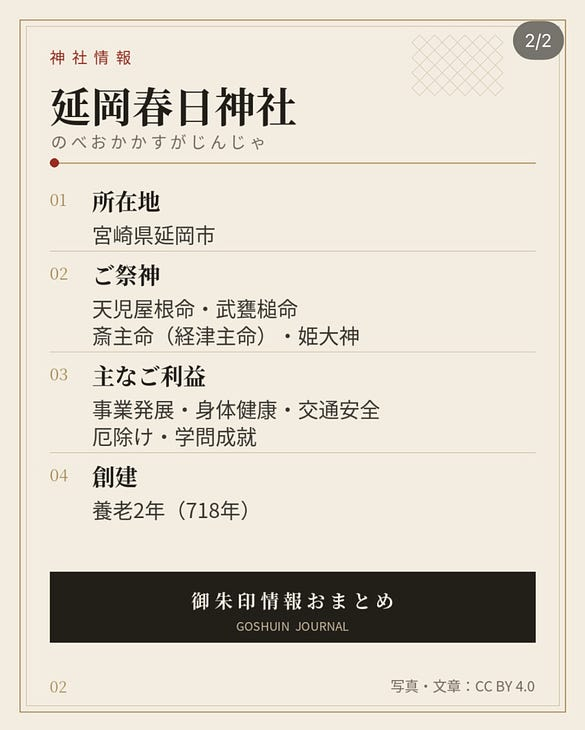
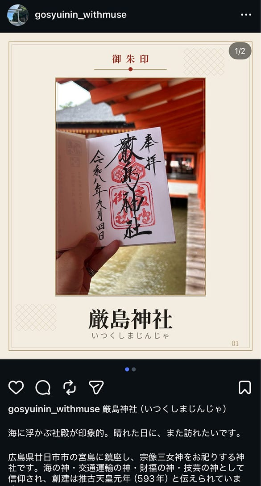
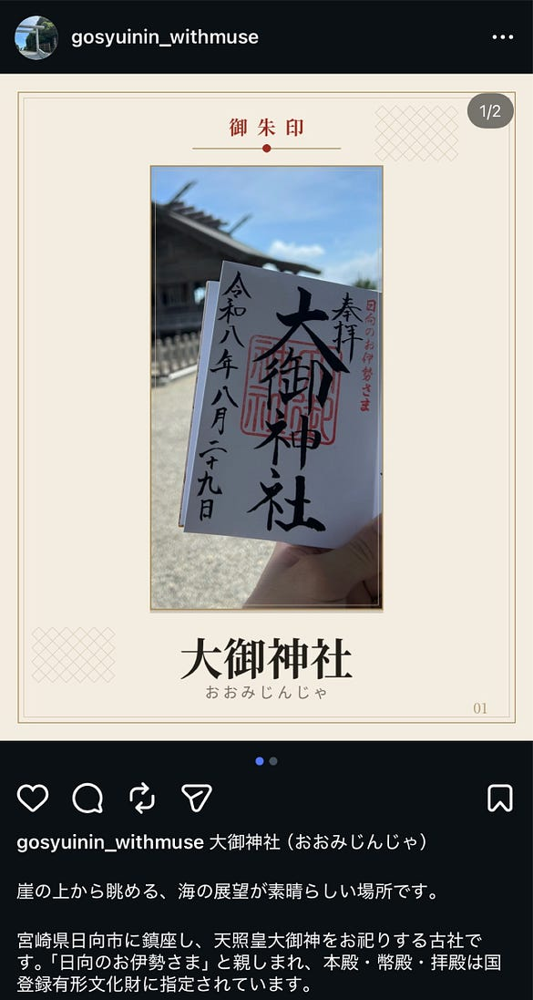
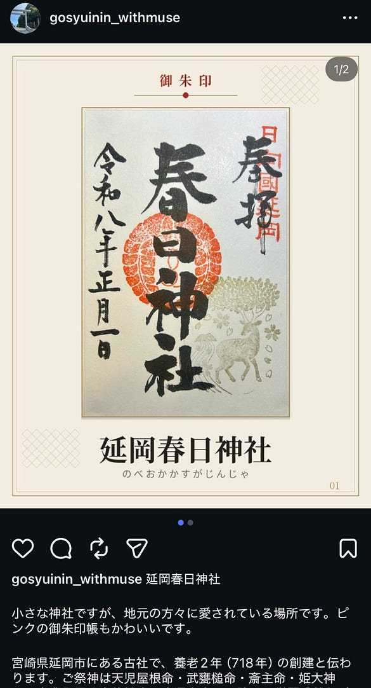
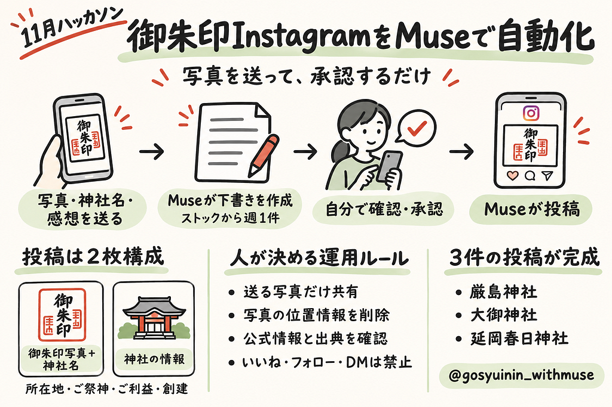

こんにちは、4年の井上です！先日新宿にて内定先の同期たちと飲み、家に帰る際に京王線を利用したのですが、なんと二回もバウンド（終点まで行って折り返し）してしまい、帰宅に3時間近くかかってしまいました。今度から何があってもおとなしく小田急線で帰ります。

さて、今回の11月ハッカソンは、10月に続いて個人での取り組みです。

### ハッカソン内容

お題は「Muse 自動化ハッカソン」です。Meta の AI エージェント「[Muse](https://muse.ai/)」だけを使って、人間側の仕事を減らす自動化を作ってみる、ということでした。ハッカソンの具体的な内容については[こちら](https://github.com/furuhashilab/README/issues/42)をご覧ください。

Muse は、Meta が2026年9月に公開した個人向けの AI エージェントです。利用者ごとに専用のクラウド環境が用意されていて、その中でエージェントがブラウザの操作やファイルの作成などを代わりにやってくれます。

今回初めてMuseを使ってみましたがびっくり。最近は彼と一緒にずっと日程調整をしているおかげで一日のタスクやスケジュールが明確になりました。

### 私のテーマ

私は、御朱印の Instagram アカウントの運営を Muse に任せることにしました。

古橋研究室のみんなはご存じの通り、御朱印を集めるのは好きです！！！ただ、これまで外部にその良さを広めようと思っていなかったり、投稿しようと思っても、写真を選んで、神社のことを調べて、文章を考えて…と意外と手間がかかるからめんどくさくなったり...。そこで、「写真を送るだけで投稿の下書きができて、自分は承認するだけ」という状態を目指しました。

### 活動内容

まず、Muse に投稿のルールを「スキル」として登録しました。

できあがった流れはこんな感じです。

1. 私が、御朱印の写真と「神社名」「一言の感想」を Muse アプリで送る
2. Muse が、それをストックしておく
3. 週1回（または私が頼んだとき）、Muse がストックから1件選んで下書きを作る
4. 私が下書きを確認して承認する
5. Muse が Instagram に投稿する

つまり、私の仕事は「写真を送る」と「承認する」の2つだけです。

投稿は2枚構成にしました。1枚目は御朱印の写真に神社名を入れたもの、2枚目は所在地やご祭神、ご利益、創建をまとめた神社の情報ページです。どちらの画像も Muse が作っていて、デザインは毎回そろうようにしています。

頑張ったことは、個人情報を Muse に渡しすぎないことです。今回のハッカソンには「Muse の設定で、自分の個人情報が漏れないよう十分に配慮すること」というルールがあります。そこでまず、Muse の設定にある「AIモデルの改善に協力」の項目をオフにしました。これで、私が Muse に送った写真ややり取りの内容が、AI の学習に使われないようにしています。

そのうえで、スマホの写真フォルダをまるごと接続するのではなく、投稿したい写真だけを送るようにしました。また、写真に残っている位置情報は投稿前に必ず消してもらい、参拝した日付など「いつどこにいたか」が分かる書き方もしないように、自分でルールを決めました。いいねやフォロー、DM などの操作も禁止にしています。ここで、写真に乗せた情報を消しても御朱印に日付が書かれているからあんま意味なくない？という質問もあると思いますが無視させていただきます。

もう一つ気をつけたのは、間違った情報を載せないことです。神社の情報は、公式サイトなどで確認できたことだけを書いてもらい、確認に使った URL も下書きと一緒に見せてもらうようにしました。御朱印の文字は読み間違えそうなので、あえて書き起こさせていません。

### 完成品

苦労の結果完成したアカウントがこちらになります。

のんびり御朱印紹介（[@gosyuinin\_withmuse](https://www.instagram.com/gosyuinin_withmuse/)）

投稿した3件はこちらです。

* 厳島神社（広島県廿日市市）：<https://www.instagram.com/p/DgGGXo2E9v9/>

* 大御神社（宮崎県日向市）：<https://www.instagram.com/p/DgGGbNjk3ai/>

* 延岡春日神社（宮崎県延岡市）：<https://www.instagram.com/p/DgGGeG2EwIM/>

宮崎出身なので、3件のうち2件が地元の神社になりました(笑)

### まとめ・感想

今回のハッカソンでは、御朱印アカウントの運営を Muse に任せてみましたが、写真を送って承認するだけで投稿までできるようになり、人の仕事をかなり減らせたと思っています！

一方で、AI に任せるからこそ、個人情報をどこまで渡すか、どんな情報なら載せていいかといったルールは、人がしっかり決めておく必要があると感じました。最後に確認して承認するのも、やっぱり人の役目だと思います。

これからも週1回の投稿を続けて、ストックを増やしていきたいです。

最後にグラレコです。

グラレコ

---

[【11月ハッカソン】みんなにもっと御朱印を普及させ隊](https://medium.com/furuhashilab/11%E6%9C%88%E3%83%8F%E3%83%83%E3%82%AB%E3%82%BD%E3%83%B3-%E3%81%BF%E3%82%93%E3%81%AA%E3%81%AB%E3%82%82%E3%81%A3%E3%81%A8%E5%BE%A1%E6%9C%B1%E5%8D%B0%E3%82%92%E6%99%AE%E5%8F%8A%E3%81%95%E3%81%9B%E9%9A%8A-e53e80325e95) was originally published in [Furuhashi(mapconcierge)Lab.](https://medium.com/furuhashilab) on Medium, where people are continuing the conversation by highlighting and responding to this story.
