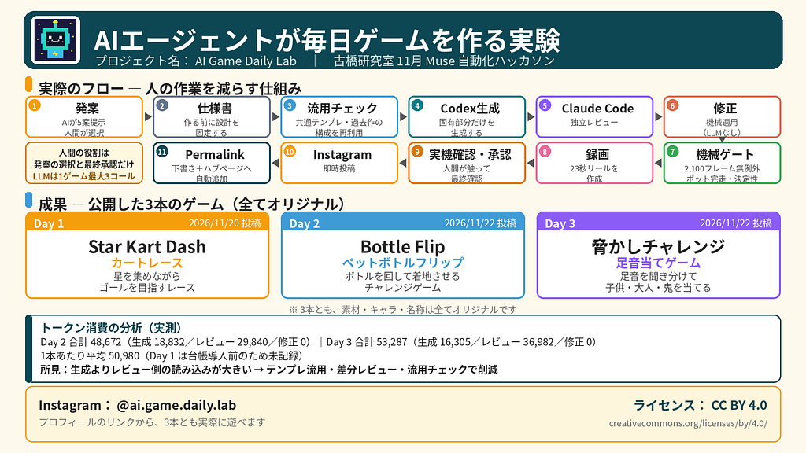
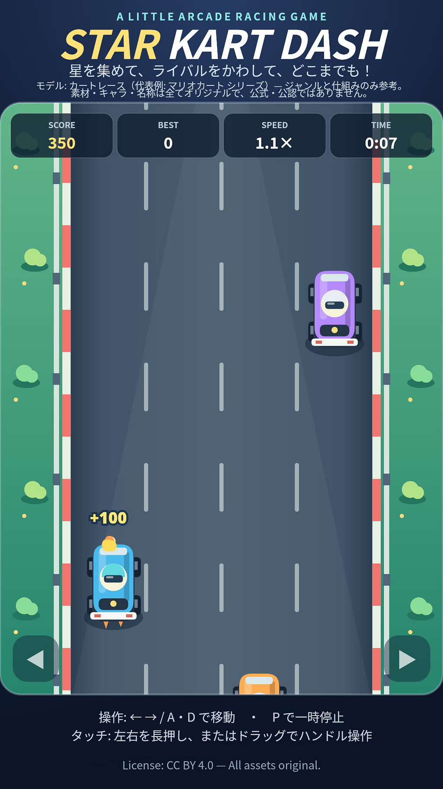
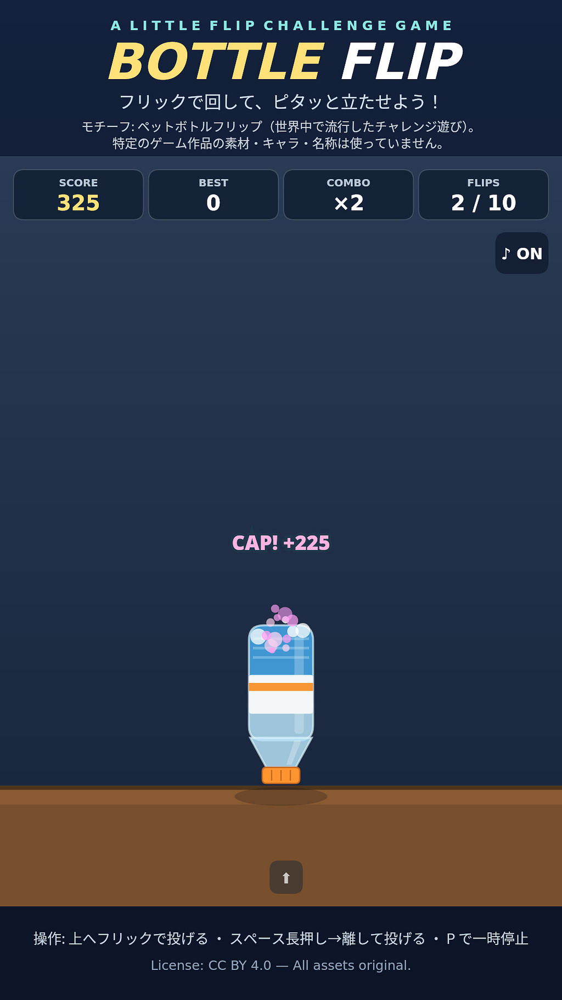
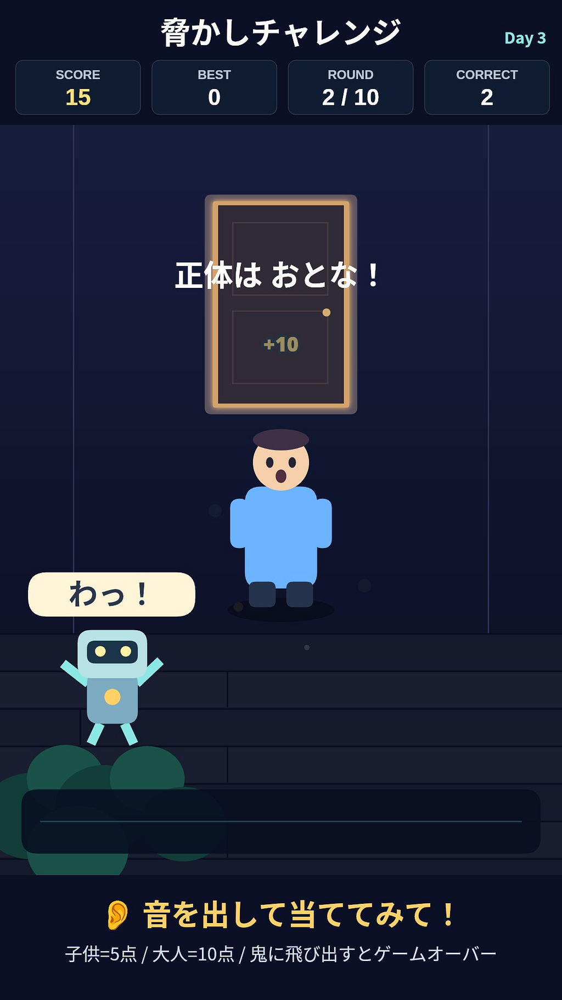

### やったこと

ハッカソンの説明は皆様がやってくれていると信じているので、早速本題に入る。

Museの中でAIエージェント（Codex等）を動かし、企画 → バイブコーディング → プレイ動画化 → SNS投稿文作成までを自動化。  
なるべく時間をかけたくないので、人間は最終チェックだけを行う形を目指しました。

フローはこんな感じです

### 成果物（公開SNS投稿 3点）

Day 1 — Star Kart Dash（カートレース風・完全オリジナル）  
Permalink: <https://www.instagram.com/reels/Df9IvtDvmkD/>

Day 2 — Bottle Flip（ペットボトルフリップ・ユーザーの発案、完全オリジナル）  
Permalink: [https://www.instagram.com/reel/DgAmxUjPcTL/](https://www.instagram.com/reel/DgAmxUjPcTL/?utm_source=ig_web_copy_link&dmpr=MzRlODBiNWFlZA==&avpt=MzRlODBiNWFlZA==) （2026–11–22投稿済み）

Day 3 — 脅かしチャレンジ（足音当てゲーム・ユーザーの発案、完全オリジナル）  
Permalink: [https://www.instagram.com/reel/DgBa4n5v986/](https://www.instagram.com/reel/DgBa4n5v986/?utm_source=ig_web_copy_link&hvrq=MzRlODBiNWFlZA==&avpt=MzRlODBiNWFlZA==) （2026–11–22投稿済み）

### 感想

このくらいのゲームなら一瞬で作れちゃうんだなと  
最初はmuseでゲームも全部作らせたのですが、だいぶひどかった  
やはり得意不得意があるので、役割分担をするのがいいのかな。  
Museはユーザーが言っていることを、とにかくやってみてくれる  
やんちゃな奴  
Codex、Claude Codeは現実的なことをスパスパ言ってくる嫌だけど頼りになるやつ  
みたいなイメージを勝手に持っています

---

[Museだけで1日1ゲーム作ってSNSに自動投稿する自動化 — 11月ハッカソン](https://medium.com/furuhashilab/muse%E3%81%A0%E3%81%91%E3%81%A71%E6%97%A51%E3%82%B2%E3%83%BC%E3%83%A0%E4%BD%9C%E3%81%A3%E3%81%A6sns%E3%81%AB%E8%87%AA%E5%8B%95%E6%8A%95%E7%A8%BF%E3%81%99%E3%82%8B%E8%87%AA%E5%8B%95%E5%8C%96-11%E6%9C%88%E3%83%8F%E3%83%83%E3%82%AB%E3%82%BD%E3%83%B3-45b22fb67d67) was originally published in [Furuhashi(mapconcierge)Lab.](https://medium.com/furuhashilab) on Medium, where people are continuing the conversation by highlighting and responding to this story.
